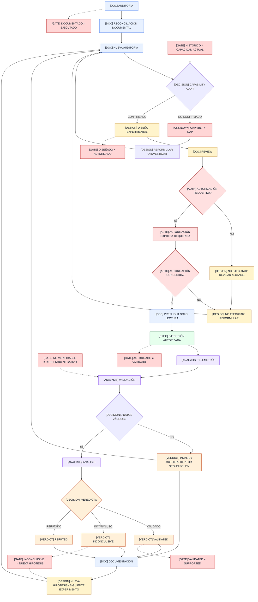
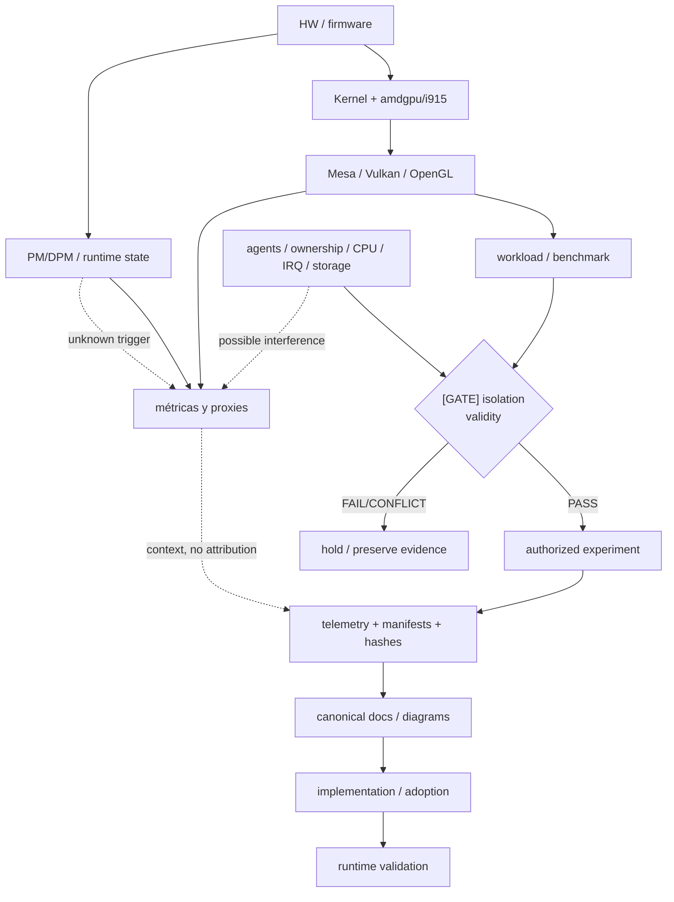

# 00 — Diagrama maestro del proyecto

**DIAGRAM_ID:** V-01
**STATUS:** DRAFT/CONFLICT
**LAST AUDITED:** 2026-09-24
**SOURCE_OF_TRUTH:**
- `00-INDICE/MASTER-RESEARCH-STATUS.md` y Addenda D6
- `00-INDICE/MASTER-PLAN.md`
- `04-IMPLEMENTACION/IMPLEMENTATION-ROADMAP.md`
- `04-IMPLEMENTACION/IMPLEMENTATION-SAFETY-RULES.md`
- `01-AUDITORIA/IMPLEMENTATION-READINESS/IMPLEMENTATION-READINESS-AUDIT.md`
- `03-EXPERIMENTOS/FASE-R4A-BANDWIDTH-REAL/EXP-F3-A-BANDWIDTH-REAL.md`
- `03-EXPERIMENTOS/FASE-R4B-GOVERNOR/EXP-F4-A-RESULTADOS-v2.3.md`
- `03-EXPERIMENTOS/FASE-R4C-JITTER-OBSERVABILITY/EXP-F1-A-RESULTADOS.md`
- `03-EXPERIMENTOS/FASE-D-COUNTERS-AUDIT/FASE-D-ETAPA-2-RESULTADOS.md`
- `01-AUDITORIA/FASE-R5-C1-TECHNICAL-DOCUMENTATION/` (snapshot técnico, no canónico)
- `04-IMPLEMENTACION/C1-ISOLATION-AUTOMATOR.md` y `.sha256`

**CONFLICTS:**
- Las fuentes ya tienen Addenda D6 y umbrales 50 °C histogramados, pero este diagrama
  se mantiene `DRAFT/CONFLICT` hasta reauditar todas las vistas derivadas.
- La capacidad runtime de H12/WSI, PM/ASPM, PMU, SQTT/RGP y counters GFX8 no está
  confirmada localmente.
- `power1_input` (`W_SMU`), `mem_busy_percent` y MCLK reportada no deben interpretarse
  más allá de su semántica documentada.
- El inventario superior de benchmarks no tiene un M2 actual elegible; las tablas
  históricas de utilidad no sustituyen esa precedencia.
- El paquete técnico R5 está fuera del índice canónico; su `DOCUMENT-HASHES.txt`
  existe pero conserva provenance histórica y no reconcilia el sidecar vigente de C1.
- El sidecar vigente registra 37/37 tests y hashes actuales; R5 conserva 24/24 y
  hashes anteriores. Las vistas no eligen un PASS limpio: `PROVENANCE_CONFLICT`.
- El roadmap ya separa dependencias de diseño/implementación F/G/K, pero esta vista aún
  no ha sido reauditada contra esa versión.

**NOTE:** este diagrama es una vista derivada. No autoriza ninguna acción.

## Flujo maestro



## Gates obligatorios

| Gate | Regla |
|---|---|
| `DOCUMENTADO` | Existe una descripción o fuente; no implica ejecución |
| `DISEÑADO` | Existe un protocolo; no implica autorización |
| `AUTORIZADO` | Existe permiso concreto; no implica resultado válido |
| `EJECUTADO` | Se produjo una corrida; no implica muestra válida |
| `VALIDADO` | Se cumplieron los gates definidos y la evidencia es reproducible |
| `SUPPORTED` | Solo si el protocolo lo permite; no se infiere de `VALIDADO` |
| `INCONCLUSIVE` | La muestra o las precondiciones no permiten decidir; vuelve a una nueva hipótesis, no a ejecución automática |
| `NO VERIFICABLE` | Artefacto o referencia no comprobable; no equivale a resultado negativo |
| `HISTÓRICO` | Evidencia conservada; no es capacidad o estado actual |

## Mapa general de capas y dependencia

La cadena siguiente es un **orden de lectura solicitado** para la trazabilidad, no una
relación causal única. Los agentes/ownership son un gate transversal y Mesa, PM/DPM,
workload y evidencia tienen dependencias que no se reducen a una sola flecha.

```mermaid
flowchart LR
    HW["[VERIFIED/DOC] Hardware<br/>RX550 Polaris12/GFX8<br/>1002:699f · card1/renderD129<br/>Intel HD4600 display 1002:412"]
    SW["[DOC] Software<br/>Fedora/Nobara · Wayland/Xwayland<br/>Vulkan/OpenGL · CPU Haswell"]
    DR["[VERIFIED] Drivers<br/>amdgpu RX550 · i915 display"]
    MS["[DOC/PARTIAL] Mesa<br/>RADV/radeonsi · stock/custom<br/>API/counters no equivalen"]
    GPU["[VERIFIED/UNKNOWN] GPU<br/>SCLK/MCLK · VRAM/GTT<br/>proxies no son PMU"]
    PM["[PARTIAL/CONFLICT] PM/DPM<br/>cap 35 W · DPM auto<br/>MCLK policy/runtime"]
    AG["[CAPABILITY/OBSERVED] Agents<br/>autopilot · sys-tuned · kalm<br/>irqbalance · KDE/sysstat"]
    BM["[HISTORICAL/EXECUTED] Benchmarks<br/>M1 · EP-05/06 · R-4A/B/C<br/>FASE-D · Superposition/E-03"]
    EX["[DESIGN/EXECUTED] Experimentos<br/>A/B · guards · C1<br/>C1 actual DEFERRED"]
    EV["[EVIDENCE] Telemetría<br/>CSV/JSON/manifests · hashes<br/>raw + auditorías"]
    DOC["[DOC] Documentación<br/>MASTER · PLAN · AUDIT<br/>DIAGRAMAS DRAFT/CONFLICT"]
    IM["[DESIGN/IMPLEMENTED] Implementación<br/>rx550-torneo · C1 v1.1.0<br/>H12 · FASE E–Q"]
    RT["[NOT_EXECUTED] Runtime validation<br/>C1_RUNTIME_VALIDATED=NO<br/>ningún claim global SUPPORTED"]

    HW --> SW --> DR --> MS --> GPU --> PM
    PM --> BM --> EX --> EV --> DOC --> IM --> RT
    AG -.->|interferencia/capacidad; NO causalidad demostrada| PM
    AG -.->|ownership/IRQ/IO/WSI confound| BM
    GPU -.->|H12/WSI y counters: causalidad UNKNOWN| EV
    PM -.->|writes sólo con autorización separada| IM
```



| Capa | Estado que puede representarse | Fuente principal |
|---|---|---|
| Hardware | RX550/Polaris12 y display Intel están identificados; equivalencia comercial Baffin no se usa | `02-ARQUITECTURA/knowledge.md`, `POLARIS12-MAP.md` |
| Software/driver | RADV/radeonsi y amdgpu observados; sin selector Vulkan puede caer en iGPU | `knowledge.md`, `evidence.md`, EP-05 |
| PM/DPM | cap/DPM/readbacks observados; trigger MCLK y runtime PM/ASPM no cerrados | R-4A, R-4B, `UNVERIFIED-CLAIMS.md` |
| Agents | capability y actividad observada; causalidad `NOT_PROVEN` | P0, auditorías background |
| Benchmarks/experiments | resultados históricos existen; R-4B global `INCONCLUSIVE`; C1 no ejecutado | resultados M1/R-4B/R-4C/FASE-D, C1 sidecar |
| Evidence/docs | artefactos y hashes presentes; mapa sigue `DRAFT/CONFLICT` | `MASTER-RESEARCH-STATUS.md`, `DIAGRAMAS/README.md` |
| Implementation/runtime | C1 v1.1.0 implementado estáticamente; runtime validation ausente | C1 doc/sidecar |

### Grafo transversal de relaciones (no causal)



El grafo transversal evita convertir una coincidencia de telemetría en causalidad: las
flechas punteadas siguen siendo posibilidades/contexto hasta que exista un gate y evidencia.

El estado visible para R-4B debe ser:

```text
S1: EXECUTED / COMPLETADA
S2: PARADA_D
VERDICT: INCONCLUSIVE
```

No se dibuja un PASS/FAIL global.

## Regla de ciclo

`INCONCLUSIVE` vuelve a:

```text
ANÁLISIS → DOCUMENTACIÓN → NUEVA HIPÓTESIS → AUDITORÍA
```

No vuelve automáticamente a ejecución.

## No permitido

Este diagrama no autoriza:

- Set H;
- S2;
- cap/DPM/PM/ASPM;
- Mesa/kernel/firmware;
- counters;
- benchmarks;
- scripts;
- servicios;
- resets.
