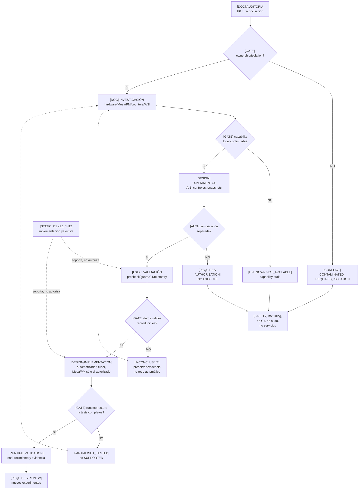

# 01 — Roadmap visual del proyecto

**DIAGRAM_ID:** V-02
**STATUS:** DRAFT/CONFLICT
**LAST AUDITED:** 2026-09-24
**SOURCE_OF_TRUTH:**
- `00-INDICE/MASTER-RESEARCH-STATUS.md` y Addenda D6
- `00-INDICE/MASTER-PLAN.md`
- `04-IMPLEMENTACION/IMPLEMENTATION-ROADMAP.md`
- `04-IMPLEMENTACION/IMPLEMENTATION-SAFETY-RULES.md`
- `01-AUDITORIA/IMPLEMENTATION-READINESS/IMPLEMENTATION-READINESS-AUDIT.md`
- `01-AUDITORIA/FASE-P0-EXPERIMENTAL-VALIDITY-GATE/P0-EXPERIMENTAL-VALIDITY-GATE-2026-09-24.md`
- `04-IMPLEMENTACION/C1-ISOLATION-AUTOMATOR.md`

**CONFLICTS:**
- Gate P0 vigente: `B. CONTAMINATED_REQUIRES_ISOLATION`; `OWNERSHIP=PARTIAL`.
- La secuencia de seis fases es una vista de madurez solicitada, no el ciclo científico canónico; la implementación C1/H12 ya existe estáticamente antes de una validación runtime.
- El roadmap F/G/K es diseño; no constituye autorización ni ejecución.
- No existe runtime validation C1; no hay claim global `SUPPORTED`.

**NOTE:** diagrama de estado y dependencias; no autoriza ninguna fase.

La secuencia de lectura solicitada es
`AUDITORÍA → INVESTIGACIÓN → EXPERIMENTOS → VALIDACIÓN → IMPLEMENTACIÓN → RUNTIME VALIDATION`;
se muestra como mapa de madurez, no como DAG causal ni como ciclo canónico.

## Fases, gates y estado real

| Fase | Estado | Evidencia | Gate de salida |
|---|---|---|---|
| **AUDITORÍA** | `PARTIAL / CONTAMINATED` | P0 B; Xwayland/ChatGPT; writers/agentes | Ownership aislado y readback |
| **INVESTIGACIÓN** | `PARTIALLY_RECONCILED` | Polaris12/Mesa/counters/PM source; runtime GFX8 desconocido | Capability audit local |
| **EXPERIMENTOS** | Historial `EXECUTED`; C1 `DEFERRED` | M1, EP-05/06, R-4A/B/C, FASE-D; C1 no ejecutado | Autorización + gates |
| **VALIDACIÓN** | `NOT_REACHED` para C1 | No hay `C1_RUNTIME_VALIDATED=YES` | Muestra completa, claims con alcance, restore |
| **IMPLEMENTACIÓN** | `DESIGNED/IMPLEMENTED`, no adoptada | `rx550-torneo`, C1 automator v1.1.0, H12 | Tests + autorización de adopción |
| **RUNTIME VALIDATION** | `NOT_EXECUTED` | `--run`, C1, sudo, guard real, restore real: `NOT_EXECUTED` | Resultado runtime y POST/RESTORE OK |

## Gates de no-progressión

- `INCONCLUSIVE` vuelve a análisis/hipótesis, no a ejecución automática.
- `PARADA_D` preserva evidencia y no se reintenta sin autorización.
- `CONFLICT` de agentes, governor, read-ahead o WSI bloquea una línea base no aislada.
- `NOT_AVAILABLE` de una capability no se convierte en `PASS` ni `REFUTED`.
- `VALIDATED` no equivale a `SUPPORTED`; `SUPPORTED` requiere alcance y gate propio.
