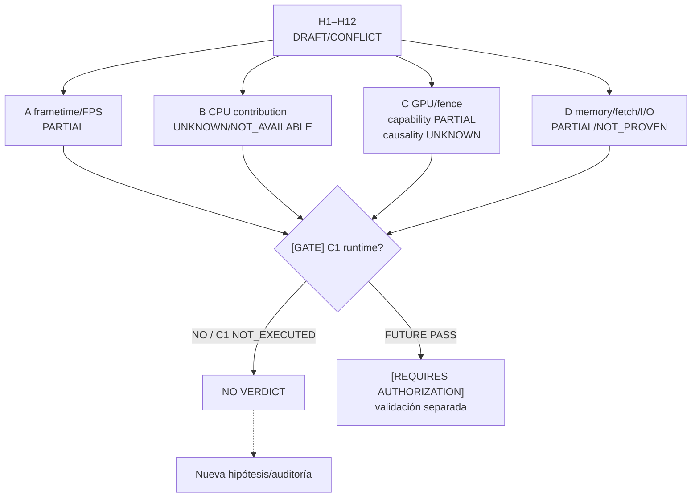

# 02 — Claims C1 e hipótesis H1–H12

**DIAGRAM_ID:** V-03
**STATUS:** DRAFT/CONFLICT
**LAST AUDITED:** 2026-09-24
**SOURCE_OF_TRUTH:**
- `00-INDICE/HYPOTHESIS-REGISTER.md`
- `04-IMPLEMENTACION/C1-ISOLATION-AUTOMATOR.md` (§Checks formales implementados, claims A–D)
- `03-EXPERIMENTOS/M1-cap-35-30/RESULTADOS-M1.md`
- `03-EXPERIMENTOS/FASE-R4B-GOVERNOR/EXP-F4-A-RESULTADOS-v2.3.md`
- `03-EXPERIMENTOS/FASE-D-COUNTERS-AUDIT/FASE-D-ETAPA-2-RESULTADOS.md`
- `01-AUDITORIA/FASE-H12-2-WSI-DOCUMENTATION/H12-2-XDG-SHELL-VULKAN-WSI-EVIDENCE.md`
- `02-ARQUITECTURA/COUNTERS-ASIC-TELEMETRY-KNOWLEDGE-ADDENDUM-2026-09-24.md`

**CONFLICTS:**
- La taxonomía A–D solicitada para este mapa (`frametime/FPS`, `CPU contribution`, `GPU/fence`, `memory/fetch/I/O`) no es la taxonomía de claims formal del automatizador C1. El documento C1 usa A=resultado runtime, B=frecuencia efectiva no disponible, C=ownership parcial y D=contexto PSI/HDD/Btrfs.
- El registro H1–H12 es provisional y sus IDs no deben fusionarse con H1/H2 locales de otras fases.
- C1 no fue ejecutado; sus checks runtime son `NOT_EXECUTED`.
- `W_SMU` es estimador SMU, `mem_busy_percent` es proxy y MCLK reportada no es bandwidth/DRAM data rate.
- H12-2 confirma parte de la capacidad/semántica WSI, no la causa del frametime M1.
- Los contadores GFX8 programables no están validados para `1002:699f`; RADV GFX8 `VK_KHR_performance_query=NOT_AVAILABLE`, PMU mainline GFX8 `NOT_AVAILABLE`.
- El master resume H8 como gating descartado en FASE-D, mientras el registro H1–H12 lo mantiene `REQUIRES EXPERIMENT`; se conserva la diferencia de alcance.

**NOTE:** esta vista no convierte una hipótesis en resultado ni autoriza C1.

## Claims de bottleneck solicitados (taxonomía de la solicitud; no canónica C1)

| Claim | Qué afirmaría | Evidencia existente | Estado | Lo que NO está probado |
|---|---|---|---|---|
| **A — frametime/FPS** | La variación de frametime/FPS tiene una causa atribuible en la corrida C1 | M1: 74 FPS/13,514 ms; cap 35/30 sin diferencia; R-4B S1 p99~9,33 ms diagnóstico; R-4C jitter harness PASS | `PARTIAL / NOT_EXECUTED` para C1 | No hay corrida C1 runtime, muestra C1 válida ni causalidad A |
| **B — CPU contribution** | CPU/frecuencia/ownership explica parte del frametime | Governor/frecuencia/IRQ/PM se observaron; `frequency_effective_estimate=NOT_AVAILABLE`; P0 ownership parcial | `UNKNOWN / NOT_AVAILABLE` | No hay aislamiento CPU ni frecuencia efectiva validada |
| **C — GPU/fence** | GPU completion, fence o WSI/present explica el tail | H12-2 r1–r3: `state=4=activated`; H12-1 r4/H12-3 tienen provenance separada; WSI capability/semantics parcialmente confirmadas; counters GFX8 no disponibles | `PARTIALLY CONFIRMED` capacidad; `UNKNOWN` causalidad | No se separó GPU completion de VSync/WSI; no hay counter ASIC validado |
| **D — memory/fetch/I/O** | VRAM/GTT/fetch/PCIe/IO explica el tail | `mem_busy`, MCLK, W_SMU, F2 y R-4A son proxies/direccionales; R-4B registra presión IO ambiental; auto-pacing/fetch-latency está `SUSTENTADA` sólo para el workload sintético | `PARTIAL / NOT_PROVEN` para mecanismo físico | No hay bandwidth real, causalidad física de fetch ni atribución de IO por proceso |

## Claims formales del automatizador C1 (taxonomía canónica)

| Claim C1 | Límite formal documentado | Estado actual |
|---|---|---|
| **A** | Resultado runtime/formal; validez científica diferida | `NOT_RUN/NOT_TESTED`; no hay JSONL runtime ni resultado C1 |
| **B** | Frecuencia efectiva del claim | `frequency_effective_estimate=NOT_AVAILABLE` |
| **C** | Ownership/control de GPU | `OWNERSHIP=PARTIAL`; clientes P0 no cerrados por el automator |
| **D** | PSI, D-state, HDD/Btrfs y contexto | Contexto solamente; sin atribución por proceso ni causalidad |

Una futura `C1_RUNTIME_VALIDATED=YES` tampoco convertiría por sí sola
ninguno de estos cuatro límites científicos en causalidad demostrada.

## H1–H12

| ID | Hipótesis | Estado documental | Evidencia/fuente | Próximo gate permitido |
|---|---|---|---|---|
| H1 | Cap sólo liga tras umbral de demanda | `PARTIALLY_VERIFIED / REQUIRES EXPERIMENT` | M1 no discriminó con `vkmark` | Capability audit + A/B autorizado |
| H2 | Deuda térmica predice throttling | `REQUIRES EXPERIMENT` | R-4B ramps/thermal confound; modelo no validado | Diseñar bloques, no ejecutar |
| H3 | Tasa DPM explica p99/stutter | `REQUIRES EXPERIMENT` | Hay estados/reloj, no métrica de transiciones | Definir sampling/observer |
| H4 | Runtime PM afecta primer frame | `REQUIRES CAPABILITY AUDIT` | Runtime status/documentación; no A/B local | Enumerar PM/display/bridge |
| H5 | ASPM afecta bursts PCIe | `REQUIRES CAPABILITY AUDIT` | Gen2×4/documentación; ASPM local no confirmado | Auditoría read-only de bridge/replay |
| H6 | Hay umbral VRAM/GTT antes de PCIe | `REQUIRES EXPERIMENT` | VRAM/VIS/GTT; bandwidth real `UNKNOWN` | Working-set ladder |
| H7 | MCLK presenta histéresis | `PARTIALLY_VERIFIED (policy only) / REQUIRES EXPERIMENT` | Política source 5/16/20; trigger local no cerrado | Separar policy de runtime |
| H8 | `gpu_busy=100%` puede coexistir con starvation | `REQUIRES EXPERIMENT` | R-4B S2 patrón histórico; clientes no verificados | Timeline submit/fence/WSI |
| H9 | Compute queue mejora sin overlap hardware | `REQUIRES CAPABILITY AUDIT / REQUIRES EXPERIMENT` | No A/B local; ACE count `UNKNOWN` | Enumerar queues/barriers |
| H10 | Workarounds Mesa dependen de workload | `PARTIALLY VERIFIED (negative tested scope) / REQUIRES EXPERIMENT` | EP-05 CUSTOM≈STOCK | A/B per-process/API-matched |
| H11 | Render scale cruza umbral DPM/thermal | `REQUIRES EXPERIMENT` | R-4B inconcluso; sin resultado H11 | Resolver H12/WSI y target |
| H12 | M1 limitado por presentación/VSync/WSI | `PARTIALLY CONFIRMED` capacidad; `UNKNOWN` causalidad | H12-2 r1–r3; H12-1 r4/H12-3/H12-4 con provenance no reconciliada; `state=4=activated` | No ejecutar; continuación autorizada futura |

El siguiente flujo usa exclusivamente la taxonomía de bottleneck solicitada;
la correspondencia con los claims formales C1 se muestra arriba y no se fusiona.

## Límites de PM/counters

- `power1_input` = `W_SMU`, no vatímetro.
- `mem_busy_percent` ≠ bandwidth; `MCLK` ≠ data rate efectiva.
- Source/catalog de GPUPerfAPI/UMR/RGP no prueba runtime ni selector ASIC.
- Programación de counters GFX8, `VK_KHR_performance_query` RADV y PMU mainline GFX8 están `NOT_AVAILABLE` o `UNKNOWN` según la capability.
- No se usa una correlación de pipeline para declarar causalidad de potencia o frametime.
