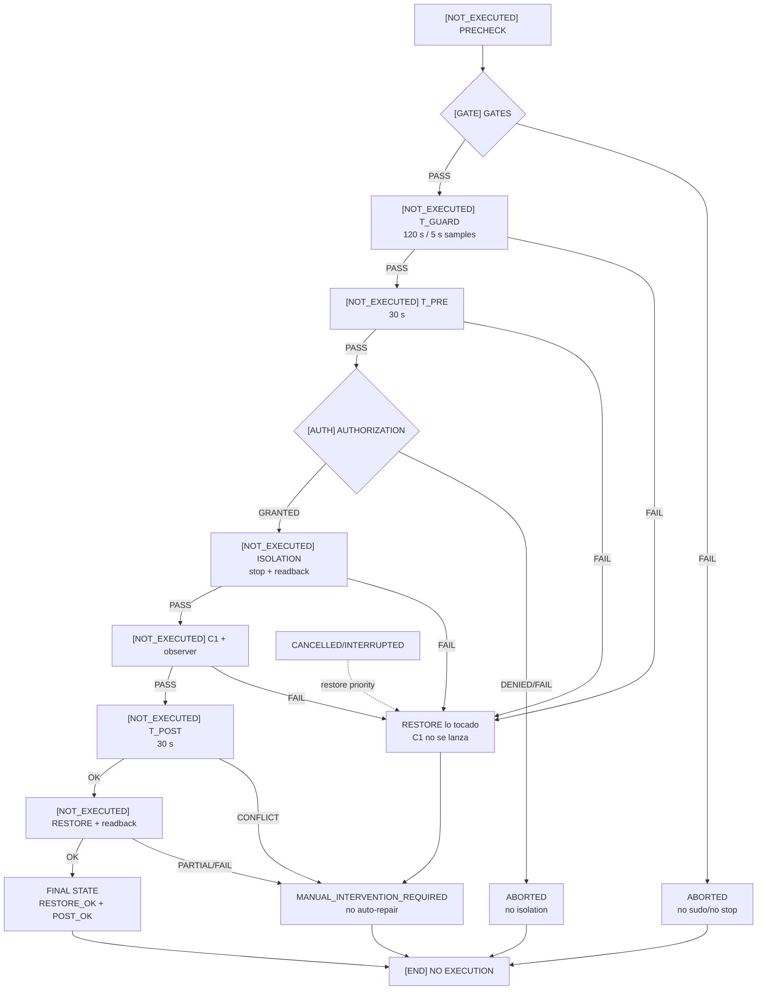

# 03 — Árbol de decisión experimental y pipeline C1

**DIAGRAM_ID:** V-04
**STATUS:** DRAFT/CONFLICT
**LAST AUDITED:** 2026-09-24
**SOURCE_OF_TRUTH:**
- `04-IMPLEMENTACION/C1-ISOLATION-AUTOMATOR.md`
- `04-IMPLEMENTACION/IMPLEMENTATION-SAFETY-RULES.md`
- `01-AUDITORIA/FASE-P0-EXPERIMENTAL-VALIDITY-GATE/P0-EXPERIMENTAL-VALIDITY-GATE-2026-09-24.md`
- `00-INDICE/MASTER-RESEARCH-STATUS.md`

**CONFLICTS:**
- Orden solicitado para la vista: `PRECHECK → GATES → T_GUARD → T_PRE → AUTHORIZATION → ISOLATION → C1 → T_POST → RESTORE → FINAL`.
- Orden de la implementación documentada: `PRE → AUTH → ISOLATION → GUARD → T_PRE → C1 → POST → RESTORE`.
- No existe autorización ni runtime validado para C1; P0 vigente es `CONTAMINATED_REQUIRES_ISOLATION`.

**NOTE:** este documento no ejecuta ni autoriza el pipeline.

## Contrato visual solicitado

## Rutas de terminación explícitas

- `ABORTED`: PRE/GATES/AUTH fallan antes de isolation; no se detiene una unidad.
- `FAILURE`: stop/readback, guard, C1 o T_POST fallan; se intenta restore.
- `CANCELLED/INTERRUPTED`: SIGINT/SIGTERM; cleanup y restore tienen prioridad.
- `CONFLICT`: discrepancia PRE/POST o transición externa; no se repara automáticamente.
- `MANUAL_INTERVENTION_REQUIRED`: restore parcial/fallido o conflicto no resoluble
  automáticamente.

La state machine canónica y sus rutas `T_POST`/`POSTCHECK` están en
`11-C1-STATE-MACHINE.md` (V-12). No se duplica aquí para evitar dos versiones
divergentes del mismo flujo.

## Gates no negociables

1. `DOCUMENTED != EXECUTED`.
2. `DESIGNED != AUTHORIZED`.
3. `AUTHORIZED != VALIDATED`.
4. Un guard fallido nunca conduce a C1.
5. `OWNERSHIP=PARTIAL` mantiene bloqueada la validación científica.
6. `POST_CONFLICT` no se corrige automáticamente.
7. `C1_RUNTIME_VALIDATED=YES` exige checks formales completos; no implica claims A–D válidas globalmente.
8. El checklist formal visible no cubre explícitamente `GPU fault|VM fault` de journal; se conserva como gap de protocolo.
9. No hay polling infinito, retry automático ni reparación de IRQ/sysfs/PM/DPM.
