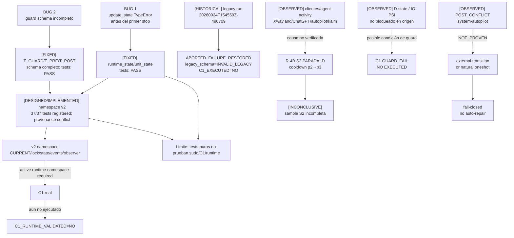

# 04 — DAG causal e historial de fallos

**DIAGRAM_ID:** V-05
**STATUS:** DRAFT/CONFLICT
**LAST AUDITED:** 2026-09-24
**SOURCE_OF_TRUTH:**
- `04-IMPLEMENTACION/C1-ISOLATION-AUTOMATOR.md` (§State residual, BUG 1/2, namespace v2, POST conflict)
- `03-EXPERIMENTOS/FASE-R4B-GOVERNOR/EXP-F4-A-RESULTADOS-v2.3.md`
- `01-AUDITORIA/FASE-P0-EXPERIMENTAL-VALIDITY-GATE/P0-EXPERIMENTAL-VALIDITY-GATE-2026-09-24.md`
- `01-AUDITORIA/IMPLEMENTATION-READINESS/IMPLEMENTATION-READINESS-AUDIT.md`

**CONFLICTS:**
- La parada D de R-4B tiene una causa externa probable, pero la evidencia principal del logger está perdida y la atribución no es verificable.
- D-state/IO PSI del guard C1 y la parada D de R-4B son eventos distintos; no hay un log de abort C1 por D-state/IO PSI y no se funden causalmente.
- `POST_CONFLICT` de `system-autopilot` no demuestra que el automatizador lo haya causado.

**NOTE:** las flechas punteadas representan hipótesis o causalidad no probada; no son causalidad demostrada.

## Cronología y provenance

- Residuo legacy: `2026-09-24 12:45:59–12:46:00 -03`; `sudo -v=OK`, `isolation_begin=OK`, `TypeError` antes de cualquier stop.
- Sidecar v1.1 más reciente: `2026-09-24T14:18:34-03:00`; no reejecuta runtime/C1.
- Los hashes históricos R5 y los hashes/tests del sidecar vigente se conservan como `CONFLICT`, no se mezclan.

## Historial conservado

| ID | Hecho | Estado | Causalidad |
|---|---|---|---|
| BUG-1 | Colisión de keyword `state=`; `UNITS_STOPPED=NONE` | Corregido; static test recorded; fresh run no reexecuted | CAUSA del fallo local reproducida por código/test |
| BUG-2 | Schema de guard sin las tres ventanas/campos | Corregido; static test recorded; fresh run no reexecuted | CAUSA del rechazo local reproducida por validador/test |
| R-4B S2 | Cooldown no alcanzó `SCLK nv0 ∧ P<4W`; rc=9 | `PARADA_D`; veredicto global `INCONCLUSIVE` | Interferencia externa: **NOT_PROVEN** |
| D-state/IO PSI | Gate C1 puede abortar por D-state, `procs_blocked` o IO PSI | Guard implementado; runtime no ejecutado | **UNKNOWN/NOT_PROVEN** |
| Legacy residual | Schema inválido, legacy no activo | `HISTORICAL_LEGACY_RUNTIME` | No es estado actual |
| Namespace v2 | Sibling namespace, lock/JSONL propios, strict allowlist | 37/37 static tests recorded; provenance conflict | Diseñado para no cargar legacy; no valida C1 |

## Resultados negativos y límites

- R-4B: S1 completa pero S2 incompleta; no se ejecuta `final()`; no `SUPPORTED`.
- EP-05: CUSTOM≈STOCK; no reproduce E5.
- M1: cap 35/30 no discriminativo para `vkmark`; no generalizar a todos los workloads.
- C1: `--dry-run` PASS sólo como modo/plan; `C1`, `sudo`, guard real y restore real `NOT_EXECUTED`.
- Las telemetrías auxiliares de R-4B en `/tmp` se consideran perdidas/no verificables; no se reconstruyen.
