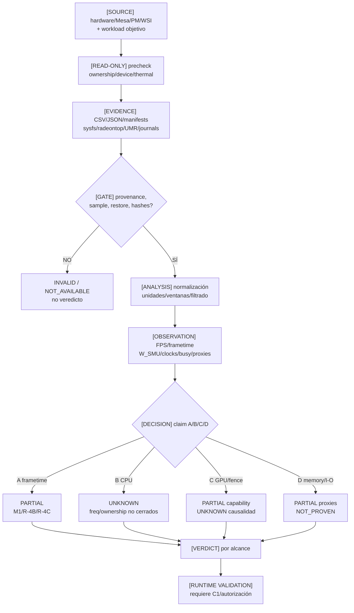

# 05 — Telemetría, evidencia y cadena de trazabilidad

**DIAGRAM_ID:** V-06
**STATUS:** DRAFT/CONFLICT
**LAST AUDITED:** 2026-09-24
**SOURCE_OF_TRUTH:**
- `02-ARQUITECTURA/evidence.md`
- `02-ARQUITECTURA/COUNTERS-ASIC-TELEMETRY-KNOWLEDGE-ADDENDUM-2026-09-24.md`
- `03-EXPERIMENTOS/FASE-R4B-GOVERNOR/EXP-F4-A-RESULTADOS-v2.3.md`
- `03-EXPERIMENTOS/FASE-D-COUNTERS-AUDIT/FASE-D-ETAPA-2-RESULTADOS.md`
- `03-EXPERIMENTOS/FASE-R4C-JITTER-OBSERVABILITY/EXP-F1-A-RESULTADOS.md`
- `03-EXPERIMENTOS/M1-cap-35-30/RESULTADOS-M1.md`
- `04-IMPLEMENTACION/C1-ISOLATION-AUTOMATOR.sha256`
- `01-AUDITORIA/FASE-R5-C1-TECHNICAL-DOCUMENTATION/DOCUMENT-HASHES.txt` (provenance histórica)
- `03-EXPERIMENTOS/WORKLOAD-SINTETICO/RESEARCH.md` y `runs/exploratorio-03-corrected/`

**CONFLICTS:**
- Evidencia histórica, P0 actual y diagramas no tienen el mismo corte temporal.
- La taxonomía A–D de este flujo es la solicitud de bottleneck (frametime/FPS, CPU, GPU/fence, memory/fetch/I/O); no es la taxonomía formal A–D del automatizador C1. Esa correspondencia está en V-03.
- R-4B S2 y sus telemetrías auxiliares están incompletas/perdidas; no se reconstruyen.
- R-4C PASS es observabilidad de protocolo, no bottleneck/performance.
- El inventario de benchmarks no tiene un candidato M2 actual elegible; las etiquetas históricas de utilidad no sustituyen la tabla superior canónica.
- No hay una única métrica que cierre A–D.
- Un E-03 histórico puede emitir `EJECUCIÓN_VÁLIDA` y aun así tener faults GPU/VM en journal; el checklist C1 visible no lo cubre explícitamente. Es un gap de protocolo, no una corrida C1.

**NOTE:** la telemetría se representa como evidencia; no se ejecuta ni se repite de nuevo.

El flujo representa claims de bottleneck solicitados; para los límites formales
`A–D` del automatizador C1, ver `02-HIPOTESIS-H1-H12.md` (V-03).

## Evidencia canónica y límites

| Fuente | Evidencia | Estado | Límite |
|---|---|---|---|
| M1 | 10/10 corridas, restore 35 W; ΔFPS=0, ΔSCLK=0; W_SMU 12,267 W | `PASS` operativo; `NO DISCRIMINATIVO` científico | No generalizar a otros workloads |
| EP-05 | CUSTOM≈STOCK; ΔFPS≤1%, ΔP≤0,3 W | `NEGATIVE RESULT` para scope probado | No reproduce E5; no optimización universal |
| EP-06 | máximo W_SMU 13,6 W; cap 25 W no liga | `HISTORICAL/NEGATIVE` | E1 linaje no fiable; no repetir |
| F2 | 8 fetches: ~112→222 ms; `W_SMU` 16,13 W (control) → 15,76 W (F2); `mem_busy` ~36% | `SUSTENTADA` para auto-pacing del workload sintético | No prueba mecanismo DRAM/PCIe ni C1 |
| R-4A | PCIe Gen2×4 y endpoints leídos | `VERIFIED` para enlace | Bandwidth real local `UNKNOWN` |
| R-4B | S1 15/15 + 8/8; S2 10/15 y PARADA_D | `INCONCLUSIVE` global | n=3 S1 diagnóstico; localizadores /tmp perdidos |
| FASE-D | 6/6; W_SMU 22,25 vs 15,78; bloques proxies | `PASS` de Etapa 2 | Correlación; no causalidad; H5 pendiente |
| R-14 | Superposition: 22,31 W steady / 24,71 W pico; score 804 | `OBSERVED/CORRELATIONAL` | No aísla geometría/vertex de poder, CPU o presentación |
| R-4C | 8 corridas, 320/320, MAE 0 / 3,66e-10 px | `PASS` de harness | No es benchmark de rendimiento |
| C1 v1.1.0 | sidecar vigente: 37/37 tests puros; `prepare/dry_run/status` no reejecutados tras observer fix | `PASS` estático registrado; provenance en `CONFLICT` | `--run`, C1, sudo, guard/restore real `NOT_EXECUTED` |

## Regla de unidades

- `power1_input` se etiqueta `W_SMU`; no vatímetro.
- `mem_busy_percent` es proxy; no bandwidth.
- MCLK reportada no es data rate DRAM.
- `gpu_busy=100%` no prueba saturación útil ni elimina starvation/WSI.
- CSV/JSON/manifests sin provenance completa se clasifican `NOT_AVAILABLE` o `UNKNOWN`, no se rellenan.

## Procedencia de C1

Sidecar vigente: `automator_version=1.1.0`; script `00971559...eb6c0`; documentación `fd87b4c...29d5f8`; tests `a262e8b6...19bc5c`; Git `c6146788...de0c5`; `commit=NONE`; `pure_tests=37/37_PASS`; `prepare/dry_run/status=NOT_REEXECUTED_AFTER_OBSERVER_FIX`; `active_namespace_state=NONE`; `run=NOT_EXECUTED`; `c1=NOT_EXECUTED`; `c1_runtime_validated=NO`.

R5 y sus derivados conservan `24/24_PASS` y los hashes anteriores
(`fd61816b...`, `cdc59384...`, `1a03c784...`). `DOCUMENT-HASHES.txt` está presente,
pero es provenance histórica; la discrepancia queda `CONFLICT`.
