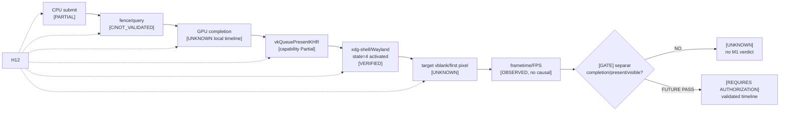

# 06 — H12: WSI, presentación y frametime

**DIAGRAM_ID:** V-07
**STATUS:** DRAFT/CONFLICT
**LAST AUDITED:** 2026-09-24
**SOURCE_OF_TRUTH:**
- `00-INDICE/HYPOTHESIS-REGISTER.md` (H12)
- `01-AUDITORIA/FASE-H12-2-WSI-DOCUMENTATION/H12-2-XDG-SHELL-VULKAN-WSI-EVIDENCE.md`
- `04-IMPLEMENTACION/H12-1/README.md`
- `04-IMPLEMENTACION/H12-1/DEPENDENCIAS.md`
- `04-IMPLEMENTACION/H12-2/README.md`
- `03-EXPERIMENTOS/M1-cap-35-30/RESULTADOS-M1.md`
- `03-EXPERIMENTOS/FASE-R4C-JITTER-OBSERVABILITY/EXP-F1-A-RESULTADOS.md`

**CONFLICTS:**
- H12-2 confirma parte de la semántica/capacidad WSI: `xdg_toplevel.state=4 = activated`.
- La regla absoluta “configure post-present = CONFLICT” fue refutada como regla normativa; la causa exacta y compatibilidad posterior del swapchain siguen `UNKNOWN`.
- H12-2 tiene alcance documental r1–r3; H12-1 documenta también r4 y H12-3 smoke; H12-4 queda implementación estática sin smoke runtime. La reconciliación r1–r4/H12-3/H12-4 es `CONFLICT` y no se fusiona como una sola corrida.
- R-4C valida observabilidad de jitter con harness, no bottleneck de performance; no usa `wl_surface.frame` como vblank.
- Runtime de `VK_EXT_present_timing`, first-pixel/vblank y separación GPU completion→WSI no están cerrados para C1.

**NOTE:** no ejecutar H12Continuation ni C1; este diagrama no concede autorización.

## Evidencia y estado

| Capa | Evidencia | Estado |
|---|---|---|
| H12-1 capability | extensiones, features, surface/domain/entry points; `VK_EXT_present_timing` condicional | `PARTIALLY SUPPORTED`; runtime local no completo |
| H12-2 r1–r3 | r1/r2 sin cleanup certificable; r3 cleanup completado, serial 12837 post-present, `first_present_completed=true`, `states=[4]` | `VERIFIED` sólo para artefactos r1–r3; `POST_PRESENT_STATE_ONLY_CONFIGURE` permitido según reconciliación, no causidad |
| H12-1 r4 / H12-3 | README declara r4 aprobado bajo su alcance y smoke H12-3 aprobado | `CONFLICT/UNRECONCILED` con el alcance H12-2 r1–r3; no se mezcla automáticamente |
| H12-4 | Implementación estática conservadora; smoke no autorizado/no ejecutado | `NOT_TESTED`; no first pixel, vblank, display latency ni ownership |
| Regla absoluta | configure posterior no implica por sí mismo conflicto normativo | `REFUTED` como regla; causa exacta `UNKNOWN` |
| R-4C observability | RADV RX550 + lavapipe; 8 corridas; 320/320; MAE 0 y ~3,66e-10 px | `PASS` del harness de observabilidad; no performance verdict |
| M1 | 74 FPS, 13,514 ms, cap no discriminativo | `OBSERVED`; no GPU-vs-WSI causalidad |
| GFX8 counters/fence | source/catalog no equivale a runtime; PMU/RADV API no disponibles como PMU GFX8 confirmado | `NOT_AVAILABLE/UNKNOWN` |

## Límites

- `wl_surface.frame` no se identifica con vblank.
- `state=4` no se interpreta como focus sin evidencia.
- No se infiere VSync-limited, GPU-limited, resize, fullscreen o maximización.
- `H12 CONTINUATION` permanece `NO EXECUTED/REQUIRES AUTHORIZATION`.
