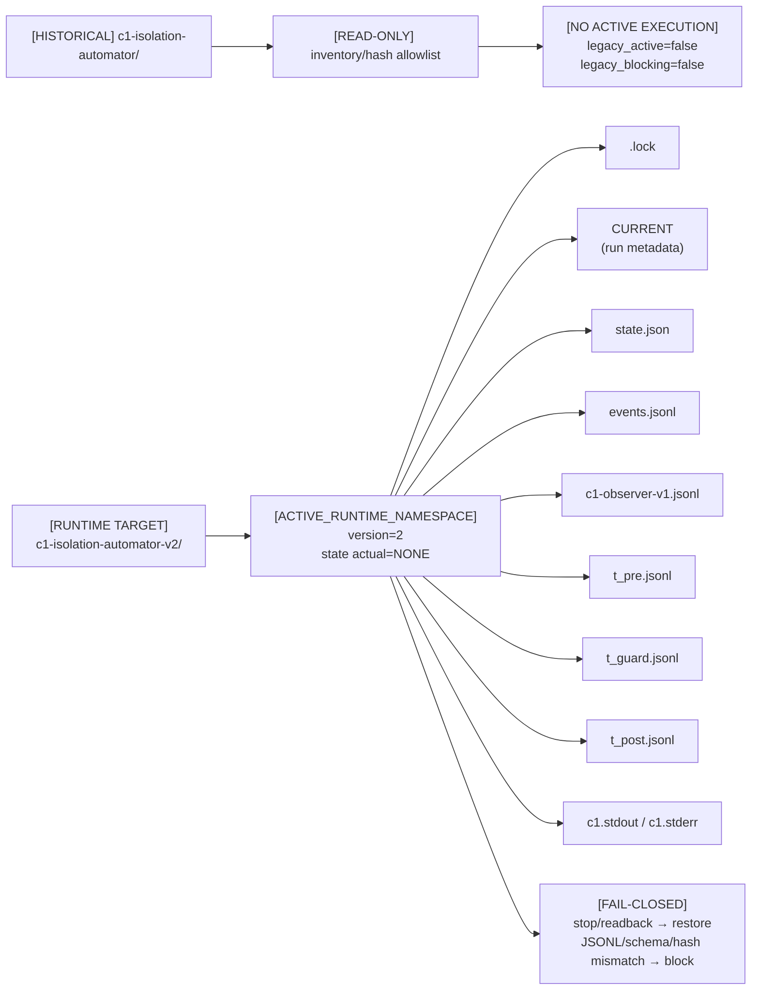

# 07 — Automatizador v1.1.0 y namespaces

**DIAGRAM_ID:** V-08
**STATUS:** DRAFT/CONFLICT
**LAST AUDITED:** 2026-09-24
**SOURCE_OF_TRUTH:**
- `04-IMPLEMENTACION/C1-ISOLATION-AUTOMATOR.md` (§Runtime files, §§332–365, §§367–388, §§421–467)
- `04-IMPLEMENTACION/C1-ISOLATION-AUTOMATOR.sha256`
- `04-IMPLEMENTACION/c1_isolation_automator.py` (sólo lectura)
- `04-IMPLEMENTACION/tests/test_c1_isolation_automator.py` (sólo lectura)

**CONFLICTS:**
- `ACTIVE_RUNTIME_NAMESPACE` describe el namespace objetivo v2; el estado actual recorded es `NONE` y `active_namespace_created=false`.
- La inspección read-only no encontró creado `/run/user/1000/c1-isolation-automator-v2/`; el árbol documentado es layout de diseño, no evidencia de una corrida.
- El residuo legacy tiene schema inválido y no es runtime activo; no se reparó ni migró.
- El orden del pipeline visualizado no coincide con la state machine fuente; ver V-12.

**NOTE:** vista documental. No ejecutar `--run`, `C1`, `sudo` ni servicios.

## Namespaces



## Reglas de aislamiento

| Elemento | Regla | Estado/proveniencia |
|---|---|---|
| `CURRENT` | Scanner activo carga sólo v2 | `CURRENT_sha256` legacy allowlisted; no se reescribe |
| Lock | Lock y JSONL permanecen en v2 | Test de lock activo: `PASS` estático |
| `state.json` | Metadata, timestamps, `initial_state`, `final_state`, hashes | Schema v2; writer mismatch bloquea |
| `events.jsonl` | Eventos de state/transiciones | Runtime real `NOT_EXECUTED` |
| Observer | Preflight estructurado: tmpfs, allowlist, hash, provenance, JSONL ausente; `agent_events=NOT_AVAILABLE` | Runtime real `NOT_EXECUTED` |
| PRE/GUARD/POST | T_PRE/T_POST=30 s; T_GUARD=120 s; muestra 5 s | Implementado; real `NOT_EXECUTED` |
| Stop/restore | Sólo `touched[]`; readback; nada de IRQ/sysfs/PM/DPM repaired automatically | Fail-closed documentado |
| Legacy | `HISTORICAL_LEGACY_RUNTIME`; no se convierte en active incomplete | Test estático `PASS` |

## Scope de unidades C1

`UNIT_SPECS` permite únicamente estas 11 unidades, y sólo si estaban `active`,
`activating` o `reloading` en PRE:

```text
system-autopilot.timer
system-autopilot.service
sys-tuned.timer
sys-tuned.service
kalm-gpu.service
kalm.service
irqbalance.service
kalm-lite.service
sysstat-collect.timer
sysstat-collect.service
kde-baloo.service
```

No cubre `kalm-cpu.service`, `powerstation.service`, `power-profiles-daemon`,
`rtkit`, `scx_loader`, `plasma-baloorunner`, Xwayland, KWin o ChatGPT. Por eso
`OWNERSHIP=PARTIAL` y la lista no prueba aislamiento integral.

## Residuo histórico identificado

```text
run_id=20260924T154559Z-490709
run_time=2026-09-24 12:45:59–12:46:00 -03 (legacy v1.0.0)
legacy_schema_status=INVALID_LEGACY
state=BUG 1: colisión antes del primer stop
UNITS_STOPPED=NONE
C1_EXECUTED=NO
legacy_active=false
state_sha256=f368fa91d050267b9fe30fb2e331e87a8a82e43f16f439470cc4b53d167bf99c
events_sha256=8e7ffbe3693545144037d07727d834422bbb7c8fab81665bc6b7c123bc5d422d
CURRENT_sha256=a06971fcfef0f3fb2f843ed836a7ffc5517a600e345c4838714eb52ab319f31f
```

La clasificación `POST_CONFLICT` de `system-autopilot.service` se conserva como `EXTERNAL_TRANSITION_OR_NATURAL_ONESHOT_COMPLETION`; `automator_stop_recorded=false` y `causality=NOT_PROVEN`.

## Validación estática registrada

**Sidecar vigente (registrado 2026-09-24T14:18:34-03:00):**
`automator_version=1.1.0`; `runtime_schema_version=2`; `runtime_namespace_version=2`;
`pure_tests=37/37_PASS`; `py_compile=PASS`; `pyflakes=PASS`; `static_scans=PASS`;
`prepare=NOT_REEXECUTED_AFTER_OBSERVER_FIX`; `dry_run=NOT_REEXECUTED_AFTER_OBSERVER_FIX`;
`live_snapshot_timestamp=2026-09-24T13:57:10-03:00`; `live_environmental_snapshot_refresh=false`;
`status=NOT_REEXECUTED_AFTER_OBSERVER_FIX`; `active_namespace_state_at_last_readonly_audit=NONE`;
`run=NOT_EXECUTED`; `C1=NOT_EXECUTED`; `c1_runtime_validated=NO`; `ready_for_execution=NO`.

**Hashes actuales leídos:** script `00971559adec044125a8fb71ddd4f8e6b97c8254eafcb7fddc8a89ec5fbeb6c0`;
documentación `fd87b4c7032a0981481424118ba9c36dffe5dde74b106aa97ba1b5730629d5f8`;
tests `a262e8b6439a79fdbd90042728b185936a7a5f27b9a2bbe6a23e7268f019bc5c`;
Git `c6146788e0d4fb12d9b0ec1209fa2840692de0c5`; sidecar SHA-256
`449ed67526805bb1e28bf5e0776a5c4666012b6018c4cc677722032185553787`; commit `NONE`.

**Parámetros C1 documentados (no ejecutados):** 1920×1080, `R8G8B8A8_UNORM`,
4 layers, 4 textures, `tex_size=4096`, 4 FMA iterations, warmup 5 s, duración 20 s,
offscreen. El observer registra frecuencia observada, pero
`frequency_effective_estimate=NOT_AVAILABLE` y `agent_events=NOT_AVAILABLE`.

**Conflicto de provenance:** el paquete R5 y vistas históricas conservan los hashes
`fd61816b...`, `cdc59384...`, `1a03c784...` y `24/24_PASS`; el sidecar vigente
registra los hashes/37 tests anteriores. `DOCUMENT-HASHES.txt` existe, pero conserva
provenance histórica y no reconcilia el sidecar actual. Estado: `CONFLICT`.
