# 08 — Agentes externos, autorización y seguridad

**DIAGRAM_ID:** V-09
**STATUS:** DRAFT/CONFLICT
**LAST AUDITED:** 2026-09-24
**SOURCE_OF_TRUTH:**
- `01-AUDITORIA/FASE-P0-EXPERIMENTAL-VALIDITY-GATE/P0-EXPERIMENTAL-VALIDITY-GATE-2026-09-24.md`
- `00-INDICE/AUDITORIA-CANDIDATOS-BACKGROUND-v2.md`
- `00-INDICE/AUDITORIA-CONSUMO-SEGUNDO-PLANO.md`
- `00-INDICE/PROTOCOLO-AB-LIMPIEZA-BACKGROUND.md`
- `00-INDICE/MASTER-RESEARCH-STATUS.md`
- `04-IMPLEMENTACION/IMPLEMENTATION-SAFETY-RULES.md`

**CONFLICTS:**
- Gate P0: `B. CONTAMINATED_REQUIRES_ISOLATION`; ownership `PARTIAL`; clientes `Xwayland`/`ChatGPT` observados.
- Corte P0: `2026-09-24 07:16:42–07:24:55 -03`; follow-up de timers `07:49`; es snapshot histórico, no estado vivo posterior.
- `system-autopilot`, `sys-tuned` y `irqbalance` tienen mecanismos solapados; la afinidad final depende del último escritor.
- La actividad observada de un agente no prueba que haya causado un frametime, D-state o `IO PSI` concreto.
- Los estados de servicios son snapshots; una ejecución externa posterior puede cambiar el estado vivo y no se incorpora como canonical status sin auditoría.

**NOTE:** capacidad y actividad no equivalen a causalidad. Este diagrama no autoriza detener, iniciar, aislar o modificar servicios.

## Mapa de escritores/interferencias

```mermaid
flowchart TD
    AP["system-autopilot.timer<br/>2 min"] --> APW["[CAPABILITY] governor<br/>IRQ/network<br/>scheduler/read_ahead<br/>renice"]
    ST["sys-tuned.timer<br/>30 min"] --> STW["[CAPABILITY] schedutil<br/>swappiness<br/>mq-deadline<br/>read_ahead/IRQ/red"]
    KL["kalmd / kalm<br/>15 s"] --> KLW["[CAPABILITY] IRQ affinity<br/>si no smp_affinity_list"]
    KLT["kalm-lite<br/>10 s"] --> KLTW["[CAPABILITY] swappiness<br/> dirty ratios<br/>según PSI"]
    KGP["kalm-gpu"] --> KGPW["[CAPABILITY] cap/DPM<br/>GPU power"]
    IB["irqbalance"] --> IBW["[CAPABILITY] IRQ balancing"]
    PS["PowerStation"] --> PSW["[CAPABILITY] D-Bus/clock<br/>(no causalidad demostrada)"]
    PPD["power-profiles-daemon"] --> PPDW["[CAPABILITY] profile selection<br/>(no write RX550 observado)"]
    RT["rtkit"] --> RTW["[CAPABILITY] RT scheduling policy"]
    BA["Baloo"] --> BAW["[UNKNOWN/NOT_AVAILABLE]<br/>filesystem index activity"]
    SS["sysstat"] --> SSW["[CAPABILITY] muestreo periódico<br/>/estadísticas/artefactos"]

    APW -.-> CPU["CPU/governor"]
    STW -.-> CPU
    APW -.-> IRQ["IRQ affinity"]
    KLW -.-> IRQ
    IBW -.-> IRQ
    APW -.-> HDD["scheduler/read_ahead/IO"]
    STW -.-> HDD
    KLTW -.-> MEM["memory/dirty/writeback"]
    KGPW -.-> GPU["cap/DPM/PM"]
    PSW -.-> PWR["power policy"]
    PPDW -.-> PWR
    RTW -.-> SCHED["scheduling"]
    BAW -.-> IO["filesystem I/O"]
    SSW -.-> J["journal/diagnostic I/O"]
```



## Matriz capability → observed activity → causalidad

| Agente | CAPABILITY documentada | OBSERVED ACTIVITY | PROVEN CAUSALITY |
|---|---|---|---|
| `system-autopilot` | governor, IRQ 39, sysctls red, scheduler, read-ahead, `renice` KWin | Timer/ciclos y escrituras de journal/sysfs observados en P0 | `NOT_PROVEN` para frametime/IO; `CONFLICT` con otros autores |
| `sys-tuned` | `schedutil`, swappiness, `mq-deadline`, read-ahead, IRQ/red | Timer habilitado/activo y código observados; efecto se solapa con autopilot | `NOT_PROVEN` |
| `kalm` / `kalmd` | afinidad IRQ si falta `smp_affinity_list` | Poll cada 15 s; con irqbalance activo registra `omitiendo` | `NOT_PROVEN`; no escribir para “arreglar” |
| `kalm-lite` | puede escribir swappiness/dirty ratios si PSI supera umbrales | Servicio observado en snapshot P0; no hay log de ajuste concluyente | `POSSIBLE/UNKNOWN`, no causalidad |
| `kalm-gpu` | cap/DPM/power state | Servicio activo; capacidad de escritura y reinicios históricos por `Device or resource busy`; sin evento de write actual observado | `NOT_PROVEN`; no tocar |
| `irqbalance` | balanceo de IRQ | Activo; coexistía con autopilot/kalmd | `CONFLICT` de ownership, no causalidad de frame |
| `PowerStation` | D-Bus/card1; propiedades de clock potencialmente escribibles | Servicio observado; write RX550 no establecido en P0 | `NOT_PROVEN` |
| `power-profiles-daemon` | selección de perfiles | Servicio activo; no hay evidencia de write específico a RX550 | `NOT_PROVEN` |
| `rtkit` | política RT de audio/DESKTOP | Servicio activo; no se midió interferencia de frametime | `NOT_PROVEN` |
| `Baloo` | indexación de archivos | Actividad no cerrada en el gate vigente | `NOT_AVAILABLE/UNKNOWN` |
| `sysstat` | muestreo periódico y escritura de estadísticas | Timer/ciclo observado; escribe estadísticas | `NOT_PROVEN`; puede ser observer de I/O |

## Actores adicionales observados en P0

| Actor | Capacidad/actividad | Estado |
|---|---|---|
| `Xwayland` | FD `card1`; acceso DRM, sin contadores de motor | `OBSERVED ACCESS`; trabajo/presentation `UNKNOWN` |
| Proceso GPU de `ChatGPT` | FD `renderD129`; VRAM/GTT reservada, sin atribución de motor | `OBSERVED ACCESS`; causalidad `NOT_PROVEN` |
| `kalm-cpu.service` | Oneshot de boot; afinidad de IRQ | `PARTIAL`; fuera de C1 allowlist |
| `scx_loader.service` | Loader sched-ext; no se encontró scheduler activo | `UNKNOWN`; fuera de allowlist |
| `crond` / `dnf-makecache` | Actividad periódica de red/archivos | `POSSIBLE/UNKNOWN`; sin coincidencia causal demostrada |

## Cobertura del automatizador C1

La allowlist C1 cubre `system-autopilot`, `sys-tuned`, `kalm-gpu`, `kalm`,
`irqbalance`, `kalm-lite`, `sysstat-collect` y `kde-baloo` (timer/service cuando
aplican). No cubre `kalm-cpu`, PowerStation, `power-profiles-daemon`, `rtkit`,
`scx_loader`, `plasma-baloorunner`, Xwayland, KWin o ChatGPT. Por tanto, la
capacidad de C1 no equivale a ownership exclusivo ni a aislamiento causal completo.

## Reglas de autorización

- `CAPABILITY` no es `OBSERVED`.
- `OBSERVED` no es `PROVEN_CAUSALITY`.
- `CONFLICT` exige preservar ambos estados y resolver con gate explícito.
- No detener/iniciar servicios desde esta vista.
- No escribir sysfs, DPM, PM, IRQ, scheduler ni governor.
- No ejecutar C1, `--run`, benchmark ni test de runtime.
- El único aislamiento válido es el protocolo escrito, con autorización separada, snapshot/readback/restore y verificador de estado final.

## Hashes de scripts leídos por P0

```text
61519cfe085860e93a087e0a299913c48741500c3787c02eca126480d0fee3ea  /usr/local/bin/system-autopilot.sh
c4f94196faa3f11bcfcd75e12264dd6bfb7857e26f7ec6dd0e87b05f2823d49e  /usr/local/bin/sys-tuned.sh
c78581bf4670f5e0a1698519298f1557167644219bab9dc8f152619740c493b9  /usr/local/bin/kalm-cpu-apply.sh
5e0a682cd446057dfa0f3f84e33cd7870a0e0faf36fd1659b3a841f8f753d7c4  /opt/kalm/kalmd.py
538648d9f8afd6fcd3bc9239123c50a1d0bf2c1f5e8481aec3187cbebeaace6a  /usr/local/bin/kalm-lite.py
a1e701768297195945ebe9b5fcbb431430a37b98c28481f67bf5017138d0c1bd  /usr/local/bin/kalm-gpu
```

## Estado de seguridad

`P0=B CONTAMINATED_REQUIRES_ISOLATION`; `OWNERSHIP=PARTIAL`; `C1_STATUS=DEFERRED`; `C1_RUNTIME_VALIDATED=NO`; no hay autorización para una nueva corrida de escritura.
