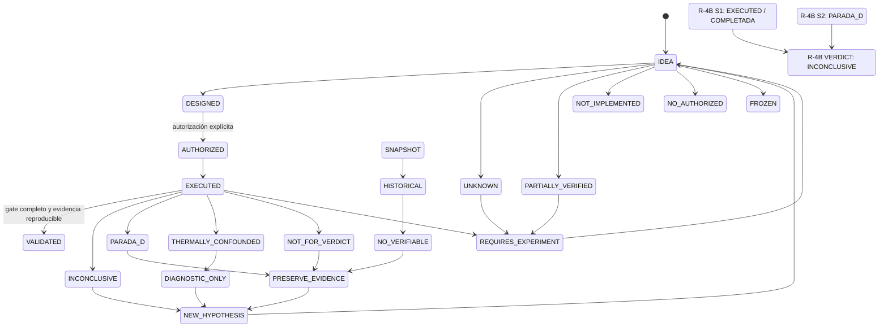

# 09 — Estados científicos y ciclo de evidencia

**DIAGRAM_ID:** V-10
**STATUS:** DRAFT/CONFLICT
**LAST AUDITED:** 2026-09-24
**SOURCE_OF_TRUTH:**
- `00-INDICE/ESTADOS-ES-EN.md`
- `01-AUDITORIA/FASE-R1-DOCUMENTATION-RECONCILIATION/R1-6-EVIDENCE-STATE-MODEL.md`
- `01-AUDITORIA/IMPLEMENTATION-READINESS/IMPLEMENTATION-READINESS-AUDIT.md`
- `00-INDICE/MASTER-RESEARCH-STATUS.md`
- `03-EXPERIMENTOS/FASE-R4B-GOVERNOR/EXP-F4-A-RESULTADOS-v2.3.md`

**CONFLICTS:**
- La taxonomía se amplió en `ESTADOS-ES-EN.md`, pero sigue siendo provisional y no cubre
  necesariamente cada etiqueta histórica de todos los snapshots.
- Readiness se armonizó con D6, pero este diagrama aún no ha sido reauditado contra todos
  los documentos heredados.
- La conversión a `LIVE` queda bloqueada hasta resolver H12/capabilities y reauditar las
  vistas derivadas.

**NOTE:** esta state machine es provisional. No autoriza una ejecución ni convierte un estado diagnóstico en `VALIDATED`.

## State machine provisional



## Estados y reglas

| Estado | Regla |
|---|---|
| `IDEA` | Propuesta sin evidencia suficiente |
| `DESIGNED` | Protocolo existe, pero no fue ejecutado |
| `AUTHORIZED` | Existe autorización concreta; no implica ejecución |
| `EXECUTED` | Ocurrió al menos una corrida; no implica validez |
| `VALIDATED` | Gate explícito cumplido y evidencia reproducible |
| `INCONCLUSIVE` | Muestra o precondiciones no permiten decidir |
| `NEW_HYPOTHESIS` | Nuevo ciclo después de un resultado inconcluso |
| `PARADA_D` | Corrida detenida por una condición definida |
| `PRESERVE_EVIDENCE` | No borrar ni reintentar automáticamente |
| `THERMALLY_CONFOUNDED` | Ventana no válida para el veredicto |
| `DIAGNOSTIC_ONLY` | Solo diagnóstico; no gate formal |
| `NOT_FOR_VERDICT` | Evidencia explícitamente excluida del veredicto |
| `REQUIRES_EXPERIMENT` | Falta una intervención o medición local |
| `UNKNOWN` | No hay evidencia suficiente |
| `PARTIALLY_VERIFIED` | Evidencia parcial, no causalidad completa |
| `SNAPSHOT` | Estado preservado de una etapa histórica |
| `HISTORICAL` | No describe el estado actual |
| `NO_VERIFIABLE` | Artefacto o referencia no comprobable |
| `NOT_IMPLEMENTED` | Diseño sin código o adopción |
| `NO_AUTHORIZED` | Requiere autorización nueva |
| `FROZEN` | No modificar sin autorización específica |

## R-4B: representación obligatoria

```text
S1: EXECUTED / COMPLETADA
S2: PARADA_D
VERDICT: INCONCLUSIVE
```

No se agrega un veredicto global binario ni se declara `SUPPORTED`.

## Reglas de transición

1. `DESIGNED → AUTHORIZED` requiere una decisión externa explícita.
2. `AUTHORIZED → EXECUTED` requiere preflight y capability audit aplicables.
3. `EXECUTED → VALIDATED` requiere todos los gates del protocolo.
4. `VALIDATED` no implica automáticamente `SUPPORTED`.
5. Regla explícita: `VALIDATED ≠ SUPPORTED`.
6. `INCONCLUSIVE` vuelve a hipótesis, no a ejecución automática.
7. `PARADA_D` conserva la evidencia y no se reintenta sin autorización.
8. `THERMALLY_CONFOUNDED` no se convierte en un veredicto binario.
9. Un snapshot no se actualiza para parecer LIVE.
10. Un diagrama no modifica el estado textual canónico.

## Estado de publicación

Este diagrama es `DRAFT/CONFLICT` hasta que:

- `ESTADOS-ES-EN.md` sea exhaustivo o declare explícitamente su alcance;
- readiness se armonice con D6;
- el vocabulario de `VALIDADO`, `INCONCLUSIVE`, `DIAGNOSTIC` y `NOT_FOR_VERDICT` sea único.
