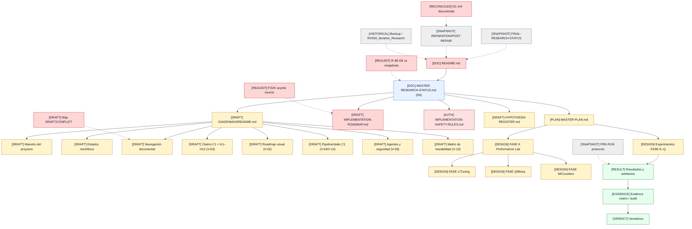

# 10 — Navegación documental

**DIAGRAM_ID:** V-11
**STATUS:** DRAFT/CONFLICT
**LAST AUDITED:** 2026-09-24
**SOURCE_OF_TRUTH:**
- `README.md`
- `00-INDICE/README.md`
- `00-INDICE/MASTER-RESEARCH-STATUS.md`
- `00-INDICE/MASTER-PLAN.md`
- `00-INDICE/R2-GLOBAL-DOCUMENTATION-MAP.md`
- `00-INDICE/PROJECT-DOCUMENTATION-STATUS.md`
- `04-IMPLEMENTACION/IMPLEMENTATION-ROADMAP.md`
- `04-IMPLEMENTACION/IMPLEMENTATION-SAFETY-RULES.md`

**CONFLICTS:**
- El mapa global ahora se marca `DRAFT/CONFLICT` y se está reindexando; no es una vista `LIVE`.
- `FINAL-RESEARCH-STATUS.md` es histórico aunque aparece como entrada de navegación.
- El roadmap F/G/K ya no declara un ciclo en su diseño; esta vista sigue requiriendo reauditoría.
- README/decisiones ya tienen una reconciliación documental, pero las auditorías repair/Set I
  permanecen como snapshots y no fuente de estado actual.
- H12/WSI y capabilities runtime siguen sin confirmar.

**NOTE:** este diagrama muestra navegación; no convierte ningún documento histórico en LIVE.

## Flujo de navegación

## REFERENCIA CANÓNICA (no equivale a vista `LIVE`)

| Documento/área | Uso |
|---|---|
| `MASTER-RESEARCH-STATUS.md` | Fuente de estado; Addenda D6 prevalece; la vista derivada requiere reauditoría |
| `MASTER-PLAN.md` | Estructura y diseño futuro; no es autorización |
| `IMPLEMENTATION-SAFETY-RULES.md` | Límite de autorización y congelación; no concede permisos |
| R-4A/R-4B v2.3/R-4C/FASE D results | Resultados canónicos dentro de alcance; R-4B se representa solo con la terna D6 |

## DRAFT / PROVISIONAL

| Documento/área | Uso |
|---|---|
| `HYPOTHESIS-REGISTER.md` | Registro textual provisional; no es un veredicto ni una vista `LIVE` |

## HISTORICAL / SNAPSHOT

| Documento/área | Regla |
|---|---|
| `FINAL-RESEARCH-STATUS.md` | No usar como estado vivo |
| `REPARATION-PLAN.md` | Plan/checkpoint histórico |
| `POST-REPARACION-DOCUMENTAL-AUDIT.md` | Auditoría histórica |
| Set I y auditorías de reorganización | Trazabilidad, no estado actual |
| PRE-RUN R-4B/R-4C | Protocolos previos, no ejecución actual |
| Backup y raíz antigua | Historia preservada, no operación |
| `/tmp` | Localizadores perdidos/no verificables |

## CONFLICT

- La vista sigue en `DRAFT/CONFLICT` hasta reauditar el mapa y las capability claims.
- `FINAL-RESEARCH-STATUS` y auditorías repair/Set I son snapshots, no estado vivo.
- H12/WSI y capacidades runtime no confirmadas; r1–r3, r4/H12-3 y H12-4 tienen alcopes distintos.
- C1 sidecar 37/37 vs provenance R5 24/24: `CONFLICT`; no runtime v2 creado.
- `R2-GLOBAL-DOCUMENTATION-MAP` es ahora una vista `DRAFT/CONFLICT`, no un mapa vivo.
- `ESTADOS-ES-EN.md` es una taxonomía ampliada pero todavía provisional.

## Regla de navegación

Un nuevo documento debe enlazarse desde una sola capa:

- estado: `00-INDICE/MASTER-RESEARCH-STATUS.md`;
- plan: `00-INDICE/MASTER-PLAN.md` o `IMPLEMENTATION-ROADMAP.md`;
- seguridad: `IMPLEMENTATION-SAFETY-RULES.md`;
- resultados: carpeta del experimento;
- auditorías: `01-AUDITORIA/`;
- fuentes: `05-FUENTES-EXTERNAS/`.

Los diagramas no sustituyen esos enlaces.
