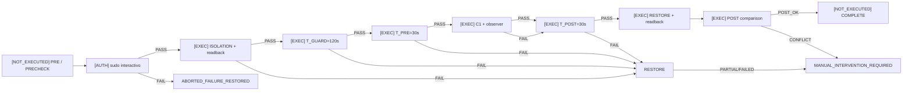

# 11 — State machine C1 v1.1.0

**DIAGRAM_ID:** V-12
**STATUS:** DRAFT/CONFLICT
**LAST AUDITED:** 2026-09-24
**SOURCE_OF_TRUTH:**
- `04-IMPLEMENTACION/C1-ISOLATION-AUTOMATOR.md` (§State machine, §§269–300, §§421–467)
- `04-IMPLEMENTACION/C1-ISOLATION-AUTOMATOR.sha256`
- `04-IMPLEMENTACION/IMPLEMENTATION-SAFETY-RULES.md`
- `01-AUDITORIA/FASE-P0-EXPERIMENTAL-VALIDITY-GATE/P0-EXPERIMENTAL-VALIDITY-GATE-2026-09-24.md`

**CONFLICTS:**
- El contrato solicitado por la visualización (`PRECHECK → GATES → T_GUARD → T_PRE → AUTHORIZATION → ISOLATION → C1`) no coincide con el orden de la state machine implementada/documentada (`PRE → AUTH → ISOLATION → GUARD → T_PRE → C1`).
- El namespace v2 está definido y validado estáticamente, pero la ejecución real, `C1`, `sudo`, `systemctl stop/start/restart` y `T_GUARD/T_PRE/T_POST` reales están `NOT_EXECUTED`.
- El código fuente usa lenguaje de autorización previa en algunos puntos, pero el sidecar vigente registra `READY_FOR_EXECUTION=NO`; la autorización concreta actual queda `UNKNOWN/REQUIRES_AUTHORIZATION`.
- `sudo=NOT_EXECUTED` en el closeout v1.1 no contradice el `sudo -v=0` del artefacto legacy v1.0: son corridas y cortes temporales distintos; el legacy falló antes del primer stop.
- El chequeo formal visible del C1 no incluye explícitamente el criterio de journal `GPU fault|VM fault` que el protocolo de E-03 dokumenta; es un gap de protocolo, no evidencia de una corrida C1.
- `C1_RUNTIME_VALIDATED=NO` y `ready_for_execution=NO`; por tanto no existe un estado runtime final validado.

**NOTE:** vista derivada; no autoriza `C1`, `--run`, `sudo` ni cambios operacionais.

## Contrato lógico solicitado

```mermaid
stateDiagram-v2
    state "CANCELLED/INTERRUPTED" as CANCELLED
    state "T_PRE / PRE" as PRE
    [*] --> ABSENT
    ABSENT --> PREPARING: namespace v2 definido; DRAFT/NOT_EXECUTED
    PREPARING --> PRECHECK
    PRECHECK --> PRECHECK_FAIL: checks fallan
    PRECHECK --> GATES: precheck PASS
    GATES --> GATES_FAIL: gate fallido
    GATES --> T_GUARD: GATES PASS
    T_GUARD --> GUARD_FAIL: D-state / IO PSI / procs_blocked / RX550
    T_GUARD --> T_PRE: PASS
    T_PRE --> PRE: PASS
    PRE --> PRE_FAIL: guard adicional falla
    PRE --> AUTHORIZATION: PASS
    AUTHORIZATION --> ABORTED: DENIED/FAIL
    AUTHORIZATION --> ISOLATION: GRANTED
    ISOLATION --> ISOLATION_FAIL: stop/readback falla
    ISOLATION --> C1: PASS
    C1 --> C1_FAIL: exit/JSONL/formal check falla
    C1 --> CANCELLED: SIGINT/SIGTERM
    C1 --> T_POST
    C1_FAIL --> T_POST: intento seguro
    CANCELLED --> T_POST: intento seguro
    T_POST --> POST_FAIL: ventana post fallida
    T_POST --> RESTORE: T_POST PASS
    RESTORE --> POSTCHECK
    POSTCHECK --> POST_CONFLICT: discrepancia PRE/POST
    POSTCHECK --> FINAL: POST_OK + RESTORE_OK
    RESTORE --> MANUAL_INTERVENTION_REQUIRED: PARTIAL/FAILED
    PRECHECK_FAIL --> ABORTED
    GATES_FAIL --> ABORTED
    PRE_FAIL --> RESTORE
    ISOLATION_FAIL --> RESTORE
    GUARD_FAIL --> RESTORE
    POST_FAIL --> RESTORE
    POST_CONFLICT --> FAILURE
    FAILURE --> MANUAL_INTERVENTION_REQUIRED
    ABORTED --> [*]
    FINAL --> [*]
```

## Orden realmente documentado en la implementación

## Resultadores de abort/fail/cancel documentados

| Resultado | Cuándo | C1 ejecutado | Restore |
|---|---|---:|---|
| `ABORTED_PRE` | PRE/TTY/confirmación/namespace falla | No | `RESTORE_ABORTED_NO_CHANGES` |
| `ABORTED_OBSERVER_CHECK` | preflight observer no es válido | No | No isolation |
| `BLOCKED_INCOMPLETE_STATE` | lock/state/orphan/legacy desconocido | No | Estado preservado |
| `ABORTED_FAILURE_RESTORED` | sudo/stop/guard/T_PRE falla y restore queda OK | No o histórico | OK |
| `ABORTED_FAILURE_RESTORE_REQUIRED` | restore parcial/fallido | Según fase | `MANUAL_INTERVENTION_REQUIRED` |
| `CANCELLED/INTERRUPTED` | SIGINT/SIGTERM | Según checkpoint | Cleanup y restore prioritarios |
| `POST_CONFLICT` | discrepancia PRE/POST o transición externa | Según fase | Fail-closed; `causality=NOT_PROVEN` |
| `COMPLETED_PARTIAL_OR_CONFLICT` | child rc=0 pero checks formales no pasan | Sí | T_POST/restore igualmente required |

`ABORTED_FAILURE_RESTORED` significa contención del fallo, no PASS de C1.

## Gates y fail-closed

| Gate | Regla documentada | Estado actual |
|---|---|---|
| PRE | Sin sudo si falla; no stop | Validación estática registrada; `prepare/dry_run/status` no reejecutados tras observer fix; ejecución real `NOT_EXECUTED` |
| TTY/CONFIRMACIÓN | Requiere TTY real y confirmación literal `RUN-C1` | `NOT_EXECUTED` |
| AUTH | sudo interactivo; no se almacenan credenciales | `NOT_EXECUTED_REQUIRES_SUDO` |
| ISOLATION | Sólo unidades PRE activas y `touched[]`; readback inmediato | Implementado; no probado con privilegios |
| T_GUARD | 120 s, muestra cada 5 s; D-state, `procs_blocked`, IO PSI, RX550 y readback | Real `NOT_EXECUTED`; gate máximo `IO_GUARD_AVG10_MAX=10.0` |
| T_PRE/T_POST | 30 s; required JSONL y checks | Real `NOT_EXECUTED` |
| C1 | Sólo después de guard/auth y con argv/version/hash permitidos | `NOT_EXECUTED` |
| Restore | Compara PRE/POST, no repara automáticamente | Implementado; `POST_CONFLICT` permanece fail-closed |
| Final | `RESTORE_OK` + `POST_OK` + checks formales | `C1_RUNTIME_VALIDATED=NO` |

El sidecar vigente registra `pure_tests=37/37_PASS` a las 14:18:34, pero marca
`prepare/dry_run/status=NOT_REEXECUTED_AFTER_OBSERVER_FIX`; el resultado fresco y
la ejecución runtime siguen `NOT_EXECUTED`.

**Límites:** `T_GUARD` no sustituye ownership exclusivo; el escaneo de procesos del automator sólo cubre otro C1/observer, no un inventario completo de clientes GPU; `OWNERSHIP=PARTIAL`; `C1_RUNTIME_VALIDATED` es una condición formal de ejecución, no validación científica global. `NOT_EXECUTED` no se convierte en PASS.
