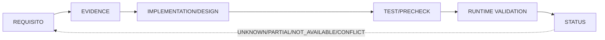

# 12 — Matriz de trazabilidad RX550

**DIAGRAM_ID:** V-13
**STATUS:** DRAFT/CONFLICT
**LAST AUDITED:** 2026-09-24
**SOURCE_OF_TRUTH:**
- `00-INDICE/MASTER-RESEARCH-STATUS.md`
- `01-AUDITORIA/IMPLEMENTATION-READINESS/IMPLEMENTATION-READINESS-AUDIT.md`
- `01-AUDITORIA/FASE-P0-EXPERIMENTAL-VALIDITY-GATE/P0-EXPERIMENTAL-VALIDITY-GATE-2026-09-24.md`
- `02-ARQUITECTURA/POLARIS12-MAP/UNVERIFIED-CLAIMS.md`
- `03-EXPERIMENTOS/M1-cap-35-30/RESULTADOS-M1.md`
- `03-EXPERIMENTOS/FASE-R4B-GOVERNOR/EXP-F4-A-RESULTADOS-v2.3.md`
- `03-EXPERIMENTOS/FASE-R4C-JITTER-OBSERVABILITY/EXP-F1-A-RESULTADOS.md`
- `04-IMPLEMENTACION/C1-ISOLATION-AUTOMATOR.md`
- `04-IMPLEMENTACION/C1-ISOLATION-AUTOMATOR.sha256`
- `01-AUDITORIA/FASE-R5-C1-TECHNICAL-DOCUMENTATION/DOCUMENT-HASHES.txt`
- `01-AUDITORIA/FASE-R5-C1-TECHNICAL-DOCUMENTATION/C1-TECHNICAL-RECORD.md`
- `04-IMPLEMENTACION/IMPLEMENTATION-SAFETY-RULES.md`

**CONFLICTS:**
- La documentación tiene resultados históricos, snapshots y Addenda con alcances distintos; la matriz no los amalgama.
- La referencia `README.md:REORGANIZATION-MANIFEST.sha256` no coincide con el archivo existente `00-INDICE/REORGANIZACION-MANIFEST.sha256`; se conserva como `CONFLICT` de ruta, no se corrige.
- La taxonomía A–D de bottleneck solicitada no coincide con los claims formales A–D del automatizador C1; se mantienen separadas en V-03.
- El código del automatizador contiene lenguaje de autorización previa, pero el sidecar vigente registra `READY_FOR_EXECUTION=NO`; autorización actual `UNKNOWN/REQUIRES_AUTHORIZATION`.
- El paquete R5 técnico está sin indexar; `DOCUMENT-HASHES.txt` existe pero es histórico y sus estados no coinciden con el master; no se usa como fuente canónica.
- `C1_RUNTIME_VALIDATED=NO`; no hay PASS de runtime para C1.

**NOTE:** una celda `PASS` sólo se refiere al alcance y source indicado; no autoriza acciones.

## Matriz

| Requisito | Evidencia | Implementación | Test | Runtime validation | Estado |
|---|---|---|---|---|---|
| Identidad RX550/display separado | RX550 `1002:699f` card1/renderD129; Intel HD4600 `1002:412` card0 | `knowledge.md`, P0, M1/EP-05 | lectura de device/maps en corridas | No C1 | `PASS` identidad; `CONFLICT` si display ownership no exclusivo |
| Ownership sin clientes concurrentes | P0: `OWNERSHIP=PARTIAL`; Xwayland/ChatGPT observados | C1 isolation/guard | guard real no ejecutado | `NOT_EXECUTED` | `CONTAMINATED_REQUIRES_ISOLATION` |
| CPU/governor reproducible | snapshots 07:16/07:24; autopilot/sys-tuned | `c1_isolation_automator.py`; telemetría | dry-run no reejecutado tras observer fix; guard real no | `NOT_EXECUTED` | `CONFLICT` |
| Runtime PM/ASPM/bridge | Gen2×4/documentación; PM/ASPM local no cerrado | FASE-I/L, H12 | capability audit pendiente | no | `UNKNOWN/REQUIRES_CAPABILITY_AUDIT` |
| Power cap snapshot/readback/restore | M1 10/10, restore 35 W; cap no discriminativo | `rx550-torneo`, M1 runner | tests M1 disponibles | historical execution only | `PASS` reversibilidad; `NO DISCRIMINATIVO` cap |
| DPM/MCLK | SCLK/MCLK reportados; policy 5/16/20 vs local 3/16/20 | FASE-I, MCLK read-only | R-4A/EP-06 read paths | no trigger cerrado | `PARTIAL/CONFLICT/UNKNOWN` |
| Thermal policy | R-4B: entrada≤50; 90 confound; 96 abort; W_SMU | R-4B v2.3, cooldowns | S1 8/8 cooldown; S2 incompleta | S1 executed; S2 stopped | `INCONCLUSIVE` |
| Mesa workload A/B | EP-05: CUSTOM≈STOCK, ΔFPS≤1%, ΔP≤0,3 W | FASE-H/Q | A/B histórico | no nueva ejecución | `PARTIAL/NEGATIVE_RESULT` |
| GFX8 catalog→API→runtime | 2304 catálogo; RADV API/PMU `NOT_AVAILABLE`; UMR catálogo | FASE-M/D | lectura no-programada Etapa 2 | runtime/ASIC `UNKNOWN` | `NOT_AVAILABLE/UNKNOWN` |
| FASE-D block proxies | 6/6; vgt/pa/sh/sx; H1 supported, H4 partial | radeontop/UMR read-only | Etapa 2 PASS | no Etapa 3 | `PARTIAL/NOT_FOR_VERDICT` |
| H12 WSI capability | H12-2 r1–r3 `state=4=activated`; H12-1 r4/H12-3 y H12-4 static no reconciliados | H12-1/H12-2 | harness/document audit | M1 causality no cerrada; H12-4 smoke no ejecutado | `PARTIALLY_CONFIRMED/UNKNOWN/CONFLICT` |
| R-4C jitter observability | 8/8; 320/320; MAE 0 / 3,66e-10 px | local Vulkan layer/harness | PASS | no performance verdict | `PASS` observability only |
| C1 PRE/GUARD/T_PRE | automator 1.1.0; `IO_GUARD_AVG10_MAX=10` | v2 state machine | 37/37 tests recorded; fresh run not reexecuted after observer fix | real guard `NOT_EXECUTED` | `PASS_STATIC_RECORDED` / `NOT_TESTED_RUNTIME` |
| C1 authorization/isolation | safety rules; no credentials stored | PRE/AUTH/ISOLATION | dry-run no reejecutado; no sudo | `NOT_EXECUTED_REQUIRES_SUDO` | `REQUIRES_AUTHORIZATION/NOT_EXECUTED` |
| C1 execution | `C1_STATUS=DEFERRED`; `--run=NOT_EXECUTED` | C1 command/observer | none runtime | no JSONL/run | `NOT_EXECUTED` |
| C1 POST/restore | fail-closed rules; `RESTORE_OK` required | state/events/observer v2 | 37/37 static tests recorded | real restore `NOT_EXECUTED` | `NOT_TESTED_RUNTIME` |
| Journal fault criterion | E-03 documenta `GPU fault|VM fault=0`; checklist C1 visible no lo incluye | gap de contrato, no implementación probada | no corrida C1 | no journal C1 | `PROTOCOL_GAP/NOT_TESTED` |
| Claims bottleneck A–D solicitados | frametime/FPS, CPU, GPU/fence, memory/fetch/I/O | V-03/V-06; no equivalen a claims formales C1 | M1/R-4B/R-4C/F2/FASE-D/H12-documental | no C1 runtime | `PARTIAL/UNKNOWN/NOT_PROVEN` |
| Claims C1 A–D | C1 doc: runtime, frecuencia, ownership, PSI/HDD/Btrfs | V-03 mantiene esta taxonomía separada de A–D de bottleneck | checks estáticos/documentales | no runtime/ownership/frecuencia | `PARTIAL/NOT_AVAILABLE/NOT_PROVEN` |
| Namespace v2/legacy | v2 state NONE; legacy historical/invalid; hashes allowlisted | automator v1.1.0 | 37/37 static tests recorded | no active C1 | `STRUCTURE_RECORDED` / `RUNTIME_NOT_CREATED` |
| C1 allowlist/coverage | P0 lista más agentes que `UNIT_SPECS` | 11 unidades; no cubre `kalm-cpu`, PowerStation, PPD, rtkit, scx, runner Baloo, Xwayland/ChatGPT | tests de contrato; no runtime | no aislamiento | `COVERAGE_GAP/NOT_PROVEN` |
| Oneshot restore | `system-autopilot`, `sys-tuned`, `sysstat` pueden ser oneshot | restore exige readback `active` | tests sintéticos; sin prueba runtime de oneshot | no stop real | `UNTESTED_EDGE_CASE` |
| IRQ mask snapshot/restore | C1 no escribe IRQ; irqbalance no garantiza máscara previa | no snapshot de máscara | no test de máscara | no runtime | `NOT_IMPLEMENTED/NOT_TESTED` |
| External agents | P0 capability/activity/conflict table | no-stop/read-only policy | read-only gate | no authorized isolation | `CAPABILITY/OBSERVED/NOT_PROVEN` |
| Provenance/integridad | sidecar vigente 37/37; R5 conserva 24/24 y hashes anteriores; `DOCUMENT-HASHES.txt` presente pero histórico | manifests/raw CSV/JSON | hashes leídos; no reejecución fresca | no commit | `CONFLICT` |
| Runtime support/optimization | no C1 validated; no claim global | FASE E–Q designs | design/static only | no runtime | `NOT_TESTED/UNKNOWN` |

## R5 y contradicciones de provenance

`01-AUDITORIA/FASE-R5-C1-TECHNICAL-DOCUMENTATION/C1-TECHNICAL-RECORD.md` se conserva
como snapshot técnico, no como estado maestro: no está indexado como paquete canónico.
`DOCUMENT-HASHES.txt` sí existe, pero conserva hashes históricos R5 y no reconcilia
el sidecar vigente de C1 (37/37 y hashes actuales). La cifra de 13,6 W de R5
tampoco se mezcla con el pico R-14/Superposition de 24,71 W: son alcances y
ventanas diferentes. La afirmación de worktree limpio no se usa aquí para cerrar
un claim.

## Estados de la matriz

- `PASS`: sólo el criterio explícito de la fila.
- `PARTIAL`: evidencia parcial, sin causalidad o cobertura completa.
- `UNKNOWN`: no hay evidencia suficiente.
- `NOT_AVAILABLE`: capability/API/artefacto no disponible en el alcance.
- `NOT_TESTED`: test existe o está diseñado, pero no se ejecutó en runtime.
- `CONFLICT`: fuentes/estados no reconciliados; prevalece texto canónico.
- `NOT_EXECUTED`: no se ejecutó C1, `--run`, sudo o restore real.
