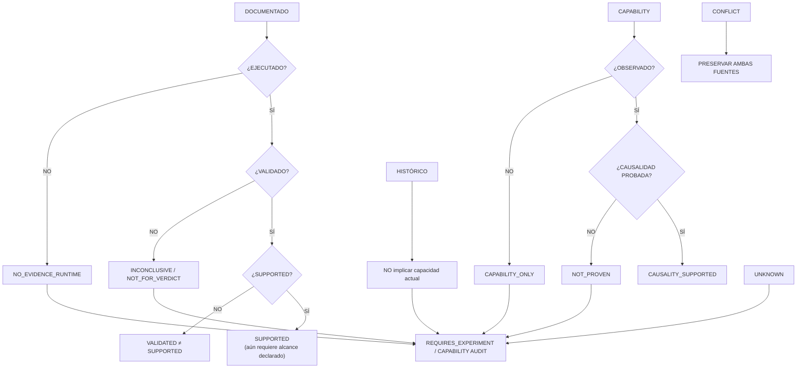

# 13 — Regla fundamental de representation visual

**DIAGRAM_ID:** V-14
**STATUS:** DRAFT
**LAST AUDITED:** 2026-09-24
**SOURCE_OF_TRUTH:**
- `00-INDICE/DIAGRAMAS/README.md`
- `00-INDICE/ESTADOS-ES-EN.md`
- `00-INDICE/MASTER-RESEARCH-STATUS.md`
- `04-IMPLEMENTACION/IMPLEMENTATION-SAFETY-RULES.md`
- `01-AUDITORIA/FASE-R1-DOCUMENTATION-RECONCILIATION/R1-6-EVIDENCE-STATE-MODEL.md`

**CONFLICTS:** las fuentes heredadas contienen estados históricos y provisionales; esta regla no resuelve sus contradicciones.

**NOTE:** regla de publicación; no autoriza acciones.

## Reglas obligatorias

1. Un diagrama nunca convierte `DESIGNED` en `EXECUTED`.
2. `DOCUMENTED`, `DESIGNED`, `AUTHORIZED`, `EXECUTED`, `VALIDATED` y `SUPPORTED` son estados distintos.
3. Un `SNAPSHOT` no describe el estado actual.
4. Un counter cumulative o una correlación temporal no se convierte en causalidad.
5. `UNKNOWN` no es resultado negativo; `NOT_AVAILABLE` no prueba inexistencia local.
6. `CAPABILITY` no se representa como `OBSERVED`; `OBSERVED` no se representa como `PROVEN_CAUSALITY`.
7. Si una fuente canónica contradice una vista, prevalece el texto y la vista queda `CONFLICT`.
8. Una línea de Mermaid sólida representa una relación documentada; una flecha punteada representa hipótesis, posibilidad o relación no causal.
9. Todo diagrama incluye provenance, fecha, conflictos y nota de no autorización.
10. Los IDs de hipótesis/claims se mantienen con su alcance y taxonomía; no se fusionan H1/H2 de documentos distintos.
11. Un hash o conteo de tests histórico no sustituye el sidecar vigente; si difieren, se marca `PROVENANCE_CONFLICT`.
12. La documentación visual no ejecuta C1, `--run`, `sudo`, servicios, sysfs, DPM, PM, benchmarks ni scripts.
