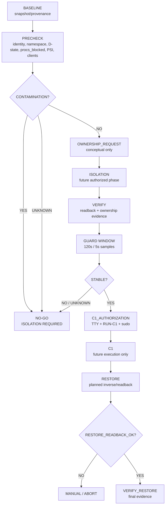

# 15 — C1 Isolation Design Flow

**STATUS:** `DOCUMENTARY DESIGN`
**ISOLATION_DESIGN:** `PREPARED_FOR_REVIEW`
**EXECUTION_EVIDENCE:** `NO`
**C1:** `DEFERRED`
**SOURCE:** `04-IMPLEMENTACION/C1-ISOLATION-DESIGN-v1.0.md`

Este diagrama es una vista derivada del diseño documental. No representa una ejecución, no autoriza acciones y no convierte `OWNERSHIP_PARTIAL` en `OWNERSHIP_FULL`.



```text
FULL_OWNERSHIP=identity + client inventory + writer resolution + stable guard + restore plan
CURRENT_OWNERSHIP=PARTIAL
CURRENT_C1=DEFERRED
RESTORE_VALIDATED=NO
```

**Sources:** `P0`, `C1-DOC`, `C1-CODE`, `C1-SIDE`, `R5`, `OBS`, `DOC-REC`, `C1-ISOLATION-DESIGN-v1.0.md`.
