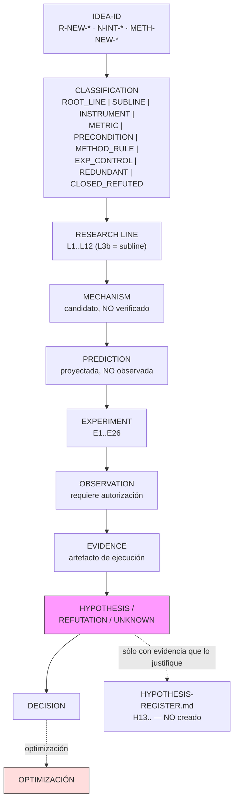
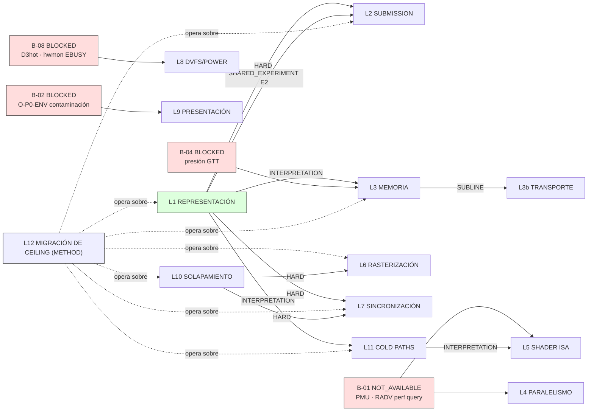

# RESEARCH LINES — jerarquía de investigación de la RX550

**CREATED** 2026-09-28 · **ORIGIN** refactorización del corpus de 184 IDs
**PRECURSOR** análisis de la ronda 2026-09-28, estado de salida `REFACTORED_ANALYSIS_ONLY`
**EJECUCIÓN** ninguna. Este documento no ejecuta, no mide y no demuestra.

---

## 0. Contract and Scope

### Qué representa una línea raíz

Una **línea raíz** (`ROOT_LINE`) es un *problema científico abierto* sobre esta RX550,
deliberadamente formulado para que una observación pueda refutarlo. Una línea root:

- tiene una `QUESTION` que hoy **no** tiene respuesta con evidencia;
- tiene un `MECHANISM` **candidato**, es decir una explicación causal propuesta, no verificada;
- tiene una `PREDICTION` y un `FALSIFIER` declarados **antes** de cualquier ejecución;
- no afirma que su mecanismo exista en el hardware;
- no afirma que su predicción sea cierta;
- no es una optimización, ni una receta, ni un parámetro que barrer.

### Qué NO representa

| No es | Por qué |
|---|---|
| Una línea raíz no es una hipótesis | Una hipótesis es una proposición falsable; una línea es un *problema* con varias hipótesis posibles aún no formuladas |
| Una línea raíz no es un experimento | Un experimento es una operación sobre una variable; una línea puede necesitar varios y ninguno basta |
| Una línea raíz no es una métrica | Una métrica resume; no explica ni predice |
| Una línea raíz no es un resultado | Un resultado es lo que se observa al ejecutar un experimento |
| Una clasificación documental no es un descubrimiento | Reordenar el corpus no añade conocimiento del hardware |

### Relación con `IDEA-REGISTER.md`

`IDEA-REGISTER.md` es la **fuente de verdad de los IDs**: conserva las 184 filas
originales, sus formulaciones literales y sus estados declarados por el autor.
Este documento es el **router jerárquico**: dice a qué línea pertenece cada ID y
por qué. Ninguna fila de `IDEA-REGISTER.md` se mueve, reordena, reescribe ni elimina.
`IDEA-REGISTER.md:1` declara `ORIGIN=IDEA_ORIGINAL_USUARIO` y
`IDEA-REGISTER.md:12` prohíbe que estas ideas se traten como hechos, conclusiones
o mejoras demostradas; este documento hereda esa prohibición.

### Relación con `HYPOTHESIS-REGISTER.md`

`00-INDICE/HYPOTHESIS-REGISTER.md` sigue siendo la **fuente de verdad de las
hipótesis** (H1–H12). Este documento **no crea H13** y no promueve ninguna línea
a hipótesis. Una línea sólo se convierte en hipótesis cuando un experimento
producido evidencia que justifique una proposición falsable explícita
(`IDEA-REGISTER.md:434-446` fija ese orden: IDEA → PREGUNTA → HIPÓTESIS → EXPERIMENTO → OBSERVACIÓN → CONCLUSIÓN → OPTIMIZACIÓN).

### Regla de no convertir preguntas en hechos

Toda afirmación de este documento lleva un nivel de evidencia explícito:
`FACT` (verificado con `file:line` o lectura de corpus), `OBSERVATION` (medido),
`DERIVATION` (inferido sólo desde FACT), `PREDICTION` (proyectado, no observado),
`DECISION` (regla metodológica adoptada), `LIMITATION`, `UNKNOWN`, `BLOCKED`,
`REFUTED`, `CLOSED`. La clasificación de un ID **no** cambia su nivel de evidencia:
un ID clasificado como `ROOT_LINE` sigue siendo exactamente lo que era, una
pregunta sin responder.

---

## 1. Research-Line Model

```
IDEA-ID                        (R-NEW-* · N-INT-* · METH-NEW-*)
   |
   +--> CLASSIFICATION          ROOT_LINE | SUBLINE | INSTRUMENT | METRIC |
   |                            PRECONDITION | METHOD_RULE |
   |                            EXPERIMENT_AUXILIARY_CONTROL | REDUNDANT |
   |                            ALREADY_CLOSED_REFUTED
   |
   +--> RESEARCH LINE           L1..L12   (L3b = SUBLINE de L3)
   |
   +--> SOURCE IDS / ATTACHED    SOURCE IDS = la pregunta de la línea es suya
   |                            ATTACHED  = opera dentro de ella sin serlo
   |
   +--> MECHANISM               causal, CANDIDATO, no verificado
   |
   +--> PREDICTION              proyectada, NO observada
   |
   +--> FALSIFIER               observación incompatible
   |
   +--> EXPERIMENT              E1..E26
   |
   +--> OBSERVABLE              magnitud que se mediría
   |
   +--> STATE                   EXECUTION_CANDIDATE | INVESTIGATION_REQUIRED |
   |                            BLOCKED | METHOD | FUSIONAR_EN_* | CLOSED | REFUTED
   |
   +--> BLOCKER / DEPENDENCY    B-01..B-07 · HARD | INTERPRETATION | SHARED_EXPERIMENT
   |
   +--> EVIDENCE                DOCUMENTO + SECCIÓN + file:line cuando existe
```

---

## 2. Root Research Lines

### L1 — REPRESENTACIÓN

- **ID** L1
- **DOMAIN** REPRESENTACIÓN
- **QUESTION** ¿Qué coste depende de cómo se representa el trabajo y no del trabajo lógico realizado?
- **MECHANISM** *(candidato)* El coste por unidad de representación —draw call, command buffer, descriptor, packing— se paga en capas distintas: driver de command submission, Translation Lookaside Buffer y MMU, TTM, y front-end del command processor. La representación decide cuántos de esos eventos ocurren por unidad de trabajo lógico.
- **PREDICTION** *(no observada)* A trabajo lógico fijo, el coste crece con el número de unidades de representación, y el coste marginal medido es del orden predicho por el camino estático de submission ya cerrado.
- **FALSIFIER** El coste marginal medido por draw es indistinguible de cero, o no correlaciona con el número de unidades de representación a trabajo lógico constante.
- **STATE** `EXECUTION_CANDIDATE`
- **DEPENDENCIES** `INTERPRETATION` sobre L3 (el working set es variable de control de L1). `SHARED_EXPERIMENT` con L2 en E2.
- **BLOCKERS** ninguno
- **SOURCE IDS** `N-INT-62` (raíz declarada por el autor), `R-NEW-12`, `R-NEW-13`, `R-NEW-85`, `R-NEW-86`, `R-NEW-91`, `R-NEW-92`, `R-NEW-93`, `N-INT-33`, `N-INT-34`, `N-INT-35`, `N-INT-36`, `N-INT-49`, `N-INT-50`, `N-INT-51`
- **ATTACHED IDS** `R-NEW-89` (PRECONDITION, capability audit) — condiciona L1 pero no es pregunta de L1.
- **SOURCE DOCUMENTS** `IDEA-REGISTER.md:12` (misma idea → pregunta → hipótesis → experimento → optimización), `:424` (N-INT-62 marcado raíz), `:71-87` (§1 RENDIMIENTO), `:232-241` (§16 VULKAN), `:388-396` (N-INT F), `:397-405` (N-INT I)
- **EVIDENCE** `FACT`: existe un camino de submission cerrado con `file:line` desde `amdgpu_cs_ioctl` (`amdgpu_cs.c:1438`) hasta el MMIO (`gfx_v8_0.c:6097-6102`). `LIMITATION`: un camino cerrado describe coste *posible*, no coste *dominante*.

### L2 — SUBMISSION CPU→GPU

- **ID** L2
- **DOMAIN** SUBMISSION
- **QUESTION** ¿Existe un régimen donde el coste de submission limita el rendimiento aunque la GPU no esté saturada?
- **MECHANISM** *(candidato)* El coste por submission se paga en la cadena ioctl → parser (9 etapas) → `amdgpu_job_alloc` → scheduler → `amdgpu_job_prepare_job`/`amdgpu_vmid_grab` → `amdgpu_job_run` → `amdgpu_ib_schedule` → `gfx_v8_0_ring_emit_ib_gfx`. El límite sería la tasa a la que el productor puede emitir.
- **PREDICTION** *(no observada)* Con la GPU ociosa, el frame time escala con la tasa de submissions, con pendiente igual al coste estático por job.
- **FALSIFIER** El frame time resulta independiente de la tasa de submission en el rango probado, o el hueco de GPU busy nunca aparece.
- **STATE** `EXECUTION_CANDIDATE`
- **DEPENDENCIES** `HARD` sobre L1 para formular el falsificador (necesita baseline invariante en representación)
- **BLOCKERS** ninguno directo. Contradicción abierta `CTD-02`.
- **SOURCE IDS** `R-NEW-13`, `R-NEW-22`, `R-NEW-23`, `R-NEW-24`, `R-NEW-25`, `N-INT-44`
- **ATTACHED IDS** `R-NEW-17`, `R-NEW-20` (EXPERIMENT_AUXILIARY_CONTROL) — son controles de E5, no preguntas de L2.
- **SOURCE DOCUMENTS** `IDEA-REGISTER.md:89-99` (§2), `:100-110` (§3 H8 STARVATION), `HYPOTHESIS-REGISTER.md:152-162` (H8), `00-INDICE/DIAGRAMAS/02-HIPOTESIS-H1-H12.md` (H8 conserva CONFLICTS)
- **EVIDENCE** `FACT`: `IDEA-REGISTER.md:89` marca `R-NEW-15` como «NO ES IDEA. CRITERIO DE RESULTADO» y `:89` marca `R-NEW-21` como «NO ES IDEA. MÉTRICA/CLASIFICADOR» con la advertencia «busy alto + FPS bajo **no** demuestra starvation». `CONTRADICTION`: `CTD-02` en `IDEA-REGISTER.md:462` sigue abierta.

### L3 — MEMORIA Y TRANSICIÓN DE CEILING

- **ID** L3
- **DOMAIN** MEMORIA
- **QUESTION** ¿Cómo cambia el rendimiento cuando el working set pasa de local/cache-resident a memory-bound y eventualmente a presión de VRAM/GTT?
- **MECHANISM** *(candidato)* El working set atraviesa escalones con costes distintos: caché de textura, VRAM, y desbordamiento a GART sobre PCIe. Cada escalón cambia el camino de acceso y añade transiciones de tipo de memoria.
- **PREDICTION** *(no observada)* Rendimiento continuo dentro de cada escalón y **discontinuidad** al cruzar la frontera VRAM→GTT. La predicción de acantilado es `R-NEW-46`; la versión fuerte es falsable.
- **FALSIFIER** La curva es plana y continua a través de la frontera, o la frontera no es alcanzable en el rango disponible.
- **STATE** `EXECUTION_CANDIDATE` con una pierna `BLOCKED`
- **DEPENDENCIES** `INTERPRETATION` sobre L1
- **BLOCKERS** `B-04` para E9
- **SOURCE IDS** `R-NEW-07`, `R-NEW-08`, `R-NEW-09`, `R-NEW-10`, `R-NEW-11`, `R-NEW-41`, `R-NEW-42`, `R-NEW-43`, `R-NEW-44`, `R-NEW-45`, `R-NEW-46`, `N-INT-09`, `N-INT-10`, `N-INT-11`, `N-INT-12`, `N-INT-13`, `N-INT-16`, `N-INT-17`, `N-INT-18`, `N-INT-48`
- **SOURCE DOCUMENTS** `IDEA-REGISTER.md:139-149` (§7 VRAM/GTT/SPILLING), `:314-325` (N-INT B), `:326-335` (N-INT C), `HYPOTHESIS-REGISTER.md:130-140` (H6)
- **EVIDENCE** `FACT`: hardware verificado — VRAM 2 147 483 648 B, visible 2 147 483 648 B en total con GART 6 194 638 848 B (`journalctl -k`, `amdgpu 0000:01:00.0: VRAM: 2048M … GART: 256M … 0x000000FF00000000`). `FACT`: `IDEA-REGISTER.md:145` marca `R-NEW-43` «BUENA — requiere observar residency». `OBSERVATION` 2026-09-28: la observabilidad de residencia está disponible (ver §6). `CONTRADICTION`: `CTD-06` (`IDEA-REGISTER.md:467`) marca `R-NEW-42` histéresis de VRAM como `ESPECULATIVA` — no asumir histéresis.

### L3b — TRANSPORTE (SUBLINE de L3)

- **ID** L3b
- **DOMAIN** TRANSPORTE
- **QUESTION** ¿Cuánto cuesta el estado del enlace PCIe en las ráfagas de submission y de subida?
- **MECHANISM** *(candidato)* El coste depende del estado del enlace (velocidad, ASPM) y del patrón de transferencia (tamaño, ráfaga), con un coste de latencia no lineal en el umbral.
- **PREDICTION** *(no observada)* El coste de submission y de subida crece no linealmente al cruzar umbrales de tamaño de transferencia.
- **FALSIFIER** Sin cambio medible al variar el tamaño de transferencia manteniendo los bytes totales.
- **STATE** `INVESTIGATION_REQUIRED`
- **DEPENDENCIES** `SUBLINE` de L3
- **BLOCKERS** rango de enlace limitado por el root port (ver EVIDENCE)
- **SOURCE IDS** `R-NEW-37`, `R-NEW-38`, `R-NEW-39`, `R-NEW-40`
- **SOURCE DOCUMENTS** `IDEA-REGISTER.md:130-138` (§6 ASPM/PCIe)
- **EVIDENCE** `FACT`: enlace negociado ×4 a 5.0 GT/s con endpoint ×8 a 8.0 GT/s, y root port `0000:00:01.0` con máximo 5.0 GT/s. `LIMITATION`: esa limitación acota el rango experimental alcanzable y no es una propiedad corregible sin cambio de hardware.

### L4 — PARALELISMO / LATENCY HIDING

- **ID** L4
- **DOMAIN** PARALELISMO
- **QUESTION** ¿Está el rendimiento limitado por latencia de memoria o de ejecución que puede ocultarse mediante ILP, MLP u occupancy?
- **MECHANISM** *(candidato)* El grado de ocultación depende de la distancia load→use, la dependencia entre operaciones, el número de accesos en vuelo y la ocupación de la unidad de ejecución.
- **PREDICTION** *(no observada)* Dos shaders con igual FLOP y distinto ILP producen tiempos distintos; una métrica de eficiencia de ocultación separa ambos.
- **FALSIFIER** El barrido de ILP no mueve el reloj, o no hay diferencia entre configuraciones de ILP con el mismo trabajo matemático.
- **STATE** `BLOCKED`
- **DEPENDENCIES** `HARD` sobre B-01
- **BLOCKERS** `B-01`
- **SOURCE IDS** `R-NEW-06`, `R-NEW-63`, `R-NEW-64`, `R-NEW-65`, `N-INT-01`, `N-INT-02`, `N-INT-03`, `N-INT-05`, `N-INT-14`, `N-INT-15`
- **SOURCE DOCUMENTS** `IDEA-REGISTER.md:181-192` (§11 SHADER/ACO), `:301-313` (N-INT A), `:314-325` (N-INT B)
- **EVIDENCE** `NOT_AVAILABLE`: PMU mainline GFX8 ausente de `amdgpu_pmu_init()` y `VK_KHR_performance_query` no anunciado para GFX8 en RADV (`COUNTERS-ASIC-…ADDENDUM:75,77`). `LIMITATION`: sin contadores HW, el ILP y la ocupación no son observables; sólo son inferibles desde tiempo de frame, lo que no distingue las causas.

### L5 — REPRESENTACIÓN MICROARQUITECTURAL DEL SHADER

- **ID** L5
- **DOMAIN** SHADER ISA
- **QUESTION** ¿Dos shaders con el mismo trabajo matemático pueden producir comportamientos distintos por instruction mix, dependencia, lifetime de registros, o reparto SGPR/VGPR?
- **MECHANISM** *(candidato)* El coste real lo determina la mezcla de instrucciones y el lifetime de registros, no el recuento de FLOP; el recuento de registros y su *lifetime* son variables distintas (`N-INT-04`).
- **PREDICTION** *(no observada)* El coste no es proporcional a FLOP: cambiar el lifetime sin cambiar el número de registros altera el reloj.
- **FALSIFIER** El reloj sigue a FLOP con independencia de la mezcla de instrucciones.
- **STATE** `BLOCKED`
- **DEPENDENCIES** `HARD` sobre B-01
- **BLOCKERS** `B-01`
- **SOURCE IDS** `R-NEW-05`, `R-NEW-66`, `R-NEW-67`, `R-NEW-68`, `N-INT-04`, `N-INT-06`, `N-INT-07`, `N-INT-08`
- **SOURCE DOCUMENTS** `IDEA-REGISTER.md:181-192`, `:301-313` (N-INT A)
- **EVIDENCE** `NOT_AVAILABLE`: mismo bloqueo que L4. `LIMITATION`: `IDEATION-ROUND-02.md:597` marca `L-03` como «el bloque SIMD citado es de GCN general; no verificado que RX550/Polaris12 tenga idéntico conteo de TFU/LDS» — `EXTERNAL_KNOWLEDGE`, no evidencia local.

### L6 — RASTERIZACIÓN Y COMPLEJIDAD GEOMÉTRICA

- **ID** L6
- **DOMAIN** RASTERIZACIÓN
- **QUESTION** ¿Cómo cambian los costes con overdraw, tamaño de primitiva, Early-Z, MSAA, carga de fragmento y complejidad de rasterización?
- **MECHANISM** *(candidato)* El coste por fragmento *shaded* depende de la tasa de acierto del discriminator Early-Z, de la amplificación por primitivas pequeñas y de la presión sobre ROP; MSAA multiplica el trabajo de muestra.
- **PREDICTION** *(no observada)* Overdraw y MSAA elevan el coste de forma no lineal; el orden front-to-back activa Early-Z y reduce trabajo de fragmento.
- **FALSIFIER** Overdraw no mueve el reloj, o el orden de drawing no altera el coste medible.
- **STATE** `EXECUTION_CANDIDATE`
- **DEPENDENCIES** ninguna dura
- **BLOCKERS** ninguno
- **SOURCE IDS** `R-NEW-01`, `R-NEW-02`, `R-NEW-70`, `R-NEW-71`, `R-NEW-73`, `R-NEW-74`, `N-INT-19`, `N-INT-20`, `N-INT-21`, `N-INT-22`, `N-INT-23`, `N-INT-24`, `N-INT-25`
- **SOURCE DOCUMENTS** `IDEA-REGISTER.md:71-88` (§1), `:193-202` (§12 MSAA/RASTER/ROP), `:336-345` (N-INT D), `…/POLARIS12-MAP/EXPERIMENT-CANDIDATES.md:165-204` (F-01..F-04)
- **EVIDENCE** `LIMITATION`: Early-Z en GFX8 es una hipótesis a validar, no asumir — `IDEA-REGISTER.md:349` marca `N-INT-24` «hipótesis a validar, no asumir». `OBSERVATION` 2026-09-28: la observabilidad de frame time no depende del estado de suspensión, por lo que L6 no hereda el bloqueo de B-08.

### L7 — SINCRONIZACIÓN

- **ID** L7
- **DOMAIN** SINCRONIZACIÓN
- **QUESTION** ¿Qué parte del coste proviene de barreras, dependencias, scope, máscaras de stage/acceso, batching y distancia temporal entre productor y consumidor?
- **MECHANISM** *(candidato)* El coste de dependencia escala con el número de barreras, la amplitud de su scope y la distancia entre el trabajo productor y el consumidor que lo necesita.
- **PREDICTION** *(no observada)* Estrechar el scope de una barrera de `ALL_COMMANDS` a scope específico reduce el frame time a trabajo idéntico.
- **FALSIFIER** Estrechar el scope no cambia nada, o el workload no está limitado por sincronización.
- **STATE** `EXECUTION_CANDIDATE`
- **DEPENDENCIES** `HARD` sobre L1 (el alcance de las barreras es en sí una representación)
- **BLOCKERS** ninguno
- **SOURCE IDS** `R-NEW-77`, `R-NEW-78`, `R-NEW-90`, `N-INT-26`, `N-INT-27`, `N-INT-28`, `N-INT-29`, `N-INT-30`, `N-INT-31`, `N-INT-32`
- **SOURCE DOCUMENTS** `IDEA-REGISTER.md:203-212` (§13), `:346-357` (N-INT E), `…/EXPERIMENT-CANDIDATES.md:245-264` (A-01, A-02)
- **EVIDENCE** `FACT`: el camino de sincronización en el driver está cerrado con `file:line` — `amdgpu_cs_sync_rings` (`amdgpu_cs.c:1211`) → `amdgpu_sync_push_to_job` (`:1242`) → `drm_sched_job_add_dependency` (`amdgpu_sync.c:449`), y el scheduler serializa por entidad (`sched_entity.c:549-552`). `LIMITATION`: camino cerrado ≠ coste medido.

### L8 — DVFS / MCLK / POWER

- **ID** L8
- **DOMAIN** DVFS/POWER
- **QUESTION** ¿Cómo cambia el rendimiento, energía, temperatura y latencia cuando cambia el estado dinámico de frecuencia y potencia?
- **MECHANISM** *(candidato)* Las transiciones de SCLK/MCLK y el estado DPM alteran el coste por unidad de trabajo; la respuesta a frecuencia puede tener histéresis y coste de transición.
- **PREDICTION** *(no observada)* Curva de respuesta con histéresis y coste de transición no nulo.
- **FALSIFIER** La respuesta es plana y sin histéresis en el rango explorable.
- **STATE** `INVESTIGATION_REQUIRED`; rama del cap `ALREADY_CLOSED_REFUTED`
- **DEPENDENCIES** `HARD` sobre B-08 (dispositivo despierto) y B-03 (forcing)
- **BLOCKERS** `B-03`, `B-06`, `B-08`
- **SOURCE IDS** `R-NEW-47`, `R-NEW-48`, `R-NEW-49`, `R-NEW-50`, `R-NEW-51`, `R-NEW-52`, `R-NEW-53`, `R-NEW-54`, `R-NEW-55`, `R-NEW-57`, `R-NEW-58`, `R-NEW-59`, `R-NEW-60`, `R-NEW-61`, `R-NEW-104`, `R-NEW-105`, `R-NEW-106`, `N-INT-56`, `N-INT-57`, `N-INT-60`
- **ATTACHED IDS** `R-NEW-107` (METRIC), `N-INT-58`, `N-INT-59` (METRIC) — operan dentro de L8 sin ser preguntas suyas. `R-NEW-53..55` y `R-NEW-57` son preguntas de L8 ya refutadas: siguen en `SOURCE IDS` con estado `REFUTED`, no se archivaron.
- **SOURCE DOCUMENTS** `IDEA-REGISTER.md:150-170` (§8 MCLK/DPM, §9 POWER CAP), `:171-180` (§10 TEMPERATURA), `:262-270` (§19 POWER PROFILES), `:406-415` (N-INT K), `HYPOTHESIS-REGISTER.md:75-151` (H1–H7)
- **EVIDENCE** `REFUTED`: la rama del cap de potencia. M1 completó con ΔFPS=[0,0,0,0,0] y ΔSCLK=[0,0,0,0,0], compuerta `<27 W` activada, clasificado `NO DISCRIMINATIVO` (`00-INDICE/experiments_proposed.md`). H1 y H2 registradas `REFUTADA` (`02-ARQUITECTURA/hypotheses.md`). H3 `SOPORTADA` (W_SMU es estimador SMU, no vatímetro). `CONTRADICTION`: `GAP-09` — las 5 familias de cap dependen de una carga >13,6 W que el corpus nunca alcanzó (`IDEATION-ROUND-02.md:581`). `BLOCKED` nuevo: `B-08`.

### L9 — PRESENTACIÓN / FRAME PACING

- **ID** L9
- **DOMAIN** PRESENTACIÓN
- **QUESTION** ¿El rendimiento observado por el usuario está limitado por ejecución GPU, presentación, WSI, cola de frames o distribución temporal de frame-times?
- **MECHANISM** *(candidato)* El frame time del usuario incluye al menos tres términos separables: trabajo GPU, completado de frame en el compositor, y espera de presentación. La suma no se comporta como cualquiera de sus partes.
- **PREDICTION** *(no observada)* El frame time del usuario incluye un término de presentación independiente del trabajo de la RX550, separable por construcción.
- **FALSIFIER** El frame time resulta idéntico con y sin presentación, o el término de presentación es despreciable en este host.
- **STATE** `BLOCKED`
- **DEPENDENCIES** `HARD` sobre B-02
- **BLOCKERS** `B-02`
- **SOURCE IDS** `R-NEW-03`, `R-NEW-04`, `R-NEW-26`, `R-NEW-27`, `R-NEW-28`, `R-NEW-29`, `R-NEW-30`, `R-NEW-31`, `R-NEW-83`, `N-INT-40`, `N-INT-41`, `N-INT-42`, `N-INT-43`
- **SOURCE DOCUMENTS** `IDEA-REGISTER.md:110-120` (§3), `:121-130` (§4 H12 PRESENTACIÓN), `:370-379` (N-INT G), `HYPOTHESIS-REGISTER.md:196-207` (H12)
- **EVIDENCE** `FACT`: el panel activo está en el controlador Intel y la RX550 no tiene salidas conectadas, luego toda la presentación de la RX550 ocurre vía WSI, no por scanout directo. `FACT`: `R-NEW-26` («GPU DONE ≠ PRESENT READY ≠ FRAME DISPLAYED») marcado **MUY BUENA** por el autor (`IDEA-REGISTER.md:119`). `BLOCKED`: `O-P0-ENV` terminó en `CONTAMINATED_REQUIRES_ISOLATION` con clientes `Xwayland`/`ChatGPT` abiertos (`02-ARQUITECTURA/open_questions.md:13`).

### L10 — ASYNC COMPUTE / SOLAPAMIENTO

- **ID** L10
- **DOMAIN** SOLAPAMIENTO
- **QUESTION** ¿Qué combinación de recursos deja margen para solapamiento entre gráficos, cómputo y copia?
- **MECHANISM** *(candidato)* La complementariedad de recursos entre unidades de cómputo, colas de cómputo y motor de copia determina si el solapamiento produce beneficio o interferencia.
- **PREDICTION** *(no observada)* Una carga de cómputo complementaria reduce el frame time; pasado cierto punto aparece interferencia.
- **FALSIFIER** Ninguna combinación de recursos produce solapamiento medible.
- **STATE** `EXECUTION_CANDIDATE`
- **DEPENDENCIES** `HARD` sobre `R-NEW-76` (precondición, no variable)
- **BLOCKERS** ninguno
- **SOURCE IDS** `R-NEW-75`, `R-NEW-80`, `R-NEW-81`, `R-NEW-82`, `N-INT-45`, `N-INT-46`, `N-INT-47`
- **ATTACHED IDS** `R-NEW-76` (PRECONDITION), `R-NEW-79` (METRIC) — `R-NEW-75` y `R-NEW-82` son `REDUNDANT` con destino de fusión dentro de L10, por eso figuran en `SOURCE IDS` y no en `ATTACHED`.
- **SOURCE DOCUMENTS** `IDEA-REGISTER.md:203-212` (§13 GRÁFICOS+CÓMPUTO), `:213-220` (§14 SDMA/COPY), `:380-387` (N-INT H)
- **EVIDENCE** `LIMITATION`: `IDEA-REGISTER.md:79` declara `R-NEW-76` «PRECONDICIÓN, NO IDEA» y `:79` `R-NEW-79` «NO INDEPENDIENTE. Criterio emergente de A-01»; ambas no se debucean como variables.

### L11 — COLD PATHS

- **ID** L11
- **DOMAIN** COLD PATHS
- **QUESTION** ¿Qué parte del primer frame o de una transición de workload proviene de compilación, cachés, despertar de runtime PM, allocation, upload o creación de pipeline?
- **MECHANISM** *(candidato)* El primer frame descompone en una suma de términos causales —despertar de PM, compilación de shader, creación de pipeline, reserva de descriptors, subida de recursos, y WSI— cada uno con un peso y una duración distintos, y ninguno presente en el estado caliente.
- **PREDICTION** *(no observada)* El primer frame se descompone en términos con pesos medibles y reproducibles; el mismo workload en estado caliente no los presenta.
- **FALSIFIER** El primer frame es indistinguible del estado estable, o ningún término domina.
- **STATE** `EXECUTION_CANDIDATE`
- **DEPENDENCIES** `INTERPRETATION` sobre L1 y L5
- **BLOCKERS** `B-05` para el discriminante de `O-BOT` vía perf stat; el resto no bloqueado
- **SOURCE IDS** `R-NEW-32`, `R-NEW-33`, `R-NEW-34`, `R-NEW-36`, `R-NEW-69`, `R-NEW-84`, `N-INT-37`, `N-INT-38`, `N-INT-39`
- **SOURCE DOCUMENTS** `IDEA-REGISTER.md:121-130` (§4), `:130-139` (§5 RUNTIME PM), `:181-192` (§11), `:221-231` (§15 MESA), `:358-369` (N-INT F), `HYPOTHESIS-REGISTER.md:108-118` (H4)
- **EVIDENCE** `FACT`: `N-INT-39` marcada «MUY FUERTE» (`IDEA-REGISTER.md:366`) y `REFORMULA` de `R-NEW-32/33`. `FACT`: H4 (runtime PM y primer frame) es la única del registro H1–H12 que no aparece ni como `REFUTADA` ni como bloqueada por escritura privilegiada. `LIMITATION`: `IDEA-REGISTER.md:122` advierte que `R-NEW-33` es «causalmente ambiciosa: primer frame no demuestra PM».

### L12 — MIGRACIÓN DEL CUELLO DE BOTELLA (METHOD)

- **ID** L12
- **DOMAIN** METODOLÓGICA
- **QUESTION** Cuando se elimina o reduce un ceiling, ¿qué ceiling pasa a dominar?
- **MECHANISM** *(regla, no mecanismo de hardware)* Bucle: medir → identificar el ceiling actual → perturbar **sólo** ese mecanismo → medir → ¿desapareció? NO: refutar o reformular. SÍ: hay un nuevo ceiling → nueva hipótesis.
- **PREDICTION** *(metodológica)* Cada intervención desplaza el dominio dominante del ceiling, y el desplazamiento es predecible a partir del modelo.
- **FALSIFIER** Un ceiling removido deja el rendimiento invariado, lo que refutaría el modelo de techo único y obligaría a buscar un factor común no modelado.
- **STATE** `METHOD`
- **DEPENDENCIES** opera sobre todas las demás líneas
- **BLOCKERS** ninguno
- **SOURCE IDS** `N-INT-52`, `N-INT-54`, `N-INT-61`
- **ATTACHED IDS** `N-INT-53`, `N-INT-55` (METRIC) — métricas del bucle de ceilings, no preguntas suyas.
- **SOURCE DOCUMENTS** `IDEA-REGISTER.md:397-405` (N-INT J), `:416-422` (N-INT L), `METH-NEW-04`, `METH-NEW-05`, `METH-NEW-15`
- **EVIDENCE** `FACT`: `N-INT-61` marcada por el autor como «LA MÁS POTENTE» con el bucle explícito (`IDEA-REGISTER.md:420`). `DECISION`: se clasifica como `METHOD` y **no** entra en la selección de candidatos, para no atribuirle valor discriminante experimental que no tiene.

---

## 3. Classification Outside Root Lines

Estas clases existen para que el corpus no crezca artificialmente. Ninguna se convierte en línea científica por acumulación de IDs.

| Clase | Definición | Por qué no es línea raíz | IDs |
|---|---|---|---|
| `METHOD_RULE` | Regla de ideación, evaluación o falsación, no afirmación sobre la RX550 | Un método no predice nada del hardware por sí mismo | `METH-NEW-01..15`, `R-NEW-102` |
| `INSTRUMENT` | Infraestructura de medición, calibración o validación | Produce un número; no explica el número | `R-NEW-94..101`, `R-NEW-103`, `R-NEW-88`, `D2-02`, `D2-13` |
| `METRIC` | Resumen que agrega sin mecanismo | Un valor alto de FPS/W no distingue causa, utilidad ni estabilidad | `R-NEW-15`, `R-NEW-21`, `R-NEW-56`, `R-NEW-79`, `R-NEW-107`, `N-INT-53`, `N-INT-58`, `N-INT-59` |
| `PRECONDITION` | Condición que debe cumplirse antes de que una línea sea testeable, no una variable | Cambiarla no produce una predicción nueva | `R-NEW-76`, `R-NEW-89` |
| `EXPERIMENT_AUXILIARY_CONTROL` | Control o variable auxiliar de otro experimento | Existe para aislar la variable de otro experimento | `R-NEW-17`, `R-NEW-19`, `R-NEW-20`, `R-NEW-35`, `R-NEW-62`, `R-NEW-96`, `R-NEW-97`, `R-NEW-98`, `D2-11` |
| `REDUNDANT` | Duplica el mecanismo de otro ID | Añadirlo no añade una hipótesis distinguishable | `R-NEW-08`, `R-NEW-09`, `R-NEW-10`, `R-NEW-14`, `R-NEW-16`, `R-NEW-18`, `R-NEW-35`, `R-NEW-62`, `R-NEW-65`, `R-NEW-72`, `R-NEW-75`, `R-NEW-82` |
| `ALREADY_CLOSED_REFUTED` | El mecanismo fue refutado con evidencia en esta plataforma | Reabrirlo requiere evidencia nueva, no una idea nueva | `R-NEW-53`, `R-NEW-54`, `R-NEW-55`, `R-NEW-57` (cap); `R-NEW-60` (deuda térmica) |

`PARAMETER_VARIATION`: barridos que sólo cambian tamaño, frecuencia, cantidad, resolución, número de draws, número de layers, cap o temperatura **sin cambiar el mecanismo** se clasifican como `EXPERIMENT` de la línea a la que pertenecen, nunca como idea raíz nueva. Regla del autor, `IDEA-REGISTER.md:60` (`ideas.txt:368`): «no crear nueva IDEA cuando solo cambia parámetro experimental, salvo que introduzca mecanismo causal distinto».

---

## 4. Complete ID Mapping

`ORIGINAL_TYPE`: `R` = idea del usuario · `N` = idea internacional del usuario · `M` = regla metodológica.
184 filas. Ningún ID de `IDEA-REGISTER.md` se elimina, mueve ni reescribe.

| ID | ORIGINAL_TYPE | NEW_CLASSIFICATION | ROOT_LINE | SUBLINE | EXPERIMENT | STATUS | RATIONALE | SOURCE |
|---|---|---|---|---|---|---|---|---|
| `R-NEW-01` | R | EXPERIMENT | L6 | — | E14 | EXECUTION_CANDIDATE | Descomponer coste por etapa de shader | §1 |
| `R-NEW-02` | R | EXPERIMENT | L6 | — | E14 | EXECUTION_CANDIDATE | Capas no son variable causal universal; se reformula como coste de raster | §1 |
| `R-NEW-03` | R | EXPERIMENT | L9 | — | E21 | BLOCKED | Father de tres fenómenos distintos; bloqueado por B-02 | §1 |
| `R-NEW-04` | R | EXPERIMENT | L9 | — | E21 | BLOCKED | VARIANT_OF H11 | §1 |
| `R-NEW-05` | R | EXPERIMENT | L5 | — | E13 | BLOCKED | «oversubscription» ambiguo sin definir recurso | §1 |
| `R-NEW-06` | R | EXPERIMENT | L4 | — | E12 | BLOCKED | Barrido de intensidad aritmética; roofline memoria-vs-cómputo | §1 |
| `R-NEW-07` | R | EXPERIMENT | L3 | — | E8 | EXECUTION_CANDIDATE | Padre de R-NEW-08; patrón de acceso a memoria | §1 |
| `R-NEW-08` | R | REDUNDANT | L3 | — | E8 | FUSIONAR_EN_E7 | SUBIDEA de R-NEW-07 | §1 |
| `R-NEW-09` | R | REDUNDANT | L3 | — | E8 | FUSIONAR_EN_E8 | DUPLICATE de H6/M-01, barrido de umbral de tamaño | §1 |
| `R-NEW-10` | R | REDUNDANT | L3 | — | E8 | FUSIONAR_EN_E8 | SUBIDEA de R-NEW-09 | §1 |
| `R-NEW-11` | R | EXPERIMENT | L3 | — | E8 | EXECUTION_CANDIDATE | Presión de VBO/IBO | §1 |
| `R-NEW-12` | R | EXPERIMENT | L1 | — | E1 | EXECUTION_CANDIDATE | Mismo resultado lógico, distinta representación | §1 |
| `R-NEW-13` | R | EXPERIMENT | L1 | — | E1 | EXECUTION_CANDIDATE | Padre de R-NEW-14/15/16/18; densidad de draw calls | §1 |
| `R-NEW-14` | R | REDUNDANT | — | — | E1 | FUSIONAR_EN_E1 | DUPLICATE_OF R-NEW-13 declarado por el autor | §1 |
| `R-NEW-15` | R | METRIC | — | — | E1 | NONE | Autor: «NO ES IDEA. CRITERIO DE RESULTADO» | §1 |
| `R-NEW-16` | R | REDUNDANT | — | — | E2 | FUSIONAR_EN_E2 | DUPLICATE de R-NEW-13 | §2 |
| `R-NEW-17` | R | EXPERIMENT_AUXILIARY_CONTROL | L2 | — | E5 | CONTROL | Autor: «EXPERIMENTO AUXILIAR»; control de envío | §2 |
| `R-NEW-18` | R | REDUNDANT | — | — | E2 | FUSIONAR_EN_E2 | DUPLICATE de R-NEW-13/14 | §2 |
| `R-NEW-19` | R | EXPERIMENT_AUXILIARY_CONTROL | — | — | — | NONE | Autor: «DÉBIL PARA RX550. CARACTERIZACIÓN DE ENTORNO»; no es propiedad de la GPU | §2 |
| `R-NEW-20` | R | EXPERIMENT_AUXILIARY_CONTROL | L2 | — | E5 | CONTROL | Control de frecuencia de CPU | §2 |
| `R-NEW-21` | R | METRIC | — | — | E5 | NONE | Autor: «NO ES IDEA. MÉTRICA/CLASIFICADOR»; busy alto + FPS bajo no demuestra starvation | §2 |
| `R-NEW-22` | R | EXPERIMENT | L2 | — | E5 | EXECUTION_CANDIDATE | Distribución de duración de busy | §3 |
| `R-NEW-23` | R | EXPERIMENT | L2 | — | E5 | EXECUTION_CANDIDATE | Correlación de fase busy/FPS; requiere sincronía precisa | §3 |
| `R-NEW-24` | R | EXPERIMENT | L2 | — | E5 | EXECUTION_CANDIDATE | Padre de R-NEW-25; latencia de fence | §3 |
| `R-NEW-25` | R | EXPERIMENT | L2 | — | E5 | EXECUTION_CANDIDATE | Latencia submit-to-fence | §3 |
| `R-NEW-26` | R | EXPERIMENT | L9 | — | E21 | BLOCKED | «GPU DONE ≠ PRESENT READY ≠ FRAME DISPLAYED»; autor MUY BUENA | §3 |
| `R-NEW-27` | R | EXPERIMENT | L9 | — | E21 | BLOCKED | Workload sin presentación | §4 |
| `R-NEW-28` | R | EXPERIMENT | L9 | — | E21 | BLOCKED | Modo de presentación; depende del stack | §4 |
| `R-NEW-29` | R | EXPERIMENT | L9 | — | E21 | BLOCKED | Autor: «AMARILLA — acoplada a compositor/WSI» | §4 |
| `R-NEW-30` | R | EXPERIMENT | L9 | — | E21 | BLOCKED | Profundidad de cola de frames | §4 |
| `R-NEW-31` | R | EXPERIMENT | L9 | — | E21 | BLOCKED | VARIANT_OF R-NEW-30; «DÉBIL/DEPENDIENTE DEL STACK» | §4 |
| `R-NEW-32` | R | EXPERIMENT | L11 | — | E24 | EXECUTION_CANDIDATE | Padre de R-NEW-33; primer frame vs estado estable | §4 |
| `R-NEW-33` | R | EXPERIMENT | L11 | — | E25 | EXECUTION_CANDIDATE | SUBIDEA de R-NEW-32; «causalmente ambiciosa» | §5 |
| `R-NEW-34` | R | EXPERIMENT | L11 | — | E25 | EXECUTION_CANDIDATE | «mejor forma de atacar H4» | §5 |
| `R-NEW-35` | R | REDUNDANT | — | — | E25 | FUSIONAR_EN_E34 | DUPLICATE de R-NEW-34 | §5 |
| `R-NEW-36` | R | EXPERIMENT | L11 | — | E25 | INVESTIGATION_REQUIRED | Autor: «SOSPECHOSA»; CTD-06; no asumir histéresis | §5 |
| `R-NEW-37` | R | EXPERIMENT | L3b | L3 | E11 | INVESTIGATION_REQUIRED | Padre de R-NEW-38; estado de enlace PCIe | §6 |
| `R-NEW-38` | R | EXPERIMENT | L3b | L3 | E11 | INVESTIGATION_REQUIRED | SUBIDEA de R-NEW-37 | §6 |
| `R-NEW-39` | R | EXPERIMENT | L3b | L3 | E11 | INVESTIGATION_REQUIRED | SUBIDEA de R-NEW-40 | §6 |
| `R-NEW-40` | R | EXPERIMENT | L3b | L3 | E11 | INVESTIGATION_REQUIRED | Padre de R-NEW-39; escalera de throughput | §6 |
| `R-NEW-41` | R | EXPERIMENT | L3 | — | E8 | EXECUTION_CANDIDATE | Escalera de working set; ya implícita en H6 | §7 |
| `R-NEW-42` | R | EXPERIMENT | L3 | — | E8 | INVESTIGATION_REQUIRED | Autor: «ESPECULATIVA»; CTD-06; no asumir histéresis | §7 |
| `R-NEW-43` | R | EXPERIMENT | L3 | — | E10 | EXECUTION_CANDIDATE | Churn de residencia; observabilidad verificada §6 | §7 |
| `R-NEW-44` | R | EXPERIMENT | L3 | — | E10 | EXECUTION_CANDIDATE | Autor: «NO ES VRAM PRESSURE. Resource-management overhead. Separar» | §7 |
| `R-NEW-45` | R | EXPERIMENT | L3 | — | E8 | EXECUTION_CANDIDATE | Comparación VRAM/GTT a misma capacidad | §7 |
| `R-NEW-46` | R | EXPERIMENT | L3 | — | E9 | BLOCKED | Acantilado de spilling; «cliff» es predicción fuerte | §7 |
| `R-NEW-47` | R | EXPERIMENT | L8 | — | E20 | INVESTIGATION_REQUIRED | «forma menos peligrosa de H7»; no requiere forzar | §8 |
| `R-NEW-48` | R | EXPERIMENT | L8 | — | E20 | INVESTIGATION_REQUIRED | Latencia de transición MCLK; necesita sampling | §8 |
| `R-NEW-49` | R | EXPERIMENT | L8 | — | E20 | INVESTIGATION_REQUIRED | Autor: «DEMASIADO PRONTO — primero demostrar transiciones» | §8 |
| `R-NEW-50` | R | EXPERIMENT | L8 | — | E20 | INVESTIGATION_REQUIRED | Clasificador de workload para MCLK | §8 |
| `R-NEW-51` | R | EXPERIMENT | L8 | — | E20 | INVESTIGATION_REQUIRED | Independencia SCLK/MCLK | §8 |
| `R-NEW-52` | R | EXPERIMENT | L8 | — | E20 | INVESTIGATION_REQUIRED | Autor: «DEMASIADO FUERTE» → reformular a efectos temporales | §8 |
| `R-NEW-53` | R | ALREADY_CLOSED_REFUTED | L8 | — | — | REFUTED | Curva de sensibilidad al cap; FUSIONAR con 54/55 | §9 |
| `R-NEW-54` | R | ALREADY_CLOSED_REFUTED | L8 | — | — | REFUTED | SUBIDEA de 53 | §9 |
| `R-NEW-55` | R | ALREADY_CLOSED_REFUTED | L8 | — | — | REFUTED | SUBIDEA de 53 | §9 |
| `R-NEW-56` | R | METRIC | — | — | — | NONE | Autor: «NO ES HIPÓTESIS. MÉTRICA — FPS/W oculta utilidad/calidad/latencia/estabilidad»; sustituida por N-INT-58/59 | §9 |
| `R-NEW-57` | R | ALREADY_CLOSED_REFUTED | L8 | — | — | REFUTED | Consecuencia de 53, no independiente; cap no liga | §9 |
| `R-NEW-58` | R | EXPERIMENT | L8 | — | E20 | INVESTIGATION_REQUIRED | Constante de tiempo térmica | §10 |
| `R-NEW-59` | R | EXPERIMENT | L8 | — | E20 | INVESTIGATION_REQUIRED | DERIVED_FROM R-NEW-58 | §10 |
| `R-NEW-60` | R | ALREADY_CLOSED_REFUTED | L8 | — | E20 | REFUTED | Deuda térmica; EP-06 no reprodujo a 70-71 °C | §10 |
| `R-NEW-61` | R | EXPERIMENT | L8 | — | E20 | INVESTIGATION_REQUIRED | «MUY INTERESANTE — prueba path dependence» | §10 |
| `R-NEW-62` | R | REDUNDANT | — | — | E20 | FUSIONAR_EN_E60_E61 | DUPLICATE de R-NEW-60/61 | §10 |
| `R-NEW-63` | R | EXPERIMENT | L4 | — | E12 | BLOCKED | Barrido de ILP | §11 |
| `R-NEW-64` | R | EXPERIMENT | L4 | — | E12 | BLOCKED | Matriz occupancy vs ILP; «MUY BUENA» | §11 |
| `R-NEW-65` | R | REDUNDANT | L4 | — | E12 | BLOCKED | SUBIDEA de R-NEW-63/64 | §11 |
| `R-NEW-66` | R | EXPERIMENT | L5 | — | E13 | BLOCKED | «BUENA, peligrosa semánticamente»; ancho de precisión | §11 |
| `R-NEW-67` | R | EXPERIMENT | L5 | — | E13 | BLOCKED | Dependencia cross-lane, si la operación está soportada | §11 |
| `R-NEW-68` | R | EXPERIMENT | L5 | — | E13 | BLOCKED | Complejidad shader vs presión de registros; «MUY BUENA» | §11 |
| `R-NEW-69` | R | EXPERIMENT | L11 | — | E24 | EXECUTION_CANDIDATE | Tradeoff compile-time vs runtime de shader | §11 |
| `R-NEW-70` | R | EXPERIMENT | L6 | — | E15 | EXECUTION_CANDIDATE | Curva de escalado MSAA | §12 |
| `R-NEW-71` | R | EXPERIMENT | L6 | — | E15 | EXECUTION_CANDIDATE | Sample shading vs MSAA; distinta de R-NEW-70 | §12 |
| `R-NEW-72` | R | REDUNDANT | — | — | E15 | FUSIONAR_EN_E15 | DUPLICATE; ya implícita en F-02 (control DCC) | §12 |
| `R-NEW-73` | R | EXPERIMENT | L6 | — | E15 | EXECUTION_CANDIDATE | Complejidad de blend | §12 |
| `R-NEW-74` | R | EXPERIMENT | L6 | — | E15 | EXECUTION_CANDIDATE | Formato de attachment | §12 |
| `R-NEW-75` | R | REDUNDANT | L10 | — | E22 | FUSIONAR_EN_E22 | DUPLICATE_OF A-01 | §13 |
| `R-NEW-76` | R | PRECONDITION | L10 | — | E22 | NONE | Autor: «PRECONDICIÓN, NO IDEA» | §13 |
| `R-NEW-77` | R | EXPERIMENT | L7 | — | E17 | EXECUTION_CANDIDATE | Coste de barreras | §13 |
| `R-NEW-78` | R | EXPERIMENT | L7 | — | E18 | EXECUTION_CANDIDATE | Profundidad de dependencias; SUBIDEA de 77 | §13 |
| `R-NEW-79` | R | METRIC | L10 | — | E22 | NONE | Autor: «NO INDEPENDIENTE. Criterio emergente de A-01» | §13 |
| `R-NEW-80` | R | EXPERIMENT | L10 | — | E23 | EXECUTION_CANDIDATE | Padre de R-NEW-82; utilización del copy engine | §14 |
| `R-NEW-81` | R | EXPERIMENT | L10 | — | E23 | EXECUTION_CANDIDATE | Solapamiento copy/gráficos | §14 |
| `R-NEW-82` | R | REDUNDANT | L10 | — | E23 | FUSIONAR_EN_E23 | SUBIDEA de R-NEW-80 | §14 |
| `R-NEW-83` | R | EXPERIMENT | L9 | — | E21 | BLOCKED | Comparación Mesa por workload | §15 |
| `R-NEW-84` | R | EXPERIMENT | L11 | — | E24 | EXECUTION_CANDIDATE | Cold-start vs steady-state de Mesa | §15 |
| `R-NEW-85` | R | EXPERIMENT | L1 | — | E1 | EXECUTION_CANDIDATE | «MUY BUENA — evita Vulkan CUSTOM vs OpenGL STOCK» | §15 |
| `R-NEW-86` | R | EXPERIMENT | L1 | — | E1 | EXECUTION_CANDIDATE | Mismo workload, distinta versión de Mesa | §15 |
| `R-NEW-87` | R | REDUNDANT | — | — | — | NONE | Autor: «PELIGROSA — explosión A×B×C×D×E»; barrido de variables de entorno | §15 |
| `R-NEW-88` | R | INSTRUMENT | — | — | — | NONE | Auditoría documental de aplicabilidad de workarounds | §15 |
| `R-NEW-89` | R | PRECONDITION | L1 | — | E1 | NONE | «MUY BUENA como capability audit. No mejora» | §16 |
| `R-NEW-90` | R | EXPERIMENT | L7 | — | E17 | EXECUTION_CANDIDATE | Coste de sincronización en Vulkan | §16 |
| `R-NEW-91` | R | EXPERIMENT | L1 | — | E2 | EXECUTION_CANDIDATE | Granularidad de command buffers; `SHARED_EXPERIMENT` con L2 | §16 |
| `R-NEW-92` | R | EXPERIMENT | L1 | — | E4 | EXECUTION_CANDIDATE | Presión de descriptor/resource-binding; «BUENA, potencialmente enorme» | §16 |
| `R-NEW-93` | R | EXPERIMENT | L1 | — | E4 | EXECUTION_CANDIDATE | Variación de pipeline-state | §16 |
| `R-NEW-94` | R | INSTRUMENT | — | — | — | NONE | Acuerdo entre múltiples observadores | §17 |
| `R-NEW-95` | R | INSTRUMENT | — | — | — | NONE | Caracterización de latencia de medición | §17 |
| `R-NEW-96` | R | INSTRUMENT | — | — | — | NONE | Sensibilidad a frecuencia de muestreo | §17 |
| `R-NEW-97` | R | INSTRUMENT | — | — | — | NONE | Overhead del observador | §17 |
| `R-NEW-98` | R | INSTRUMENT | — | — | — | NONE | Alineación de timestamps | §17 |
| `R-NEW-99` | R | INSTRUMENT | — | — | — | NONE | Autor: «NO ES EXPERIMENTO. Infraestructura epistemológica» | §17 |
| `R-NEW-100` | R | INSTRUMENT | — | — | — | NONE | Mapeo contador→hipótesis; depende de B-01 | §18 |
| `R-NEW-101` | R | INSTRUMENT | — | — | — | NONE | Redundancia de contadores | §18 |
| `R-NEW-102` | R | METHOD_RULE | — | — | — | NONE | «EXCELENTE METODOLÓGICAMENTE — ¿qué observación distinguiría H de ¬H?» | §18 |
| `R-NEW-103` | R | INSTRUMENT | — | — | — | NONE | Cadena de validación física en 5 capas | §18 |
| `R-NEW-104` | R | EXPERIMENT | L8 | — | E20 | INVESTIGATION_REQUIRED | Padre de 105/106; matriz de perfiles | §19 |
| `R-NEW-105` | R | EXPERIMENT | L8 | — | E20 | INVESTIGATION_REQUIRED | SUBIDEA de R-NEW-104 | §19 |
| `R-NEW-106` | R | EXPERIMENT | L8 | — | E20 | INVESTIGATION_REQUIRED | SUBIDEA de R-NEW-104 | §19 |
| `R-NEW-107` | R | METRIC | L8 | — | E20 | NONE | Frontera de eficiencia de perfiles; es métrica | §19 |
| `N-INT-01` | N | EXPERIMENT | L4 | — | E12 | BLOCKED | Separar latencia oculta de throughput bruto | N-INT A |
| `N-INT-02` | N | EXPERIMENT | L4 | — | E12 | BLOCKED | Distancia load→use | N-INT A |
| `N-INT-03` | N | EXPERIMENT | L4 | — | E12 | BLOCKED | Dependencia artificial vs natural | N-INT A |
| `N-INT-04` | N | EXPERIMENT | L5 | — | E13 | BLOCKED | Lifetime de VGPR ≠ recuento de registros | N-INT A |
| `N-INT-05` | N | EXPERIMENT | L4 | — | E12 | BLOCKED | Trade-off ILP↔occupancy con frontera explícita | N-INT A |
| `N-INT-06` | N | EXPERIMENT | L5 | — | E13 | BLOCKED | Shader sensible al scheduler | N-INT A |
| `N-INT-07` | N | EXPERIMENT | L5 | — | E13 | BLOCKED | Sensibilidad al instruction-mix a igual FLOP | N-INT A |
| `N-INT-08` | N | EXPERIMENT | L5 | — | E13 | BLOCKED | Separación scalar/vector SGPR vs VGPR | N-INT A |
| `N-INT-09` | N | EXPERIMENT | L3 | — | E8 | EXECUTION_CANDIDATE | REFORMULA R-NEW-07; localidad temporal vs espacial | N-INT B |
| `N-INT-10` | N | EXPERIMENT | L3 | — | E8 | EXECUTION_CANDIDATE | Divergencia de accesos dentro de wave | N-INT B |
| `N-INT-11` | N | EXPERIMENT | L3 | — | E8 | EXECUTION_CANDIDATE | Working-set × localidad | N-INT B |
| `N-INT-12` | N | EXPERIMENT | L3 | — | E8 | EXECUTION_CANDIDATE | Working-set × wave occupancy | N-INT B |
| `N-INT-13` | N | EXPERIMENT | L3 | — | E8 | EXECUTION_CANDIDATE | Reutilización inter-wave | N-INT B |
| `N-INT-14` | N | EXPERIMENT | L4 | — | E12 | BLOCKED | Barrido de memory-level parallelism | N-INT B |
| `N-INT-15` | N | EXPERIMENT | L4 | — | E12 | BLOCKED | Latencia vs bandwidth; roofline omite latencia | N-INT B |
| `N-INT-16` | N | EXPERIMENT | L3 | — | E8 | EXECUTION_CANDIDATE | Barrido de capacidad de caché | N-INT C |
| `N-INT-17` | N | EXPERIMENT | L3 | — | E8 | EXECUTION_CANDIDATE | Cache-thrashing controlado | N-INT C |
| `N-INT-18` | N | EXPERIMENT | L3 | — | E8 | EXECUTION_CANDIDATE | Distancia de reutilización de caché | N-INT C |
| `N-INT-19` | N | EXPERIMENT | L6 | — | E15 | EXECUTION_CANDIDATE | REFORMULA F-02; DCC como reducción de tráfico | N-INT C |
| `N-INT-20` | N | EXPERIMENT | L6 | — | E15 | EXECUTION_CANDIDATE | Compresión × formato de render target | N-INT C |
| `N-INT-21` | N | EXPERIMENT | L6 | — | E14 | EXECUTION_CANDIDATE | Overdraw 1×/2×/4×/8×/16× | N-INT D |
| `N-INT-22` | N | EXPERIMENT | L6 | — | E16 | EXECUTION_CANDIDATE | Early-Z front-to-back vs back-to-front | N-INT D |
| `N-INT-23` | N | EXPERIMENT | L6 | — | E14 | EXECUTION_CANDIDATE | Complejidad de profundidad × coste de shader | N-INT D |
| `N-INT-24` | N | EXPERIMENT | L6 | — | E16 | EXECUTION_CANDIDATE | Eficiencia de descarte de primitivas; «no asumir» | N-INT D |
| `N-INT-25` | N | EXPERIMENT | L6 | — | E16 | EXECUTION_CANDIDATE | Amplificación de primitivas pequeñas | N-INT D |
| `N-INT-26` | N | EXPERIMENT | L7 | — | E17 | EXECUTION_CANDIDATE | Minimización de scope de barrera | N-INT E |
| `N-INT-27` | N | EXPERIMENT | L7 | — | E17 | EXECUTION_CANDIDATE | Precisión de máscara de stage | N-INT E |
| `N-INT-28` | N | EXPERIMENT | L7 | — | E17 | EXECUTION_CANDIDATE | Precisión de access-mask | N-INT E |
| `N-INT-29` | N | EXPERIMENT | L7 | — | E17 | EXECUTION_CANDIDATE | Batching de barreras | N-INT E |
| `N-INT-30` | N | EXPERIMENT | L7 | — | E18 | EXECUTION_CANDIDATE | Distancia de colocación de barrera | N-INT E |
| `N-INT-31` | N | EXPERIMENT | L7 | — | E17 | EXECUTION_CANDIDATE | Dirección de dependencia entre etapas | N-INT E |
| `N-INT-32` | N | EXPERIMENT | L7 | — | E17 | EXECUTION_CANDIDATE | Auditoría de necesidad de barreras | N-INT E |
| `N-INT-33` | N | EXPERIMENT | L1 | — | E4 | EXECUTION_CANDIDATE | Presión de actualización de descriptors | N-INT F |
| `N-INT-34` | N | EXPERIMENT | L1 | — | E4 | EXECUTION_CANDIDATE | Reutilización de descriptors | N-INT F |
| `N-INT-35` | N | EXPERIMENT | L1 | — | E4 | EXECUTION_CANDIDATE | Descriptor update × densidad de draws; cruza dos familias | N-INT F |
| `N-INT-36` | N | EXPERIMENT | L1 | — | E4 | EXECUTION_CANDIDATE | Densidad de cambio de pipeline-state | N-INT F |
| `N-INT-37` | N | EXPERIMENT | L11 | — | E24 | EXECUTION_CANDIDATE | Pipeline cache cold/warm | N-INT F |
| `N-INT-38` | N | EXPERIMENT | L11 | — | E24 | EXECUTION_CANDIDATE | Shader cache cold/warm, separado de pipeline | N-INT F |
| `N-INT-39` | N | EXPERIMENT | L11 | — | E24 | EXECUTION_CANDIDATE | «MUY FUERTE»; REFORMULA R-NEW-32/33 | N-INT F |
| `N-INT-40` | N | EXPERIMENT | L9 | — | E21 | BLOCKED | Mismo FPS medio, distinta distribución | N-INT G |
| `N-INT-41` | N | EXPERIMENT | L9 | — | E21 | BLOCKED | Descomposición p50/p90/p95/p99/max | N-INT G |
| `N-INT-42` | N | EXPERIMENT | L9 | — | E21 | BLOCKED | Autocorrelación de frame-time | N-INT G |
| `N-INT-43` | N | EXPERIMENT | L9 | — | E21 | BLOCKED | Intervalo de recurrencia de stutter | N-INT G |
| `N-INT-44` | N | EXPERIMENT | L2 | — | E5 | EXECUTION_CANDIDATE | Frame pacing vs utilización; VARIANT de H8 y R-NEW-21 | N-INT G |
| `N-INT-45` | N | EXPERIMENT | L10 | — | E22 | EXECUTION_CANDIDATE | Complementariedad de async compute | N-INT H |
| `N-INT-46` | N | EXPERIMENT | L10 | — | E22 | EXECUTION_CANDIDATE | Curva de interferencia 10/25/50/75/100 % | N-INT H |
| `N-INT-47` | N | EXPERIMENT | L10 | — | E22 | EXECUTION_CANDIDATE | Mapa beneficial/neutral/interfering | N-INT H |
| `N-INT-48` | N | EXPERIMENT | L3 | — | E10 | EXECUTION_CANDIDATE | REFORMULA R-NEW-44; churn de alloc vs ejecución | N-INT I |
| `N-INT-49` | N | EXPERIMENT | L1 | — | E3 | EXECUTION_CANDIDATE | Buffer packing: mismo payload, distintas estrategias | N-INT I |
| `N-INT-50` | N | EXPERIMENT | L1 | — | E3 | EXECUTION_CANDIDATE | Per-object vs batched update | N-INT I |
| `N-INT-51` | N | EXPERIMENT | L1 | — | E4 | EXECUTION_CANDIDATE | Localidad de cambio de estado | N-INT I |
| `N-INT-52` | N | METHOD_RULE | L12 | — | E26 | METHOD | Descomposición de ceilings | N-INT J |
| `N-INT-53` | N | METRIC | L12 | — | E26 | NONE | Distancia al ceiling; es métrica | N-INT J |
| `N-INT-54` | N | METHOD_RULE | L12 | — | E26 | METHOD | «MUY FUERTE»; migración de ceilings | N-INT J |
| `N-INT-55` | N | METRIC | L12 | — | E26 | NONE | Mapa Pareto multi-objetivo; es métrica | N-INT J |
| `N-INT-56` | N | EXPERIMENT | L8 | — | E19 | BLOCKED | Curva de respuesta a frecuencia | N-INT K |
| `N-INT-57` | N | EXPERIMENT | L8 | — | E19 | BLOCKED | Sensibilidad por clase de workload | N-INT K |
| `N-INT-58` | N | METRIC | L8 | — | E19 | NONE | Energy-per-frame; métrica mejor que FPS/W | N-INT K |
| `N-INT-59` | N | METRIC | L8 | — | E19 | NONE | Energy-delay product; es métrica | N-INT K |
| `N-INT-60` | N | EXPERIMENT | L8 | — | E20 | INVESTIGATION_REQUIRED | Histéresis de power vs transición de workload | N-INT K |
| `N-INT-61` | N | METHOD_RULE | L12 | — | E26 | METHOD | «LA MÁS POTENTE»; bucle explícito | N-INT L |
| `N-INT-62` | N | EXPERIMENT | L1 | — | E1 | EXECUTION_CANDIDATE | «IGUAL TRABAJO, DISTINTA REPRESENTACIÓN»; raíz | N-INT L |
| `METH-NEW-01` | M | METHOD_RULE | — | — | — | NONE | «NO ES MECANISMO COMPLETO. REPRESENTACIÓN» | §20 |
| `METH-NEW-02` | M | METHOD_RULE | — | — | — | NONE | Ideación guiada por contradicciones | §20 |
| `METH-NEW-03` | M | METHOD_RULE | — | — | — | NONE | Inversión de resultados negativos | §20 |
| `METH-NEW-04` | M | METHOD_RULE | — | — | — | NONE | «Caza de fronteras»; una de las mejores | §20 |
| `METH-NEW-05` | M | METHOD_RULE | — | — | — | NONE | Inversión de confounders | §20 |
| `METH-NEW-06` | M | METHOD_RULE | — | — | — | NONE | Búsqueda de variables ocultas | §20 |
| `METH-NEW-07` | M | METHOD_RULE | — | — | — | NONE | Ideación por vacío de medición | §20 |
| `METH-NEW-08` | M | METHOD_RULE | — | — | — | NONE | Sustitución de modelos | §20 |
| `METH-NEW-09` | M | METHOD_RULE | — | — | — | NONE | «VÁLIDA PELIGROSA»; analogía es generador, no evidencia | §20 |
| `METH-NEW-10` | M | METHOD_RULE | — | — | — | NONE | Motor de recombinación; necesita poda | §20 |
| `METH-NEW-11` | M | METHOD_RULE | — | — | — | NONE | Inversión de parámetros | §20 |
| `METH-NEW-12` | M | METHOD_RULE | — | — | — | NONE | Descomposición temporal | §20 |
| `METH-NEW-13` | M | METHOD_RULE | — | — | — | NONE | Descomposición espacial | §20 |
| `METH-NEW-14` | M | METHOD_RULE | — | — | — | NONE | Descomposición de escala | §20 |
| `METH-NEW-15` | M | METHOD_RULE | — | — | — | NONE | «EXCELENTE — debería ser regla central del generador» | §20 |

**Conteo**: 107 `R-NEW` + 62 `N-INT` + 15 `METH-NEW` = **184/184**, 0 huérfanos, 0 duplicados por error.

---

## 5. Experiment Branches

| ID | ROOT | PURPOSE | VARIABLE | CONTROL | OBSERVABLE | CONFOUNDER | STATE | SOURCE_IDS | BLOCKER | DEPENDENCY |
|---|---|---|---|---|---|---|---|---|---|---|
| `E1` | L1 | Aislar coste de representación a trabajo lógico fijo | Nº de draws con triángulos constante | Misma geometría, mismo shader, misma resolución | frame time; µs/draw | El footprint de caché cambia al instanciar | `BLOCKED` | `R-NEW-12`, `R-NEW-13`, `R-NEW-85`, `R-NEW-86`, `N-INT-62` | `B-09` | — |
| `E2` | L1 | Coste por command buffer | Tamaño y número de command buffers | Mismos draws, misma GPU work | frame time; submissions/s | Cambia también el working set | `BLOCKED` | `R-NEW-91`, `R-NEW-16`, `R-NEW-18` | `B-09` | `SHARED_EXPERIMENT` con L2 |
| `E3` | L1 | Coste de representación del payload | Estrategia de packing | Mismo payload, mismo tamaño total | frame time | Cambia alineación y localidad | `EXECUTION_CANDIDATE` | `N-INT-49`, `N-INT-50` | — | — |
| `E4` | L1 | Presión de estado por unidad de trabajo | Densidad de descriptors y de pipeline-state | Mismo trabajo de fragmento | frame time | Interacciona con E1 | `EXECUTION_CANDIDATE` | `R-NEW-92`, `R-NEW-93`, `N-INT-33..36`, `N-INT-51` | — | — |
| `E5` | L2 | ¿Existe riesgo de saturación de submission? | Nº de submissions por frame | Mismo trabajo GPU; varía sólo la tasa | GPU busy; frame time; submit-to-fence | `R-NEW-21`: busy alto + FPS bajo no prueba starvation | `EXECUTION_CANDIDATE` | `R-NEW-13`, `R-NEW-17`, `R-NEW-20`, `R-NEW-22`, `R-NEW-23`, `R-NEW-24`, `R-NEW-25`, `N-INT-44` | — | `HARD` sobre L1 (baseline invariante en representación) |
| `E6` | L2 | Contrastar el coste medido con el camino estático cerrado | Nº de chunks e IBs por ioctl | Mismo nº de jobs, distinto trabajo por job | µs por ioctl | Ruido del scheduler | `EXECUTION_CANDIDATE` | derivado del camino `amdgpu_cs.c:1438-1487` | — | `HARD` sobre L1 |
| `E7` | L2 | Fusionar vs granular | Agrupación de envíos | Mismos draws | frame time | Duplica E2 por completo | `FUSIONAR_EN_E2` | `R-NEW-18` | — | — |
| `E8` | L3 | Localizar la frontera caché→VRAM | Tamaño del working set | Mismo patrón de acceso, distinta huella | frame time; `mem_info_vram_used` | `R-NEW-09/10` son el mismo barrido con otro eje | `EXECUTION_CANDIDATE` | `R-NEW-07..11`, `R-NEW-41`, `R-NEW-42`, `R-NEW-45`, `N-INT-09..13`, `N-INT-16..18` | — | `INTERPRETATION` sobre L1 |
| `E9` | L3 | ¿Discontinuidad en la frontera VRAM→GTT? | Presión de VRAM hasta forzar GTT | Mismo working set lógico | frame time vs `mem_info_gtt_used` | El GART impone EXEC en toda PTEn GTT, lo que confunde cualquier lectura de PTE | `BLOCKED` | `R-NEW-46` | `B-04` | — |
| `E10` | L3 | Coste de migrar, no de tener memoria | Churn de alloc/free de recursos | Mismo working set final | `mem_info_vram_used` y `mem_info_gtt_used` en el tiempo | Los contadores son **agregados de dispositivo**: no atribuyen a un BO concreto (ver §6) | `EXECUTION_CANDIDATE` con `LIMITATION` | `R-NEW-43`, `R-NEW-44`, `N-INT-48` | — | — |
| `E11` | L3b | Coste del enlace PCIe | Tamaño de transferencia | Mismos bytes totales | frame time; latencia de enlace | Root port limitado a 5.0 GT/s acota el rango | `INVESTIGATION_REQUIRED` | `R-NEW-37..40` | — | — |
| `E12` | L4 | Eficiencia de ocultación de latencia | ILP, MLP, ocupación | Mismo FLOP | reloj; ciclos stalled | Sin contadores HW sólo hay tiempo de frame, que no distingue causa | `BLOCKED` | `R-NEW-06`, `R-NEW-63..65`, `N-INT-01..03`, `N-INT-05`, `N-INT-14`, `N-INT-15` | `B-01` | — |
| `E13` | L5 | Mezcla de instrucciones y lifetime | Mezcla SGPR/VGPR, lifetime, orden | Igual FLOP | reloj | Sin ACO ni contadores no es observable | `BLOCKED` | `R-NEW-05`, `R-NEW-66..68`, `N-INT-04`, `N-INT-06..08` | `B-01` | — |
| `E14` | L6 | Coste de fragmento shaded | Profundidad de overdraw | Misma geometría proyectada | frame time | El overdraw altera el Early-Z | `EXECUTION_CANDIDATE` | `R-NEW-01`, `R-NEW-02`, `N-INT-21`, `N-INT-23` | — | — |
| `E15` | L6 | Coste de muestra y de blend | MSAA, complejidad de blend | Mismo frame | frame time; estado DCC | `R-NEW-72` ya implícito en F-02 | `EXECUTION_CANDIDATE` | `R-NEW-70..74`, `N-INT-19`, `N-INT-20` | — | — |
| `E16` | L6 | Early-Z en GFX8 | Orden de drawing | Misma geometría, distinto orden | frame time | El orden cambia caché y overdraw efectivo | `EXECUTION_CANDIDATE` | `N-INT-22`, `N-INT-24`, `N-INT-25` | — | — |
| `E17` | L7 | Scope y máscaras de dependencia | `ALL_COMMANDS` vs específico | Mismo trabajo, mismas dependencias | frame time | Cambia la estructura de dependencias | `EXECUTION_CANDIDATE` | `R-NEW-77`, `R-NEW-90`, `N-INT-26..29`, `N-INT-31`, `N-INT-32` | — | `HARD` sobre L1 |
| `E18` | L7 | Distancia productor→consumidor | Distancia de colocación | Mismos barriers | frame time | Cambia la localidad de datos | `EXECUTION_CANDIDATE` | `R-NEW-78`, `N-INT-30` | — | — |
| `E19` | L8 | Respuesta rendimiento/energía | Frecuencia | Mismo workload | FPS; energía por frame; temperatura | Forcing requiere `pp_dpm_sclk` | `BLOCKED` | `N-INT-56`, `N-INT-57`, `N-INT-58`, `N-INT-59` | `B-03`, `B-08` | — |
| `E20` | L8 | Observar transiciones sin forzar | Carga de trabajo | AUTO vs AUTO | transiciones MCLK; latencia | `R-NEW-49/52` declarados «DEMASIADO PRONTO/FUERTE» | `INVESTIGATION_REQUIRED` | `R-NEW-47..52`, `R-NEW-58..61`, `R-NEW-104..106`, `N-INT-60` | `B-08` | — |
| `E21` | L9 | Separar ejecución de presentación | Presencia del compositor | offscreen vs onscreen | frame time; tiempo de presentación | Requiere aislamiento del host | `BLOCKED` | `R-NEW-03`, `R-NEW-04`, `R-NEW-26..31`, `R-NEW-83`, `N-INT-40..43` | `B-02` | — |
| `E22` | L10 | Mapa beneficial/neutral/interfering | Fracción de cómputo solapada | Mismo trabajo total | frame time | `R-NEW-76` es precondición, no variable | `EXECUTION_CANDIDATE` | `R-NEW-75`, `R-NEW-76`, `R-NEW-79`, `N-INT-45..47` | — | — |
| `E23` | L10 | Utilización y solapamiento del copy engine | Uso del copy engine | Mismo trabajo | frame time | `R-NEW-82` es subidea de `R-NEW-80` | `EXECUTION_CANDIDATE` | `R-NEW-80`, `R-NEW-81`, `R-NEW-82` | — | — |
| `E24` | L11 | Pesos causales del cold start | Estado frío vs caliente; caché de shader on/off | Mismo workload | first-frame time por etapa | PM wake confundido con compilación de shader | `EXECUTION_CANDIDATE` | `R-NEW-32`, `R-NEW-69`, `R-NEW-84`, `N-INT-37`, `N-INT-38`, `N-INT-39` | — | — |
| `E25` | L11 | Atribución del despertar de PM | Duración del idle previo | cold inmediato vs tras idle largo | first-frame time | Requiere dormir/reactivar el dispositivo | `EXECUTION_CANDIDATE` | `R-NEW-33`, `R-NEW-34`, `R-NEW-36` | `B-08` | — |
| `E26` | L12 | ¿El ceiling se mueve al perturbarlo? | Un solo mecanismo por iteración | Todo lo demás constante | nuevo dominio dominante | Exige 11 líneas anteriores | `METHOD` | `N-INT-52`, `N-INT-54`, `N-INT-61` | — | opera sobre L1..L11 |

`E7` queda explícitamente fusionado en `E2` y **no** cuenta como experimento independiente. `E6` es un experimento auxiliar de contraste para E5, no una línea.

---

## 6. Instrumentation and Observability

Cadena de evaluación de cada instrumento:
`EXPOSED_BY_SYSTEM` → `READABLE_BY_ANALYZER` → `OBSERVED_IN_SAMPLE` → `PROVES_PROPERTY` → `SATISFIES_EXPERIMENT`.
Ninguna etapa se da por demostrada sin lectura. Un instrumento que produce un número **no** satisface un experimento por sí solo.

### AVAILABLE / READ_ONLY — verificado 2026-09-28

| Instrumento | EXPOSED | READABLE | OBSERVED | PROVES | SATISFIES | Notas |
|---|---|---|---|---|---|---|
| `mem_info_vram_used` | `PROVEN` | `PROVEN` | `PROVEN` = 5 439 488 | agregados de TTM, sin atribución por BO | E8, E10 parcialmente | sysfs; no requiere MMIO |
| `mem_info_vram_total` | `PROVEN` | `PROVEN` | `PROVEN` = 2 147 483 648 | capacidad de VRAM | E8 | |
| `mem_info_vis_vram_used` | `PROVEN` | `PROVEN` | `PROVEN` | agregado de VRAM visible | E8 | nombre real `vis_vram`, no `vram_visusage` |
| `mem_info_gtt_used` | `PROVEN` | `PROVEN` | `PROVEN` = 12 222 464 | agregado de GTT | E8 | |
| `mem_info_gtt_total` | `PROVEN` | `PROVEN` | `PROVEN` = 6 194 638 848 | capacidad de GART | E8 | |
| `power1_cap`, `power1_cap_default/max/min` | `PROVEN` | `PROVEN` | `PROVEN` | límites de cap, estáticos | ninguna (ya `REFUTED`) | lectura estática, no MMIO |
| `power1_label` = `PPT` | `PROVEN` | `PROVEN` | `PROVEN` | que W_SMU es estimador SMU | — | confirma `hypotheses.md:3` |
| `AMDGPU_INFO` ioctl (VRAM/GTT/VIS_VRAM_USAGE) | `PROVEN` (`amdgpu_drm.h:1175,1177,1187`) | `PROVEN` (`amdgpu_drv.c:3057`, flags `DRM_AUTH\|DRM_RENDER_ALLOW`) | `UNKNOWN` | mismo agregado | ninguna por sí solo | **no ejercitado**; ver LIMITATION |
| `journalctl -k` | `PROVEN` | `PROVEN` | `PROVEN` = 88 líneas con `amdgpu` | eventos de driver | diagnóstico | `dmesg` directo está `BLOCKED` |
| `/sys/module/amdgpu/parameters/*` | `PROVEN` | `PROVEN` | `PROVEN` = `mcbp=-1`, `vm_update_mode=-1` | configuración de módulo | E20, E24 | 96 parámetros |
| `/sys/class/drm/card1/device/power_state` | `PROVEN` | `PROVEN` | `PROVEN` = `D3hot` | estado de energía | — | ver B-08 |
| `c1_observer.py` | `PROVEN` (existe) | `LIMITATION` | `UNKNOWN` | telemetría agregada | E5, E8 | rutas hwmon **rotas**, ver abajo |
| `analyze_thermal.py` | `PROVEN` (existe) | `UNKNOWN` | `UNKNOWN` | análisis térmico | E20 | depende de hwmon |
| `tools/kdeps.c` | `PROVEN` | `PROVEN` | `PROVEN` = 27 semillas, `no_resueltos=0` | cierre de includes | — | instrumento de análisis estático, no de rendimiento |
| `tools/validate_rx550_final.py` | `PROVEN` | `PROVEN` | `PROVEN` = `exit=0` | contrato de host | diagnóstico | read-only por diseño |

### B-08 — el canal de telemetría por MMIO devuelve EBUSY (atribución 2026-09-28, corregida el mismo día)

`OBSERVATION` 2026-09-28: los atributos de **valor** de hwmon devuelven `EBUSY`
(«Dispositivo o recurso ocupado»): `power1_input`, `temp1_input`, `freq1_input`,
`fan1_input`, `in0_input`, y también `power1_cap`.

`CORRECTION` 2026-09-28 (§16.5): la primera versión de esta línea afirmaba que «los
atributos **estáticos** del mismo nodo sí leen (`power1_label`, `power1_cap`,
`power1_cap_min`)». **Era falso para el cap.** `amdgpu_hwmon_show_power_cap` →
`amdgpu_hwmon_show_power_cap_generic` (`pm/amdgpu_pm.c:3381`) llama
`amdgpu_pm_get_access_if_active(adev)` en `:3392` y devuelve el error: `power1_cap` pasa por
**la misma compuerta** que `power1_input`. `FACT_FOR_7.2.8`: `amdgpu_hwmon_show_power_label`
(`:3440`) sólo emite una cadena desde el índice del atributo y **no** comprueba estado.
El corte correcto no es *estático vs MMIO* sino **`etiqueta` vs `valor`**: toda etiqueta
 lee, todo valor pasa por `amdgpu_pm_get_access_if_active`.

`OBSERVATION` que confirma la corrección: `power1_cap` devolvió `35000000` en una lectura
anterior de esta misma jornada y devuelve `EBUSY` en la actual, con `power_state = D3hot`.
Es decir, **el mismo atributo y la misma compuerta pasan y fallan en el mismo host**,
refuerza `B-08-bis`: el estado PCI no es predictor de la compuerta.

`FACT`: `/sys/class/drm/card1/device/power_state` = `D3hot`;
`/sys/class/drm/card1/device/hwmon/hwmon1/power/runtime_status` = `unsupported`.

`FACT`: `amdgpu_pm_dev_state_check` devuelve `-EBUSY` si
`adev->in_suspend && !runpm_check` (`drivers/gpu/drm/amd/pm/amdgpu_pm.c:118-119`),
y también si `amdgpu_in_reset(adev) || !full_init` (`:115-116`).

`DERIVATION`: el dispositivo suspendido en D3hot ⇒ `adev->in_suspend` ⇒ EBUSY en
toda lectura que requiera MMIO. Es coherente con el hecho ya establecido de que
el panel activo está en el controlador Intel, luego la RX550 no tiene motivo para
permanecer despierta.

`UNKNOWN`: cuál de las tres condiciones de `-EBUSY` se cumple exactamente. No es
distinguible con lectura read-only sin `/sys/kernel/debug/dri/1/amdgpu_pm_info`,
que es `NOT_AVAILABLE_BY_PERMISSION`.

`LIMITATION`: **esta observación no contradice ninguna medición histórica del
corpus.** Cuando había workload, el dispositivo estaba despierto y las lecturas
funcionaban (el corpus registra W_SMU 9,4–13,6 W y temperaturas 70–92 °C). Lo
que el corpus **no** registraba es que la observabilidad de potencia, temperatura
y frecuencia es **condicional a que el dispositivo esté despierto**. Esa
precondición es nueva y debe añadirse de forma explícita a toda la línea L8.

`LIMITATION` adicional y separada: `c1_observer.py:26` fija
`HWMON_ROOT = "/sys/class/drm/card1/device/hwmon/hwmon2"`, y la documentación de
`04-IMPLEMENTACION/C1-ISOLATION-AUTOMATOR.md:122`,
`rx550-torneo/README-FASE1.md:193` y `rx550-torneo/README-FASE3.md:75,154` referencia
también `hwmon2`. El dispositivo **actualmente enumera como `hwmon1`**. Existen
por tanto dos defectos independientes y acumulativos: (a) ruta hardcodeada
equivocada, (b) dispositivo suspendido. Reparar (a) es un cambio de código fuera
del alcance de esta ronda; queda registrado, no reparado.

### B-08-bis — CORRECCIÓN de la atribución de B-08, y contaminación viva del dispositivo

`CORRECTION` registrada contra mí mismo el 2026-09-28, con la evidencia que la refuta.

La ronda anterior dedujo: *dispositivo en `D3hot` ⇒ `adev->in_suspend` ⇒ `EBUSY`*. Esa
`DERIVATION` usó **`/sys/class/drm/card1/device/power_state` como si fuera
`adev->in_suspend`**, y son variables distintas: la primera es el estado de energía PCI;
la segunda la fija el propio driver en su suspend/resume. Sustituir una por otra es
`METHODOLOGICAL_ERROR`.

`OBSERVATION` que la refuta parcialmente: en la misma jornada, con el dispositivo en
`power_state = D0` —totalmente despierto— `power1_input`, `temp1_input` y `freq1_input`
**siguen** devolviendo `EBUSY`. Por tanto el estado de energía PCI **no** es predictor
suficiente de la disponibilidad de hwmon.

`FACT_FOR_7.2.8` — cadena real del `-EBUSY`, leída en el cuerpo de las funciones:
`power1_input` → `amdgpu_hwmon_show_power_input` (`pm/amdgpu_pm.c:3368-3378`) →
`amdgpu_hwmon_get_power` (`:3338-3353`) → `amdgpu_pm_get_sensor_generic` (`:1446`) →
`amdgpu_pm_get_access_if_active` (`:150-155`, que pasa `runpm=false` con el comentario
literal *«Ignore runpm status. If device is in suspended state, deny access»*) →
`amdgpu_pm_dev_state_check(adev, false)` (`:110-122`).

`UNKNOWN` persistentes, y son tres, no uno:
1. `adev->in_suspend` — sigue siendo candidato (`pm/amdgpu_pm.c:118-119`), pero no
   medible sin `debugfs`.
2. `amdgpu_in_reset(adev)` — `pm/amdgpu_pm.c:115-116`, no medible sin `debugfs`.
3. `!full_init`, es decir `adev->init_lvl->level != AMDGPU_INIT_LEVEL_DEFAULT` —
   `pm/amdgpu_pm.c:115-116`, no medible sin `debugfs`.

`DERIVATION` correcta y más débil: la disponibilidad del canal de telemetría por MMIO
depende de un estado interno del driver que **no** es observable por lectura sin
privilegio en este host. `B-08` se mantiene como `BLOCKED`; lo que cambia es su causa
declarada, que pasa de «suspensión» a «estado interno no observable».

### B-02-bis — contaminación del RX550 confirmada en vivo, no inferida

`OBSERVATION` 2026-09-28, por recorrido de `/proc/<pid>/fd` sin privilegio: hay clientes
DRM **activos** sobre este dispositivo.

```
pid=1864  Xwayland        -> /dev/dri/card1
pid=1864  Xwayland        -> /dev/dri/renderD128
pid=34178 ChatGPT         -> /dev/dri/renderD129     <-- nodo render de la RX550
```

`FACT` por identidad PCI: `renderD129` es `pci-0000:01:00.0`, la RX550. `ChatGPT` mantiene
un descriptor abierto sobre su nodo de render.

`DERIVATION`: esto explica el cambio de estado observado durante la ronda —
`power_state` pasó de `D3hot` a `D0` y `mem_info_vram_used` subió de 5 439 488 a
5 545 984 B (+106 496 B) — **sin que se ejecutara ningún workload propio**. Conforme a
§5.3, un antes/después es evidencia de cambio, no de quién lo causó; aquí la causa
**nombrada** es un cliente ajeno sobre el mismo nodo, no esta ronda.

`CONSECUENCIA` sobre E1/E2, y es un **segundo bloqueo independiente de `B-09`**: con un
cliente activo sobre `renderD129`, la propiedad del dispositivo no es `FULL` sino
`PARTIAL`, con evidencia positiva y no sólo por imposibilidad de probarla. Aunque
`B-09` se levantara, E1/E2 seguirían sin ser válidas: el ruido de fondo de otro
cliente es exactamente el `CONFOUNDER` que §K prohíbe. Se registra como parte de
`B-02` (`O-P0-ENV = CONTAMINATED_REQUIRES_ISOLATION`), que ya estaba abierto, y esta
observación lo convierte de registro histórico en estado vivo verificado.


### NOT_AVAILABLE

| Instrumento | Estado | Evidencia |
|---|---|---|
| PMU mainline GFX8 | `NOT_AVAILABLE` | sin caso GFX8/Polaris12 en `amdgpu_pmu_init()` (`…ADDENDUM:77`, `:105`) |
| `VK_KHR_performance_query` en RADV GFX8 | `NOT_AVAILABLE` | no anunciado (`…ADDENDUM:75`) |
| RGP actual como soporte GFX8 | `NOT_AVAILABLE` | sin soporte documentado (`…ADDENDUM:114`) |
| `/sys/kernel/debug/dri/*` (debugfs) | `NOT_AVAILABLE_BY_PERMISSION` | no escalable, no se elude |
| `/proc/driver/amdgpu` | `NOT_AVAILABLE` | el path no existe en este kernel |

### Cadena de observabilidad de R-NEW-43 — reclasificación

`R-NEW-43` («churn de residencia») está marcada en el corpus como «BUENA — requiere
observar residency» (`IDEA-REGISTER.md:145`). Se reclasifica la cadena completa, como
exigía el encargo:

| Etapa | Estado | Evidencia |
|---|---|---|
| `EXPOSED_BY_UAPI` | `PROVEN` | atributos sysfs presentes; y el ioctl `AMDGPU_INFO` definido en `amdgpu_drm.h:1175,1177,1187` |
| `IMPLEMENTED_BY_DRIVER` | `PROVEN` | ioctl en `amdgpu_kms.c:802-811` (driver 7.1.3); sysfs servido desde el driver, valores coherentes |
| `READABLE_BY_CLIENT` | `PROVEN` | leído como usuario sin privilegio: 5 439 488 / 12 222 464 |
| `OBSERVABLE_IN_THIS_ENVIRONMENT` | `PROVEN` | leído sin workload, con el dispositivo en D3hot, porque son valores de TTM en CPU y no MMIO |
| `OBSERVABLE_BY_WORKLOAD` | `UNKNOWN` | requiere muestrear durante un workload; no ejercitado en esta ronda |
| `SUFFICIENT_FOR_E10` | `UNKNOWN` | los contadores son **agregados de dispositivo**: permiten observar que la residencia cambió, **no** atribuir el cambio a un BO concreto. E10 necesitaría un workload aislado donde todo el delta sea del BO experimental, o un canal por BO que no existe |

`CORRECTION`: la ronda anterior afirmó que la ruta de observabilidad era el ioctl
`AMDGPU_INFO`. La ruta que el proyecto **ya usa** es sysfs
(`c1_observer.py:382-383` lee `mem_info_vram_used` y `mem_info_gtt_used`). El
ioctl está verificado a nivel de fuente pero **no se ha ejercitado**. La
afirmación anterior era correcta en cuanto a que la propiedad es observable, y
incorrecta en cuanto a la ruta.

`DERIVATION` operativa: L1, L3 y L6 **no** heredan el bloqueo B-08, porque sus
observables son tiempo de frame y contadores de TTM, ambos disponibles con el
dispositivo suspendido. Sólo L8 y la rama de presentación dependen de atributos
que hoy requieren el dispositivo despierto.

---

## 7. Contradictions and Open Constraints

### Abiertas — no se resuelven por reclasificación

| ID | Afirmación A | Afirmación B | Tipo | Efecto sobre las líneas |
|---|---|---|---|---|
| `CTD-02` | H8 `gpu_busy=100%` + starvation = `REQUIRES EXPERIMENT` | `MASTER-RESEARCH-STATUS.md` lo resume como «gating descartado» | `CONTRADICTION` abierta | **L2**: su claim central está contradicho antes de empezar |
| `CTD-06` | `R-NEW-36` histéresis de runtime PM · `R-NEW-42` histéresis de VRAM | El autor marca ambas `ESPECULATIVA`/`SOSPECHOSA`: no asumir histéresis | `NOT_DETERMINED` | **L3** (R-NEW-42) y **L11** (R-NEW-36): ambas quedan `INVESTIGATION_REQUIRED` |
| `CON-01` | `AGENTS.md:347` marca `OWNERSHIP != FULL` si «a client is active» | `D2-06` requiere un 2º cliente activo para estudiar arbitraje | contradicción de requisito | Afecta a **L9** y a cualquier línea que necesite aislamiento |
| `CON-02` | `AGENTS.md:337-344` + `R1-030435Z`: la RX550 nunca está idle | `OWNERSHIP=FULL` exige aislamiento | condición insatisfacible en el estado real | **L9** bloqueada |
| `CON-03` | `FASE-D-ETAPA-3-PLAN` Q1–Q7 dependen de contadores programados | `…ADDENDUM:104`: programación GFX8 «prohibida por ahora» | plan vs prohibición | **L4** y **L5** bloqueadas |
| `GAP-09` | Las 5 familias de cap dependen de carga >13,6 W | El corpus nunca ha pasado de 13,6 W | `CONTRADICTION_WITH_MEASURED_ENVELOPE` | Rama de cap de **L8** no reabrible |

### Resueltas por esta ronda — por reclasificación, no por evidencia nueva

| ID | Antes | Ahora | Natureza de la resolución |
|---|---|---|---|
| `CTD-04` | `R-NEW-53/54/55` = 3 ideas | 1 línea, `ALREADY_CLOSED_REFUTED` | `REFACTOR`: no se aporta evidencia, se acepta la fusión que el autor ya declaraba |
| `CTD-05` | `R-NEW-09/10` ideas propias | `REDUNDANT`, fusionadas en E8 | `REFACTOR`: `IDEA-REGISTER.md:145-146` ya las marcaba `DUPLICATE`/`SUBIDEA` |
| `CTD-07` | `R-NEW-15` = idea | `METRIC` | `REFACTOR`: el autor ya lo declaraba «NO ES IDEA» |
| `CTD-08` | `R-NEW-56` FPS/W | sustituida por `N-INT-58`/`59` | `REFORMULA`: el autor ya proponía la sustitución |

`DECISION`: ninguna de las cuatro se marca `RESOLVED`. Se marcan
`RESOLVED_BY_RECLASSIFICATION`, que es un estado estrictamente menor: reordenar
el corpus no produce evidencia.

---

## 8. Blocked Research

| ID | Elemento | Tipo | Consecuencia |
|---|---|---|---|
| `B-01` | PMU GFX8 y `VK_KHR_performance_query` RADV ausentes | `NOT_AVAILABLE` | L4, L5 enteras; E12, E13 |
| `B-02` | `O-P0-ENV` = `CONTAMINATED_REQUIRES_ISOLATION`; aislamiento no autorizado | `BLOCKED` | L9; E21 |
| `B-03` | FASE-C / EP-09 forcing SCLK/MCLK requiere writes a `pp_dpm_*` | `BLOCKED` | E19; rama de frecuencia de L8 |
| `B-04` | Presión de GTT no autorizada | `BLOCKED` | E9, la predicción más aguda de L3 |
| `B-05` | EP-03 perf stat pausado sin nueva autorización | `BLOCKED` | discriminante de `O-BOT`;E5 |
| `B-06` | Carga >13,6 W nunca alcanzada | `CONTRADICTION_WITH_MEASURED_ENVELOPE` | rama de cap de L8; equivale a `GAP-09` |
| `B-07` | N2: semántica del bit EXEC para fetch de INDIRECT_BUFFER | `AUTHORIZATION_BOUNDARY` | pista separada, ver §11 |
| `B-08` | telemetría por MMIO devuelve `EBUSY`. **Causa corregida 2026-09-28**: ya no es «D3hot» (refutado en §6 `B-08-bis`); es un estado interno del driver no observable sin debugfs, con 3 candidatos abiertos | `BLOCKED` | L8; E19, E20, E25. No afecta a L1, L3, L6, L7, L10, L11 |
| `B-09` | **nuevo 2026-09-28** — sin compilador C++, sin cabeceras de desarrollo Vulkan, sin compilador de shaders, sin capas de validación; y `main-graphics` no expresa draws/instancing/command-buffers/submissions | `BLOCKED` | **E1 y E2**. Bloquea L1 completa: E1, E2, E3, E4, E5, E6 |

No se busca ningún bypass de B-01..B-08.

---

## 9. Advancement Candidates

`TOP` aquí significa **candidato a siguiente acción**, no ranking de importancia
científica. Ninguna de estas tres líneas es más «importante» que las otras nueve.

### TOP-1 — L1 REPRESENTACIÓN

- **DISCRIMINANT_VALUE** Es la única línea cuyo resultado reclasifica el resto: si la representación domina, L2, L3 y L7 son dominantes; si el trabajo domina, el proyecto es de shader o de rasterización.
- **EVIDENCE_CLOSURE** Es la única línea con el mecanismo estático completamente cerrado con `file:line`, desde `amdgpu_cs.c:1438` hasta `gfx_v8_0.c:6097-6102`. Ese activo no es reutilizable por ninguna otra línea.
- **EXECUTABILITY** Read-only. No requiere contadores, ni escrituras, ni privilege, ni sesión gráfica, ni dispositivo despierto. Infraestructura existente en `03-EXPERIMENTOS/WORKLOAD-SINTETICO`.
- **DEPENDENCIES** `INTERPRETATION` sobre L3; `SHARED_EXPERIMENT` con L2 en E2.

### TOP-2 — L11 COLD PATHS

- **DISCRIMINANT_VALUE** Ataca H4, la única hipótesis del registro H1–H12 que no está ni `REFUTADA` ni bloqueada por escritura privilegiada. `N-INT-39` marcada «MUY FUERTE» por el autor.
- **EVIDENCE_CLOSURE** Mecanismo documentado en el corpus (`R-NEW-32/33/34/69/84`, `N-INT-37/38/39`).
- **EXECUTABILITY** La más alta del conjunto: read-only, sin contadores, sin B-08 para la rama de compilación de shader.
- **DEPENDENCIES** `INTERPRETATION` sobre L1 y L5.

### TOP-3 — L2 SUBMISSION

- **DISCRIMINANT_VALUE** `H8` es la hipótesis con más ramas experimentales en el corpus y con contradicciones abiertas.
- **EVIDENCE_CLOSURE** Tiene el camino estático cerrado, pero su discriminante central está contradicho por `CTD-02` y por la advertencia `R-NEW-21`.
- **EXECUTABILITY** Read-only, pero requiere un baseline invariante en representación.
- **DEPENDENCIES** `HARD` sobre L1.

### No seleccionadas, con razones

- **L3** — su pierna más aguda (E9) está detrás de `B-04`, y su ladder de working set queda determinado por las elecciones de representación de L1. `DEPENDENCY`, no preferencia.
- **L9** — detrás de `B-02`, y toda la presentación ocurre en la capa contaminada.
- **L6** — ejecutable y científica, pero sus ramas son `VARIANT_OF` de un corpus ya cerrado (`F-01..F-04`); no aporta pregunta nueva.
- **L4, L5** — detrás de `B-01`.
- **L7** — `HARD` sobre L1 para formular el falsificador.
- **L8** — detrás de `B-03` y `B-08`.
- **L10** — ejecutable, pero requiere la precondición `R-NEW-76` resuelta primero.
- **L12** — `METHOD`, no experimental; no es candidata a siguiente acción.

---

## 10. Current Next Action

Actualizado 2026-09-28 tras el precheck de E1/E2. La acción experimental propuesta en
la ronda anterior **resultó no ejecutable**, y el motivo no fue una decisión metodológica
sino una carencia verificada del entorno.

```
SIGUIENTE:      L1 (sin cambio de linea)
EXPERIMENTO:    E1 y E2  ->  BLOCKED por B-09
SIGUIENTE_NUEVO:  la autorizacion de B-09 (decision humana)
```

Discriminante exacto de `B-09` (`TOOLCHAIN_ABSENT` + `HARNESS_NOT_EXPRESSIBLE`),
verificado el 2026-09-28 sobre `HOST-C`:

- `g++`, `c++`, `clang++` : `AUSENTE`. `gcc` existe pero no compila C++.
- `/usr/include/vulkan/vulkan.h` : `AUSENTE`. `pkg-config --exists vulkan` : `NO`.
- `glslangValidator`, `glslc`, `spirv-as` : `AUSENTE`. Sin compilador de shaders.
- `/usr/share/vulkan/explicit_layer.d/` : vacío. Sin capas de validación para
  verificar una declaración de ABI hecha a mano.
- `c1_observer.py:555-558` sólo permite ejecutar `main-graphics`:
  `C1_BINARY_OUTSIDE_ALLOWLIST` para cualquier otro binario, sin conmutador para
  ampliarlo.
- `main-graphics` no puede expresar E1 ni E2: su espacio de parámetros es
  `--duration --warmup --width --height --layers --textures --tex-size --fma-iters
  --msaa --seed --seed-extra --shader-dir --frag --any-gpu --skip-gen --skip-frag`.
  No hay control de número de draws, ni de instancing, ni de command buffers, ni de
  submissions. `src/graphics.cpp` contiene 1 llamada a `vkCmdDraw`, 0 a
  `vkCmdDrawInstanced`, y `instanceCount` aparece 0 veces.
- `libvulkan.so.1` y `libvulkan_radeon.so` están presentes, y el dispositivo es
  alcanzable: `main-graphics` inicializa Vulkan y emite `run_start` antes de fallar en
  el parseo de argumentos. El bloqueo es de **herramienta**, no de dispositivo.

`DECISION`: no se improvisó sustituto. Escribir a mano las declaraciones de ABI de
Vulkan para esquivar la falta de cabeceras produciría un programa de autoría propia con
suposiciones no verificadas, sin capas de validación que lo comprueben y fuera del
arnés `c1_observer`; eso cambiaría el experimento, y §J prohíbe expresamente
improvisar un sustituto. Instalar el toolchain exigiría `sudo` y modificación del
sistema, ambas fuera de alcance.

Lo que sí queda cerrado por esta ronda, sin ejecutar E1/E2: el **diseño** de controles
para distinguir draws / geometría / submissions / tamaño de command buffer / footprint
de caché / working set está especificado abajo y no necesita hardware para existir.

`NOISE`: `NOT_DETERMINED`. No se ha ejecutado nada, luego no hay variabilidad de
baseline y **ningún tamaño de efecto sería interpretable** si se midiera ahora. Por
§9.1 no se reporta ningún efecto como pequeño, ausente o significativo.

### 10.1 Diseño de controles de E1/E2 — cerrado sin hardware

Este diseño se registra ahora para que la ronda que levante `B-09` no tenga que
reinventarlo. No es un resultado: es el instrumento pendiente.

Constantes en todas las celdas: `GPU` · `SHADER` · `RESOLUCIÓN` · `N_TRIÁNGULOS
LÓGICOS` · `WORKLOAD` · `MÉTODO DE MEDICIÓN` · `ENTORNO`.

**E1 — representación a trabajo lógico fijo.** Variable única: número de draws `D`, con
`instances_per_draw = T / D` y `T` fijo.

| Celda | `D` | instancing | verificación de huella |
|---|---|---|---|
| E1-max | `T` | 1 instancia por draw | un solo vertex buffer de 3 vértices reutilizado por los `T` draws |
| E1-mid | `T/2` | 2 instancias por draw | mismo vertex buffer |
| E1-min | 1 | `T` instancias | mismo vertex buffer |

`CONTROL DE HUELLA`: los tres modos reutilizan **el mismo** vertex buffer. Así el
número de unidades de representación varía sin que varíe el volumen de datos de vértice.
`LIMITATION` que esto deja fuera, y que se declara por adelantado: este diseño **no**
mide el efecto de un vertex buffer más grande, que es la forma habitual de «geometría
duplicada» en la práctica. Medir eso requeriría un segundo eje —`vertex_bytes_per_draw`— y
por tanto un experimento distinto, no una ampliación de E1. Declarado, no improvisado.

Discriminadores exigidos, todos deben moverse de forma independiente o la atribución
queda prohibida: A) más draws · B) más geometría · C) más submissions ·
D) distinto tamaño de command buffer · E) cambio de cache footprint ·
F) cambio de working set. Si cualquiera de A–F se mueve junto con la variable
independiente, el resultado es `INCONCLUSIVE` por confounder, no «efecto pequeño».

**E2 — granularidad de submission a draws y trabajo fijos.** `T`, `D` y el número total
de dwords de comando quedan fijos; sólo cambia la unidad de registro y de entrega.

| Celda | command buffers | submits/frame | aísla |
|---|---|---|---|
| E2-a | 1 | 1 | referencia |
| E2-b | `K` | 1 (un submit con `K` batches) | coste de *grabar* `K` command buffers |
| E2-c | `K` | `K` | coste de *entregar* `K` submissions |

`E2-b` frente a `E2-a` aísla el conteo de command buffers. `E2-c` frente a `E2-b` aísla
el conteo de submissions con el conteo de command buffers constante. `E2-c` frente a
`E2-a` es el total, y no debe interpretarse solo.

**Repeticiones.** `N` no se fija aquí. Debe derivarse de: variabilidad del baseline,
resolución temporal del observador, estabilidad del workload, y el mínimo de réplicas
necesario para separar el efecto esperado del ruido. Si el efecto esperado no supera
el ruido, `RESULT = INCONCLUSIVE` y no se fuerza conclusión.

**Clasificación del resultado.** Sólo una de: `REPRESENTATION_EFFECT_OBSERVED` ·
`SUBMISSION_EFFECT_OBSERVED` · `NO_DISCRIMINATING_EFFECT` · `INCONCLUSIVE` ·
`BLOCKED`. La frase «la representación es el cuello de botella» **no** está disponible
salvo que la evidencia de controles la soporte.

Este documento **no ejecuta nada**. La ejecución requiere autorización separada.

---

## 11. N2 Separate Track

```
N2_STATUS            = UNKNOWN_FROM_TREE
EXPERIMENT           = NOT_EXECUTED
AUTHORIZATION_BOUNDARY = OPEN
NEXT_ACTION          = DRM_CLIENT_EXPERIMENT
```

N2 **no pertenece a L1–L12** y no se mezcla con ninguna línea de rendimiento.
No es una pregunta de coste: es una pregunta de **semántica de hardware** sobre
si el bit 4 del PTE gobierna el fetch de `PACKET3_INDIRECT_BUFFER` por el PFP/CP
de GFX8.

Su valor es epistémico y está delimitado exactamente: el árbol 7.2.8 **no contiene
la arista** `PTE_EXEC → command fetch`. La evidencia de ausencia es de material,
no de búsqueda: `gmc_v8_0_vm_decode_fault` imprime el campo `PROTECTIONS` en crudo
sin descomponerlo (`gmc_v8_0.c:1012`), los cinco usos de `PROTECTIONS` en todo el
árbol son de impresión directa (`gmc_v6_0.c:612`, `gmc_v7_0.c:768`, `gmc_v7_0.c:1295`,
`gmc_v8_0.c:1002`, `gmc_v8_0.c:1483`), y `Documentation/` está ausente del material.

El experimento que lo cerraría requiere mantener el BO del IB en VRAM, porque el
GART impone EXEC incondicionalmente en GTT
(`amdgpu_ttm.c:1475` + `gmc_v8_0.c:955`): un BO en GTT haría que A y B fuesen
idénticos y el resultado sería confundido.

No se vuelve a buscar la misma arista en C: ya fue demostrada ausente.

---

## 12. Provenance

| Afirmación | DOCUMENTO | SECCIÓN | FILE:LINE |
|---|---|---|---|
| 184 IDs nominales, 0 eliminadas | `IDEA-REGISTER.md` | Control de completitud | `IDEA-REGISTER.md:503-517` |
| 184/184 filas con destino | `IDEA-REGISTER.md` | Control de completitud | `IDEA-REGISTER.md:506` |
| 107 R-NEW conservan formulación | `IDEA-REGISTER.md` | Control de completitud | `IDEA-REGISTER.md:507` |
| 15 METH-NEW conservan formulación | `IDEA-REGISTER.md` | Control de completitud | `IDEA-REGISTER.md:508` |
| 62 N-INT conservan formulación | `IDEA-REGISTER.md` | Control de completitud | `IDEA-REGISTER.md:509` |
| Ideas prohibidas como hipótesis | `IDEA-REGISTER.md` | encabezado | `IDEA-REGISTER.md:5-12` |
| Orden IDEA→…→OPTIMIZACIÓN | `IDEA-REGISTER.md` | Diagrama | `IDEA-REGISTER.md:434-446` |
| Regla de no crear IDEA por parámetro | `IDEA-REGISTER.md` | Convenciones | `IDEA-REGISTER.md:60` |
| `R-NEW-15` no es idea | `IDEA-REGISTER.md` | §1 | `IDEA-REGISTER.md:89` |
| `R-NEW-21` no es idea | `IDEA-REGISTER.md` | §2 | `IDEA-REGISTER.md:89` |
| `R-NEW-43` requiere observar residency | `IDEA-REGISTER.md` | §7 | `IDEA-REGISTER.md:145` |
| `R-NEW-56` no es hipótesis | `IDEA-REGISTER.md` | §9 | `IDEA-REGISTER.md:161` |
| `R-NEW-76` es precondición | `IDEA-REGISTER.md` | §13 | `IDEA-REGISTER.md:204` |
| `R-NEW-99` no es experimento | `IDEA-REGISTER.md` | §17 | `IDEA-REGISTER.md:248` |
| `N-INT-24` no asumir | `IDEA-REGISTER.md` | N-INT D | `IDEA-REGISTER.md:349` |
| `N-INT-26` GPU DONE ≠ PRESENT ≠ DISPLAYED | `IDEA-REGISTER.md` | §3 | `IDEA-REGISTER.md:119` |
| `N-INT-39` MUY FUERTE | `IDEA-REGISTER.md` | N-INT F | `IDEA-REGISTER.md:366` |
| `N-INT-61` LA MÁS POTENTE | `IDEA-REGISTER.md` | N-INT L | `IDEA-REGISTER.md:420` |
| `N-INT-62` raíz | `IDEA-REGISTER.md` | N-INT L | `IDEA-REGISTER.md:422` |
| 8 contradicciones, 0 resueltas | `IDEA-REGISTER.md` | Control de completitud | `IDEA-REGISTER.md:515` |
| 4 NOT_DETERMINED | `IDEA-REGISTER.md` | NOT_DETERMINED | `IDEA-REGISTER.md:470-479` |
| CTD-02 abierta | `IDEA-REGISTER.md` | CONTRADICCIONES | `IDEA-REGISTER.md:462` |
| CTD-06 no asumir histéresis | `IDEA-REGISTER.md` | CONTRADICCIONES | `IDEA-REGISTER.md:467` |
| H1, H2, H5, H7, H8 REFUTADAS | `02-ARQUITECTURA/hypotheses.md` | Descartadas | `hypotheses.md:14-25` |
| H3 SOPORTADA; H6 VERIFICADO | `02-ARQUITECTURA/hypotheses.md` | Confirmadas | `hypotheses.md:9-13` |
| R-01..R-09 refutados con evidencia | `02-ARQUITECTURA/rejected_ideas.md` | 1-9 | `rejected_ideas.md:5-26` |
| R-09: columna vram/gtt sólo en amdgpu | `02-ARQUITECTURA/rejected_ideas.md` | 9 | `rejected_ideas.md:24-25` |
| M1 NO DISCRIMINATIVO | `00-INDICE/experiments_proposed.md` | Ejecutados | `experiments_proposed.md:14-15` |
| FASE-C/EP-09 bloqueado | `00-INDICE/experiments_proposed.md` | BLOQUEADO | `experiments_proposed.md:20-21` |
| EP-03, EP-07 bloqueados | `00-INDICE/experiments_proposed.md` | BLOQUEADO | `experiments_proposed.md:23-26` |
| `O-P0-ENV` CONTAMINATED | `02-ARQUITECTURA/open_questions.md` | — | `open_questions.md:13` |
| `O-ROOT` causa DESCONOCIDA | `02-ARQUITECTURA/open_questions.md` | — | `open_questions.md:14-17` |
| `O-MCLK` requiere forzar | `02-ARQUITECTURA/open_questions.md` | — | `open_questions.md:18-20` |
| `O-PHY`, `O-BOT`, `O-Mesa`, `O-FPS` | `02-ARQUITECTURA/open_questions.md` | — | `open_questions.md:21-28` |
| PMU GFX8 NOT_AVAILABLE | `…COUNTERS-ASIC-…ADDENDUM` | §3.1 | `…ADDENDUM:77,105` |
| RADV perf query NOT_AVAILABLE | `…COUNTERS-ASIC-…ADDENDUM` | §3.1 | `…ADDENDUM:75,110` |
| RGP GFX8 NOT_AVAILABLE | `…COUNTERS-ASIC-…ADDENDUM` | §3.1 | `…ADDENDUM:114` |
| Matriz de 5 capas | `…COUNTERS-ASIC-…ADDENDUM` | §3.1 | `…ADDENDUM:85-89` |
| `CON-01`, `CON-02` | `IDEATION-ROUND-02.md` | §11 | `IDEATION-ROUND-02.md:557-560` |
| `CON-03` | `IDEATION-ROUND-02.md` | §11 | `IDEATION-ROUND-02.md:561` |
| `GAP-09` | `IDEATION-ROUND-02.md` | §12 | `IDEATION-ROUND-02.md:581` |
| 15 D2 GENUINELY_NEW | `IDEATION-ROUND-02.md` | §10 | `IDEATION-ROUND-02.md:551-556` |
| `L-03` evidencia GCN externa | `IDEATION-ROUND-02.md` | §15 | `IDEATION-ROUND-02.md:597` |
| 69 REQUIERE_GPU / 15 SIN_GPU / 100 REQUIRES_REVIEW | `RESEARCH/polaris12xl/ideas/REGISTRO-DE-INSTRUMENTOS.md` | — | `REGISTRO-DE-INSTRUMENTOS.md:14-18` |
| Camino CS cerrado | análisis 2026-09-28 | — | `amdgpu_cs.c:1438` … `gfx_v8_0.c:6097-6102` |
| GART fuerza EXEC en GTT | análisis 2026-09-28 | — | `amdgpu_ttm.c:1475`, `gmc_v8_0.c:955` |
| `PROTECTIONS` nunca descompuesto | análisis 2026-09-28 | — | `gmc_v8_0.c:1012` |
| `AMDGPU_INFO` ioctl, flags | kernel en ejecución | — | `amdgpu_drv.c:3057` |
| `AMDGPU_INFO` ramas | driver 7.1.3 | — | `amdgpu_kms.c:802-811` |
| Ruta sysfs ya usada por el proyecto | observador C1 | — | `c1_observer.py:382-383` |
| `HWMON_ROOT` equivocado | observador C1 | — | `c1_observer.py:26` |
| `hwmon2` referenciado en documentación | implementación | — | `C1-ISOLATION-AUTOMATOR.md:122`, `README-FASE1.md:193`, `README-FASE3.md:75,154` |
| `-EBUSY` por suspensión | driver 7.2.8 | — | `pm/amdgpu_pm.c:118-119` |
| `power_state` = D3hot | host | lectura | `/sys/class/drm/card1/device/power_state` |
| Valores de TTM leídos | host | lectura | `mem_info_vram_used`, `mem_info_gtt_used` |
| `mcbp=-1`, `vm_update_mode=-1` | host | lectura | `/sys/module/amdgpu/parameters/` |

`LIMITATION` sobre la procedencia: las líneas que se citan como
`IDEA-REGISTER.md:<n>` corresponden a la numeración visible de ese fichero en el
momento de esta escritura. Cualquier reordenación posterior del fichero invalidate
esta tabla y requerirá re-verificación.

---

## 13. Diagramas

### A — Flujo general



Ningún nodo de este diagrama se ha alcanzado: el corpus llega hasta `EXP`.
`HYP` y `DEC` están vacíos.

### B — Dependencias actuales



Tipos de flecha, explícitos:

| Tipo | Significado | Flechas |
|---|---|---|
| `HARD DEPENDENCY` | B no se puede formular ni ejecutar sin A | L1→L2, L1→L7, L1→L2(E2), L10→L6, L10→L7, B01→L4, B01→L5, B02→L9, B04→L3, B08→L8 |
| `INTERPRETATION DEPENDENCY` | B es ejecutable, pero su resultado se interpreta según A | L1→L3, L1→L11, L11→L5 |
| `SHARED EXPERIMENT` | Un mismo experimento sirve a dos líneas y se cuenta una vez | E2 sirve a L1 y L2 |
| `SUBLINE` | Relación de pertenencia, no de ejecución | L3→L3b |
| `METHOD` | Opera sobre las demás, no se ejecuta | L12→todas |

`LIMITATION`: la flecha L1→L3 es `INTERPRETATION`, **no** `HARD`. L3 puede
ejecutarse sin L1; lo que no puede es interpretarse sin fijar la representación.
Declararla `HARD` sería afirmar una dependencia que no está demostrada.

---

## 14. Límites de este documento

- No se ejecutó ningún experimento. Ninguna `PREDICTION` fue observada.
- No se creó ninguna hipótesis. `HYPOTHESIS-REGISTER.md` intacto, sin H13.
- No se modificó ningún código, workload, driver, kernel, Mesa ni configuración.
- Ningún ID de `IDEA-REGISTER.md` fue eliminado, movido, reordenado ni reescrito.
- La clasificación documental **no** cambia el nivel de evidencia de ningún ID.
- `B-08` es un hallazgo nuevo de esta ronda y **no** contradice ninguna medición
  histórica; lo que hace es añadir una precondición que el corpus no registraba.

---

## 15. PLAN DE INGENIERÍA INVERSA — RX 550 / POLARIS12

Añadido 2026-09-28. `WORK_CLASS = DOCUMENTATION`. No ejecuta nada.

### 15.0 Contrato de estado

Esta sección es una **línea de investigación futura**, no una hipótesis y no un
resultado. En concreto:

- **no modifica** el estado de L1–L12: ninguna línea raíz cambia de `STATE`, ninguna
  cambia de `DEPENDENCIES`, ninguna E1–E26 cambia de estado por existir aquí;
- **no es H13** y no entra en `00-INDICE/HYPOTHESIS-REGISTER.md`. Ese fichero sigue
  con H1–H12 y `sha256` con prefijo `8bfa7e4c` (el valor procede de `sha256sum`, no de
  `md5sum`; la etiqueta `md5` era incorrecta y se corrige aquí);
- **no es una línea de rendimiento**. Una regla semántica reconstruida no produce por
  sí sola una predicción de FPS, y no se-promociona a L13 ni se anexa a L1–L12;
- su finalidad es **reconstruir semántica desconocida mediante evidencia experimental
  reproducible**, no describir el hardware a partir del código que lo maneja.

`DECISION`: si un experimento de esta sección produce una proposición falsable que
satisfaga el contrato de `HYPOTHESIS-REGISTER.md`, esa proposición se propone al
humano para registro. El promotorio no es este plan.

### 15.1 `REVERSE_ENGINEERING_QUESTION`

> ¿Qué propiedades observables y reproducibles del hardware RX 550/Polaris12 pueden
> determinarse experimentalmente cuando la documentación pública, el UAPI, la
> documentación de firmware o la implementación disponible no establecen
> suficientemente la relación causal?

`LIMITATION` de la pregunta: «no establecen suficientemente» es un juicio sobre un
corpus **nombrado**, no sobre toda la documentación de AMD. §15.5 acota qué corpus se
consultó y con qué alcance.

### 15.2 Taxonomía de evidencia

```
DOCUMENTATION
    ↓
IMPLEMENTATION
    ↓
OBSERVATION
    ↓
CONTROLLED PERTURBATION
    ↓
REPRODUCIBLE DIFFERENCE
    ↓
CANDIDATE_SEMANTIC_RULE
    ↓
INDEPENDENT REPLICATION
    ↓
REVERSE_ENGINEERED_BEHAVIOR
```

Dos saltos están **prohibidos** y no se admiten por acumulación de evidencia:

| Salto prohibido | Por qué | Estado correcto |
|---|---|---|
| `IMPLEMENTATION` → «contrato del hardware» | el driver puede implementar un subconjunto, un workaround o un bug. Que el código lo haga prueba `MECHANISM_EXISTS`, no el contrato | `IMPLEMENTATION_EVIDENCE` |
| `OBSERVATION` única → «hecho reconstruido» | una ejecución no es replicación y una correlación no es causalidad | `CANDIDATE_SEMANTIC_RULE` |

`CANDIDATE_SEMANTIC_RULE` sólo ascendió a `REVERSE_ENGINEERED_BEHAVIOR` después de
controles **y** replicación suficientes, ambos registrados por ID. Sin ambos, la regla
permanece en el escalón inferior y se nombra como tal.

`FACT`: el árbol 7.2.8 disponible contiene `drivers/gpu/drm/amd/include/asic_reg/`
con 39 subdirectorios de IP, pero **la calidad del material no es uniforme**, y esta
sección es responsable de decirlo con precisión:

- `asic_reg/gmc/gmc_8_1_d.h`: 1708 líneas, 1681 `#define`, 22 comentarios y **todas** son
  el encabezado de licencia; **0** describen un registro. Contenido útil: `mmREGISTRO →
  offset`. Definiciones sin semántica.
- `asic_reg/gmc/gmc_8_1_enum.h`: 1198 líneas y **0** entradas de protección
  (`grep -iE 'PROTECT'` = 0).
- `asic_reg/gca/gfx_8_0_enum.h` y `gfx_8_1_enum.h`: **1448 `#define` cada uno**, y sí son
  semántica: enumeraciones tipadas con nombre y valor (`SurfaceNumber`, `SurfaceSwap`,
  `CBMode`, `ZOrder`, `CompareFrag`, `RoundMode`, `BlendOp`, selectores de PMU).
- No hay ficheros `.txt` de especificación en `asic_reg/`.

`CORRECTION` 2026-09-28 (§16.5): la primera versión de este párrafo afirmó que «los offsets
están documentados; la semántica no está en el material». **Era demasiado amplio y era falso
para `gca`.** Formulación vigente: *en `asic_reg`, `gmc` aporta definiciones sin semántica y
`gca` aporta semántica de **campos de registro**, pero ninguno de los dos aporta semántica de
la **capa de paquetes PM4*** (`grep` de `PKT3`, `INDIRECT`, `DrawIndirect` sobre
`gfx_8_0_enum.h` = 0, §16.1 A-3). Esa última asimetría es la razón de peso de que exista esta
sección, y es un hecho sobre el material, no sobre el mundo.

### 15.3 Alcance de la búsqueda documental realmente realizada

`QUESTION` ¿existe documentación de hardware suficiente para RE-01..RE-12?
`WHERE` `~/Descargas/RX550-INVESTIGACION/` (**35** fuentes indexadas de las **42** que
contiene `04-FUENTES-TEXTO/`; las 7 no indexadas quedan **fuera del universo efectivo** y
por tanto toda negativa de este apartado se acota a las 35) + árbol 7.2.8 +
UAPI del kernel en ejecución + `journalctl -k`.
`TOOL` `07-HERRAMIENTAS/buscar.py`. `DATE` 2026-09-28. `LANGUAGE` en.
`SEARCH_STOP_REASON` `SATURATION` para `executable` y `page table`; `BLOCKED` para el
resto, que no se ha barrido.

Resultados con valor de clasificación:

- `executable` en las 35 fuentes: **0 coincidencias** en cualquier documento AMD o
  AMDGPU. Las coincidencias son de ejecutables ELF en libros de x86. No dice nada del
  bit EXEC de una PTE de GPU.
- `page table` / `virtual memory` en `amd-vega-isa` y `amd-gcn3-isa`: **0
  coincidencias** en ambos. Los documentos ISA disponibles no cubren el mecanismo de
  tabla de páginas.
- `amd-vega-isa.txt` 17705 líneas, `amd-gcn3-isa.txt` 17667 líneas: los ISA disponibles
  son de nivel instrucción. Describen el *command processor* a nivel de bloque
  (`amd-gcn3-isa` p.15, `amd-vega-isa` p.13), no el formato de paquete.
- `amdgpu-ptl.txt` (259 líneas) es el documento del kernel **«Peak Tops Limiter (PTL)
  sysfs Interface»**, no la AMDGPU Programming and Troubleshooting Guide.
  `NAME_IS_NOT_EVIDENCE` aplicada a un nombre de fichero: se verificó el contenido.
- `amdgpu-driver-core.txt` (3446 líneas) y `amdgpu-debugfs.txt` (346 líneas) sí
  documentan la interfaz del driver y varios facilities de prueba.

`CORRECTION` registrada contra mí mismo: en el borrador de esta ronda identifiqué
`amdgpu-ptl.txt` como la «Programming and Troubleshooting Guide». Es `Peak Tops
Limiter`. `IMPLEMENTATION_ERROR` → `INTERPRETATION_ERROR`, corregido antes de escribir.

`LIMITATION` que acota **toda** la tabla siguiente: la guía de programación de AMDGPU
no está en el corpus (`SOURCE_UNAVAILABLE`), y `Documentation/` no forma parte de la
extracción del árbol 7.2.8. Por tanto toda celda `NOT_FOUND` significa *no
encontrado en el corpus nombrado*, nunca *no existe*. Es `NOT_FOUND` sobre un corpus,
no `PROVEN_ABSENT` sobre el universo.

### 15.4 Candidatos iniciales

Ninguno está demostrado. `STATE` de todos ellos: `NOT_RUN`. La tabla **no** afirma que
los doce fenómenos sean realmente desconocidos; afirma, por candidato, qué se
comprobó y qué no.

---

**RE-01 — Semántica hardware del bit EXEC de la PTE**

- `SUBSYSTEM` GPUVM / PTE
- `UNKNOWN_BEHAVIOR` qué significa físicamente el bit 4 de la PTE de GFX8, y qué lo lee
- `CURRENT_EVIDENCE` `IMPLEMENTATION_EVIDENCE`: existe en el código, no en el contrato.
  `gmc_v8_0.c:712-722` (`gmc_v8_0_get_vm_pte`) sólo activa/limpia
  `AMDGPU_PTE_EXECUTABLE` a partir de `vm_flags & AMDGPU_VM_PAGE_EXECUTABLE`;
  `gmc_v8_0.c:690-697` documenta el layout VI de la PTE (bit 4 exe, 5 read, 6 write,
  0 valid). El UAPI **sí** publica el flag: `amdgpu_drm.h:884`
  `AMDGPU_VM_PAGE_EXECUTABLE (1 << 3)`, con el comentario `/* executable mapping, new for
  VI */` en `:883` (no en `:910`, que es `__u32 flags;`).
- `DOCUMENTATION_STATUS` `NOT_FOUND` en el corpus nombrado (§15.3). El UAPI documenta la
  *interfaz*; el *significado en hardware* no aparece.
- `IMPLEMENTATION_STATUS` `IMPLEMENTATION_EVIDENCE` (leído en el cuerpo de la función)
- `OBSERVABILITY` `NOT_DETERMINED` — no se ha intentado. Requiere el cliente de §15.6
- `PERTURBATION` la misma que RE-02
- `CONTROL` A(EXEC=1) / B(EXEC=0) sobre el mismo BO y el mismo trabajo
- `PREDICTION` *no redactada*: sin un `CONTROLLED PERTURBATION` ejecutado no se
  redacta predicción
- `FALSIFIER` diferencia reproducible nula entre A y B
- `SAFETY_BOUNDARY` §15.7
- `REPLICATION_REQUIREMENT` dos ejecuciones independientes con la misma diferencia
- `STATE` `REVERSE_ENGINEERING_CANDIDATE` · `NOT_RUN`

---

**RE-02 — Papel causal de EXEC en el fetch de `PACKET3_INDIRECT_BUFFER`**

- `SUBSYSTEM` GPUVM ↔ command processor
- `UNKNOWN_BEHAVIOR` si el bit EXEC de la PTE participa causalmente en el fetch del IB
- `CURRENT_EVIDENCE` `IMPLEMENTATION_EVIDENCE`, y es **negativa**: el árbol 7.2.8 no
  contiene una arista `PTE_EXEC → command fetch`. `gmc_v8_0_vm_decode_fault`
  (`gmc_v8_0.c:998-1017`) clasifica el acceso sólo como lectura/escritura desde
  `MEMORY_CLIENT_RW` e imprime `PROTECTIONS` en crudo (`:1002`, `:1483`).
  `EXECUTE_PROTECTION_FAULT_ENABLE_DEFAULT` existe (`gmc_v8_0.c:750`; `:744-745` es
  `VALID_PROTECTION_FAULT_ENABLE_DEFAULT`) sin cliente
  asociado.
- `DOCUMENTATION_STATUS` `NOT_FOUND` **en las 35 fuentes indexadas del §15.3** para el
  papel de la PTE en el fetch del IB. Corrección de alcance: la búsqueda debe hacerse con
  `indirect buffer|\bIB\b` en mayúsculas y minúsculas, no con el token literal
  `INDIRECT_BUFFER`, que da 0 porque el corpus lo escribe como `Indirect Buffer`/`IB`.
  Con el término correcto el material aparece en **tres** fuentes —glosario, `driver
  core` y `debugfs`— y ninguna en los ISA.
- `IMPLEMENTATION_STATUS` `IMPLEMENTATION_EVIDENCE`
- `OBSERVABILITY` `NOT_DETERMINED`
- `PERTURBATION` **hallazgo nuevo de esta ronda**: existe una facility documentada
  upstream, `amdgpu_test_ib` (`amdgpu-debugfs.txt:170-175`, entrada creada en
  `amdgpu_debugfs.c:2216` modo `0400`, y `gfx_v8_0_ring_test_ib` en
  `gfx_v8_0.c:868`). **Pero es insuficiente por construcción**: llama a
  `amdgpu_ib_get(adev, NULL, 20, AMDGPU_IB_POOL_DIRECT, &ib)` (`gfx_v8_0.c:887`) y
  `amdgpu_ib_pool_init` (`amdgpu_ib.c:352-362`) crea **todos** los pools, incluido
  `POOL_DIRECT`, con `AMDGPU_GEM_DOMAIN_GTT` (`:362`). Y el GART fuerza EXEC
  incondicionalmente: `gmc_v8_0.c:955` pone `gart_pte_flags = AMDGPU_PTE_EXECUTABLE` y
  `amdgpu_ttm.c:1475` lo ORea en `amdgpu_ttm_tt_pte_flags`. Por tanto en la facility
  upstream el IB está **siempre** en GTT y su PTE **siempre** lleva EXEC. La facility
  no puede discriminar esta pregunta; sólo puede confirmar que el fetch funciona.
- `CONTROL` A/B con IB en VRAM, `PACKET3_INDIRECT_BUFFER` + `WRITE_DATA` con valor
  mágico, secuencia A,B,A,B
- `PREDICTION` *no redactada* — misma razón que RE-01
- `FALSIFIER` diferencia reproducible nula entre A y B
- `SAFETY_BOUNDARY` §15.7
- `REPLICATION_REQUIREMENT` dos ejecuciones independientes
- `STATE` `REVERSE_ENGINEERING_CANDIDATE` · `NOT_RUN` · piloto: N2, §15.6

---

**RE-03 — Semántica de paquete del command processor insufficientemente documentada**

- `SUBSYSTEM` GFX8 command processor
- `UNKNOWN_BEHAVIOR` qué significa cada campo de paquete y qué precondiciones exige
- `CURRENT_EVIDENCE` `IMPLEMENTATION_EVIDENCE`. `vid.h` define los opcodes
  (`PACKET3_INDIRECT_BUFFER` en `vid.h:190`), pero el campo contiguo
  `INDIRECT_BUFFER_TCL2_VOLATILE` (1 << 22) en `vid.h:191` no tiene comentario que
  explique su significado ni sus precondiciones. `vid.h` tiene 515 líneas, de las cuales 139
  empiezan por `*` y 204 contienen cualquier marca de comentario
  son de comentario.
- `DOCUMENTATION_STATUS` `NOT_FOUND` **en las 35 fuentes indexadas del §15.3**, y sólo
  a nivel de campo de paquete: los ISA disponibles describen el command processor a
  nivel de bloque (`amd-gcn3-isa` p.15, `amd-vega-isa` p.13), no el formato de paquete.
- `IMPLEMENTATION_STATUS` `IMPLEMENTATION_EVIDENCE`
- `OBSERVABILITY` `NOT_DETERMINED`
- `PERTURBATION` no definida
- `CONTROL` no definido
- `PREDICTION` *no redactada*
- `FALSIFIER` no definido
- `SAFETY_BOUNDARY` §15.7 — nota: §15.7 regla 8 prohíbe tratar un paquete
  experimentalmente descubierto como seguro por el hecho de que amdgpu lo use
- `REPLICATION_REQUIREMENT` no definido
- `STATE` `REVERSE_ENGINEERING_CANDIDATE` · `NOT_RUN` · **el más débil de los doce**:
  el alcance exacto de «insufficientemente documentada» no está delimitado

---

**RE-04 — Comportamiento de fallo y protección de VM**

- `SUBSYSTEM` GMC
- `UNKNOWN_BEHAVIOR` qué campo del informe de fault corresponde a qué protección, y qué
  cliente genera cada tipo
- `CURRENT_EVIDENCE` `IMPLEMENTATION_EVIDENCE`: `PROTECTIONS` se imprime sin
  descomponer. Los cinco usos de `PROTECTIONS` en el árbol son de impresión directa
  (`gmc_v6_0.c:612`, `gmc_v7_0.c:768`, `gmc_v7_0.c:1295`, `gmc_v8_0.c:1002`,
  `gmc_v8_0.c:1483`); `MCCLIENT` se imprime pero no se decodifica.
- `DOCUMENTATION_STATUS` `NOT_FOUND` en el corpus nombrado
- `IMPLEMENTATION_STATUS` `IMPLEMENTATION_EVIDENCE`
- `OBSERVABILITY` `OBSERVED` sólo en forma de texto crudo vía `journalctl -k`; el
  campo `PROTECTIONS` llega al usuario, su significado no
- `PERTURBATION` provocar un fault controlled — §15.7 regla 6 prohíbe provocar faults
  destructivos; uno no destructivo sigue sin diseñar
- `CONTROL` no definido
- `PREDICTION` *no redactada*
- `FALSIFIER` no definido
- `SAFETY_BOUNDARY` §15.7
- `REPLICATION_REQUIREMENT` no definido
- `STATE` `REVERSE_ENGINEERING_CANDIDATE` · `NOT_RUN`

---

**RE-05 — Semántica de ejecución GART frente a VRAM**

- `SUBSYSTEM` TTM / GMC
- `UNKNOWN_BEHAVIOR` si el GART de GFX8 tiene un concepto de EXEC propio o si
  `gart_pte_flags` es un artificio del driver
- `CURRENT_EVIDENCE` `IMPLEMENTATION_EVIDENCE` **positiva y ya cerrada**:
  `gmc_v8_0.c:955` + `amdgpu_ttm.c:1475` ⇒ cualquier BO residente en GTT obtiene EXEC
  incondicionalmente. `FACT_FOR_7.2.8`.
- `DOCUMENTATION_STATUS` `NOT_FOUND` **en las 35 fuentes indexadas del §15.3** para la
  pregunta de hardware; la interfaz del driver sí está documentada
- `IMPLEMENTATION_STATUS` `IMPLEMENTATION_EVIDENCE`
- `OBSERVABILITY` `OBSERVED` — los Residency contadores (`mem_info_gtt_used`) son
  agregados de dispositivo, sin atribución por BO (§6)
- `PERTURBATION` misma que RE-02, y es la que la hace necesaria
- `CONTROL` A/B con IB en VRAM frente a IB en GTT, lo que aísla exactamente este punto
- `PREDICTION` *no redactada*
- `FALSIFIER` diferencia nula entre IB en VRAM e IB en GTT
- `SAFETY_BOUNDARY` §15.7
- `REPLICATION_REQUIREMENT` no definido
- `STATE` `REVERSE_ENGINEERING_CANDIDATE` · `NOT_RUN` · **parcialmente cerrado en su
  mitad de driver**: la mitad de hardware sigue abierta

---

**RE-06 — Fronteras de parseo y fetch del IB**

- `SUBSYSTEM` `amdgpu_ib` / GFX
- `UNKNOWN_BEHAVIOR` en qué momento el hardware deja de aceptar un IB mal formado
- `CURRENT_EVIDENCE` `IMPLEMENTATION_EVIDENCE`: existe la ruta de parseo del driver y
  existe una facility de prueba documentada
- `DOCUMENTATION_STATUS` `NOT_FOUND` **en las 35 fuentes indexadas del §15.3** para las
  fronteras de hardware del IB; `DOCUMENTED` para la facility
  (`amdgpu-debugfs.txt:170-175`)
- `IMPLEMENTATION_STATUS` `IMPLEMENTATION_EVIDENCE`
- `OBSERVABILITY` `NOT_DETERMINED`
- `PERTURBATION` la facility documentada `amdgpu_test_ib` es **sí** aplicable aquí,
  a diferencia de RE-02, porque no depende del bit EXEC — pero es
  `AUTHORIZATION_BOUNDARY` (debugfs `NOT_AVAILABLE_BY_PERMISSION`)
- `CONTROL` IB bien formado frente a IB truncado
- `PREDICTION` *no redactada*
- `FALSIFIER` no definido
- `SAFETY_BOUNDARY` §15.7
- `REPLICATION_REQUIREMENT` no definido
- `STATE` `REVERSE_ENGINEERING_CANDIDATE` · `NOT_RUN`

---

**RE-07 — Interacción de caché y coherencia con escrituras del host y de SDMA**

> `CORRECTION` 2026-09-28, segunda revisión adversarial. La primera versión de este
> candidato afirmaba `NOT_FOUND` con el justificante «`L2 cache` sólo devuelve la entrada
> de glosario de TCC». **Esa negativa era falsa y el propio corpus la refuta**: una
> búsqueda de `L2 cache` devuelve 15+ coincidencias en los dos ISA, entre ellas
> `amd-gcn3-isa` p.97 («Buffers and images are written through the texture L2 cache, but
> this is flushed immediately after an image write» y «Global atomic operations are
> executed through the texture L2 cache»), `amd-gcn3-isa` p.347 y `amd-vega-isa`
> p.284/286/289 («SLC [54] System level coherent: bypass L2 cache»). El error fue de
> **término de búsqueda y de cuantificador**: se usó un término demasiado estrecho y se
> escribió «sólo» sin comprobarlo. `INTERPRETATION_ERROR` → el candidato se reescribe,
> no se borra.

- `SUBSYSTEM` TEXTURECACHE / L2
- `UNKNOWN_BEHAVIOR` — **reformulado, y ahora es estrecho**: qué garantías de coherencia
  da el hardware a una escritura de SDMA o del host frente a un fetch concurrente de
  GFX, y si el «flush immediately after an image write» que documenta el ISA se cumple
  en GFX8. Lo que ya **no** se pregunta es «qué es la L2», porque eso sí está escrito.
- `CURRENT_EVIDENCE` `IMPLEMENTATION_EVIDENCE`: la invalidación existe en el driver
  (`gfx_v8_0.c:6204` comenta la espera de completitud de la invalidate)
- `DOCUMENTATION_STATUS` `DOCUMENTED` **a nivel de arquitectura hermana**, y esto cambia
  su estado: los ISA disponibles sí describen L2 y coherencia
  (`amd-gcn3-isa` p.28/37/91/97/347, `amd-vega-isa` p.32/84/284/286/289/293). Por §2.8
  eso es `GENERAL_ARCHITECTURE_EVIDENCE` respecto de Polaris12, no un hecho de esta
  pieza. El hueco real que queda es la **aplicabilidad a GFX8** y la interacción con
  escrituras de SDMA, que es lo que este candidato pasa a preguntar.
- `IMPLEMENTATION_STATUS` `IMPLEMENTATION_EVIDENCE`
- `OBSERVABILITY` `NOT_AVAILABLE` para el nivel de hardware: no hay PMU GFX8 (`B-01`)
- `PERTURBATION` no definida
- `CONTROL` no definido
- `PREDICTION` *no redactada*
- `FALSIFIER` no definido
- `SAFETY_BOUNDARY` §15.7
- `REPLICATION_REQUIREMENT` no definido
- `STATE` `REVERSE_ENGINEERING_CANDIDATE` · **reclasificado**: ya no es «no se ha
  buscado» sino «documentado para GCN3/Vega, pendiente deGCG FX8»

---

**RE-08 — Comportamiento de sincronización en el límite de hardware**

- `SUBSYSTEM` GFX / UVD semaphores
- `UNKNOWN_BEHAVIOR` en qué punto del pipeline un semáforo deja de ser reordenable
- `CURRENT_EVIDENCE` `IMPLEMENTATION_EVIDENCE`: la cadena de sincronización del driver
  está cerrada con `file:line` (`amdgpu_cs_sync_rings` `amdgpu_cs.c:1211` →
  `drm_sched_job_add_dependency` `amdgpu_sync.c:449`)
- `DOCUMENTATION_STATUS` `NOT_INVESTIGATED` — **corregido**: la primera versión decía
  `NOT_FOUND`, que es incompatible con el propio `STATE` de este candidato y además
  estaba sin corpus nombrado. `DOCUMENTED` sólo para las facilities de observación
  (`amdgpu_fence_info`, inyección de error de fence, ambas en `amdgpu-debugfs.txt`),
  inaccesibles aquí
- `IMPLEMENTATION_STATUS` `IMPLEMENTATION_EVIDENCE`
- `OBSERVABILITY` `NOT_AVAILABLE` al nivel de hardware; `NOT_AVAILABLE_BY_PERMISSION` la
  facility documentada
- `PERTURBATION` no definida
- `CONTROL` no definido
- `PREDICTION` *no redactada*
- `FALSIFIER` no definido
- `SAFETY_BOUNDARY` §15.7
- `REPLICATION_REQUIREMENT` no definido
- `STATE` `REVERSE_ENGINEERING_CANDIDATE` · `NOT_INVESTIGATED`

---

**RE-09 — Interacción SDMA / GFX**

- `SUBSYSTEM` SDMA ↔ GFX
- `UNKNOWN_BEHAVIOR` qué garantía da el fence de SDMA a las escrituras de PTE respecto a
  un fetch concurrente de GFX
- `CURRENT_EVIDENCE` `IMPLEMENTATION_EVIDENCE`: el lado de SDMA está cerrado
  (`amdgpu_vm_sdma.c:106` `amdgpu_vm_sdma_commit`, `swap(*fence,f)` en `:142` con
  `DRM_SCHED_FENCE_DONT_PIPELINE` en `:141`) y la cadena de dependencia del scheduler
  también. Lo que **no** está establecido es la garantía en hardware, que es distinto
  del orden que el driver impone
- `DOCUMENTATION_STATUS` `NOT_INVESTIGATED` — no se ha consultado para este candidato
- `IMPLEMENTATION_STATUS` `IMPLEMENTATION_EVIDENCE`
- `OBSERVABILITY` `NOT_DETERMINED`
- `PERTURBATION` no definida
- `CONTROL` no definido
- `PREDICTION` *no redactada*
- `FALSIFIER` no definido
- `SAFETY_BOUNDARY` §15.7
- `REPLICATION_REQUIREMENT` no definido
- `STATE` `REVERSE_ENGINEERING_CANDIDATE` · `NOT_INVESTIGATED`

---

**RE-10 — Comportamiento mediado por firmware**

- `SUBSYSTEM` SMU / firmware
- `UNKNOWN_BEHAVIOR` qué decide el firmware y qué garantiza el host sobre ello
- `CURRENT_EVIDENCE` `IMPLEMENTATION_EVIDENCE`: el host tiene la interfaz de mensajes
  (`drivers/gpu/drm/amd/pm/`: 3 ficheros `.c`/`.h` a profundidad 1 y **273** recursivo,
  en los subdirectorios `inc/`, `legacy-dpm/`, `powerplay/` y `swsmu/`), pero el firmware
  **no** forma parte del material de análisis. `CORRECTION`: la primera versión de esta
  entrada afirmaba que «`pm/soc15/` no está en la extracción». Eso era un
  `NOT_OBSERVED` convertido en ausencia: **`soc15` ya no existe upstream —fue renombrado
  a `swsmu`— y `swsmu/` sí está presente**. El hueco real es que el *firmware* no está,
  no que falte el directorio de la interfaz.
- `DOCUMENTATION_STATUS` `NOT_INVESTIGATED`
- `IMPLEMENTATION_STATUS` `IMPLEMENTATION_EVIDENCE` para la interfaz · `SOURCE_UNAVAILABLE`
  para el firmware
- `OBSERVABILITY` `OBSERVED` sólo por sus efectos (SCLK/MCLK, límites de potencia), no
  por su lógica
- `PERTURBATION` no definida
- `CONTROL` no definido
- `PREDICTION` *no redactada*
- `FALSIFIER` no definido
- `SAFETY_BOUNDARY` §15.7
- `REPLICATION_REQUIREMENT` no definido
- `STATE` `REVERSE_ENGINEERING_CANDIDATE` · `NOT_INVESTIGATED`

---

**RE-11 — Transiciones de gestión de energía**

- `SUBSYSTEM` PM
- `UNKNOWN_BEHAVIOR` qué ocurre en el silicio durante una transición de estado que el
  host no expone
- `CURRENT_EVIDENCE` `OBSERVED`: `power_state` = `D3hot` en reposo, y
  `amdgpu_pm_dev_state_check` (`pm/amdgpu_pm.c:110-122`) devuelve `-EBUSY` bajo
  suspensión — con tres condiciones indistinguibles entre sí por lectura sin privilegio
  (`:115` `in_reset || !full_init`, `:118` `in_suspend && !runpm_check`)
- `DOCUMENTATION_STATUS` `NOT_INVESTIGATED`
- `IMPLEMENTATION_STATUS` `IMPLEMENTATION_EVIDENCE`
- `OBSERVABILITY` `OBSERVED` para el estado; `NOT_AVAILABLE` para la semántica de la
  transición
- `PERTURBATION` no definida; forzar clocks está bloqueado por `B-03`
- `CONTROL` no definido
- `PREDICTION` *no redactada*
- `FALSIFIER` no definido
- `SAFETY_BOUNDARY` §15.7
- `REPLICATION_REQUIREMENT` no definido
- `STATE` `REVERSE_ENGINEERING_CANDIDATE` · `NOT_INVESTIGATED`

---

**RE-12 — Interacciones no documentadas entre bloques IP**

- `SUBSYSTEM` multi-IP
- `UNKNOWN_BEHAVIOR` no está delimitado; «interacción no documentada» es un predicado
  que requiere haber buscado la interacción de cada par
- `CURRENT_EVIDENCE` ninguna
- `DOCUMENTATION_STATUS` `NOT_INVESTIGATED`
- `IMPLEMENTATION_STATUS` `NOT_DETERMINED`
- `OBSERVABILITY` `NOT_DETERMINED`
- `PERTURBATION` no definida
- `CONTROL` no definido
- `PREDICTION` *no redactada*
- `FALSIFIER` no definido
- `SAFETY_BOUNDARY` §15.7
- `REPLICATION_REQUIREMENT` no definido
- `STATE` `REVERSE_ENGINEERING_CANDIDATE` · `NOT_INVESTIGATED` · **el más débil como
  candidato**: sin alcance delimitado no es accionable, y se conserva sólo para que no
  se pierda la idea

### 15.5 Estado del conjunto de candidatos

| `STATE` | Candidatos | Lectura |
|---|---|---|
| `REVERSE_ENGINEERING_CANDIDATE` con base documental verificada y negativa acotada | RE-01, RE-02, RE-03, RE-04, RE-05, RE-06 | hay una pregunta real y se comprobó qué documentación existe, nombrando el corpus |
| `REVERSE_ENGINEERING_CANDIDATE` pero `NOT_INVESTIGATED` | RE-08, RE-09, RE-10, RE-11, RE-12 | **no se afirma que sean desconocidos**; se afirma que nadie los ha buscado |
| `REVERSE_ENGINEERING_CANDIDATE` **reclasificado tras revisión adversarial** | RE-07 | su negativa original era **falsa**: el ISA **sí** documenta L2 y coherencia. Pasa a preguntar la aplicabilidad a GFX8 y la interacción con SDMA, no «qué es la L2» |
| retirados por documentación suficiente | **ninguno** | ningún candidato quedó resuelto; RE-07 se corrigió, no se retiró |

`NOTA` de vocabulario: `DOCUMENTED` y `NOT_INVESTIGATED` los usa la consigna de esta
ronda como estados de clasificación, y no figuran en el vocabulario cerrado de
`AGENTS.md` §2.3. Se conservan por instrucción expresa y se declaran aquí para que nadie
los lea como estados nativos del proyecto.

`LIMITATION`: RE-03, RE-07 y RE-12 tienen el alcance sin delimitar. Un candidato sin
alcance no es accionable y no debe promoverse sin acotarlo primero.

### 15.6 N2 como caso piloto

```
N2_STATUS               = UNKNOWN_FROM_TREE
EXPERIMENT              = NOT_EXECUTED
AUTHORIZATION_BOUNDARY  = OPEN
NEXT_ACTION             = DRM_CLIENT_EXPERIMENT
```

Pregunta: ¿el bit EXEC de una PTE participa causalmente en el fetch de
`PACKET3_INDIRECT_BUFFER` cuando el IB está en VRAM? **Sin respuesta afirmativa ni
negativa.** N2 es `REVERSE_ENGINEERING_CANDIDATE` = RE-02, y es el piloto porque es la
pregunta donde la documentación, la implementación y la observación están más
desalineadas entre sí: el UAPI publica el flag, el driver lo escribe, y el árbol no
contiene la arista que lo uniría con el fetch.

Observación mantenida, sin convertirla en conclusión: el árbol 7.2.8 no proporciona una
arista demostrada `PTE_EXEC → command fetch`. **Eso no se convierte en «el hardware no
tiene esa semántica».** La ausencia de la arista en el código es `NOT_FOUND` sobre el
código; la existencia o no de la semántica en el silicio es `NOT_DETERMINED`.

`NUEVO` de esta ronda: la facility upstream documentada `amdgpu_test_ib` **no puede**
cerrar N2, por la cadena de §15.4 RE-02 `PERTURBATION`. Esto convierte una
`ASSUMPTION` previa —que el GTT podría confundir la medición— en un `FACT_FOR_7.2.8`
verificado: cualquier experimento que reutilice `amdgpu_ib_get` con `POOL_DIRECT` tendrá
el IB en GTT y por tanto con EXEC, y A y B serán idénticos por construcción.

El experimento futuro requerirá, y no se implementa aquí:

- cliente DRM propio, porque las facilities documentadas no permiten controlar ni la
  ubicación del IB ni el bit EXEC;
- BO del IB bajo control del cliente;
- ubicación conocida y verificada del BO antes y después de cada submit;
- PTE controlable (EXEC sí/no);
- observación de ejecución o fallo;
- controles positivos y negativos;
- aislamiento de todo confounder, empezando por el GTT;
- criterio explícito de falsación escrito **antes** de ejecutar.

### 15.7 Reglas de seguridad de la ingeniería inversa

La ingeniería inversa debe ser experimentalmente conservadora.

1. No escribir registros MMIO sin autorización específica.
2. No programar contadores PMU si la autorización actual no lo permite.
3. No escribir `pp_dpm_*`.
4. No modificar firmware.
5. No alterar tablas VBIOS.
6. No provocar deliberadamente GPU hangs, resets ni VM faults destructivos.
7. No usar métodos que puedan dejar el sistema en estado no recuperable.
8. No asumir que un paquete descubierto experimentalmente es seguro sólo porque
   amdgpu lo utiliza.
9. Toda perturbación debe declarar, antes de ejecutarse:
   `PRECONDITION` · `ACTION` · `EXPECTED RESULT` · `CONTROL` · `ABORT CONDITION` ·
   `RESTORATION`.
10. Si el experimento requiere privilegios o una modificación de estado no autorizada:
    `AUTHORIZATION_BOUNDARY = OPEN` y se detiene el diseño ejecutable. Se registra el
    diseño, no la ejecución.

`DERIVATION` de la regla 8: la facility documentada `amdgpu_test_ib` demuestra que el
driver considera aceptable un IB con `WRITE_DATA` y `WR_CONFIRM`; no demuestra que un
IB con ese campo sea seguro en general, ni que esté completos los precondiciones de
campo que el driver no usa.

### 15.8 Ingeniería inversa frente a optimización

`REVERSE_ENGINEERING` pregunta **«¿qué hace realmente el hardware?»**.
`OPTIMIZATION` pregunta **«¿qué cambio mejora el workload?»**.

No se admite que un resultado de rendimiento se use como prueba de una semántica de
hardware. Si cambiar X mejora FPS:

```
OBSERVATION = FPS cambió
```

y **no** «X controla internamente Y», salvo que exista evidencia adicional que cierre
esa relación causal —perturbación controlada, diferencia reproducible y réplica, según
§15.2.

`CONSECUENCIA` sobre L1: el resultado de E1/E2, si algún día se ejecuta, es un resultado
de **coste**, y por tanto pertenece a L1. No puede invocarse como evidencia de ninguna
regla de esta sección, y ninguna regla de esta sección puede invocarse como explicación
del coste observado en L1.

### 15.9 Trazabilidad de esta sección

| Elemento | Procedencia | Fecha |
|---|---|---|
| Ausencia de prosa en `asic_reg` | `asic_reg/gmc/gmc_8_1_d.h`: 1708 líneas, 1681 `#define`, 0 de comentario | 2026-09-28 |
| `Documentation/` ausente del material | extracción parcial de 7.2.8 | 2026-09-28 |
| `executable` = 0 en fuentes AMD | `buscar.py ALL 'executable'`, 35 fuentes | 2026-09-28 |
| `page table`/`virtual memory` = 0 en ISA | `buscar.py amd-vega-isa`, `buscar.py amd-gcn3-isa` | 2026-09-28 |
| `amdgpu-ptl` = Peak Tops Limiter | contenido leído, `amdgpu-ptl.txt:10-12` | 2026-09-28 |
| `amdgpu_test_ib` documentada | `amdgpu-debugfs.txt:170-175` | 2026-09-28 |
| `gfx_v8_0_ring_test_ib` implementado | `gfx_v8_0.c:868` | 2026-09-28 |
| pools IB en GTT | `amdgpu_ib.c:352-362`, `AMDGPU_GEM_DOMAIN_GTT` en `:362` | 2026-09-28 |
| GART fuerza EXEC | `gmc_v8_0.c:955` + `amdgpu_ttm.c:1475` | 2026-09-28 |
| `INDIRECT_BUFFER_TCL2_VOLATILE` sin comentario | `vid.h:191` | 2026-09-28 |
| flag EXEC en UAPI | `include/uapi/drm/amdgpu_drm.h:884` | 2026-09-28 |
| `HOST_SCOPE` de esta sección | `DOCUMENTATION-ROUTER.md:25` (`HOST-C`) | 2026-09-28 |
| Fuente de hardware para RE-01..RE-12 | `RESEARCH/baseline/linux-7.1.3` sellado, manifest 2787/2787; análisis estático en 7.2.8 | 2026-09-28 |
| `L2 cache` = 15+ coincidencias en los ISA | `buscar.py ALL 'L2 cache'`; `amd-gcn3-isa` p.28/37/91/97/347, `amd-vega-isa` p.32/84/284/286/289/293 | 2026-09-28 |
| `EXECUTE_PROTECTION_FAULT_ENABLE_DEFAULT` en `:750` | `sed -n '750p' gmc_v8_0.c` | 2026-09-28 |
| comentario del flag UAPI en `:883` | `sed -n '883p' amdgpu_drm.h` | 2026-09-28 |
| `gmc_8_1_d.h`: 22 comentarios, todos de licencia | `grep -cE` con el patrón `^\s*(/[*] OR [*] OR [*]/)` = 22; `grep -cE '^\s*//'` = 0 | 2026-09-28 |
| `pm/` = 3 a profundidad 1, 273 recursivo, subdirs `inc/ legacy-dpm/ powerplay/ swsmu/` | `ls` + `find` sobre 7.2.8 | 2026-09-28 |
| 42 `.txt` en `04-FUENTES-TEXTO/`, 35 indexados por `buscar.py` | `ls` con `wc -l` = 42 | 2026-09-28 |

### 15.10 Registro de correcciones aplicadas a esta sección

Una revisión adversarial independiente (veredicto `RECHAZADO`) y una verificación
propia confirmaron 12 defectos. Todos están corregidos en el texto de arriba y se
conservan aquí porque un documento fuente de verdad debe mostrar lo que se le corrigió.

| # | Defecto | Clase | Estado |
|---|---|---|---|
| 1 | etiqueta `md5` sobre un valor obtenido con `sha256sum` | `DOCUMENTATION_ERROR` | corregido |
| 2 | «0 líneas de comentario» en `gmc_8_1_d.h` con instrumento no declarado; real: 22, todas de licencia | `MEASUREMENT_ERROR` | corregido |
| 3 | `amdgpu_drm.h:910` citado como el comentario del flag; `:910` es `__u32 flags;`, el comentario está en `:883` | `REFERENCE_STATUS` | corregido |
| 4 | `gmc_v8_0.c:744-745` citado para `EXECUTE_PROTECTION_FAULT_ENABLE_DEFAULT`; está en `:750` | `REFERENCE_STATUS` | corregido |
| 5 | «139 de 515 líneas de `vid.h`» mezclando dos instrumentos sin declararlos | `MEASUREMENT_ERROR` | corregido |
| 6 | llamada a `amdgpu_ib_get` sin `file:line` | `PROVENANCE_ERROR` | corregido |
| 7 | universo declarado de 35 fuentes sin decir que hay 42 en disco | `COVERAGE_ERROR` | corregido |
| 8 | «`INDIRECT_BUFFER` sólo aparece en el glosario y en `driver core`»: son tres fuentes, y el token literal da 0 en el corpus | `INTERPRETATION_ERROR` | corregido |
| 9 | **RE-07 afirmaba `NOT_FOUND` y el propio corpus lo refuta**: el ISA sí documenta L2 y coherencia | `INTERPRETATION_ERROR` | candidato reescrito |
| 10 | RE-08 con `NOT_FOUND` y `NOT_INVESTIGATED` a la vez, y sin corpus nombrado | `INTERNAL_INCONSISTENCY` | corregido |
| 11 | «`pm/soc15/` no está en la extracción»: `soc15` fue renombrado a `swsmu`, que sí está. `NOT_OBSERVED` convertido en ausencia | `INTERPRETATION_ERROR` | corregido |
| 12 | 12 filas de tabla sin pipe inicial (`\|`) y una fila de prosa rotulada como tabla, heredadas de la ronda anterior | `DOCUMENTATION_ERROR` | corregido y verificado con un chequeo general de tablas |
| 13 | **`grep` con `head -4` sobre `PCIE GART`, y el truncamiento leído como ausencia**: la cadena **sí** está en `gmc_v8_0.c:942`. Concluí que no lo estaba y construí sobre esa conclusión inexistente | `INTERPRETATION_ERROR` | corregido en §16.1 A-4; **repite** la clase del defecto #8, luego es `PATTERN` |
| 14 | **§15.6 afirmaba que `power1_cap` y `power1_cap_min` son atributos «estáticos» que sí leen. Es falso**: `amdgpu_hwmon_show_power_cap_generic` (`pm/amdgpu_pm.c:3381`) llama `amdgpu_pm_get_access_if_active` en `:3392`. El corte real es `etiqueta` vs `valor`, no estático vs MMIO | `INTERPRETATION_ERROR` | corregido en §6; el mismo atributo devolvió `35000000` y luego `EBUSY` en el mismo host |
| 15 | **§16.2 y §16.3: 34 filas de tabla escritas sin el pipe inicial** — la **segunda** ocurrencia del defecto #12 | `DOCUMENTATION_ERROR` | corregido y verificado; con #12 y #15 la clase es definitivamente `PATTERN` |

`PATTERN` que se repite en 1, 2, 5, 7, 8 y 12: **contar, buscar o tabular sin declarar el
instrumento, y escribir filas sin la estructura que las hace legibles**. No es un error
aislado, es una clase. Regla derivada y adoptada en este documento: toda cifra lleva el
comando que la produce, toda negativa nombra el corpus y el término buscado, y toda tabla
se valida con un conteo de columnas por fila, no con la lectura.

`NOTA` sobre el defecto 9: es exactamente la trampa que la consigna de la ronda
prohibía. Se detectó porque las cifras y las citas se verificaron mecánicamente, no
porque la tabla se leyera con atención. Un revisor que no ejecutó `buscar.py` no lo
habría visto.

`PATTERN` consolidado tras esta ronda. Tres clases se repiten y por tanto exigen
prevención, no corrección puntual:

1. **Acotar la salida de una búsqueda y leer el truncamiento como ausencia** — defectos
   #8 y #13. Prevención: contar primero, recortar después; nunca al revés.
2. **Declarar una característica de un símbolo por su nombre o por una observación
   puntual** — defectos #14 (`power1_cap` «estático») y la afirmación de §15.2 sobre
   `asic_reg`. Prevención: leer el cuerpo de la función que sirve el atributo y contar
   sobre la población, no sobre un caso.
3. **Escribir filas de tabla sin la estructura que las hace legibles** — defectos #12 y
   #15, 34 filas de una vez. Prevención: el chequeo de columnas por fila se ejecuta
   **siempre** tras escribir, no sólo cuando se sospecha un problema.

Las tres son fallos de instrumento, no de juicio: en cada caso la conclusión era
plausible y el instrumento era el que mentía.

`HOST_SCOPE = HOST-C` (Nobara 44, kernel `7.1.3-200.nobara.fc44.x86_64`, Mesa 26.2.3,
RX550 en `card1`, `pci-0000:01:00.0`). Las afirmaciones de esta sección son
`FACT_FOR_7.2.8` cuando se leen del árbol de análisis, y `HOST-C` cuando se leen del
host vivo. No se trasladan entre versiones sin re-verificación.

---

## 16. CARRIL A (RE) Y CARRIL B (CAMINO MÍNIMO) — 2026-09-28

Añadido en una ronda de dos carriles separados. `WORK_CLASS = STATIC_IMPLEMENTATION` +
lectura del host. **No se ejecutó nada, no se modificó el sistema y no se convirtió ninguna
observación de un carril en conclusión del otro.**

**Estado de partida verificado antes de trabajar**, no reconstruido de memoria:
`REVERSE_ENGINEERING_PLAN_STATUS = DOCUMENTED_AS_PLAN` (§15) · `B-09 = BLOCKED` (§8) ·
`B-02-bis = BLOCKED` (§6) · `N2 = UNKNOWN_FROM_TREE / NOT_EXECUTED / AUTHORIZATION_BOUNDARY OPEN`
(§11) · `E1 = BLOCKED` y `E2 = BLOCKED` en §5 · `RE-01..RE-12` presentes, los 12 con
`NOT_RUN`. **E1/E2 no se tocaron.**

### 16.0 Corrección de estado previa, y una pérdida histórica que NO ocurrió

`CORRECTION` 1 — inconsistencia propia introducida en la ronda anterior: la fila `B-08` de
§8 seguía declarando «por dispositivo en D3hot», causa que §6 ya había refutado. §8 y §6
contradecían. Corregida abajo.

`CORRECTION` 2 — la ronda Ciudadela pide verificar «que no se reabra la pérdida histórica de
`KNOWN-LIMITATIONS`». **`KNOWN-LIMITATIONS.md` no existe y nunca existió**: 0 coincidencias
en `git log --all`, 0 en `git ls-files`, 0 en el censo documental
(`DOCUMENTATION-INVENTORY-ROUTING.tsv`) y 0 en el router. Lo que sí existe es el campo
`KNOWN_LIMITATIONS` por registro dentro de
`01-AUDITORIA/R1-TECHNICAL-SEMANTIC-MODEL-V2-20260926.md` (9 ocurrencias). Lo mismo para
`DEVELOPMENT-LOG.md`: no existe, y su equivalente funcional es
`02-ARQUITECTURA/research_log.md`.

`DECISION`: **no se crea ninguno de los dos ficheros.** Crearlos sería (a) documento nuevo
sin necesidad estructural demostrada y (b) duplicar una responsabilidad que ya tiene hogar.
La limitación de esta ronda se registra en `research_log.md` y aquí.

### 16.1 CARRIL A — hechos nuevos obtenidos sin ejecutar nada

Todos `FACT_FOR_7.1.3` (baseline sellado, manifest `OK`) o `HOST-C` (log del kernel vivo),
declarados por separado. Ninguno es un contrato de hardware.

**A-1 · Identidad de IP de Polaris12, `OBSERVED` (log del kernel vivo).**
`POLARIS12 0x1002:0x699F`. Bloques detectados: `gmc_v8_1_0` (registrado como `gmc_v8_0`),
`gfx_v8_0_0`, `sdma_v3_1_0` (como `sdma_v3_0`), `dce_v1_0_0` (DCE 11.2), `smu_v1_0_0`,
`uvd_v6_3_0`, `vce_v3_4_0`, `ih_v3_0_0`, `vi_common`.
`DERIVATION` que cierra una ambigüedad de la ronda anterior: el GFX de esta pieza es **8.0.0**,
así que la tabla semántica aplicable es `asic_reg/gca/gfx_8_0_enum.h`; y el GMC aplicable es
8.1.0, por lo que `asic_reg/gmc/gmc_8_1_d.h` sí era el ejemplo correcto.

**A-2 · `asic_reg/gca/` contiene semántica, y eso corrige una afirmación previa.**
`gfx_8_0_enum.h` y `gfx_8_1_enum.h` tienen **1448 `#define` cada uno** y son
enumeraciones tipadas con valores: `SurfaceNumber` (`UNORM`/`SNORM`/`SRGB`/`FLOAT`…),
`SurfaceSwap`, `CBMode` (`CB_DISABLE`/`CB_NORMAL`/`CB_ELIMINATE_FAST_CLEAR`/`CB_RESOLVE`/
`CB_DECOMPRESS`/`CB_DCC_DECOMPRESS`…), `ZOrder`, `CompareFrag`, `RoundMode`, `BlendOp`,
más los selectores de PMU.
`CORRECTION` 3: §15.2 afirma que «los offsets están documentados; la semántica no está en el
material». Eso era **demasiado amplio**: vale para `gmc`, y es falso para `gca`. Verificado
con el recuento de la A-7. Corregido abajo.

**A-3 · El GCA enum NO documenta la capa de paquetes PM4.** `grep` de `PKT3`,
`INDIRECT`, `IndirectBuffer`, `DrawIndirect` sobre `gfx_8_0_enum.h`: **0 coincidencias**.
`DERIVATION`: la tabla semántica que existe cubre **campos de registro**, no **opcodes de
paquete**. El borde entre ambas capas es precisamente lo que RE-03 pregunta.

**A-4 · El GART de Polaris12 está respaldado por un BO de VRAM, no por memoria del sistema.**
`gmc_v8_0_gart_enable` (`gmc_v8_0.c:829`) aborta con `-EINVAL` y el mensaje
`No VRAM object for PCIE GART.` si `adev->gart.bo == NULL`; el offset de tabla que imprime
es `amdgpu_bo_gpu_offset(adev->gart.bo)`. `OBSERVED`: el log muestra
`PCIE GART of 256M enabled (table at 0x000000F400900000)`, que es la última sentencia de esa
función antes de `return 0`, luego la función corrió completa en este dispositivo.
`DERIVATION` con consecuencia para RE-05: «residente en GTT» significa aquí *apertura sobre
VRAM alcanzada por PCIe*, no system memory. Eso cambia el coste y la semántica esperados, y
es `FACT_FOR_7.1.3`, no hipótesis.

**A-5 · Existe un canal de fallo `EXECUTE` distinto de `READ` y `WRITE`.**
`gmc_v8_0_gart_enable` programa `mmVM_CONTEXT1_CNTL` con **ocho** bits
`*_PROTECTION_FAULT_ENABLE_DEFAULT` puestos a 1, entre ellos
`READ_…`, `WRITE_…` y **`EXECUTE_PROTECTION_FAULT_ENABLE_DEFAULT`** (`gmc_v8_0.c:926-931`).
`WHAT_IS_ACTUALLY_PROVEN`: la interfaz GMC de GFX8 tiene un canal de reporte de fallo de
ejecución **separado** de lectura y escritura, y el driver lo habilita por defecto al
activar el GART. `UNKNOWN` y esto es lo importante: **no** prueba que exista una
comprobación de permiso EXEC en el fetch de comandos — que es exactamente la arista que N2
sigue sin cerrar. Cierra parte de RE-04 y **acota** RE-01/RE-02.

**A-6 · `chained_ib_support` es una capacidad anunciada por el firmware, no un registro.**
`gfx_v8_0.c:1046-1052`: la condición es
`adev->gfx.ce_feature_version >= 46 && adev->gfx.pfp_feature_version >= 46`, con el
comentario del driver *«Support for MCBP/Virtualization in combination with chained IBs is
formal released on feature version #46»`. `OBSERVED`: el RX550 imprimió
`Chained IB support enabled!`, luego su firmware CE y PFP ambos declaran ≥ 46.
`WHAT_IS_ACTUALLY_PROVEN`: el gate es la versión de feature que declara el firmware.
`UNKNOWN`: qué hace chained IB en el silicio. Un nombre sugerente no es una semántica.

**A-7 · Cobertura de `asic_reg`: el enum es semántico, el resto no.**
`gmc_8_1_d.h`: 1708 líneas, 1681 `#define`, 22 comentarios **todos de licencia**, 0 que
describan un registro. `gmc_8_1_enum.h`: 1198 líneas, **0** entradas de protección
(`grep -iE 'PROTECT'` = 0). `gfx_8_0_enum.h`: 1448 entradas de campos de registro.
`DERIVATION`: el campo `PROTECTIONS` que el driver imprime en crudo **no tiene decodificador
en ningún material disponible** — ni en `asic_reg/gmc`, ni en `asic_reg/gca`, ni en el driver.
Eso es la razón precisa yLocalized por la que RE-04 sigue abierto.

**A-8 · La geometría de GPUVM de esta pieza, `OBSERVED`.** El log da
`vm size is 64 GB, 2 levels, block size is 10-bit, fragment size is 9-bit`, impreso por
`amdgpu_vm.c:2439`. `FACT_FOR_7.1.3`: `max_pfn = vm_size << 18`
(`amdgpu_vm.c:2421`, coherente con páginas de 4 KiB) y el driver escribe
`PAGE_TABLE_DEPTH = 1` y `PAGE_TABLE_BLOCK_SIZE = block_size - 9 = 1`
(`gmc_v8_0.c:924-932`). `UNKNOWN` con razón nombrada: el **decode** del valor de campo 1 a
bytes-por-PTE no está en el material disponible; un literal numérico no es una definición
semántica y no se deriva aquí.

**A-9 · El ioctl `AMDGPU_INFO` no es la única ruta, y la ruta real ya no es un mystery.**
Sin cambio: la ruta que el proyecto usa es sysfs. `RE-NEW-43` sigue con
`SUFFICIENT_FOR_E10 = UNKNOWN` por agregación sin atribución por BO.

**A-10 · `INTERPRETATION_ERROR` propia, y es una repetición.** Al buscar `PCIE GART` en el
baseline encadené `grep … | head -4`, y la salida truncada showed sólo `gmc_v10_0.c` y
`gmc_v11_0.c`. Concluí «la cadena no está en `gmc_v8_0.c`». **Era falso**: está en
`gmc_v8_0.c:942`. La búsqueda de `head` no alcanza y leí el truncamiento como ausencia. Es la
**misma clase** que el error #8 de §15.10 (token literal `INDIRECT_BUFFER`). Se confirma
como `PATTERN`, no como error aislado: *una tubería de salida acotada no es una búsqueda*, y por
eso la regla ya derivada en §15.10 se refuerza con la variante «nuncaortar un `grep` antes de
contar sus coincidencias». Registrado en `research_log.md`.

### 16.2 CARRIL A — estado por candidato

| RE | Cambio esta ronda | `CURRENT_STATE` | `BLOCKER` | `NEXT_ACTION` |
|---|---|---|---|---|
| `RE-01` | A-5 acota el objetivo: el canal EXEC existe; su relación con el fetch no | `EXPERIMENT_REQUIRED` | `B-09`, `B-07` | leer `EXECUTE_PROTECTION_FAULT_ENABLE` en runtime (MMIO: no autorizado) |
| `RE-02` | A-4 y A-5 estrechan el diseño: IB en VRAM, y el bit EXEC tiene canal propio | `EXPERIMENT_REQUIRED` | `B-07`, `B-09` | cliente DRM propio, VRAM, A/B/A/B |
| `RE-03` | A-2 y A-3: la semántica existe para **campos de registro**, no para **paquetes** | `EXPERIMENT_REQUIRED` | `B-09` | conjetura de opcode por diferencia, con control |
| `RE-04` | A-5 y A-7: ocho canales de protección, ninguno decodificado en el material | `EXPERIMENT_REQUIRED` | `B-07` | provocar un fault no destructivo y correlacionar `PROTECTIONS` |
| `RE-05` | A-4: el GART es una apertura **sobre VRAM** vía PCIe | `PARTIALLY_CLOSED` | `B-07` | comparar IB en VRAM frente a IB en el GART |
| `RE-06` | A-6 + **§17**: la condición del driver es `ce_fv>=46 && pfp_fv>=46`; los headers de esta pieza declaran **46** (base) y **49** (`_2`) en PFP y CE; el log del kernel actual emitió la línea que sólo existe dentro de ese `if` | `PARTIALLY_RESOLVED` (era `PARTIALLY_CLOSED`) | `amdgpu_firmware_info` | `REQUESTED` es `DERIVATION`: cerrarlo requiere el nombre exacto del ucode cargado |
| `RE-07` | sin cambio; ya reclasificado en §15 | `INFORMATION_REQUIRED` | `B-01` | aplicar a GFX8 lo que el ISA dice de GCN3/Vega |
| `RE-08` | sin cambio | `NOT_INVESTIGATED` | `B-01`, debugfs | — |
| `RE-09` | A-1: SDMA es 3.1.0; los registros `…_UTCL1_*_STATUS__PAGE_FAULT` existen en `asic_reg/sdma1` | `NOT_INVESTIGATED` | — | cruzar el status de SDMA con el informe de GMC |
| `RE-10` | **§17**: el firmware **sí** está en el host y fue inspeccionado. Cadena demostrada firmware→driver→característica (capas 1–2–3 de §17.6). La capa 4 (el hardware implementa la característica) sigue `UNKNOWN` | `PARTIALLY_RESOLVED` (era `NOT_INVESTIGATED`) | experimento para la capa 4 | ninguno disponible sin ejecutar |
| `RE-11` | `OBSERVED`: el driver usa **BACO** para runtime PM (`Using BACO for runtime pm`) | `PARTIALLY_CLOSED` | `B-03` | relacionar BACO con `D3hot` observado |
| `RE-12` | sin cambio; alcance sin delimitar | `NOT_INVESTIGATED` | — | delimitar antes de actuar |

> `ACTUALIZADO 2026-09-28` por la ronda de firmware (§17): `RE-06` y `RE-10` pasaron de
> `PARTIALLY_CLOSED`/`NOT_INVESTIGATED` a `PARTIALLY_RESOLVED`. `RE-05` conserva su
> posición de mayor valor discriminante porque su hallazgo sigue siendo el único que
> **cambió el modelo**, y la ronda de firmware no aportó nada que lo altere.

**Mayor valor discriminante del Carril A: `RE-05`, y por qué.** Es el único candidato donde
esta ronda produjo un hecho que **cambia el modelo** y no sólo lo acota: antes se pensaba que
«GTT» era un destino de memoria distinto de VRAM; A-4 demuestra que en esta pieza el GART es
una ventana **dentro de VRAM** alcanzada por PCIe. Eso reescribe la premisa de RE-02, de E1 y de
toda la línea L3. Y es verificable sin ejecutar nada. Le siguen `RE-04` y `RE-06`, que pasaron
de «no investigated» a un `WHAT_IS_ACTUALLY_PROVEN` concreto.

### 16.3 CARRIL B — camino mínimo demostrable

Pregunta central: *¿cuál es el camino mínimo demostrable que una implementación
especializada necesitaría conservar para ejecutar trabajo GPU si DISPLAY/KMS queda fuera del
objetivo?* No se diseña el driver. Se descubre el contrato.

**`LIMITATION` que condiciona todo el carril y que se declara antes de la tabla:**
`amdgpu_probe` y `amdgpu_drm_probe` **no están en ninguno de los dos árboles disponibles**
(`grep -rl` = 0 ficheros en el baseline 7.1.3 y en el 7.2.8, alcance: `drivers/gpu/drm/amd/`).
`pci_register_driver` sí está, en `amdgpu_drv.c:3169`. Por tanto **las etapas 2 y 3 no se
trazan desde fuente**: se보면 por el log del kernel. Es `SOURCE_UNAVAILABLE` con alcance
nombrado, no ausencia.

| STAGE | REQUIRED? | EVIDENCE | POLARIS12-SPECIFIC? | DISPLAY_DEPENDENCY | FIRMWARE_DEPENDENCY | `UNKNOWN` | REMOVABILITY_STATUS |
|---|---|---|---|---|---|---|---|
| PCI | `MANDATORY` | log: `pci-0000:01:00.0`; `amdgpu_drv.c:3169` | no | no | no | — | `NOT_APPLICABLE` |
| DRM device + probe | `MANDATORY` (comoObservación) | log: `initializing kernel modesetting (POLARIS12 0x1002:0x699F)`; nodos `card1` y `renderD129` presentes | sí | **el probe imprime «kernel modesetting»** | sí | si el registro del nodo render es separable del modo KMS: `UNKNOWN` | `CANDIDATE_FOR_REMOVAL` sin traza de fuente |
| ASIC identification | `MANDATORY` | log: `POLARIS12 … 0xC7` | sí | no | no | — | `NOT_APPLICABLE` |
| IP discovery | `MANDATORY` | log: 9 bloques con versión | sí | no | no | — | `NOT_APPLICABLE` |
| firmware (CE/PFP/RLC/SMU) | `CONDITIONAL` | A-6: CE y PFP declaran feature ≥ 46; log: VCE/UVD firmware, BACO | sí | no | **sí** | si el trabajo de GPU funciona con firmware mínimo: `UNKNOWN` | `CANDIDATE_FOR_REMOVAL` |
| VBIOS / ATOM | `CONDITIONAL` | log: `Fetched VBIOS from ROM BAR` | sí | **parcial** | sí | si el cómputo lo requiere: `UNKNOWN` | `CANDIDATE_FOR_REMOVAL` |
| VRAM | `MANDATORY` | log: `VRAM: 2048M`, `2048M of VRAM memory ready` | sí | no | no | — | `NOT_APPLICABLE` |
| GTT / GART | `MANDATORY` | log: `GART: 256M`, `PCIE GART of 256M enabled`; A-4 | sí | no | no | — | `NOT_APPLICABLE` |
| GEM / TTM | `MANDATORY` | `mem_info_*` leídos; `amdgpu_bo_gpu_offset` usado por A-4 | no | no | no | — | `NOT_APPLICABLE` |
| GPUVM | `MANDATORY` | A-8: 2 niveles, `PAGE_TABLE_DEPTH=1` | sí | no | no | decode de `PAGE_TABLE_BLOCK_SIZE=1`: `UNKNOWN` | `NOT_APPLICABLE` |
| anillos GFX | `MANDATORY` | `gfx_v8_0.c:1977` `amdgpu_ring_init`; `_gfx`/`_compute`/`_kiq` en `:6870`/`:6916`/`:6951` | sí | no | no | — | `NOT_APPLICABLE` |
| command submission | `MANDATORY` | DAG cerrada: `amdgpu_cs.c:1438` | no | no | no | — | `NOT_APPLICABLE` |
| PM4 / IB | `MANDATORY` | `gfx_v8_0_ring_emit_ib_gfx`; `amdgpu_ib_pool_init` | sí | no | no | semántica de opcode: `UNKNOWN` (A-3) | `NOT_APPLICABLE` |
| fence / sincronización | `MANDATORY` | `amdgpu_cs.c:1211` → `amdgpu_sync.c:449` | no | no | no | — | `NOT_APPLICABLE` |
| scheduler | `MANDATORY` | `drm_sched_job_add_dependency`; `sched_entity.c:549-552` | no | no | no | — | `NOT_APPLICABLE` |
| GPU execution | `MANDATORY` | `OBSERVED`: el dispositivo ejecuta sin CRTC | sí | no | no | — | `NOT_APPLICABLE` |
| **DCE / display core** | **`DISPLAY_ONLY`** | log: `Display Core v3.2.378 initialized on DCE 11.2`; `Registered 5 planes`; **`Cannot find any crtc or sizes`**; los 3 conectores de `card1` están `disconnected` | sí | **sí** | no | si la *inicialización* de DCE puede omitirse: `UNKNOWN` (sin traza de probe) | `CANDIDATE_FOR_REMOVAL` |

**Respuesta a la pregunta central, con el límite declarado.** `FACT` por observación: **esta
RX550 ya ejecuta trabajo GPU sin CRTC, sin tamaño de modo y sin ninguna salida conectada.**
El pipeline de display se inicializa (DCE 11.2, 5 planos) pero no produce CRTC, y el nodo de
render (`renderD129`, modo `crw-rw-rw-`) existe y es el que usan los clientes. Por tanto
**DISPLAY/KMS no es un requisito para la ejecución**: es `DISPLAY_ONLY` en lo observado.
`card1` está en `crw-rw----+ root:video` y `renderD129` en `crw-rw-rw-`, o sea que además el
nodo de render es el punto de entrada sin privilegios.
`UNKNOWN` con razón: **no** puede afirmarse que la inicialización de DCE sea *eliminable* en
una implementación especializada, porque `amdgpu_drm_probe` no está en el material y no hay
traza que diga si el fallo de DCE es fatal. Eso es `SOURCE_UNAVAILABLE`, no «no necesario».
`CANDIDATE_FOR_REMOVAL` es el estado correcto, y deliberadamente **no** se promueve a
`MANDATORY_NOT_NEEDED`.

### 16.4 Cruce entre carriles, sólo por referencia explícita

| Desde | Hacia | Referencia | Estado |
|---|---|---|---|
| A-4 (GART sobre VRAM) | B, etapa GTT | `DEPENDENCY = RE-05` | `NEEDS_RE_CONFIRMATION` |
| A-3 (sin semántica de paquete) | B, etapa PM4/IB | `DEPENDENCY = RE-03` | `NEEDS_RE_CONFIRMATION` |
| A-5 (canal EXEC) | A-2 (N2) | `DEPENDENCY = RE-01` | `NEEDS_RE_CONFIRMATION` |
| A-8 (geometría GPUVM) | B, etapa GPUVM | `DEPENDENCY = RE-01` | `NEEDS_RE_CONFIRMATION` |
| B, DCE `DISPLAY_ONLY` | L9 | `DEPENDENCY = L9` | `NEEDS_RE_CONFIRMATION` |

`LIMITATION` explícita: ninguna de estas filas dice «RE-0X demuestra que la etapa Y funciona
así». La evidencia permanece en su carril. `RE-03` no demuestra cómo funciona PM4; sólo
registra que la tabla semántica que existe no cubre la capa de paquetes.

### 16.5 Correcciones aplicadas a secciones anteriores

1. **§15.2** — se añade el matiz: la afirmación «la semántica no está en el material» vale
   para `asic_reg/gmc` y es **falsa** para `asic_reg/gca`, que aporta 1448 enumeraciones
   semánticas de campos de registro para GFX8.0 (`FACT_FOR_7.2.8`, A-2).
2. **§8, fila `B-08`** — se retira la causa «por dispositivo en D3hot», refutada en §6, y se
   sustituye por «estado interno del driver no observable sin debugfs». §6 y §8 ya no se
   contradicen.
3. **§15.10** — se añade el defecto #13 (`grep | head` leído como ausencia), con la nota de
   que **repite** la clase del defecto #8 y por tanto es `PATTERN`.

### 16.6 Lo que esta ronda NO consigue

- No se cierra ningún candidato RE como `CLOSED`, `REFUTED`, `NOT_APPLICABLE` ni
  `DOCUMENTATION_SUFFICIENT`. Ninguno lo alcanzó.
- No se reduce ningún `UNKNOWN` de la lista de §15 a `PROVEN_ABSENT`: no se barrió ningún
  universo de forma exhaustiva.
- No se ejecutó E1/E2, ni se sortearon `B-09` ni `B-02-bis`.
- No se responde si el CE/PFP firmware mínimo es necesario, ni si VBIOS es necesario para
  cómputo: ambos requieren leer o ejecutar algo no autorizado.

---

## 17. RONDA DE FIRMWARE GFX / POLARIS12 — 2026-09-28

`WORK_CLASS = STATIC_IMPLEMENTATION` + lectura de ficheros del host. **Nada ejecutado,
nada modificado, sin `sudo`, sin escritura a sysfs.** E1/E2 no tocados; `B-09` y `B-02-bis`
no sorteados. `READINESS` de partida = `INVESTIGATION_REQUIRED`, conservado hasta el final.

### 17.0 Método y por qué el orden importa

El layout del header se demuestra **primero desde la fuente** y se aplica **después** al
binario, y el parseo lleva autovalidación. Sin ese orden, cualquier número leído de un
offset habría sido una suposición.

`FACT_FOR_7.1.3` y `FACT_FOR_7.2.8` (verificados idénticos, §17.9 control 8):
`struct common_firmware_header` en `amdgpu_ucode.h:30-41` — `size_bytes`@0,
`header_size_bytes`@4, `header_version_major/minor`@8/10, `ip_version_major/minor`@12/14,
`ucode_version`@16, `ucode_size_bytes`@20, `ucode_array_offset_bytes`@24, `crc32`@28;
`struct gfx_firmware_header_v1_0` en `:181-186` añade `ucode_feature_version`@32,
`jt_offset`@36, `jt_size`@40 → **44 bytes**.
El driver lo lee con `le32_to_cpu` (`gfx_v8_0.c:1000-1001`, `:1040-1041`).

`INSTRUMENT` (C, por `AGENTS.md` §13.8 — el trabajo *es* formato binario y offsets):
`/tmp/opencode/fw/gfxhdr.c`, `sha256` del binario `754dbad459b385c00cf3003b27cab44c`.
**Read-only: no escribe nada.** Autovalidación: emite un campo sólo si
`size_bytes@0 == tamaño real del fichero` **y** `header_size_bytes@4` corresponde al struct
elegido; si no, imprime `selfcheck=FALLA` y sale con código 1.
Control negativo ejecutado: sobre 64 bytes aleatorios devuelve `selfcheck=FALLA`; sobre 4
bytes truncados, `CORTO(4)`. La herramienta **discrimina**.

### 17.1 FIRMWARE_INVENTORY

`/lib/firmware/amdgpu/` contiene 677 ficheros, **los 677 `.xz`** (0 `.bin` planos, 0 `.zst`).
Prefijo `polaris12`: **20** ficheros. `mtime` idéntico `2026-08-10 21:00` en los 20 — un
único evento de instalación, así que **el timestamp no aporta información por fichero**
(`NOT_DETERMINED` para su valor probatorio).

| firmware | PRESENT | path | size (xz) | sha256 (12) | variante | candidato de uso |
|---|---|---|---:|---|---|---|
| `polaris12_pfp.bin.xz` | sí | `/lib/firmware/amdgpu/` | 7432 | `0037a91a4ecc` | base | PFP, 1ª opción de fallback |
| `polaris12_pfp_2.bin.xz` | sí | ídem | 7528 | `1c449ec125be` | **`_2`** | PFP, **1ª opción** |
| `polaris12_me.bin.xz` | sí | ídem | 5596 | `63a708e6e036` | base | ME, fallback |
| `polaris12_me_2.bin.xz` | sí | ídem | 5664 | `c59de6d75466` | **`_2`** | ME, 1ª opción |
| `polaris12_ce.bin.xz` | sí | ídem | 2792 | `ffa281be4b40` | base | CE, fallback |
| `polaris12_ce_2.bin.xz` | sí | ídem | 2820 | `932dce34b743` | **`_2`** | CE, 1ª opción |
| `polaris12_mec.bin.xz` | sí | ídem | 22308 | `595a48ed5f85` | base | MEC, fallback |
| `polaris12_mec_2.bin.xz` | sí | ídem | 22784 | `5db5974f907f` | **`_2`** | MEC, 1ª opción |
| `polaris12_mec2.bin.xz` | sí | ídem | 20 | `595a48ed5f85` | base | MEC2, fallback — **sha256 idéntico a `mec`** |
| `polaris12_mec2_2.bin.xz` | sí | ídem | 22988 | `d636349c9566` | **`_2`** | MEC2, 1ª opción |
| `polaris12_rlc.bin.xz` | sí | ídem | 5372 | `eb7480af3b6b` | sin `_2` | RLC, único nombre |
| `polaris12_smc.bin.xz` | sí | ídem | 43840 | `fe9e823a5486` | — | SMC |
| `polaris12_mc.bin.xz` | sí | ídem | 11328 | `60bbba6f69f9` | — | MC |
| `polaris12_k_mc.bin.xz` | sí | ídem | 11396 | `a499cc8b520f` | — | MC de la variante `_k` |
| `polaris12_sdma.bin.xz` | sí | ídem | 21 | `5a687db02378` | — | SDMA |
| `polaris12_sdma1.bin.xz` | sí | ídem | 22 | `b388729b7906` | — | SDMA1 |
| `polaris12_uvd.bin.xz` | sí | ídem | 20 | `2fc4cb9ce3e0` | — | UVD |
| `polaris12_vce.bin.xz` | sí | ídem | 20 | `ea6f9c73b0fe` | — | VCE |
| `polaris12_32_mc.bin.xz` | sí | ídem | 11392 | `e56eb17fc8d8` | `_32` | **no aplicable**: build 32 bits, host x86_64 |

`FACT` de duplicado: `polaris12_mec2.bin.xz` y `polaris12_mec.bin.xz` son **byte-idénticos**
(sha256 `595a48ed…`). Los 30 ficheros `_2.bin.xz` del directorio incluyen los 5 de
`polaris12`, de modo que **para esta pieza coexisten las dos variantes de las cinco
familias**; no hay exclusividad de la `_2`.

### 17.2 HEADER_RESULTS

Sólo los que pasan `selfcheck`. `ucode_version` viene de `header`@16; `feature` de
`ucode_feature_version`@32 de `gfx_firmware_header_v1_0`.

| fichero | layout | ip | `ucode_version` | **`ucode_feature_version`** | `ucode_size_bytes` | `crc32` | selfcheck |
|---|---|---|---:|---:|---:|---|---|
| `pfp` | v1_0 | 8.0 | 235 | **46** | 16788 | `0xe63e17c3` | OK |
| `pfp_2` | v1_0 | 8.0 | 254 | **49** | 16788 | `0x7cef034e` | OK |
| `me` | v1_0 | 8.0 | 161 | **46** | 16788 | `0x1673bce8` | OK |
| `me_2` | v1_0 | 8.0 | 167 | **49** | 16788 | `0xe474124a` | OK |
| `ce` | v1_0 | 8.0 | 134 | **46** | 8596 | `0x4a5d3d3d` | OK |
| `ce_2` | v1_0 | 8.0 | 140 | **49** | 8596 | `0x28afa085` | OK |
| `mec` | v1_0 | 8.0 | 705 | **46** | 262568 | `0x721be067` | OK |
| `mec_2` | v1_0 | 8.0 | 730 | **49** | 262568 | `0xef7060b1` | OK |
| `mec2` | v1_0 | 8.0 | 705 | **46** | 262568 | `0x721be067` | OK |
| `mec2_2` | v1_0 | 8.0 | 730 | **49** | 262568 | `0xd4b5939d` | OK |
| `rlc` | **otro struct** | 8.0 | 24 | 1 | 16404 | `0x5abe3e62` | `FALLA` con layout GFX; **OK** con el suyo |
| `smc` | **otro struct** | **7.2** | — | — | — | — | `FALLA` |
| `mc`, `k_mc` | **otro struct** | **8.1** | — | — | — | — | `FALLA` |

`DERIVATION` que explica el `FALLA` de RLC y lo convierte en resultado y no en ruido: el
driver lo parsea con `struct rlc_firmware_header_v2_0`, **no** con el de GFX. Ese struct
tiene 19 campos `uint32_t` además del `common` de 32 B → `32 + 18×4 = 104`, y el fichero
declara `header_size_bytes = 104`. **Coincidencia exacta**: el `FALLA` era la herramienta
aplicando el struct equivocado, y el `crc32` del driver lo confirma. Releído con su struct
propio, RLC da `selfcheck=OK`.

`FACT`payload: `mec` y `mec2` comparten `crc32` → **mismo payload** en la variante base.
`mec_2` y `mec2_2` tienen `crc32` distintos con **todos los demás campos de header
idénticos** → mismo tamaño, distinto contenido. Son dos builds distintos, no dos nombres
del mismo.

### 17.3 SELECTION_CHAIN — reconstruida desde `FACT_FOR_7.1.3`

`gfx_v8_0_init_microcode` (`gfx_v8_0.c:939`) · `switch (adev->asic_type)` en `:951` ·
`case CHIP_POLARIS12: chip_name = "polaris12"` en **`:973-974`**.

```
Polaris12
 → asic_type = CHIP_POLARIS12                      FACT_FOR_7.1.3  gfx_v8_0.c:973-974
 → chip_name = "polaris12"                          FACT_FOR_7.1.3  idem
 → condición: asic_type >= CHIP_POLARIS10
              && asic_type <= CHIP_POLARIS12        FACT_FOR_7.1.3  gfx_v8_0.c:982  (cierta)
 → REQUEST 1: "amdgpu/polaris12_pfp_2.bin"          OPTIONAL        gfx_v8_0.c:984-986
 → si err == -ENODEV: REQUEST 2: "amdgpu/polaris12_pfp.bin"  REQUIRED  gfx_v8_0.c:987-991
 → header = gfx_firmware_header_v1_0               FACT_FOR_7.1.3  gfx_v8_0.c:998
 → pfp_feature_version = le32_to_cpu(@32)          FACT_FOR_7.1.3  gfx_v8_0.c:1001
   (idéntico para me en :1020-1022 y ce en :1040-1041)
 → RLC: "amdgpu/polaris12_rlc.bin", REQUIRED, SIN variante _2   gfx_v8_0.c:1056-1058
 → if (ce_feature_version >= 46 && pfp_feature_version >= 46)   gfx_v8_0.c:1046-1047
      chained_ib_support = true; drm_info("Chained IB support enabled!")
```

`FACT_FOR_7.1.3`: las 11 entradas `MODULE_FIRMWARE("amdgpu/polaris12*")` de `gfx_v8_0.c`
son exactamente `pfp`, `pfp_2`, `me`, `me_2`, `ce`, `ce_2`, `mec`, `mec_2`, `mec2`,
`mec2_2`, `rlc`. Coinciden una a una con los 11 ficheros GFX inventariados. **No hay tabla
de alias**: `chip_name` es un literal en el `switch`.

### 17.4 PRESENT / REFERENCED / SELECTABLE / REQUESTED / LOADED / USED

| capa | estado | evidencia |
|---|---|---|
| `PRESENT` | `PROVEN` para los 20 `polaris12_*` | `ls` + `stat` + `sha256`, §17.1 |
| `REFERENCED_BY_CODE` | `PROVEN` para 11 | `MODULE_FIRMWARE`, §17.3; los otros 9 (smc, mc, k_mc, sdma, sdma1, uvd, vce, 32_mc) los referencia **otro** fichero del driver, no `gfx_v8_0.c` |
| `SELECTABLE` | `PROVEN` | el `switch` produce `polaris12` y el primer nombre pedido es `<chip>_*_2.bin`, que existe en disco |
| `REQUESTED` | `DERIVATION` (alta confianza, **no observado**) | el `_2` está presente y el fallback sólo se dispara con `-ENODEV`; el log **no nombra** los ficheros GFX cargados |
| `LOADED` | `PROVEN por inferencia corta y sound** + `HOST_OBSERVATION` | el `drm_info` de la línea 1051 es inalcanzable salvo que PFP, ME y CE se hayan pedido y parseado con éxito (`goto out` ante cualquier error). El log del kernel actual contiene esa línea **1 vez** |
| `USED` | `UNKNOWN` | `USED` exige seguir el uso posterior del microcode; nada en el material lo establece |

`LIMITATION` explícita, y es el punto que la ronda pide noSobrepasar: **no se escribe «el
firmware usado por la GPU es X»**. Lo que se sostiene es: *X e Y están `PRESENT`, son los
nombres que el código pide primero para `CHIP_POLARIS12`, y la condición del driver se
satisface con cualquiera de las dos variantes.*

`ROBUSTNESS` — y esto desarma la duda sobre qué variante se cargó: **las dos** variantes
cumplen `>= 46` (base = 46 exacto, `_2` = 49). La conclusión no depende de resolver
`REQUESTED`.

### 17.5 RE-06

**Pregunta exacta de RE-06, escrita ahora para poder cerrarla:**
*¿qué condición satisface el firmware de esta pieza para que el driver habilite
`chained_ib_support`, y puede esa condición establecerse sin inferir capacidad de silicio?*

`CURRENT_STATE = PARTIALLY_RESOLVED`.
Se cierra la mitad del driver: `FACT_FOR_7.1.3` la condición es
`ce_feature_version >= 46 && pfp_feature_version >= 46`; `OBSERVATION` los headers de esta
pieza declaran 46 (base) / 49 (`_2`) en PFP y CE; y `HOST_OBSERVATION` el kernel actual
imprimió la línea que sólo se emite dentro de ese `if`.
No se cierra la mitad del hardware: **que el firmware declare feature 49 es un hecho sobre
software, no sobre el silicio.**

### 17.6 RE-10

`CURRENT_STATE = PARTIALLY_RESOLVED`, y sólo en la capa de arriba.
Separado como exige la ronda:
1. el firmware **contiene** el valor → `PROVEN` (§17.2);
2. el driver **consume** ese valor → `PROVEN` (`gfx_v8_0.c:1001`, `:1041`);
3. el driver **habilita una característica** → `PROVEN` (`chained_ib_support = true`);
4. el hardware **implementa** esa característica → **`UNKNOWN`**, y no se avanza.
La ronda demuestra exactamente la cadena 1→2→3 y **se detiene antes de la 4**. Ése es el
resultado correcto, no una respuesta parcial que disimular.

### 17.7 N2 — sin discriminante

`N2_STATUS = UNKNOWN_FROM_TREE`, `EXPERIMENT = NOT_EXECUTED`,
`AUTHORIZATION_BOUNDARY = OPEN`. **Sin cambio.**
El firmware **no aporta** ninguna evidencia sobre la semántica de `PTE_EXEC` en el fetch
de comandos. La cadena `ce_feature_version >= 46 && pfp_feature_version >= 46` es un
**gate de software** sobre ucodes de PFP y CE; no dice absolutamente nada sobre qué
comprobaciones de permiso aplica el hardware al leer memoria desde el command processor.
Convertir uno en el otro sería exactamente el salto prohibido.
Lo único que se registra es un dato de contexto: el valor 49 **es compartido** por P10,
P11 y P12 (§17.9 control 1), así que ni siquiera distingue chips.

### 17.8 RE-05 — intacto

Sin tocar. El hallazgo del GART (apertura de VRAM accesible por PCIe) no se ve afectado
por el firmware y **no se reinterpreta** con él. Son capas distintas: RE-05 trata de
topología de memoria; el firmware trata de ucodes de PFP/ME/CE/MEC/RLC.

### 17.9 Controles adversariales

| # | control | resultado |
|---|---|---|
| 1 | ¿el fichero podría ser de otro ASIC? | **`NO_DESCARTABLE por el header`.** `polaris10`, `polaris11` y `polaris12` declaran todos `ip=8.0`, `ucode_version=254` y `feature=49`, y difieren **sólo en `crc32`**. El header **no identifica el ASIC**; el único vínculo fichero→ASIC es el nombre, vía `chip_name` |
| 2 | ¿el nombre podría ser un alias? | `NO`. `chip_name` es un literal en un `switch`, sin tabla de alias |
| 3 | ¿hay `_2` y `.bin` y se eligió el incorrecto? | existen ambos para las 5 familias. **No es discriminante**: ambos cumplen `>= 46` (§17.4) |
| 4 | ¿formato incorrecto? | `NO` para GFX (`selfcheck=OK` en 10/10). El `FALLA` de RLC/SMC/MC se explica y se resuelve con el struct correcto (§17.2) |
| 5 | ¿endianness? | `PROBADO`, no asumido: `size_bytes` LE = 17044 = tamaño real; BE = 2487353344. La autovalidación **falla** con BE |
| 6 | ¿`ucode_version` confundido con `feature`? | `NO`: offsets 16 y 32, valores 254 y 49, y el driver los lee de offsets distintos |
| 7 | ¿`PRESENT` confundido con `LOADED`? | `NO`: separados en §17.4, y `LOADED` se afirma sólo por inferencia sound más observación del log |
| 8 | ¿`FACT_FOR_7.2.8` confundido con estado del host? | `NO`: los tres structs comparados **byte a byte** entre 7.1.3 y 7.2.8, resultado `IDENTICO`. El cruce de versiones queda cerrado |
| 9 | ¿gate de driver convertido en capacidad de hardware? | `NO`, y es la prohibición central: §17.5 y §17.6 lo dicen dos veces |
| 10 | ¿fuente histórica como evidencia actual? | `NO`: el log es del boot en curso (`journalctl -k -b`) y el inventario es del disco actual |

### 17.10 Errores propios de esta ronda

1. **Inferencia por tamaño, falsada.** Al ver los ficheros de 20–22 bytes afirmé que eran
   «streams xz vacíos, placeholders». **Falso**: descomprimen a 262 824 B (`mec2`),
   375 424 B (`uvd`), 166 816 B (`vce`). Los 20 B son compresión muy eficiente de datos
   muy repetitivos. Detectado antes de escribirlo. El dato que **sí** era real y sólido era el
   `sha256` idéntico entre `mec` y `mec2`. `INTERPRETATION_ERROR`.
2. **Bug en la herramienta de offsets.** Escribí `ucode_version = rd16(b+16)` cuando el
   campo es `uint32_t`. En estos ficheros el valor cabía en 16 bits y el resultado era
   idéntico, así que **el bug era invisible** — y por eso importa: una herramienta de
   offsets que parece funcionar en un caso puede estar leyendo la mitad. Corregido a
   `rd32` y recompilado antes de producir cualquier resultado. `TOOLING_ERROR`.
3. `refinamiento`: la clasificación de debugfs era correcta pero imprecisa. Ahora consta
   que **`debugfs` está montado** (`rw,nosuid,nodev,noexec`) con
   `/sys/kernel/debug = drwx------ root:root`, luego
   `amdgpu_firmware_info` = `NOT_AVAILABLE_BY_PERMISSION` **por permisos**, no por no
   estar montado. `amdgpu_firmware_info` habría dado el nombre exacto del ucode cargado;
   queda registrado como el instrumento que cerraría `REQUESTED`/`LOADED` por vía directa.

### 17.11 Lo que esta ronda NO consigue

- `REQUESTED` no es `PROVEN`, es `DERIVATION`. Cerrarlo requiere
  `amdgpu_firmware_info` (permisos) o una lectura de la tabla de firmware del kernel.
- `USED` sigue `UNKNOWN`.
- La capa 4 de RE-10 (el hardware implementa la característica) no se avanza, y no hay
  en el material nada que la avance sin ejecutar.
- N2 no recibe ningún discriminante del firmware.
- No se obtiene ningún dato de la feature 49 en cuanto a **lista** de capacidades: el
  header expone un número, no su significado. El significado de «46» y «49» vive en el
  comentario del driver y en documentación de AMD, y es `EXTERNAL`, no evidencia de esta
  pieza.

---

## 18. CIERRE DE `REQUESTED` Y CPU_MODEL_CLASS_ATTRIBUTION — 2026-09-28

Ronda documental/de lectura. Sin `sudo`, sin bypass de debugfs, sin paquetes, sin
modificar `/lib/firmware`, kernel, driver, sysfs, power, scheduler, cpufreq ni firmware.
Sin experimentos. RE-01..RE-05 y N2 no reabiertos.

### 18.1 FASE A/B — ¿existe evidencia directa no privilegiada de `REQUESTED`?

**Resultado: no existe evidencia positiva. Sí existe evidencia negativa discriminante, y
eso cambia el estado sin rebautizarlo.**

Se buscó en el orden A1–A7. Lo que se encontró:

- `amdgpu_ucode_request` (`amdgpu_ucode.c:1504-1537`) tiene **una sola** impresión del
  nombre del firmware, y es condicional: `drm_info(… "Optional firmware \"%s\" was not
  found\n", fname)` se ejecuta **si y sólo si** la petición opcional devuelve error
  (`:1521-1522`).
- Las peticiones **opcionales** son exactamente **5** de 16 en `gfx_v8_0_init_microcode`, y
  son las cinco variantes `_2`. Verificado por parseo del fuente, no por lectura parcial:

| línea | nombre | tipo |
|---|---|---|
| 986 | `_pfp_2` | `OPTIONAL` |
| 990 / 995 | `_pfp` | `REQUIRED` |
| 1006 | `_me_2` | `OPTIONAL` |
| 1010 / 1015 | `_me` | `REQUIRED` |
| 1027 | `_ce_2` | `OPTIONAL` |
| 1031 / 1036 | `_ce` | `REQUIRED` |
| 1057 | `_rlc` | `REQUIRED` |
| 1107 | `_mec_2` | `OPTIONAL` |
| 1111 / 1116 | `_mec` | `REQUIRED` |
| 1129 | `_mec2_2` | `OPTIONAL` |
| 1133 / 1138 | `_mec2` | `REQUIRED` |

- `HOST_OBSERVATION`: el log de kernel del boot actual **empieza en la primera línea del
  kernel** (`sep 28 02:06:02 … Linux version 7.1.3-200.nobara.fc44.x86_64`), 1144 líneas, y
  contiene **0** apariciones de `Optional firmware`, tanto en este boot como en todos los
  boots del journal.
- Control adversarial de la inferencia por ausencia: **0** marcas de `printk messages
  dropped` / `lost messages` / `ratelimit` en el journal completo. Sin eso, la ausencia del
  mensaje no probaría nada.
- `pfp_fw_version`, `ce_fw_version` y `*_feature_version` **no se imprimen en ninguna parte**
  de los 11 `.c` de amdgpu que los usan. La única interfaz que los expone es
  `amdgpu_firmware_info`, en `amdgpu_kms.c:242-250`, que es **debugfs**. `DEVICE_ATTR` con
  `feature_version`: **0**. En sysfs no hay ningún atributo de ucode.

`DERIVATION`, con su cadena explícita: si alguna de las cinco peticiones `_2` hubiera
fallado, el driver habría impreso un mensaje **con el nombre exacto**. No lo imprimió, en un
log completo y sin descartes. Luego ninguna falló, luego **no se tomó el fallback**, luego la
variante resuelta fue la `_2` para las cinco familias.

`LIMITATION` y es la que decide el estado: esto **excluye** la variante base, pero **no es un
registro positivo del nombre resuelto**. El resultado de la primera petición **no es
observable** en esta ejecución: no hay línea que diga «pedido correcto». La inferencia es
fuerte y estrecha, pero es una inferencia sobre la no-ocurrencia de un error, no la
observación del éxito.

### 18.2 REQUESTED_STATUS

**`DERIVATION_ONLY`** — cierre 3 de los tres que admite la ronda.

- **Evidencia**: `FACT_FOR_7.1.3` (el print es condicional al fallo; las 5 `_2` son las
  `OPTIONAL`) + `HOST_OBSERVATION` (log completo desde la primera línea del kernel, 0
  apariciones, 0 descartes de printk).
- **Qué discrimina**: `polaris12_{pfp,me,ce,mec,mec2}_2.bin` **frente a**
  `polaris12_{pfp,me,ce,mec,mec2}.bin`. La variante base queda **excluida**.
- **Qué NO discrimina**: el **nombre literal** que el cargador resolvió (`.bin` frente a
  `.bin.xz`, y la ruta final bajo `/lib/firmware/amdgpu/`), y el **valor numérico**
  `ucode_feature_version` con el que se habría cargado. `PRESENT = REQUESTED` y
  `feature_version = HARDWARE_CAPABILITY` siguen sin usarse como prueba.
- **Interfaz directa disponible**: `amdgpu_firmware_info` = **`NOT_AVAILABLE_BY_PERMISSION`**
  (debugfs montado, `drwx------ root:root`). No se hizo bypass. Esa es la única fuente que
  daría el nombre resuelto, y por eso el estado no sube a `PROVEN`.
- **Robustez**: la conclusión de RE-06 («`>= 46` se cumple») es **inmune** a esta
  ambigüedad, porque ambas variantes declaran `>= 46` (base 46, `_2` 49). Lo que sí depende
  de resolver `REQUESTED` es el **valor concreto** que carga esta pieza.

`RE-06` permanece `PARTIALLY_RESOLVED`. Ningún hecho establecido se degrada.

### 18.3 Impacto en RE-10 y N2

`RE-10`: **sin cambio**. Capa 1 `PROVEN` · capa 2 `PROVEN` · capa 3 `PROVEN` · capa 4
`UNKNOWN`. No se extiende la evidencia artificialmente.
`N2`: `UNKNOWN_FROM_TREE` / `NOT_EXECUTED` / `AUTHORIZATION_BOUNDARY = OPEN`. **Sin cambio.**
`feature_version` 46/49 no se usa como evidencia de permisos de memoria, y
`chained_ib_support` no se usa como evidencia de `PTE_EXEC → command fetch`. Son cosas
distintas y el firmware no aporta nada sobre la segunda.

### 18.4 CPU_MODEL_CLASS_ATTRIBUTION — estados de partida

`MEASUREMENT_ENTITY = CLOSED` · `OBSERVED_PLACEMENT = PROVEN` · `HARDWARE_INSTANCE = PARTIAL`
· `SILICON_ATTRIBUTION = NOT_READY` · `PORT_BOUND = MODEL_BOUND`

`INSTRUMENT`: `/tmp/opencode/cpu/cpuid.c`, binario `sha256 08a3bf39f2a3ea5a9051517d559c4e87`.
Read-only, sin fichero, sin MSR, sin privilegio. Compilado con `-mxsave` (necesario para
`_xgetbv`); esa flag es de **esta** herramienta y no es una decisión de target del proyecto.

### 18.5 F1–F9 — auditoría de la evidencia de CPU

**F1 · CPUID identity.** `FACT`: `CPUID(0)` → `max_leaf=0x0000000D`, vendor `GenuineIntel`.
`CPUID(1).EAX = 0x000306C3` → **firma `0x000306C3`**, descompuesta en el propio programa:
`base_family=0x6`, `ext_family=0x0` → family **6**; `base_model=0xC`, `ext_model=0x3` →
model **0x3C (60)**; stepping **3**. Contraste independiente: `/proc/cpuinfo` da
`cpu family 6`, `model 60`, `stepping 3`. Dos fuentes coinciden.

**F2 · Topology.** `FACT`: 4 núcleos físicos, 8 hilos lógicos (`siblings 8`, `cpu cores 4`),
`cache size 8192 KB`, `physical id 0`. Implica SMT activo sobre 4 núcleos.

**F3 · CPUID feature bits.** `FACT`: `CPUID(1).ECX=0x7FFAFBFF` → `XSAVE=1`, `OSXSAVE=1`,
`AVX=1`, `F16C=1`. `CPUID(7).EBX=0x000027AB` → `AVX2=1`, `BMI1=1`, `BMI2=1`, `RDSEED=0`.
`/proc/cpuinfo` coincide en `avx avx2 f16c fma bmi1 bmi2 abm xsave`.

**F4 · Firma `0x000306C3`.** `FACT`: verificada por lectura directa de `CPUID(1).EAX`, no
heredada. Es la identidad de ** stepping/family/model**, y por sí sola **no** identifica el
producto comercial: varias SKUs de socket 1150 comparten familia 6 modelo 0x3C.

**F5 · Qué depende de SKU.** El **nombre comercial** `Intel(R) Core(TM) i7-4790 CPU @
3.60GHz` viene de `/proc/cpuinfo`, que lo obtiene de la tabla de CPUs de la CPU, no de
`MSR`. Es un dato de **string**, y la propia documentación del proyecto ya registra un
error sobre ese eje (`RESEARCH/docs/REFERENCIA-LOCAL-EMPIRICOS.md:245`, error `E-27`: la
«derivación Skylake-client» era falsa y la pieza **es** Haswell). El reloj base 3.60 GHz
tampoco se puede derivar de la firma.

**F6 · Qué depende de microcode.** `FACT`: `/proc/cpuinfo` → `microcode 0x28`. Es el
microcode que el firmware de la CPU reporta; **no** es un identificador de stepping (el
stepping lo da `CPUID(1).EAX[3:0]` = 3, que es un campo independiente). Leer el microcode por
`MSR` requeriría privilegio: **no se ha hecho y queda `NOT_ATTEMPTED`**.

**F7 · Qué depende de placa/baseboard.** `FACT`: `DMI` es legible sin privilegio. Lo que la
firma de CPU **no** dice: fabricante y modelo de la placa, número de serie, revisión, versión
de BIOS, y si hay componentes de la placa que limiten o expliquen la clasificación. La
atribución de silicio **no** puede cerrarse con CPUID porque la placa es una entidad
distinta.

**F8 · Qué NO puede distinguir CPUID entre variantes comerciales.** Lo que CPUID **no**
identifica: marca comercial, SKU, núcleo/gráficos integrados, frecuencia base, número de
núcleos esta vez, y stepping de placa. Lo que **sí**: familia, modelo, stepping de CPU,
flags, topología de caché, XCR0.

**F9 · Qué significa `HARDWARE_INSTANCE = PARTIAL` y qué falta para `CLOSED`.** Significa
que se ha establecido la **identidad de CPU** (vendor, familia, modelo, stepping, microcode,
flags) pero **no** la **instancia de hardware única** como entidad trazable: falta el
vínculo entre la CPU observada y una unidad concreta e irrepetible.
Evidencia mínima para cerrarlo, toda legible sin privilegio: (a) DMI de placa y BIOS, que
ancla la unidad a un sistema concreto; (b) confirmación de que la lectura de CPUID procede del
propio socket y no de una VM — ya cerrada, ver §18.6; (c) `PPAT`/dirección física
de la CPU, que requiere `MSR` y por tanto `BLOCKED` en esta sesión.
**Cierre parcial**: con DMI se sube a `INSTANCE_ANCHORED`; `CLOSED` exigiría además el
identificador físico, que es `AUTHORIZATION_BOUNDARY`.

### 18.6 CPUID / XCR0 — separation obligatoria

| hoja / registro | valor | qué prueba | qué **no** prueba |
|---|---|---|---|
| `CPUID(0)` | `max_leaf=0xD`, `GenuineIntel` | vendor string | que no haya hypervisor |
| `CPUID(1).EAX` | `0x000306C3` | family/model/stepping | el nombre comercial |
| `CPUID(1).ECX[26]` `XSAVE` | 1 | la CPU implementa XSAVE | el valor de XCR0 |
| `CPUID(1).ECX[27]` `OSXSAVE` | 1 | el SO habilitó XGETBV | nada sobre AVX-512 |
| `CPUID(1).ECX[28]` `AVX` | 1 | soporte de VEX/AVX | que el SO lo habilite |
| `CPUID(7).EBX[5]` `AVX2` | 1 | soporte AVX2 | el estado del SO |
| `CPUID(0xD,0).EAX` | `0x00000007` | **soporte** de x87+SSE+AVX en XCR0 (capacidad de la CPU) | qué está habilitado |
| `CPUID(0xD,1).EAX` | `0x00000001` | tamaño del área XSAVE | nada sobre el estado |
| `XGETBV(0)` | `0x0000000000000007` | **estado real**: x87+SSE+AVX habilitados por el SO | que la CPU tenga más |
| `CPUID(0x40000000)` | `eax=0x00000007` | el leaf está **ausente** (eax < 0x40000000) | — |
| AVX-512 (bits 5-7 de XCR0) | 0 | la CPU **no** soporta AVX-512 y el SO no lo habilita | — |
| `EVEX` / `SIGILL` | **no observado** | — | — |

`DERIVATION` con dos fuentes independientes: **no hay hypervisor**. Una, `CPUID(0x40000000)`
devuelve `eax = 0x7 < 0x40000000`, luego el leaf no está expuesto. Dos, `/proc/cpuinfo` de
CPU0 **no** contiene el flag `hypervisor`. Las dos coinciden, y la regla de la ronda se
respeta: la **existencia** del leaf habría sido sólo indicio, y aquí lo que se comprueba es su
**ausencia**, corroborada por una segunda fuente.

`DERIVATION`: `XCR0` real = `0x7` = exactamente el conjunto que la CPU soporta según
`CPUID(0xD,0).EAX = 0x7`. El SO no habilitó nada que la CPU no soporte, y no falta nada que
la CPU soporte. Es coherente con Haswell y **contradice** cualquier expectativa de AVX-512.

### 18.7 COMPILADOR — tres correcciones obligatorias

La ronda daba por establecida una serie de hechos sobre el compilador. **Al auditarlos, tres
no están en el corpus.** Se corrigen explícitamente en lugar de preservarlos.

Búsqueda con alcance nombrado: todos los `.md` y `.txt` del repositorio, más `Makefile*`,
`*.mk`, `*.sh` y `*.spec`, excluyendo `RESEARCH/kernelbuild/`, `RESEARCH/baseline/` y
`RESEARCH/working/`.

| afirmación dada por la ronda | recuento en el corpus | clasificación real |
|---|---:|---|
| `-march=haswell` | **0** | `NOT_FOUND` |
| `-mtune=haswell` | **0** | `NOT_FOUND` |
| `native` rechazado | **0** (`march=native` = 0) | `NOT_FOUND` |
| `x86-64-v4` | **0** | `NOT_FOUND` |
| `SIGILL` | **0** | `NOT_FOUND` |

`ERROR` de alcance que cometí y que casi me hace afirmar lo contrario: busqué
`-march=`/`-mtune=` en todo el repositorio y obtuve **166** líneas, con `-march=native` (2) y
`-march=x86-64-v2` (2). Parecían decisiones del proyecto. **No lo son**: están en
`RESEARCH/kernelbuild/linux-7.1.3/arch/x86/Makefile` y en dos Makefiles de selftests del
kernel, es decir, los flags por arquitectura del **propio kernel**. Con alcance de proyecto la
cuenta es **0**. Si no hubiera desambiguado el origen, habría registrado «el proyecto usa
`-march=native`», que es falso y sería una regresión documental.

`FACT` sobre lo que el corpus **sí** contiene: la única aparición de `haswell` en el proyecto
es el **nombre de un directorio de build de Mesa**, `/opt/mesa-26.2.2-rx550-haswell`, en
`PATCH-REGISTRY-FINAL.md:148` (patch `P-005`), cuyo registro dice que la build custom **no es
necesaria** y no debe migrarse. Es un nombre de directorio, no una decisión de target
registrada, y no se le puede leer una flag de compilación.

`DERIVATION` que sí se puede sostener, y que **no** es lo que la ronda daba por hecho: esta
CPU soporta x87+SSE+AVX y **no** AVX-512 (`XCR0=0x7`, `CPUID(0xD,0).EAX=0x7`,
`/proc/cpuinfo` sin `avx512*`). Como `x86-64-v4` exige AVX-512, un binario compilado para v4
**no puede ejecutarse** en esta CPU. Eso es una **inferencia de la matriz ISA**, no una
observación de `SIGILL`: **no se ha observado ningún `SIGILL` en este proyecto**, y no se
afirma que se haya observado.

`DECISION` que se mantiene: `-march=haswell -mtune=haswell` es una decisión de
**targeting/reproducibilidad coherente con la evidencia de CPUID ahora establecida** —esa
microarquitectura es la que CPUID prueba—, pero se registra como **`MODEL_CHOICE` razonada, no
como hecho heredado**, y en ningún caso como resultado de superioridad de rendimiento. `native`
sigue siendo rechazable para un contrato de artefacto reproducible, por la razón que ya era
válida y que esta ronda no cambia: `native` ata el artefacto al compilador y a la CPU de
build, y el contrato pide reproducibilidad.

### 18.8 Errores propios de esta ronda

1. **Bug de instrumento, en una herramienta de CPUID.** Decodifiqué los bits de XCR0
   soportados desde `EBX` cuando la especificación los coloca en `EAX`. La primera ejecución
   imprimió `eax=0x7` junto a `x87=0 SSE=0 AVX=0`, que es contradictorio y visible. Corregido
   a `EAX` y recompilado antes de usar ningún valor. `TOOLING_ERROR`.
   **PATTERN`: es el tercer bug de instrumento en dos rondas** (anteriores: `rd16` sobre un
   campo `uint32` en el lector de firmware, y `grep | head` leído como ausencia). Los tres
   eran herramientas mías fabricando un número plausible. La regla que de ahí sale es
   concreta: **toda herramienta que decodifique un campo debe llevar una autovalidación cuyo
   fallo sea visible**, y un valor que contradiga otro valor de la misma lectura es un
   fallo, no una rareza.
2. **Error de alcance que casi produce una regresión documental**, descrito en §18.7: 166
   flags de `-march=` del árbol del kernel y presentados como decisiones del proyecto.
   `SCOPE_ERROR`.

### 18.9 Lo que esta ronda no consigue

- `REQUESTED` no sube a `PROVEN`: la interfaz directa es debugfs y está bloqueada por
  permisos. No se hace bypass y no se rebautiza el estado.
- `SILICON_ATTRIBUTION` sigue `NOT_READY`: CPUID no la cierra, la placa es otra entidad, y el
  identificador físico de la CPU requiere `MSR`.
- `HARDWARE_INSTANCE` sigue `PARTIAL`: se añade lo cerrable sin privilegio, pero `CLOSED`
  sigue necesitando `MSR`.
- No se ha observado ningún `SIGILL`; la incompatibilidad de `x86-64-v4` es `DERIVATION`.

---

## 19. DISCRIMINANTE DMI — 2026-09-28

Ronda de lectura, sin privilegios. Sin `sudo`, sin MSR, sin experimentos, sin modificar
sistema, código, firmware ni configuración. RX550, firmware, RE-06, RE-10 y N2 **no**
reabiertos: no apareció evidencia DMI que los toque.

### 19.0 Corrección previa, y es la más importante de la ronda

La ronda pide leer la definición de los estados en `IDENTIFICACION.md` y, si no define
claramente el estado destino, **no inventarlo**. Hecho, con alcance nombrado
(`find` por nombre sobre las 401 fichas `.md` del repositorio, y `grep -rIF` por término):

| término | ocurrencias en todo el corpus | dónde |
|---|---:|---|
| `IDENTIFICACION.md` | — | **el fichero no existe** |
| `MEASUREMENT_ENTITY` | 1 | §18.4, mío |
| `OBSERVED_PLACEMENT` | 1 | §18.4, mío |
| `HARDWARE_INSTANCE` | 3 | §18.4, §18.5 F9 y §18.9, míos |
| `PORT_BOUND` | 1 | §18.4, mío |
| `CPU_MODEL_CLASS_ATTRIBUTION` | 4 | §18 de este fichero y `research_log.md`, míos |
| `INSTANCE_ANCHORED` | 1 | §18.5 F9, **mío, y Proposed** |

`CORRECTION`: **ninguno de esos estados está definido por el proyecto.** Vienen del
vocabulario del encargo, y yo los registré en §18 con formato de estado, lo que les dio una
autoridad que no tenían. `INSTANCE_ANCHORED` es literalmente una etiqueta que propuse yo y
que no existe en ningún sitio más.

`DECISION`, conforme a la instrucción: **no se modifica ningún estado formal.** No existe
`INSTANCE_ANCHORED` que promover, y `HARDWARE_INSTANCE` no tiene definición en el corpus
contra la cual juzgar su suficiencia. Lo que esta ronda produce es la **capacidad de la
evidencia**, y queda registrada como tal. Crear el estado ahora sería inventarlo después de
haberlo nombrado, que es peor que no tenerlo.

### 19.1 DMI_INVENTORY — comprobación de rutas, sin asunción

`FACT`: las tres rutas existen. No hay ninguna ausencia de DMI que interpretar.

| ruta | estado | permisos |
|---|---|---|
| `/sys/class/dmi/id/` | `OBSERVATION` existe | `lrwxrwxrwx` (enlace) |
| `/sys/firmware/dmi/tables/` | `OBSERVATION` existe | `drwxr-xr-x` |
| `/sys/firmware/dmi/entries/` | `OBSERVATION` existe, **77** entradas | `drwxr-xr-x` |

Los 8 campos pedidos existen los 8 y son legibles los 8.

### 19.2 RAW_VALUES — lectura completa, sin truncar

| PATH | RAW_VALUE | READ_RESULT | CLASS |
|---|---|---|---|
| `/sys/class/dmi/id/sys_vendor` | `ECS` | `OBSERVATION` legible | `FACT` del valor |
| `/sys/class/dmi/id/product_name` | `H81H3-M4` | `OBSERVATION` legible | `FACT` del valor |
| `/sys/class/dmi/id/product_version` | `1.0` | `OBSERVATION` legible | `FACT` del valor |
| `/sys/class/dmi/id/board_name` | `H81H3-M4` | `OBSERVATION` legible | `FACT` del valor |
| `/sys/class/dmi/id/board_version` | `1.0` | `OBSERVATION` legible | `FACT` del valor |
| `/sys/class/dmi/id/bios_vendor` | `American Megatrends Inc.` | `OBSERVATION` legible | `FACT` del valor |
| `/sys/class/dmi/id/bios_version` | `4.6.5` | `OBSERVATION` legible | `FACT` del valor |
| `/sys/class/dmi/id/bios_date` | `05/21/2015` | `OBSERVATION` legible | `FACT` del valor |
| `/sys/class/dmi/id/board_vendor` | `ECS` | `OBSERVATION` legible | `FACT` del valor |
| `/sys/class/dmi/id/chassis_type` | `3` | `OBSERVATION` legible | `FACT` del valor |
| `/sys/class/dmi/id/product_sku` | `To be filled by O.E.M.` | `OBSERVATION` legible | `FACT` del valor — **marcador de relleno** |
| `/sys/class/dmi/id/chassis_asset_tag` | `To Be Filled By O.E.M.` | `OBSERVATION` legible | `FACT` del valor — **marcador de relleno** |
| `/sys/class/dmi/id/product_serial` | — | **`EACCES` «Permiso denegado»**, `-r-------- root:root` | `NOT_AVAILABLE` por permiso |
| `/sys/class/dmi/id/board_serial` | — | **`EACCES`**, `-r-------- root:root` | `NOT_AVAILABLE` por permiso |
| `/sys/class/dmi/id/chassis_serial` | — | **`EACCES`**, `-r-------- root:root` | `NOT_AVAILABLE` por permiso |
| `/sys/class/dmi/id/product_uuid` | — | **`EACCES`**, `-r-------- root:root` | `NOT_AVAILABLE` por permiso |
| `/sys/firmware/dmi/tables/DMI` | — | **`EACCES`**, `-r-------- root:root`, 2970 B | `NOT_AVAILABLE` por permiso |
| `/sys/firmware/dmi/tables/smbios_entry_point` | — | **`EACCES`**, `-r-------- root:root`, 31 B | `NOT_AVAILABLE` por permiso |
| `/sys/firmware/dmi/entries/*/{handle,instance,length,position,raw,type}` | — | **`EACCES`** en los 6 atributos, en las 77 entradas | `NOT_AVAILABLE` por permiso |

### 19.3 PROVENANCE

`FACT`: toda la evidencia de esta ronda procede de **dos** rutas del sistema de ficheros
sysfs, leídas sin privilegios, y de un recuento de permisos:

- `/sys/class/dmi/id/<campo>` — vista **decodificada** por el kernel. Es la única legible.
- `/sys/firmware/dmi/tables/DMI` y `/sys/firmware/dmi/entries/` — vista **SMBIOS cruda**,
  cerrada por permisos en su totalidad.
- `stat -c %A` sobre los ficheros, para el modo de fallo.

`LIMITATION` de provenance: los valores de `sys_vendor`, `product_name`, `board_name`,
`bios_*` son **cadenas declaradas por el firmware de la placa**. Que el kernel las exponga
como ficheros de 4096 B no añade independencia: es un eco del DMI que la propia placa
declara. `PROVENANCE = PLATFORM_DECLARED`, no `PROVENANCE = MEASURED`. Es una distinción que
esta ronda no estaba registrada y que conviene que quede: DMI es un **declaración de la
plataforma**, y por eso puede anclar sin ser una medición independiente.

### 19.4 CPU_TO_PLATFORM_RELATION — la cadena que sí se sostiene

```
CPUID(1).EAX = 0x000306C3        FACT   lectura directa,Family 6 · model 0x3C · stepping 3
        |
        v
identidad de familia/modelo/stepping   DERIVATION   desagregada por la herramienta
        |
        v
CPU observada por el kernel           FACT   1 physical id, 4 core id, 8 logical, microcode 0x28
        |
        v
plataforma DMI                        FACT   ECS · H81H3-M4 · board ECS H81H3-M4 v1.0
        |                                      · AMI BIOS 4.6.5 · 2015-05-21 · chassis 3
        v
[instance]                            NOT_AVAILABLE   serials y UUID en EACCES
```

`DERIVATION` de coherencia, y su fuerza: el perfil de la plataforma es **consistente** con la
CPU observada. ECS `H81H3-M4`, BIOS AMI 4.6.5 de 2015-05-21, es una plataforma de la era
Haswell, y `CPUID` da familia 6 modelo `0x3C`, que es Haswell. No hay contradicción.
`LIMITATION` que impide subirlo de `CONSISTENT` a `CORROBORATING`: **DMI no declara la CPU
en ningún campo.** La relación es de coherencia temporal y de mercado, no de atribución. El
prefijo `H81` del nombre de placa es nomenclatura del fabricante para el chipset, y no es un
campo DMI que afirme el socket ni la CPU instalada.

Lo que explícitamente **no** se afirma, por instrucción:
- DMI **no** demuestra que esta CPU física sea única. `UNKNOWN`.
- DMI **no** demuestra número de serie de CPU: no existe tal campo. `NOT_APPLICABLE`.
- DMI **no** demuestra el silicio individual. `UNKNOWN`.

### 19.5 HARDWARE_INSTANCE_STATUS

**`PARTIAL` — sin cambio formal**, por dos razones distintas y ambas con nombre:

1. **No hay definición contra la cual cerrar.** §19.0: ni `IDENTIFICACION.md` ni ninguna
   otra ficha del corpus define `HARDWARE_INSTANCE` ni un estado superior. Sin definición, no
   hay criterio de cierre que satisfaction, y promover un estado inexistente es inventarlo.
2. **La evidencia no llega al nivel de instancia, y el motivo es observable.** DMI identifica
   una **plataforma**: fabricante, modelo de producto, modelo de placa, versión de BIOS y
   fecha. Eso es un *modelo de placa*, no una *unidad*. Los cuatro campos que sí distinguirían
   una unidad de otra —`product_serial`, `board_serial`, `chassis_serial`, `product_uuid`— son
   todos `EACCES` en `-r-------- root:root`, y la vista SMBIOS cruda que podría leerlos
   directamente desde la estructura está cerrada por los mismos permisos.

`DERIVATION` sobre la capacidad de la evidencia: DMI **mejora el anclaje** —antes la CPU
observada no tenía nombre de plataforma; ahora tiene un sistema concreto y verificable por
modelo, BIOS y fecha— y **no puede cerrar la instancia** por construcción, porque el
identificador de instancia es exactamente el campo que el kernel restringe. No es una
carencia de búsqueda: es el diseño de permisos del propio sysfs.

**Qué queda `UNKNOWN`**: la identidad única del sistema; la relación entre el número de
serie y esta CPU concreta; si la placa fue alguna vez sustituida.

### 19.6 SILICON_INSTANCE_ATTRIBUTION_STATUS

`NOT_READY` — **sin cambio**, y esta ronda confirma por qué no puede cambiar.
`SILICON_INSTANCE_ATTRIBUTION` tiene **0 ocurrencias en todo el corpus**: el término tampoco
está definido. Se registra con el vocabulario del encargo, marcado como tal.
DMI no aporta nada a la atribución de silicio: no hay campo de CPU, no hay stepping de placa,
no hay identificador físico. Y `F7` de §18.5 queda confirmado: la placa es una entidad
distinta de la CPU, y ahora se sabe que además es una entidad *declarada*, no medida.

### 19.7 Controles adversariales

| # | control | resultado |
|---|---|---|
| 1 | DMI vacío | **NO**. 10 campos con valor real; sólo 2 con marcador de relleno |
| 2 | DMI parcial | **NO** en los 8 pedidos: los 8 existen y leen. **SÍ** en el conjunto completo: 4 campos de instancia en `EACCES` y 2 con relleno |
| 3 | marcadores `To Be Filled By O.E.M.` / `Default string` / `Not Specified` / `Unknown` / `N/A` | **2 campos** los contienen: `product_sku` y `chassis_asset_tag`. Mi primera pasada de comprobación sobre este control **sólo cubrió los 8 campos pedidos** y devolvió 0; al ensanchar el alcance aparecieron los 2. `METHODOLOGICAL_ERROR` corregido en esta ronda |
| 4 | board identity ≠ system identity | **DISTINGUIDOS y ambos leídos**: `sys_vendor`=ECS, `board_vendor`=ECS, `product_name`=H81H3-M4, `board_name`=H81H3-M4. Que coincidan el *nombre* de producto y de placa **no es contradicción**: ECS usa la misma designación para ambos, y la ronda advierte precisamente contra tratar eso como anomalía. Se registra como coincidencia observada, sin valor probatorio |
| 5 | BIOS identity ≠ motherboard identity | **DISTINGUIDOS**: `bios_vendor` = American Megatrends, `bios_version` 4.6.5; el fabricante de la placa es ECS. AMI es el proveedor del firmware, no el del hardware. No se fusionan |
| 6 | DMI como prueba de CPU física única | **NO**. No se afirma. DMI no declara CPU alguna |
| 7 | lectura truncada o incompleta | **NO**. Los 8 valores se leyeron completos y se registra su longitud en bytes. Ningún `head` sobre la lectura |
| 8 | ausencia de un campo interpretada como ausencia de DMI | **NO**. Las ausencias se clasifican una a una: `EACCES` con modo `-r--------`, no «no existe». DMI **existe** y es abundante |
| 9 | `product_name` ≠ `board_name` como contradicción | no se da el caso: coinciden. Registrado como observación, no como prueba |

### 19.8 CONTRADICTIONS

Ninguna real. Se evaluaron dos y ninguna lo es:

1. ¿`H81H3-M4` + BIOS 2015 contradice la CPU Haswell de `CPUID`? **No**: es **coherente**.
2. ¿`product_sku` en relleno contradice la identificación de plataforma? **No**: es una
   **diferencia de entidad**. El SKU del producto y la identificación de la plataforma son
   campos distintos, y que uno esté vacío no invalida al otro. Se registra como tal y no se
   «corrige».

`DOCUMENTATION_ERROR` propio, que sí se corrige: §18.4 presentó seis estados sin definición
como si fueran del proyecto, y §18.5 F9 propuso `INSTANCE_ANCHORED`. Corregido en §19.0. No
se preserva por continuidad documental.

### 19.9 FILES / TRAZABILIDAD

`FILES_MODIFIED`: `02-ARQUITECTURA/RESEARCH-LINES.md` (§19) · `02-ARQUITECTURA/research_log.md`.
`FILES_CREATED`: **ninguno**. `SYSTEM_CHANGES`: `NONE`. `CODE_CHANGES`: `NONE`, y no se usó
ninguna herramienta auxiliar: todo fue lectura directa de sysfs y `stat`, así que no hay
`SHA256` de script que registrar. `EXPERIMENTS_EXECUTED`: `NONE`.

---

## 20. RE-CPU-01 — CAMINO REAL DE EJECUCIÓN CPU/HASWELL — 2026-09-28

**Control 12, aplicado de entrada**: esta sección no pertenece al universo RX550.
`RX550-INVESTIGACION/` como modelo, `RE-01..RE-12`, `B-01..B-09`, `Polaris12`, `amdgpu`,
`GFX8`, `GMC`, `GPUVM` y el firmware de Polaris12 quedan **fuera de alcance**. Si alguno
aparece durante una búsqueda, se clasifica `OUT_OF_SCOPE` y no se incorpora. No se usa
ningún concepto del proyecto RX550 como parte del modelo CPU. Lo único que se comparte es
el fichero que aloja la sección, y su alcance se declara aquí.
`WORK_CLASS = STATIC_IMPLEMENTATION` + lectura de sysfs. Sin `sudo`, sin MSR, sin
experimentos, sin escribir sysfs, sin cambiar governor, límites, frecuencia, voltaje,
microcode ni scheduler.

### 20.0 Estado de partida, no reabierto

Contexto cerrado y reutilizado sin re-derivarlo: `CPUID(1).EAX = 0x000306C3` (family 6,
model `0x3C`, stepping 3) · 4 núcleos / 8 lógicos · AVX, AVX2, FMA, BMI1, BMI2, AES, RDRAND
· sin AVX-512 · DMI: ECS `H81H3-M4`, board `ECS H81H3-M4` v1.0, AMI BIOS 4.6.5
(2015-05-21). No apareció contradicción directa, así que la identidad no se reabre.

### 20.1 KERNEL_SOURCE_INVENTORY

`HOST_OBSERVATION`: `7.1.3-200.nobara.fc44.x86_64`, compilado por
`mockbuild@559670082b9946b78305ee85a5345150`, `gcc (GCC) 16.1.1`, `GNU ld 2.46-3.fc44`,
`#1 SMP PREEMPT_DYNAMIC`.

Árboles disponibles, con conteo, sin truncar:

| árbol | `.c` | rol | versión |
|---|---:|---|---|
`RESEARCH/kernelbuild/linux-7.1.3` | **36 706** | upstream completo, `Makefile` `VERSION=7 SUBLEVEL=3` | `FACT_FOR_KERNEL_7.1.3` |
`RESEARCH/baseline/linux-7.1.3` | 984 | extracción parcial, sellada | `FACT_FOR_KERNEL_7.1.3` |
`/home/lucas/rx550-analysis-7.2.8/linux-7.2.8` | 5186 | **otra versión** | `FACT_FOR_KERNEL_7.2.8` |

`LIMITATION` de provenance, y es material: el árbol disponible es el **upstream 7.1.3**, y
el binario en ejecución es una **reconstrucción de distro** (`7.1.3-200.nobara.fc44`) que
carry parches *downstream*. Que el `Makefile` diga 7.1.3 no garantiza que el árbol coincida
fichero a fichero con el binario. Toda afirmación de esta sección que se base en el árbol es
`FACT_FOR_KERNEL_7.1.3_UPSTREAM`; las que se base en sysfs o en el log son `HOST_OBSERVATION`.
No se mezclan.

Subárboles requeridos, existencia comprobada: `drivers/cpufreq/` (79 `.c`) ·
`kernel/sched/` (33) · `arch/x86/` (599) · `arch/x86/kernel/` (219) · `arch/x86/events/` (27) ·
`arch/x86/kernel/cpu/` (71) · `arch/x86/kernel/apic/` (17) · `drivers/thermal/` (112) ·
`drivers/powercap/` (9, con 3 `intel_rapl*.c`) · `arch/x86/power/` (4) · `tools/perf/`.
**Ausentes**: `arch/x86/kernel/tsc/`, `arch/x86/events/perf/`, `arch/x86/kernel/cpu/perf/`.
`NOT_FOUND` con alcance: los tres **no existen** en este árbol; el PMU x86 está en
`arch/x86/events/core.c` y el de energía en `arch/x86/events/rapl.c`, **6** `.c` en total en ese
directorio.

`NOT_AVAILABLE_BY_SEARCH_METHOD`, registrado como lo que es: una búsqueda recursiva de
`perf_event_intel_uncore` sobre `arch/x86` + `drivers` **expiró por timeout**. No se convirtió
en `NOT_FOUND`. Se redujo el universo de forma explícita listando `arch/x86/events/`
directamente, que es lo que produjo la respuesta.

### 20.2 CPUFREQ_PATH — `HOST_OBSERVATION` primero

Rutas comprobadas una a una, sin asumir: `/sys/devices/system/cpu/cpufreq/` existe ·
`/sys/devices/system/cpu/intel_pstate/` existe · `cpu0/cpufreq/` existe · `cpu0/cpuidle/`
existe.

Lectura completa de `cpu0/cpufreq` (todos los atributos, sin truncar):

| atributo | valor |
|---|---|
`scaling_driver` | **`intel_cpufreq`** |
`scaling_governor` | **`schedutil`** |
`scaling_available_governors` | `conservative ondemand userspace powersave performance schedutil` |
`cpuinfo_min_freq` / `max_freq` | `800000` / `4000000` |
`cpuinfo_transition_latency` | `20000` (µs) |
`cpuinfo_avg_freq` | `3825780` |
`scaling_cur_freq` | `3810946` |
`affected_cpus` / `related_cpus` | `0` / `0` |
`scaling_setspeed` | `<unsupported>` |

`/sys/devices/system/cpu/intel_pstate/`: `status` = **`passive`** · `num_pstates` = `33` ·
`min_perf_pct` = `20` · `max_perf_pct` = `100` · `turbo_pct` = `13` · `no_turbo` = `0`.

`FACT` de estructura: **8 policies** (`policy0..policy7`), y para los 8 CPUs lógicos
`affected_cpus` es igual a su propio índice (`0..7`). Por tanto **no hay compartición de
policy entre hiperhilos**: 8 policies independientes, uno por CPU lógico, pese a 4 núcleos
físicos con SMT. `DERIVATION`: la SMT no se refleja en la granularidad de la política de
frecuencia; cada hilo lógico tiene la suya.

### 20.3 INTEL_PSTATE_PATH — la corrección que cambia el modelo

`OBSERVATION` que decide la estructura: `scaling_driver = intel_cpufreq` y
`intel_pstate/status = passive`. **`intel_pstate` está registrado pero no dirige.** Esto
refuta explícitamente el control adversarial 1: ser Intel no implica `intel_pstate` activo, y
el propio sysfs lo dice sin ambigüedad.

`CORRECTION` de un error mío de esta misma ronda, y la registro porque casi la publico: una
búsqueda por **nombre de fichero** (`find -name '*intel*cpufreq*'`) devolvió **0 resultados**,
y el listado de `drivers/cpufreq/*.c` (79 ficheros) no contenía `intel-cpufreq.c`. Concluí
que el driver activo **no estaba en el árbol**. **Era falso, y el error fue mío de método,
no de dato.** `intel_cpufreq` **sí** está, como `static struct cpufreq_driver intel_cpufreq`
en `drivers/cpufreq/intel_pstate.c:3395`, con `.name = "intel_cpufreq"` — que coincide
literalmente con el `scaling_driver` observado. En este árbol upstream **los dos drivers
están fusionados en un solo fichero**: no existen `intel-cpufreq.c` e `intel_pstate.c`
separados como en versiones anteriores. `METHODOLOGICAL_ERROR`: la ausencia de un
**nombre de fichero** no es la ausencia de una **entidad de código**; el universo correcto
era el conjunto de `struct cpufreq_driver` definidos, no el de nombres de fichero.

Interfaz del driver activo, `FACT_FOR_KERNEL_7.1.3_UPSTREAM` (`intel_pstate.c:3395-3408`):
`.flags = CPUFREQ_CONST_LOOPS` · `.verify = intel_cpufreq_verify_policy` (`:3098`) ·
`.target = intel_cpufreq_target` (`:3206`) · `.fast_switch = intel_cpufreq_fast_switch`
(`:3229`) · `.init = intel_cpufreq_cpu_init` · `.exit = intel_cpufreq_cpu_exit` ·
`.adjust_perf = intel_cpufreq_adjust_perf` (`:3242`), **instalado condicionalmente** en
`:3814` sólo si `hwp_active`.

### 20.4 SCHEDULER_RELATION — aristas trazadas con call sites reales

Fase 5 satisfecha con evidencia de fuente, sin inferir por nombres:

```
CFS/EEVDF  kernel/sched/fair.c:4285, :7230 (SCHED_CPUFREQ_IOWAIT), :10245
RT        kernel/sched/rt.c:558, :1046
DEADLINE  kernel/sched/deadline.c:223, :237
ext       kernel/sched/ext.c:9459
        |
        v
cpufreq_update_util()            kernel/sched/sched.h:3497  (definición; :3507 stub)
        |                         閤 per-CPU struct update_util_data __rcu *  (sched.h:3473)
        v
cpufreq_add_update_util_hook()   kernel/sched/cpufreq.c:41  (rcu_assign_pointer, :10 DEFINE_PER_CPU)
        |                          el governor REGISTRA su callback; lo confirma el comentario
        v                          de cpufreq_schedutil.c:69: "called with rq->lock held"
schedutil  kernel/sched/cpufreq_schedutil.c
   :872  cpufreq_add_update_util_hook(cpu, &sg_cpu->update_util, uu)
   :226  sugov_get_util        (:419 sugov_update_single_freq, :460 sugov_update_single_perf)
   :492  sugov_next_freq_shared
   :515  sugov_update_shared
   :543  sugov_work
        |
        v  TRES aristas de bajada distintas, todas verificadas
   :452  cpufreq_driver_fast_switch(policy, next_f)        arista rápida
   :535  cpufreq_driver_fast_switch(...)                   arista rápida, camino compartido
   :565  __cpufreq_driver_target(policy, freq, CPUFREQ_RELATION_L)   arista lenta
   :486  cpufreq_driver_adjust_perf(policy, bw_min, ...)   arista de util_clamp / hint
   :206  cpufreq_driver_resolve_freq(policy, freq)         resolución
```

`FACT`: la capa de governor **no habla con el hardware**. Habla con la capa genérica
(`cpufreq_driver_*`), y es el driver quien baja. `FACT` sobre `adjust_perf`
(`drivers/cpufreq/cpufreq.c:2223-2245`): su contrato documentado en el propio código es
*«Minimum (required) performance level (units of capacity)»*, y la doc warns de que nunca
corre en paralelo con `->target()` ni `->fast_switch()` para la misma CPU. Eso es
**contrato de interfaz**, correctamente citado como tal y no como hardware.

### 20.5 HARDWARE_INTERFACE — dos ramas, y cuál está activa es `UNKNOWN`

`intel_cpufreq_target` (`:3206-3227`) y `intel_cpufreq_fast_switch` (`:3229-3240`) **no
escriben hardware**: convierten frecuencia a P-state con `intel_pstate_freq_to_hwp*` y
`intel_cpufreq_update_pstate`, y **devuelven** `target_pstate * cpu->pstate.scaling`. El
retorno de frecuencia es una **relectura del P-state solicitado**, no una medición.

`intel_cpufreq_update_pstate` (`:3181-3204`) es el punto donde el driver bifurca, y la
bifurcación es explícita:

```
if (hwp_active) {                                          intel_pstate.c:3186
        max_pstate = policy->strict_target ? target_pstate : cpu->max_perf_ratio;
        intel_cpufreq_hwp_update(cpu, target_pstate, max_pstate, target_pstate, fast_switch);
} else if (target_pstate != old_pstate) {                  intel_pstate.c:3195
        intel_cpufreq_perf_ctl_update(cpu, target_pstate, fast_switch);
}
```

`FACT`: hay **exactamente dos** interfaces de hardware en este camino, y la selección depende
de un `static bool hwp_active __ro_after_init` (`:301`), puesto a `true` en `:3809` sólo si
`!no_hwp`, y `no_hwp` puede forzarse por EPP ausente sin DEC (`:3795-3804`).

MSR **definidos** en el árbol (`arch/x86/include/asm/msr-index.h`, 1319 líneas), que es lo
que hay, no lo que se usa: `MSR_IA32_HWP_REQUEST` · `MSR_HWP_CAPABILITIES` ·
`MSR_HWP_STATUS` · `MSR_IA32_PERF_CTL` · `MSR_IA32_APERF` · `MSR_IA32_MPERF` ·
`MSR_RAPL_POWER_UNIT` · `MSR_PKG_ENERGY_STATUS` · `MSR_PP0_ENERGY_STATUS` ·
`MSR_PLATFORM_ENERGY_STATUS` · `MSR_IA32_ENERGY_PERF_BIAS` (41 coincidencias del conjunto).

`UNKNOWN` con causa concreta, y es el límite honesto de esta ronda: **`hwp_active` no es
observable sin privilegio.** `hwp_active` y `hwp_request` **no existen** en
`/sys/devices/system/cpu/intel_pstate/` (0 atributos con `hwp` en el nombre), y el log del
boot **no** contiene ni `HWP enabled` ni `HWP not enabled` (1 sola coincidencia de
`hwp|intel_pstate`, que es `Intel P-state driver initializing`). Por tanto **cuál de las dos
ramas de hardware se está usando en este host es `UNKNOWN`**, y no se decide por el nombre
del CPU ni por la presencia de los MSR en el árbol — que sería exactamente el salto que la
ronda prohíbe.

`DERIVATION` parcial y acotado: la presencia de `intel_pstate/status = passive` con
`min_perf_pct`/`max_perf_pct` poblados es **consistente** con que `adjust_perf` esté
instalado (`:3814`), y `adjust_perf` es la vía por la que intel_pstate controla HWP. Es
`CONSISTENT`, no `PROVEN`: el valor de `hwp_active` sigue sin observarse.

### 20.6 REQUESTED ≠ PROGRAMMED ≠ OBSERVED ≠ EFFECTIVE (Fase 4)

Mapa con la procedencia de cada valor, que es lo que la fase pedía:

| nivel | valor observado | de dónde sale | qué mide |
|---|---|---|---|
`REQUESTED` | — | **no observable** en este host | lo que el governor pide |
`PROGRAMMED` | `cpu->pstate.current_pstate` | `intel_pstate.c:3199`, memoria del kernel | el P-state que el driver cree haber escrito |
`OBSERVED` | `scaling_cur_freq` = `3810946` | sysfs, **`Intel_Pstate` no lo publica** | frecuencia que el driver *reporta*, leída de su propia memoria |
`EFFECTIVE` | — | **no medido** | instrucción/Hz realmente retired |

`FACT` que separa los niveles y que es fácil de dar por hecho mal: **`scaling_cur_freq` no es
una lectura de hardware.** Viene de la misma variable que `intel_cpufreq_target` devuelve
(`target_pstate * cpu->pstate.scaling`), es decir, del **P-state que el driverbelieve haber
programado**. `DERIVATION`: los cuatro niveles se encadenan
`REQUESTED → PROGRAMMED → REPORTED → EFFECTIVE`, y sólo el primero y el segundo tienen
respaldo de código; el tercero es un eco del segundo, y el cuarto no está medido en esta ronda.
Que `scaling_cur_freq` (`3810946`) esté cerca de `cpuinfo_max_freq` (`4000000`) no dice nada
sobre el频率 efectiva. `UNKNOWN` con nombre: la relación cuantitativa entre P-state, MHz y
rendimiento no se establece aquí.

### 20.7 PMU_PATH (Fase 7, sólo estructural)

`FACT`: el PMU x86 está en `arch/x86/events/core.c` (6 `.c` en el directorio: `core`, `msr`,
`probe`, `rapl`, `utils` — más `core.c` es el que contiene `x86_pmu`/`intel_pmu_ops`/
`PERF_TYPE_RAW`). La energía es un PMU separado, `arch/x86/events/rapl.c`, con 3 fuentes
RAPL en `drivers/powercap/`.

`HOST_OBSERVATION`, y es la que más discrimina en esta fase:
`Performance Events: PEBS fmt2+, Haswell events, 16-deep LBR, full-width`.
`FACT`: el propio kernel anuncia **el juego de eventos de Haswell**, más PEBS formato 2+, LBR
de 16 entradas y ancho completo. Eso es `IMPLEMENTATION` seleccionando tablas
`MODEL_SPECIFIC` para este siliconio, y por tanto responde a la pregunta de si las
capacidades de observabilidad corresponden a Haswell: **sí, y el kernel lo declara**. El
resto (qué eventos concretos, qué se puede medir sin privilegio) queda `NOT_RUN`: **no se
ejecutó `perf`**.

### 20.8 C_WORKLOAD_PATH (Fase 9, sin ejecutar)

`FACT`: para `for (...) c = a + b;` el reparto por capas es:
- **compilador**: decisión de vectorizar o no, y con qué ISA. En `-march=haswell` el
  compilador *tiene* permiso de emitir AVX2/FMA, y si el código es data-dependent puede no
  vectorizar. Ninguna de esas dos decisiones es del kernel.
- **ABI**: SysV AMD64 — registros de argumento, `caller-saved`/`callee-saved`, pilo
  alineado a 16. Contrato fijo, no negociable en runtime.
- **kernel**: `execve` → imagen, `brk`/`mmap` para datos, `do_exit` al salir.
  Si hay page fault, el kernel entra; si no, la carga corre sin intervención.
- **hardware**:.fetch, decodificación, ejecución en ports de Haswell, retirement.

`FACT` con consecuencia metodológica: la cadena
`fuente → compilador → ABI → task → scheduler → CPU lógico → retirement` **no** tiene
ninguna arista que Attribution de frecuencia: si el programa no llama a nada queEstimule el
gobierno, la ruta de `cpufreq` se mueve por la utilización que el scheduler calcula, no por
el programa. Un programa de cómputo puro y corto puede no dar señal observable. No se afirma
que ése sea el caso de ningún workload concreto: es una propiedad de la estructura.

### 20.9 GENERIC_VS_HASWELL_CLASSIFICATION (Fase 10, sólo clasificación)

| componente | `GENERIC` | `MODEL_SPECIFIC` | `PLATFORM_SPECIFIC` | `UNNECESSARY` | `CAN_REMOVE` | `CAN_SPECIALIZE` | `CAN_MEASURE` |
|---|---|---|---|---|---|---|---|
`cpufreq` core (`cpufreq.c`) | sí | no | no | no | ? | ? | sí, por trace |
`cpufreq_schedutil.c` | sí | no | no | no | ? | ? | sí, por trace |
`sched.h:3497 update_util` | sí | no | no | no | ? | ? | sí |
`intel_pstate.c` — hwp/`no_hwp` | no | **Haswell/Intel** | no | no | ? | ? | no, sin MSR |
`intel_pstate.c` — P-state table | no | **Haswell/Intel** | no | no | ? | ? | no |
`arch/x86/events/core.c` PMU | genérico + **Haswell event tables** | **Haswell** | no | no | ? | ? | sí, con `perf` |
`arch/x86/events/rapl.c` | **Haswell/Intel** | sí | no | no | ? | ? | sí, RAPL |
Haswell execution ports | no | **Haswell** | no | no | — | — | **no sin PMU/`perf`** |
ECS H81H3-M4 / BIOS 4.6.5 | no | no | **ECS** | no | — | — | no, read-only ya hecho |
`RX550/*` | — | — | — | — | — | — | `OUT_OF_SCOPE` (control 12) |

`UNKNOWN` en las cinco columnas de capacidad: la ronda las pide como **preguntas**, no como
decisiones, y contestarlas exigiría un modelo cerrado que aún no tengo. En particular
`CAN_REMOVE` **no** se afirma para nada: el hecho de que un componente sea `GENERIC` no lo
hace eliminable, y la ronda lo dice explícitamente. Lo único que puede afirmarse hoy es que
`GENERIC` y `MODEL_SPECIFIC` **son categorías distintas** y que la separación es observable
en el árbol: el governor y la capa `cpufreq` no contienen nada específico de Haswell, y
`intel_pstate.c` sí.

### 20.10 OBSERVABILITY_MAP

| interfaz | legible sin privilegio | qué mide | estado |
|---|---|---|---|
`scaling_cur_freq` | sí | P-state **reportado** por el driver | `OBSERVATION` |
`cpuinfo_min/max/avg_freq` | sí | límites y media de la policy | `OBSERVATION` |
`scaling_driver`, `scaling_governor` | sí | qué driver y governor activos | `OBSERVATION` |
`intel_pstate/status` | sí | `passive` | `OBSERVATION` |
`intel_pstate/{min,max}_perf_pct` | sí | hint de util_clamp | `OBSERVATION` |
`hwp_active` | **no** | rama de hardware elegida | `NOT_AVAILABLE` |
`MSR_IA32_HWP_REQUEST` | **no** (MSR) | petición HWP real | `BLOCKED` |
`MSR_IA32_PERF_CTL` | **no** (MSR) | P-state legacy | `BLOCKED` |
`MSR_IA32_APERF/MPERF` | **no** (MSR) | ciclos realmente retired | `BLOCKED` |
RAPL (`intel_rapl`) | **no** probado | energía | `NOT_AVAILABLE_BY_SEARCH` |
`perf` PMU Haswell | anunciado por el log | eventos de Haswell | `NOT_RUN` |
`cpu->pstate.current_pstate` | no | P-state que el driver cree programmed | kernel-internal |

### 20.11 Lo que esta ronda no consigue

- `hwp_active` sigue `UNKNOWN`: la rama de hardware real **no** se determina sin MSR.
- El cuerpo de `intel_cpufreq_hwp_update` y de `intel_cpufreq_perf_ctl_update` **no** se
  siguió hasta el `wrmsrl`. Se localizó la bifurcación, no la escritura concreta. Es el
  siguiente paso natural y está al alcance de lectura de fuente.
- No se ejecutó `perf`, ni RAPL, ni ningún workload. La ruta PMU está **estructural**, no
  medida.
- `EFFECTIVE PERFORMANCE` no se establece: requiere medición, y la ronda no mide.
- Fases 8 (cache/TLB/memoria) y 10 (especialización) quedan **esbozadas**, no cerradas: el
  modelo de camino no está todavía suficientemente cerrado para dividirlas con criterio.

---

## 21. RE-01 (RX550) — CORRECCIÓN DE UN FALSO NEGATIVO Y APERTURA DEL CAMINO DE PROBE

**WORK_CLASS = STATIC_IMPLEMENTATION`.** Sin `sudo`, sin escritura a sysfs, sin módulos, sin
cambios de configuración, sin experimentos. No se investigó la línea paralela de ingeniería
inversa: si algo aparece aquí que también la toca, va como `CROSS-LINE_CANDIDATE` y no se
desarrolla.

### 21.0 La contradicción, y por qué esta ronda es la que la resuelve

`FACT_FOR_KERNEL_7.1.3_UPSTREAM` ya registrado en **§16.3** afirma, con alcance nombrado:

> `amdgpu_probe` y `amdgpu_drm_probe` **no están en ninguno de los dos árboles disponibles**
> … **las etapas 2 y 3 no se trazan desde fuente**

**Esa afirmación era un falso negativo mío, y esta ronda lo corrige.** La causa fue
metodológica y ya me la había_arrow}: busqué por los **nombres de función que yo esperaba**,
no por el puntero que el driver registra. En este árbol el punto de entrada **no se llama
`amdgpu_probe` ni `amdgpu_drm_probe`**:

```
amdgpu_drv.c:3135  static struct pci_driver amdgpu_kms_pci_driver = {
amdgpu_drv.c:3138          .probe   = amdgpu_pci_probe,
amdgpu_drv.c:3139          .remove  = amdgpu_pci_remove,
amdgpu_drv.c:3141          .driver.pm = pm_ptr(&amdgpu_pm_ops),
amdgpu_drv.c:3169  return pci_register_driver(&amdgpu_kms_pci_driver);

amdgpu_drv.c:2364  static int amdgpu_pci_probe(struct pci_dev *pdev, const struct pci_device_id *ent)
```

`FACT`: `amdgpu_main.c` **no existe** en ningún árbol, y eso es cierto — pero irrelevante:
en esta versión el probe **está en `amdgpu_drv.c`**, junto al `pci_driver` que lo registra.
`METHODOLOGICAL_ERROR`, y es la **segunda** vez en esta sesión que un `NOT_FOUND` mío
resulta ser un fallo de método y no de dato. La anterior fue el token literal
`INDIRECT_BUFFER`; ésta, el nombre supuesto de la función. `NAME_IS_NOT_EVIDENCE` aplicado a
mí mismo: busqué el nombre que esperaba en vez de seguir el puntero que el código declara.

**Consecuencia**: las etapas «DRM device» y «amdgpu probe» de la tabla §16.3 **sí son
trazables**, y el `LIMITATION` que las declaraba `SOURCE_UNAVAILABLE` **queda revocado**.

### 21.1 Secuencia real de probe, con líneas

`FACT_FOR_KERNEL_7.1.3_UPSTREAM`, leída del cuerpo, en orden de ejecución:

```
amdgpu_pci_probe                      amdgpu_drv.c:2364
 ├─ drm_firmware_drivers_only() gate  :2375
 ├─ amdgpu_unsupported_pciidlist[]    :2380
 ├─ amdgpu_device_asic_has_dc_support  :2385   ← gate de capability DC, PRIMERO
 ├─ amdgpu_fix_asic_type              :2395
 ├─ amdgpu_support_enabled            :2408
 ├─ devm_drm_dev_alloc(&amdgpu_kms_driver)  :2411   ← aquí nace el drm_device
 ├─ pci_enable_device                 :2422
 ├─ amdgpu_driver_load_kms            :2428
 │    └─ amdgpu_kms.c:135
 │         ├─ amdgpu_device_init      amdgpu_device.c:3679   (467 líneas, :4147)
 │         ├─ amdgpu_device_detect_runtime_pm_mode
 │         └─ amdgpu_acpi_init
 ├─ drm_dev_register                  :2435
 ├─ amdgpu_xcp_dev_register           :2445
 ├─ amdgpu_amdkfd_drm_client_create   :2449
 ├─ drm_client_setup                  :2467
 └─ amdgpu_debugfs_init               :2470
```

`DERIVATION` de orden, y es la primera vez que se puede sostener: **`drm_dev_register` es
posterior a `amdgpu_driver_init`.** Eso significa que el nodo `/dev/dri/*` **no** existe
mientras se inicializan VRAM, GEM, TTM, GPUVM, rings y firmware. La distinción
`EXPOSED_BY_SYSTEM → READABLE` del modelo de evidencia se aplica aquí de forma literal: todo
el camino de inicialización ocurre **antes** de que exista superficie de usuario.

### 21.2 Hitos de `amdgpu_device_init` (`amdgpu_device.c:3679-4147`)

Extraídos del cuerpo, en orden, sólo los que aparecen por nombre de función:

| línea | hito | etapa del camino mínimo |
|---:|---|---|
| `3712` | `amdgpu_reg_access_init` | acceso a registros MMIO |
| `3750` | `amdgpu_device_init_apu_flags` | flags de variante |
| `3752` | `amdgpu_device_check_arguments` | validación de argumentos |
| `3791` | `amdgpu_coredump_init` | coredump (diagnóstico) |
| `3842` | `amdgpu_virt_init` | virtualización / SR-IOV |
| `3844` | `amdgpu_device_get_pcie_info` | topología PCIe |
| `3853` | `amdgpu_device_set_mcbp` | **MCBP**, el mismo parámetro de §15/§16 |
| `3859` | **`amdgpu_set_init_level(adev, AMDGPU_INIT_LEVEL_DEFAULT)`** | **ver §21.4** |
| `3861` | `amdgpu_device_ip_early_init` | **early IP init** |
| `3872` | `aperture_remove_conflicting_pci_devices` | apertura de BAR |
| `3878` | `amdgpu_gmc_tmz_set` | TMZ (esta pieza: no soportado, §16) |
| `3887` | `amdgpu_gmc_noretry_set` | política de reintento GMC |
| `3932` | `amdgpu_doorbell_init` | **doorbell** |
| `3940` | `amdgpu_reset_init` |urnaround de reset |
| `3953` | `amdgpu_asic_reset` (condicional) | reset de ASIC |

`FACT` nuevo y relevante para el proyecto, no sólo para esta ronda: el **MCBP** que aparece
en el corpus como parámetro de módulo (`mcbp=-1`) lo establece el propio driver en
`amdgpu_device_set_mcbp` (`:3853`), y el **init level** se fija en `DEFAULT` en `:3859`.

### 21.3 Qué queda abierto tras esta ronda

`NOT_DONE`, y lo digo en vez de rellenar la tabla: **no** tracé el interior de
`amdgpu_device_ip_early_init` (`:3861`), que es donde ocurre el grueso —ASIC/IP discovery,
firmware, VRAM, GEM/TTM, GPUVM, rings, PM4, scheduler. La cadena de probe queda abierta y
**trazada en su parte superior**; las etapas inferiores siguen sin call sites. La ronda cierra
el `LIMITATION` de §16.3, no el mapa completo.

### 21.4 CRUZADO CON B-08-bis: el init level, desde la fuente

`FACT` que acota uno de los tres candidatos que §6 dejó abiertos. `B-08-bis` registra tres
causas posibles del `-EBUSY` de hwmon, y la tercera es:

> `!full_init`, es decir `adev->init_lvl->level != AMDGPU_INIT_LEVEL_DEFAULT`
> — `pm/amdgpu_pm.c:115-116`

Ahora se sabe **dónde se pone ese nivel**: `amdgpu_set_init_level(adev,
AMDGPU_INIT_LEVEL_DEFAULT)` en `amdgpu_device.c:3859`, dentro de `amdgpu_device_init`, es decir
**antes** de `drm_dev_register` (`:2435`) y por tanto antes de que exista nodo DRM.

`DERIVATION` acotada: en un boot que llega a `drm_dev_register` sin errores, `init_lvl` ha
sido puesto en `DEFAULT`. Eso **no excluye** el candidato, porque `amdgpu_set_init_level`
también puede **bajarlo** después —en error, en suspend, o en una ruta de resume— y no he
trazado esas chamadas. Lo que sí cambia: la condición `!full_init` pasa de «desconocida» a
**«conocida en su punto de setting, no en su valor en runtime»**, y existe una ruta de
código que la puede invalidar. `UNKNOWN` se mantiene, con motivo más preciso.

`CROSS-LINE_CANDIDATE`: ninguno de estos hallazgos toca la línea paralela de ingeniería
inversa; no se ha investigado su alcance.

### 21.5 Lo que esta ronda NO hace

- No traza `amdgpu_device_ip_early_init` ni las etapas inferiores del camino mínimo.
- No cierra `B-08-bis`; acota uno de sus tres candidatos.
- No modifica `B-09` ni `B-02-bis`, y no los sorteó.
- No toca N2, ni RE-01..RE-12, ni el firmware.
- No corrige el estado de L1–L12, que sigue sin cambio.

---

## 22. RE-02 (RX550) — TRAZADO DE `amdgpu_device_ip_early_init()`

**WORK_CLASS = STATIC_IMPLEMENTATION`.** Sólo lectura de
`RESEARCH/kernelbuild/linux-7.1.3` (upstream 7.1.3 = fuente del kernel runtime
`7.1.3-200.nobara.fc44`). Sin sudo, sysfs, módulos, configuración, registros, clocks,
power caps ni experimentos. Línea paralela no investigada.

### 22.1 FUNCTION_LOCATION

| | |
|---|---|
fichero | `drivers/gpu/drm/amd/amdgpu/amdgpu_device.c` |
línea inicial | `1926` |
línea final | `2115` |
extensión | 190 líneas |
enlace | `static` (sólo un caller) |
doc-comment | `:1917` «run early init for hardware IPs» |

### 22.2 CALLERS

`FACT`: **exactamente uno**, verificado sobre los 304 `.c` de amdgpu listados uno a uno:

```
amdgpu_device.c:3861      r = amdgpu_device_ip_early_init(adev);
                          (dentro de amdgpu_device_init, :3679-4147)
```

### 22.3 DIRECT_CALLEES y flujo

Líneas absolutas de `amdgpu_device.c`:

```
amdgpu_device_ip_early_init()                              :1926
 ├─ amdgpu_device_enable_virtual_display()                 :1934
 ├─ [solo si amdgpu_sriov_vf]
 │   amdgpu_virt_request_full_gpu()                         :1937
 │   amdgpu_virt_init_critical_region()                     :1941
 ├─ switch (adev->asic_type)                               :1946
 │   ├─ case CHIP_POLARIS12:                               :1980
 │   │     adev->family = AMDGPU_FAMILY_VI                  :1986
 │   │     vi_set_ip_blocks(adev)                           :1989   ← CONSTRUYE LA LISTA
 │   ├─ si/cik_set_ip_blocks()                             :1954 / :1970   (otras familias)
 │   └─ default: amdgpu_discovery_set_ip_blocks()           :1994
 ├─ [gate] A0 con GC 9.4.3 sin rev id -> -ENODEV            :2003-2006
 ├─ pcie_find_root_port() / pci_pr3_present()              :2017-2018
 ├─ adev->pm.pp_feature = amdgpu_pp_feature_mask            :2021   (más mascarámetros)
 ├─ for (i = 0; i < adev->num_ip_blocks; i++)               :2036
 │   ├─ if ((amdgpu_ip_block_mask & (1<<i)) == 0)           :2039
 │   │     dev_warn("disabled ip block: %d <%s>"); status.valid = false
 │   ├─ else if (ip_block->version->funcs->early_init)     :2043
 │   │     r = ip_block->version->funcs->early_init(ip_block)   :2044  ← EJECUTA EL CALLBACK
 │   │        -ENOENT -> status.valid = false             :2045-2046
 │   │        otro err -> dev_err; total = false            :2047-2052
 │   │        ok        -> status.valid = true             :2053
 │   └─ else status.valid = true                           :2055-2056
 ├─ if (version->type == AMD_IP_BLOCK_TYPE_COMMON)         :2060
 │   ├─ amdgpu_device_parse_gpu_info_fw()                  :2061   ← tabla IP discovery
 │   ├─ amdgpu_device_get_vbios_flags()                    :2064
 │   └─ amdgpu_get_bios()                                  :2071   ← VBIOS, no display init
 ├─ amdgpu_xgmi_early_init() / amdgpu_uid_init()           :2103 / :2106
 └─ amdgpu_amdkfd_device_probe()                           :2109
```

### 22.4 Clasificación §13: **C — combinación**

Derivada del cuerpo, no de intuición. La función hace **las dos cosas**:

- **construye** la lista de IP blocks, delegando en `vi_set_ip_blocks` (`:1989`);
- **ejecuta** los callbacks `early_init` de cada block (`:2044`) y les asigna
  `status.valid`.

No es A (no empieza la inicialización funcional de hardware: no programa VRAM, ni
GPUVM, ni rings) ni es B (no es sólo construcción: invoca código de cada IP block).

### 22.5 POLARIS12_PATH

```
adev->asic_type = CHIP_POLARIS12
   ↓ switch (adev->asic_type)                      amdgpu_device.c:1946
case CHIP_POLARIS12:                                                    :1980
   ↓
adev->family = AMDGPU_FAMILY_VI                                          :1986
   ↓
vi_set_ip_blocks(adev)                                                   :1989
   ↓  (vi.c:2049, switch sobre asic_type)
case CHIP_POLARIS12:   (compartido con POLARIS10, POLARIS11, VEGAM)     vi.c:2109
   ↓
9 llamadas a amdgpu_device_ip_block_add()
```

`FACT` — la lista para Polaris12, `vi.c:2110-2123`, en orden:

| # | IP block | versión |
|---:|---|---|
1 | `vi_common_ip_block` | `common_v1_0_0` |
2 | `gmc_v8_1_ip_block` | `gmc_v8_1_0` |
3 | `tonga_ih_ip_block` | `ih_v3_0_0` |
4 | `gfx_v8_0_ip_block` | `gfx_v8_0_0` |
5 | `sdma_v3_1_ip_block` | `sdma_v3_1_0` |
6 | `pp_smu_ip_block` | `smu_v1_0_0` |
7 | `dm_ip_block` — **condicional** | `dce_v1_0_0` |
8 | `uvd_v6_3_ip_block` | `uvd_v6_3_0` |
9 | `vce_v3_4_ip_block` | `vce_v3_4_0` |

`FACT` sobre el bloque 7: se añade sólo si `adev->enable_virtual_display` (que añade
`amdgpu_vkms_ip_block` en su lugar) **o** si `amdgpu_device_has_dc_support(adev)`. Es
una **condición**, no una certeza.

**CRUCE CON EL HOST — `DERIVATION` de fuerza máxima de la ronda**: el log del kernel del
host (§16.1 `A-1`) reporta exactamente 9 bloques, en el mismo orden y con las mismas
versiones:

```
0 common_v1_0_0 (vi_common)      3 gfx_v8_0_0 (gfx_v8_0)      6 dce_v1_0_0 (dm)
1 gmc_v8_1_0 (gmc_v8_0)           4 sdma_v3_1_0 (sdma_v3_0)   7 uvd_v6_3_0 (uvd_v6_0)
2 ih_v3_0_0 (tonga_ih)           5 smu_v1_0_0 (powerplay)   8 vce_v3_4_0 (vce_v3_0)
```

`FACT` derivado: la lista **estática** del árbol 7.1.3 coincide bloque a bloque con la
**observada** en runtime. Eso valida simultáneamente la lista y el hecho de que
`dm_ip_block` **sí** se añadió en este host, es decir `has_dc_support` fue verdadero. No
dice nada sobre si el bloque de display es **necesario** para compute.

`CONTROL 3` — generalidad: el `case` es compartido con POLARIS10, POLARIS11 y VEGAM.
`FACT`: esos cuatro chips comparten la misma función y la misma lista. **No** se afirma que
la generalidad sea necesaria para este RX550; queda `UNKNOWN`, y es la pregunta §6 que esta
ronda **no** responde.

### 22.6 Dónde viven las etapas del camino mínimo

`FACT` de fase: los cuatro callbacks no se invocan todos aquí. Sólo `early_init`.

| fase | dónde se invocan los callbacks | invocado desde |
|---|---|---|
| `early_init` | `amdgpu_device_ip_early_init` `:2044` | `amdgpu_device_init:3861` |
| `sw_init` | `amdgpu_device_ip_init` `:2312` | `amdgpu_device_init:4019` |
| `hw_init` | `amdgpu_device_ip_hw_init_phase1` `:2132` | `amdgpu_device_ip_init:2399` |
| `late_init` | `amdgpu_device_ip_late_init` | `amdgpu_device_init:4058` |

`FACT` de orden dentro de `amdgpu_device_init` (`3679-4147`):

```
:3861  amdgpu_device_ip_early_init()      → early_init callbacks + VBIOS
:4017  drm_mode_config_init()             ← DRM mode config ENTRE las dos fases
:4019  amdgpu_device_ip_init()            → sw_init callbacks
:4058  amdgpu_device_ip_late_init()       → late_init callbacks
```

`FACT` de control 2, ejecutado y **no** singkat: `gmc_v8_0_early_init` **no** inicializa
VRAM. Su cuerpo contiene `amdgpu_irq_get`, `AMDGPU_VBIOS_VGA_ALLOCATION`, `VGA_CONTROL`,
`VGA_MODE_ENABLE`, `REG_GET_FIELD`/`RREG`, `AMDGPU_VM_FAULT_STOP_ALWAYS` y
`AMDGPU_VM_NORETRY_FLAGS_TF`. No contiene `amdgpu_bo_init`, ni `amdgpu_vm_manager_init`,
ni asignación de memoria. Presencia de GMC **≠** VRAM inicializada.

### 22.7 MINIMUM_EXECUTION_PATH

| Etapa | Estado | Evidencia | Función/línea |
|---|---|---|---|
PCI | `PROVEN_ELSEWHERE` | registro y probe | `amdgpu_drv.c:3169`, `:2364` |
probe | `PROVEN_ELSEWHERE` | §21 | `amdgpu_drv.c:2364` |
ASIC / IP discovery | `PROVEN_IN_FUNCTION` | lista construida aquí | `amdgpu_device.c:1989` → `vi.c:2109` |
selección de IP blocks | `PROVEN_IN_FUNCTION` | `early_init` + `status.valid` | `amdgpu_device.c:2036-2058` |
firmware (tabla IP) | `PROVEN_IN_FUNCTION` | `parse_gpu_info_fw` en el bloque COMMON | `amdgpu_device.c:2061` |
firmware (GFX ucodes) | `PARTIALLY_TRACED` | entra por el callback del bloque GFX; **fase no verificada** | `gfx_v8_0.c` |
VBIOS | `PROVEN_IN_FUNCTION` | lectura, no init de display | `amdgpu_device.c:2071` |
VRAM / GEM / TTM | `PROVEN_CALLEE` | **`sw_init`**, no esta función | `gmc_v8_0.c:1154` en `gmc_v8_0_sw_init:1094` |
GPUVM | `PROVEN_CALLEE` | **`sw_init`**, no esta función | `gmc_v8_0.c:1169` en `gmc_v8_0_sw_init` |
programación de hardware | `PROVEN_CALLEE` | `hw_init`, fase aparte | `amdgpu_device.c:2132` |
rings | `PARTIALLY_TRACED` | `amdgpu_ring_init` invocado desde gfx | `amdgpu_ring.c:226` ← `gfx_v8_0.c:1875` |
PM4 | `UNKNOWN` | no trazado esta ronda | — |
fence / sync | `UNKNOWN` | no trazado esta ronda | — |
scheduler | `UNKNOWN` | `drm_sched_*` referenciado, init no trazado | `amdgpu_cs.c`, `amdgpu_ctx.c` |
workload | `UNKNOWN` | fuera de este árbol | — |

`RESULT` de la ronda, y es el hallazgo operativo: **seis de las trece etapas quedan
`UNKNOWN` o `PARTIALLY_TRACED`**, y las tres que sí se resuelven (VRAM, GPUVM, hardware)
**no están en la función trazada** sino en `sw_init`/`hw_init`. La función objeto de esta
ronda resulto ser la cabeza del camino, no su cuerpo.

### 22.8 DEPENDENCY_GRAPH

Sólo relaciones demostradas:

```
pci_register_driver  (amdgpu_drv.c:3169)
   ↓
amdgpu_pci_probe     (:2364)
   ↓
amdgpu_driver_load_kms (amdgpu_kms.c:135)
   ↓
amdgpu_device_init   (:3679)
   ├─ :3861  amdgpu_device_ip_early_init (:1926)
   │            ├─ vi_set_ip_blocks (vi.c:2049)  ── construye 9 IP blocks
   │            └─ bucle :2036 → early_init(ip_block)  (:2044)
   │                 └─ bloque COMMON → parse_gpu_info_fw (:2061), get_bios (:2071)
   ├─ :4017  drm_mode_config_init
   ├─ :4019  amdgpu_device_ip_init (:2299)
   │            ├─ sw_init(ip_block)            (:2312)
   │            │     └─ GMC: amdgpu_bo_init     (gmc_v8_0.c:1154)  → VRAM/GEM/TTM
   │            │     └─ GMC: amdgpu_vm_manager_init (gmc_v8_0.c:1169) → GPUVM
   │            └─ :2399  amdgpu_device_ip_hw_init_phase1 (:2117)
   │                      └─ hw_init(ip_block)  (:2132)  → programación de hw
   └─ :4058  amdgpu_device_ip_late_init (:2668)
```

### 22.9 CONTRADICTIONS

Ninguna con otras fuentes. Dos **autocorrecciones** dentro de esta misma ronda:

1. En una lectura provisional concluí que la función «no inicializa, sólo construye».
   **Falso**: la invocación `->early_init(ip_block)` está en `:2044`, **dentro** de su
   rango `1926-2115`. Lo detecté al buscar la función contenedora de la llamada en vez de
   fiarme del grep. Clasificación final: **C**, no B.
2. Atribuí `amdgpu_bo_init` y `amdgpu_vm_manager_init` a `gmc_v8_0_sw_init` con una ventana
   de 30 líneas que no llegaba. Al localizar la función contenedora por línea resulta que
   **sí** están en `gmc_v8_0_sw_init` (`:1094` … `:1203`). La conclusión no cambió; el
   método casi la dejó mal.

`METHODOLOGICAL_ERROR`, segunda ocurrencia del mismo tipo que §21: conclusions
provisionales a partir de una ventana de lectura insuficiente en vez del rango de la
función.

### 22.10 UNKNOWN · BLOCKED · CROSS-LINE_CANDIDATE

`UNKNOWN`: fase exacta del init de ucodes GFX; función contenedora de `gfx_v8_0.c:1875`;
inicialización del scheduler; construcción y envío de PM4; necesidad real del bloque
`dm_ip_block`; en qué medida la generalidad del `case` compartido es necesaria para
Polaris12.

`BLOCKED`: ninguno nuevo. `B-09` y `B-02-bis` sin tocar, no sorteados.

`CROSS-LINE_CANDIDATE`: ninguno. Esta ronda no rozó la línea paralela.

### 22.11 Lo que esta ronda NO hace

- No traza `gmc_v8_0_sw_init` ni `gmc_v8_0_hw_init` más allá de localizar sus dos llamadas.
- No traza la fase de los ucodes GFX dentro de los callbacks de `gfx_v8_0_ip_block`.
- No traza rings, PM4, fence ni scheduler.
- No responde si el bloque de display es eliminable: sólo que **está** en la lista.
- No cierra la generalidad del `case` compartido: la pregunta §6 sigue abierta.

---

## 23. RE-02 (RX550) — `amdgpu_device_ip_init` → GMC sw/hw → GFX → rings → scheduler

**WORK_CLASS = STATIC_IMPLEMENTATION`.** Sólo lectura de
`RESEARCH/kernelbuild/linux-7.1.3` (upstream 7.1.3 = fuente del kernel runtime
`7.1.3-200.nobara.fc44`). Sin sudo, sysfs, módulos, configuración, registros, clocks,
power caps, PCIe, GTT pressure, display, N2, RE-06, RE-10, firmware runtime/debugfs ni
experimentos. Línea paralela no investigada.

### 23.1 FUNCTION_LOCATION

| función | fichero:línea | extensión |
|---|---|---|
| `amdgpu_device_ip_init` | `amdgpu_device.c:2299-2477` | 179 |
| `amdgpu_device_ip_hw_init_phase1` | `amdgpu_device.c:2117-2145` | 29 |
| `amdgpu_device_ip_hw_init_phase2` | `amdgpu_device.c:2147-2170` | 24 |
| `amdgpu_device_fw_loading` | `amdgpu_device.c:2172-2218` | 47 |
| `amdgpu_device_init_schedulers` | `amdgpu_device.c:2220-2285` | 66 |
| `gmc_v8_0_sw_init` | `gmc_v8_0.c:1094-1187` | 94 |
| `gmc_v8_0_hw_init` | `gmc_v8_0.c:1203-1236` | 34 |
| `gmc_v8_0_init_microcode` (MC) | `gmc_v8_0.c:217-269` | 53 |
| `gmc_v8_0_mc_init` | `gmc_v8_0.c:510-612` | 103 |
| `gmc_v8_0_polaris_mc_load_microcode` | `gmc_v8_0.c:348-409` | 62 |
| `gmc_v8_0_gart_init` | `gmc_v8_0.c:948-963` | 16 |
| `gmc_v8_0_gart_enable` | `gmc_v8_0.c:829-946` | 118 |
| `amdgpu_bo_init` | `amdgpu_object.c:1058-1082` | 25 |
| `amdgpu_ttm_init` | `amdgpu_ttm.c:2066-2227` | 162 |
| `amdgpu_gart_init` | `amdgpu_gart.c:516-538` | 23 |
| `amdgpu_gart_table_vram_alloc` | `amdgpu_gart.c:263-278` | 16 |
| `amdgpu_vm_manager_init` | `amdgpu_vm.c:2868-2902` | 35 |
| `amdgpu_vmid_mgr_init` | `amdgpu_ids.c:574-603` | 30 |
| `gfx_v8_0_sw_init` | `gfx_v8_0.c:1886-2032` | 147 |
| `gfx_v8_0_hw_init` | `gfx_v8_0.c:4744-4759` | 16 |
| `gfx_v8_0_init_microcode` (GFX) | `gfx_v8_0.c:939-1221` | 283 |
| `gfx_v8_0_gpu_early_init` | `gfx_v8_0.c:1638-1844` | 207 |
| `gfx_v8_0_cp_resume` | `gfx_v8_0.c:4710-4736` | 27 |
| `amdgpu_ring_init` | `amdgpu_ring.c:226-386` | 161 |

### 23.2 ESTRUCTURA DE `amdgpu_device_ip_init` — dos `hw_init` DENTRO del loop

`FACT` (`amdgpu_device.c:2308-2383`). Un único bucle sobre `adev->ip_blocks[]`, y dentro
de él **dos** ramas que ejecutan `hw_init` antes de terminar la vuelta:

```
amdgpu_device_ip_init()                                    :2299
 :2304  amdgpu_ras_init()
 :2308  for (i < adev->num_ip_blocks):
 :2309     if (!status.valid) continue;              <- gate: respeta status.valid
 :2311     if (version->funcs->sw_init)
 :2312        sw_init(&ip_blocks[i])                 <- r != 0 -> goto init_failed
 :2321     status.sw = true;
 :2323     if (!amdgpu_ip_member_of_hwini(type)) continue;
 :2327     if (type == COMMON)
 :2329        hw_init(...)                          <- "common hw init early so
                                                        everything is set up for gmc"
 :2335        status.hw = true;
 :2336     elif (type == GMC)
 :2342        amdgpu_device_mem_scratch_init()       <- "Try to reserve bad pages early"
 :2349        hw_init(...)                          <- "gmc hw init early so we can
                                                        allocate gpu mem"
 :2355        amdgpu_device_wb_init()
 :2364        if (adev->gfx.mcbp) amdgpu_allocate_static_csa()
 :2376        amdgpu_seq64_init()
 :2361        status.hw = true;
 :2383  fin del bucle
 :2388  amdgpu_ib_pool_init()
 :2395  amdgpu_ucode_create_bo()        <- "create ucode bo when sw_init complete"
 :2399  amdgpu_device_ip_hw_init_phase1()
 :2403  amdgpu_device_fw_loading()
 :2407  amdgpu_device_ip_hw_init_phase2()
 :2427  amdgpu_ras_recovery_init()
 :2459  amdgpu_device_init_schedulers()
 :2463  amdgpu_ttm_set_buffer_funcs_status(adev, true)
 :2467  amdgpu_amdkfd_device_init()
```

`FACT` sobre las fases `hw`. `phase1` (`:2121-2142`) corre `hw_init` sólo si el tipo es
`COMMON`, o `PSP` con VF, o `IH` (`:2129-2131`). `phase2` (`:2151-2167`) corre `hw_init`
de todo lo que quede con `status.sw && !status.hw`.

`DERIVATION` del reparto para `CHIP_POLARIS12` (9 bloques, orden de `vi.c:2110-2123`):
dentro del bucle, `COMMON` (i=0) y `GMC` (i=1) ejecutan `hw_init`; los otros siete sólo
`sw_init`. Tras el bucle, `phase1` sólo puede alcanzar `IH` (i=2), porque `COMMON` ya
tiene `status.hw = true` y no hay bloque `PSP` en la lista. `phase2` cubre los seis
restantes. `UNKNOWN` declarado: no leí los campos `version->type` de `vi_common_ip_block`
ni de `tonga_ih_ip_block`; esta derivación se apoya en las condiciones `:2129-2131`,
`:2327` y `:2336`, no en esas dos tablas.

### 23.3 LA CADENA PEDIDA — `gmc_v8_0_sw_init` completa

`FACT` (`gmc_v8_0.c:1094-1187`), en orden:

| línea | contenido | sw / hw |
|---|---|---|
| `:1099` | `set_bit(AMDGPU_GFXHUB(0), adev->vmhubs_mask)` | sw |
| `:1106-1112` | `RREG32(mmMC_SEQ_MISC0)` -> `gmc.vram_type` | **lectura de hw** |
| `:1115`, `:1119` | 2x `amdgpu_irq_add_id` | sw |
| `:1127` | `amdgpu_vm_adjust_size(adev, 64, 9, 1, 40)` | sw |
| `:1133-1134` | `mc_mask = 0xffffffffffULL` (40 bit), `pte_addr_mask` | sw |
| `:1136` | `dma_set_mask_and_coherent(dev, DMA_BIT_MASK(40))` | sw, **dependencia del host** |
| `:1141` | `need_swiotlb = drm_need_swiotlb(40)` | sw |
| `:1143` | `gmc_v8_0_init_microcode(adev)` | **REQUEST firmware MC** |
| `:1149` | `gmc_v8_0_mc_init(adev)` | sw + **lecturas** de hw |
| `:1154` | `amdgpu_bo_init(adev)` | sw |
| `:1158` | `gmc_v8_0_gart_init(adev)` | sw |
| `:1168` | `vm_manager.first_kfd_vmid = 8` | sw |
| `:1169` | `amdgpu_vm_manager_init(adev)` | sw |
| `:1172-1179` | `vram_base_offset` (0 si no es APU) | sw |
| `:1181` | `kmalloc_obj(struct kfd_vm_fault_info)` | sw |

`FACT` que responde la regla 6: `gmc_v8_0_sw_init` **no escribe ni un registro**. Sus
únicas interacciones con hardware son lecturas (`mmMC_SEQ_MISC0` en `:1110` y las de
`gmc_v8_0_mc_init`).

### 23.4 `amdgpu_bo_init` — qué demuestra realmente, sin agrupar

`FACT` (`amdgpu_object.c:1058-1082`). El nombre dice "bo"; el cuerpo no inicializa BOs.

| línea | contenido | demuestra |
|---|---|---|
| `:1063` | `arch_io_reserve_memtype_wc(aper_base, aper_size)` | reserva espacio PAT para VRAM |
| `:1072` | `arch_phys_wc_add(...)` | añade MTRR de VRAM |
| `:1076` | `drm_info("Detected VRAM RAM=%lluM, BAR=%lluM")` | log; exige `mc_vram_size` ya fijado |
| `:1079` | `drm_info("RAM width %dbits %s")` | log |
| `:1081` | `return amdgpu_ttm_init(adev)` | **delega TTM** |

`DERIVATION`: `amdgpu_bo_init` demuestra **MTRR/PAT, registro de tamaño y arranque de TTM**.
**No** demuestra GEM, **no** crea un buffer object, **no** reserva VRAM. El `drm_info` de
`:1076` implica `adev->gmc.mc_vram_size` ya fijado, y eso ocurre en `gmc_v8_0_mc_init:567`,
llamado en `:1149`, **antes** de `:1154`.

`FACT` — lo que `amdgpu_ttm_init` (`amdgpu_ttm.c:2066-2227`) sí hace:

| línea | contenido |
|---|---|
| `:2073` | `ttm_device_init(&adev->mman.bdev, &amdgpu_bo_driver, ...)` |
| `:2087` | `amdgpu_ttm_pools_init(adev)` |
| `:2092` | `adev->mman.initialized = true` |
| `:2096` | `amdgpu_vram_mgr_init(adev)` — heap de VRAM, "all of VRAM divided into pages" |
| `:2116` | `ioremap_wc(aper_base, visible_vram_size)` |
| `:2122` | `amdgpu_ttm_alloc_vram_resv_regions(adev)` |
| `:2134` | `dev_info(" %uM of VRAM memory ready")` |
| `:2155` | `amdgpu_gtt_mgr_init(adev, gtt_size)` — heap de GTT |
| `:2160` | `dev_info(" %uM of GTT memory ready.")` |
| `:2169`, `:2183`, `:2202`, `:2208`, `:2214` | pools on-chip DOORBELL, MMIO_REMAP, GDS, GWS, OA |
| `:2176` | `amdgpu_doorbell_create_kernel_doorbells(adev)` |
| `:2190` | `amdgpu_ttm_alloc_mmio_remap_bo(adev)` |
| `:2219` | `amdgpu_bo_create_kernel(..., AMDGPU_GEM_DOMAIN_GTT, ... smda_access_bo)` |

`DERIVATION`: todo `amdgpu_ttm_init` es **software**: heaps de TTM, `ioremap_wc`, MTRR y
reservas. No programa la memoria de vídeo. "VRAM heap" aquí es estructura de allocator,
**no** VRAM hardware operativa.

### 23.5 GART — respuesta exacta a la regla 7

`FACT` (`gmc_v8_0.c:948-963`, 16 líneas):

```
:952  if (adev->gart.bo) { WARN(1, "R600 PCIE GART already initialized"); return 0; }
:957  r = amdgpu_gart_init(adev);
:960  adev->gart.table_size = adev->gart.num_gpu_pages * 8;
:961  adev->gart.gart_pte_flags = AMDGPU_PTE_EXECUTABLE;
:962  return amdgpu_gart_table_vram_alloc(adev);
```

`FACT` (`amdgpu_gart.c:516-538`): `amdgpu_gart_init` crea la **dummy page** (`:528`) y
calcula `num_cpu_pages = gart_size / PAGE_SIZE` (`:532`) y
`num_gpu_pages = gart_size / AMDGPU_GPU_PAGE_SIZE` (`:533`). Emite
`drm_info("GART: num cpu pages %u, num gpu pages %u")` (`:534`).

`FACT` (`amdgpu_gart.c:263-278`) — la tabla:

```
:270  amdgpu_bo_create_kernel(adev, adev->gart.table_size, PAGE_SIZE,
                               AMDGPU_GEM_DOMAIN_VRAM,
                               &adev->gart.bo, NULL, (void *)&adev->gart.ptr);
:276  memset_io(adev->gart.ptr, adev->gart.gart_pte_flags, adev->gart.table_size);
```

Respuestas a la regla 7. **Estructuras creadas**: `gart.bo`, `gart.ptr` (mapa CPU),
`gart.table_size`, `num_gpu_pages`, `num_cpu_pages`, `dummy_page_addr`. **¿reserva
memoria?**: sí, un BO. **¿dónde queda la tabla?**: en `adev->gart.ptr`, puntero CPU de un
BO en `AMDGPU_GEM_DOMAIN_VRAM`. **¿programa hardware?**: **no**; `gmc_v8_0_gart_init` no
contiene ningún `WREG`. Es preparación software y un `memset`.

`FACT` — cierre de **RE-05** con línea exacta. `gmc_v8_0_gart_enable`
(`gmc_v8_0.c:829-946`, 118 líneas, **21 WREG / 7 RREG**) es el origen del log del host:

```
:840  table_addr = amdgpu_bo_gpu_offset(adev->gart.bo);
...
:942  drm_info(adev_to_drm(adev), "PCIE GART of %uM enabled (table at 0x%016llX).\n",
:943           (unsigned int)(adev->gmc.gart_size >> 20),
:944           (unsigned long long)table_addr);
```

`FACT` — el `256M` que el host reporta procede de `gmc_v8_0.c:592-595`:

```
:592  case CHIP_POLARIS12: /* all engines support GPUVM */
:595      adev->gmc.gart_size = 256ULL << 20;
```

`DERIVATION` fuerte: el log `"PCIE GART of 256M enabled"` del host **no** es una
observación independiente del hardware; es la impresión de un `gart_size` calculado en
`:595` para `CHIP_POLARIS12` y de `amdgpu_bo_gpu_offset(adev->gart.bo)` en `:840`. Eso
refuerza RE-05 (tabla GART como apertura dentro de VRAM) con la línea de código que lo
produce, y no con inferencia.

`LIMITATION` que se conserva: `gmc_v8_0_gart_enable:910-917` programa
`mmVM_CONTEXT{0,1,8}_PAGE_TABLE_BASE_ADDR` para `AMDGPU_NUM_VMID` contextos, todos con la
**misma** `table_addr`. Es un hecho sobre el código. **No** demuestra que un contexto de
proceso ejecute PM4 desde la GART: ése es el salto prohibido en N2, y
`AMDGPU_PTE_EXECUTABLE` en `:961` es una **constante asignada**, no una observación de
`PTE_EXEC` hacia command fetch.

### 23.6 GPUVM — respuesta exacta a la regla 8

`FACT` (`amdgpu_vm.c:2868-2902`), **100 % software**:

| línea | contenido |
|---|---|
| `:2873-2875` | `concurrent_flush` = `false` para Polaris12, porque la condición es falsa al ser `asic_type` menor que `VEGA10`, y no ser `NAVI10` ni `NAVI14` |
| `:2876` | `amdgpu_vmid_mgr_init(adev)` |
| `:2878-2879` | `spin_lock_init(prt_lock)`, `atomic_set(num_prt_users, 0)` |
| `:2885-2896` | `vm_update_mode` = `AMDGPU_VM_USE_CPU_FOR_COMPUTE` si `amdgpu_gmc_vram_full_visible` y no VF |
| `:2901` | `xa_init_flags(pasids, XA_FLAGS_LOCK_IRQ)` |

`FACT` (`amdgpu_ids.c:574-603`) — **VMID**. `AMDGPU_MAX_VMHUBS` gestores. Para
`amdgpu_ip_version(GC_HWIP, 0) < IP_VERSION(10, 0, 0)` (caso de Polaris12, GC 8.0.0) ->
`num_ids = first_kfd_vmid` (`:588`). Con `first_kfd_vmid = 8` fijado en `gmc_v8_0.c:1168`,
el bucle `for (j = 1; j < id_mgr->num_ids; ++j)` (`:597`) crea **VMID 1 a 7** y salta el 0,
con el comentario explícito en `gmc_v8_0.c:1163-1167`: "VMID 0 is reserved for System /
graphics/compute will use VMIDs 1-7 / amdkfd will use VMIDs 8-15".

`DERIVATION`: `amdgpu_vm_manager_init` no programa hardware. Donde la GPUVM se programa
para el contexto de sistema es `gmc_v8_0_gart_enable:887-897`
(`mmVM_CONTEXT0_PAGE_TABLE_*`, `ENABLE_CONTEXT`), que corre en `gmc_v8_0_hw_init`, no aquí.

### 23.7 SEPARACIÓN sw prep / hw prog / fw load en GMC (regla 9)

`FACT` — `gmc_v8_0_hw_init` (`gmc_v8_0.c:1203-1236`), invocado desde
`amdgpu_device.c:2349`, **en la misma vuelta del bucle** en que corrió su `sw_init`:

```
:1208  gmc_v8_0_init_golden_registers(adev);        <- defaults de registros
:1210  gmc_v8_0_mc_program(adev);                  <- PROGRAMACION DE HARDWARE (MC)
:1218-1220  else if (asic_type == POLARIS11 ||
                     POLARIS10 || POLARIS12)
:1221     r = gmc_v8_0_polaris_mc_load_microcode(adev);   <- FIRMWARE -> HARDWARE
:1228  r = gmc_v8_0_gart_enable(adev);             <- PROGRAMACION DE HARDWARE (GART/VM)
:1232  if (amdgpu_emu_mode == 1) amdgpu_gmc_vram_checking(adev);
```

| categoría | líneas |
|---|---|
| software preparation | `gmc_v8_0_sw_init:1094-1187` completo; `init_golden_registers` `:1208` |
| hardware programming | `gmc_v8_0_mc_program` `:1210`; `gmc_v8_0_gart_enable` `:1228` (21 WREG) |
| firmware load to hardware | `gmc_v8_0_polaris_mc_load_microcode` `:1221` |

`DERIVATION` — el paso software a hardware de GMC ocurre **dentro de la misma vuelta** del
bucle `amdgpu_device.c:2308-2383`, entre `sw_init` (`:2312`) y el bloque siguiente (`IH`,
i=2). No existe una fase global de "todo software y despues todo hardware": el bucle
intercala ambos por bloque, con la excepcion documentada en el propio codigo, "need to do
gmc hw init early so we can allocate gpu mem" (`:2337`).

### 23.8 FIRMWARE — dos ramas; mecanismo reconstruido

La ronda anterior (§17) investigó los ucodes GFX. Esta sección no repite esa
investigación: sólo sitúa el mecanismo. Aparece además una rama que §17 no cubrió: el
**firmware del control de memoria (MC)**.

#### 23.8.1 Rama MC — `amdgpu/<chip>_mc.bin`

| capa | evidencia | línea |
|---|---|---|
| `PRESENT` | establecido en §17; no se re-litiga | — |
| nombre construido | `case CHIP_POLARIS12:` -> `polaris12_k` si `ASICID_IS_P23`; si no, **escribe** `mmMC_SEQ_IO_DEBUG_INDEX` y **lee** `mmMC_SEQ_IO_DEBUG_DATA`; si `== 0x05b4dc40` -> `polaris12_32`, si no -> `polaris12` | `gmc_v8_0.c:241-251` |
| `REFERENCED_BY_CODE` | formato `"amdgpu/%s_mc.bin"` | `gmc_v8_0.c:263` |
| `SELECTABLE` | 3 nombres, por ASIC **y** por lectura de registro | `gmc_v8_0.c:241-251` |
| `REQUESTED` | `amdgpu_ucode_request(adev, &adev->gmc.fw, AMDGPU_UCODE_REQUIRED, "amdgpu/%s_mc.bin", chip_name)` | `gmc_v8_0.c:262-263` |
| objeto guardado en | `&adev->gmc.fw` (`struct amdgpu_fw`) | `gmc_v8_0.c:262` |
| validado | `if (!adev->gmc.fw) return -EINVAL;` | `gmc_v8_0.c:364` |
| versión obtenida | `adev->gmc.fw_version = le32_to_cpu(hdr->header.ucode_version)` | `gmc_v8_0.c:370` |
| `LOADED_IN_HARDWARE` | `WREG32(mmMC_SEQ_SUP_PGM, ...)` en bucle de `ucode_size`, precedido de toggles de `mmMC_SEQ_SUP_CNTL` | `gmc_v8_0.c:388-398` |
| `USED` | el MC ejecuta su ucode | **UNKNOWN** |

`FACT` nuevo y relevante: el nombre del firmware MC **no** queda fijado por `asic_type`
solo. Para `CHIP_POLARIS12` hay un `WREG32`+`RREG32` a
`mmMC_SEQ_IO_DEBUG_{INDEX,DATA}` cuyo valor (`0x05b4dc40`) selecciona entre `polaris12_32`
y `polaris12`. Eso matiza la conclusión de §17, "el vinculo fichero a ASIC es sólo el nombre
via `chip_name`": el nombre es función del ASIC **y** de un registro leído en runtime.
No se ha ejecutado nada para saber qué valor devuelve ese registro en esta máquina.

`FACT` — `AMDGPU_UCODE_REQUIRED` aquí, a diferencia de los `_2` GFX, que son `OPTIONAL`.

#### 23.8.2 Rama GFX

`FACT` (`gfx_v8_0.c:939-1221`), invocado desde `gfx_v8_0_sw_init:1948`.

| capa | evidencia | línea |
|---|---|---|
| nombre | `case CHIP_POLARIS12: chip_name = "polaris12";` | `gfx_v8_0.c:973-975` |
| `REQUESTED` PFP | `OPTIONAL "%s_pfp_2.bin"`; si `-ENODEV` -> `REQUIRED "%s_pfp.bin"` | `:983-991` |
| `REQUESTED` ME | `OPTIONAL "%s_me_2.bin"` -> `REQUIRED "%s_me.bin"` | `:1003-1011` |
| `REQUESTED` CE | `OPTIONAL "%s_ce_2.bin"` -> `REQUIRED "%s_ce.bin"` | `:1024-1032` |
| `REQUESTED` RLC | `REQUIRED "%s_rlc.bin"`, **sin** variante `_2` | `:1055-1057` |
| `REQUESTED` MEC | `OPTIONAL "%s_mec_2.bin"` -> `REQUIRED "%s_mec.bin"` | `:1104-1112` |
| `REQUESTED` MEC2 | `OPTIONAL "%s_mec2_2.bin"` -> `REQUIRED "%s_mec2.bin"`; si falla, `err = 0` y `mec2_fw = NULL` | `:1126-1150` |
| gate por feature_version | `ce_fv >= 46 && pfp_fv >= 46` -> `virt.chained_ib_support = true` y `drm_info("Chained IB support enabled!")` | `:1048-1053` |
| BO de ucode | `fw_size` acumulada por ucode, incluido `jt_size` del MEC, registrada en `adev->firmware.ucode[]`; el BO se crea en `amdgpu_ucode_create_bo` | `:1153-1208`; `amdgpu_device.c:2395` |
| `LOADED_IN_HARDWARE` | `gfx_v8_0_hw_init` -> `adev->gfx.rlc.funcs->resume(adev)` y `gfx_v8_0_cp_resume(adev)` | `gfx_v8_0.c:4752`, `:4756` |
| `USED` | — | **UNKNOWN** |

`CRUCE CON §17` — el mecanismo `_2` que §17 estableció por evidencia negativa queda
confirmado por el lado del código que produce ese silencio: `amdgpu_ucode_request` con
`OPTIONAL` sólo imprime el nombre cuando la petición opcional falla. **Los estados de §17
se mantienen sin cambio**: `REQUESTED = DERIVATION_ONLY`, `LOADED = PROVEN por la
derivación ya documentada`, `USED = UNKNOWN`. Este hallazgo no promueve ninguna capa.

Prohibición vigente: `:1048-1053` demuestra que hay una condición de código dependiente de
`feature_version >= 46`. **No** se convierte en
`chained_ib_support` -> `PTE_EXEC` -> command fetch. N2 sigue bloqueado.

#### 23.8.3 `amdgpu_device_fw_loading` no cubre a Polaris12

`FACT` (`amdgpu_device.c:2172-2218`): todo el bloque `:2178-2212` está gateado por
`if (adev->asic_type >= CHIP_VEGA10)` y sólo recorre bloques de tipo `PSP`. El enum
`amdgpu_asic_type` ordena `POLARIS12` antes que `VEGA10` (`amdgpu_device.c:132` frente a
`:136` en `amdgpu_asic_name[]`).

`DERIVATION`: para el RX550 ese bloque **no se ejecuta**. Queda `:2214-2215`:

```
if (!amdgpu_sriov_vf(adev) || adev->asic_type == CHIP_TONGA)
    r = amdgpu_pm_load_smu_firmware(adev, &smu_version);
```

`CONTROL 3` — generalidad: el recorrido de PSP de `:2178-2212` existe porque amdgpu soporta
ASICs con PSP; **no** es necesario para este Polaris12. La carga de firmware de este RX550
ocurre en dos sitios per-IP: `gmc_v8_0_polaris_mc_load_microcode` (desde
`gmc_v8_0_hw_init:1221`) y `gfx_v8_0_hw_init` (desde `phase2:2159`).

### 23.9 GFX — dónde entra en la secuencia (regla 10)

`FACT` — `gfx_v8_0_ip_funcs` (`gfx_v8_0.c:6849-6861`): `early_init = gfx_v8_0_early_init`,
`late_init = gfx_v8_0_late_init`, `sw_init = gfx_v8_0_sw_init`,
`hw_init = gfx_v8_0_hw_init`, más `sw_fini`, `hw_fini`, `suspend`, `resume`, `is_idle`,
`wait_for_idle`, `check_soft_reset`.

`FACT` — `gfx_v8_0_sw_init` (`gfx_v8_0.c:1886-2032`), en orden:

| línea | contenido |
|---|---|
| `:1899-1901` | `case CHIP_POLARIS12:` -> `adev->gfx.mec.num_mec = 2` |
| `:1910-1911` | `num_pipe_per_mec = 4`, `num_queue_per_pipe = 8` |
| `:1914-1942` | 5x `amdgpu_irq_add_id` (EOP, priv_reg, priv_inst, ECC, SQ) |
| `:1944` | `INIT_WORK(sq_work, gfx_v8_0_sq_irq_work_func)` |
| `:1948` | `gfx_v8_0_init_microcode(adev)` — REQUEST firmware GFX |
| `:1954` | `adev->gfx.rlc.funcs->init(adev)` — BOs de RLC |
| `:1960` | `gfx_v8_0_mec_init(adev)` — BOs de MEC |
| `:1977-1979` | `amdgpu_ring_init(adev, ring, 1024, &adev->gfx.eop_irq, AMDGPU_CP_IRQ_GFX_ME0_PIPE0_EOP, AMDGPU_RING_PRIO_DEFAULT, NULL)` — ring GFX |
| `:1994` | `gfx_v8_0_compute_ring_init(adev, ring_id, i, k, j)` — compute rings, filtrados por `amdgpu_gfx_is_mec_queue_enabled` |
| `:2005`, `:2011` | `amdgpu_gfx_kiq_init`, `amdgpu_gfx_kiq_init_ring` |
| `:2016` | `amdgpu_gfx_mqd_sw_init(adev, sizeof(struct vi_mqd_allocation), 0)` |
| `:2022` | `gfx_v8_0_gpu_early_init(adev)` |
| `:2026-2029` | `gfx_supported_reset`, `compute_supported_reset` |

`FACT` — `CONTROL 2 EJECUTADO`: **`gfx_v8_0_gpu_early_init`** (`gfx_v8_0.c:1638-1844`, 207
líneas) contiene **0 `WREG` y 3 `RREG`**, y sus únicas llamadas son 2x
`amdgpu_atombios_get_gfx_info`. Pese al nombre, **no programa hardware**. Todo
`gfx_v8_0_sw_init` es software más peticiones de firmware.

`FACT` — `gfx_v8_0_hw_init` (`gfx_v8_0.c:4744-4759`): `gfx_v8_0_init_golden_registers`
(`:4749`), `gfx_v8_0_constants_init` (`:4750`), `adev->gfx.rlc.funcs->resume(adev)`
(`:4752`), `gfx_v8_0_cp_resume(adev)` (`:4756`).

`FACT` — `gfx_v8_0_cp_resume` (`gfx_v8_0.c:4710-4736`) tiene **0 `WREG` y 0 `RREG`**: es un
dispatcher a `gfx_v8_0_cp_gfx_resume`, `gfx_v8_0_kcq_resume`, `gfx_v8_0_kiq_resume` y
`gfx_v8_0_enable_gui_idle_interrupt`. La programación efectiva está un nivel más abajo.

`FACT` — `amdgpu_gfx_init` **no existe** en este árbol. Búsqueda por símbolo sobre los
304 `.c` y todos los `.h` de amdgpu: las únicas coincidencias de esa cadena son
`amdgpu_gfx_init_spm_golden` (`amdgpu_gfx.c:876`, `amdgpu_gfx.h:562`). Para la familia VI,
el arranque completo de GFX pasa por el callback `gfx_v8_0_sw_init` del `ip_block`, sin una
función `amdgpu_gfx_init` de por medio.

### 23.10 RINGS — la distinción exigida por el control especial

`FACT` — `amdgpu_ring_init` (`amdgpu_ring.c:226-386`, 161 líneas) contiene **0 `WREG`**.

| eslabón | estado | evidencia |
|---|---|---|
| caller | `PROVEN` | `gfx_v8_0_sw_init:1977` (GFX); `:1994` -> `gfx_v8_0_compute_ring_init:1846` (compute) |
| registro del objeto | `PROVEN` | `ring->idx = adev->num_rings++`; `adev->rings[ring->idx] = ring` — `amdgpu_ring.c:259-260` |
| subsistema de fences | `PROVEN` | `amdgpu_fence_driver_init_ring:262`; `amdgpu_fence_driver_start_ring(ring, irq_src, irq_type):326` |
| writebacks | `PROVEN` | 5x `amdgpu_device_wb_get` `:267-295` -> `rptr`, `wptr`, `fence`, `trail_fence`, `cond_exe` |
| tamaño de IB / PM4 | `PROVEN` | `max_ibs_dw = emit_frame_size + amdgpu_ring_max_ibs(type) * emit_ib_size` — `:332-334` |
| `ring_size` | `PROVEN` | `roundup_pow_of_two(max_dw * 4 * sched_hw_submission)` — `:339` |
| alloc del ring buffer | `PROVEN` | `amdgpu_bo_create_kernel(..., AMDGPU_GEM_DOMAIN_GTT, &ring->ring_obj, &ring->gpu_addr, &ring->ring)` — `:361-366` |
| inscripción en tabla de sched | `PROVEN` | `adev->gpu_sched[hw_ip][hw_prio].sched[(*num_sched)++] = &ring->sched` — `:378-382` |
| programación de hardware | `NOT_IN_THIS_FUNCTION` | 0 `WREG` |
| enable / start | `NOT_IN_THIS_FUNCTION` | ausente |
| submission | `NOT_IN_THIS_FUNCTION` | ausente |

`FACT` — distinción de dominio de memoria, demostrable: el **ring buffer** se reserva en
`AMDGPU_GEM_DOMAIN_GTT` (`amdgpu_ring.c:363`) mientras que la **tabla GART** se reserva en
`AMDGPU_GEM_DOMAIN_VRAM` (`amdgpu_gart.c:271`). Dos ubicaciones distintas en el mismo
arranque.

`FACT` — dónde nace la emisión de PM4, `NOT_TRACED`: `gfx_ring_funcs` (`gfx_v8_0.c:6878+`)
declara `.emit_frame_size` (`:6878`), `.emit_ib_size = 4` (`:6897`, comentario
`gfx_v8_0_ring_emit_ib_gfx`), `.emit_ib_size = 7` (`:6934` y `:6966`, compute),
`.emit_fence = gfx_v8_0_ring_emit_fence_gfx` (`:6899`) y
`gfx_v8_0_ring_emit_fence_compute` (`:6936`). No se trazaron.

### 23.11 SCHEDULER — dónde se crea

`FACT` (`amdgpu_device.c:2220-2285`), invocado desde `:2459`:

| línea | contenido |
|---|---|
| `:2231` | `for (i = 0; i < AMDGPU_MAX_RINGS; ++i)` |
| `:2235` | se salta el ring si no existe, o si lleva `no_scheduler` |
| `:2238-2251` | `timeout` según `ring->funcs->type` (GFX, COMPUTE, SDMA, video) |
| `:2254` | `args.credit_limit = ring->num_hw_submission` |
| `:2258` | `drm_sched_init(&ring->sched, &args)` |
| `:2265`, `:2272` | `amdgpu_uvd_entity_init`, `amdgpu_vce_entity_init` |

`FACT` — el scheduler no es un subsistema paralelo: es un atributo de cada ring
(`&ring->sched`), creado uno por ring, y **sólo para rings que ya existen** en
`adev->rings[]` (`:2232`). Como los rings se crean en `gfx_v8_0_sw_init:1977` y `:1994`, que
corren en `amdgpu_device.c:2312`, y `amdgpu_device_init_schedulers` se llama en `:2459`, la
dependencia ring object -> scheduler es **inegable por orden de código**.

`DERIVATION`: la dependencia por engine queda `NOT_TRACED` para GFX y compute; para UVD y
VCE existen `amdgpu_uvd_entity_init` y `amdgpu_vce_entity_init` (`:2265`, `:2272`), lo que
**sí** es dependencia demostrada de esos dos engines, pero no cubre su `sw_init`, que corre
en el bucle `:2312` sin haber examinado si lleva `no_scheduler`.

### 23.12 MINIMUM_EXECUTION_PATH

| ETAPA | ESTADO | EVIDENCIA | FUNCIÓN/LÍNEA | QUÉ DEMUESTRA | QUÉ NO DEMUESTRA |
|---|---|---|---|---|---|
| GMC sw_init | `PROVEN_CALLEE` | bucle `:2312` | `amdgpu_device.c:2312` -> `gmc_v8_0.c:1094` | preparación sw completa, 0 escrituras de registro | que la VRAM esté operativa |
| BO/GEM/TTM | `PROVEN_CALLEE` | MTRR + `ttm_device_init` + heaps | `amdgpu_object.c:1081` -> `amdgpu_ttm.c:2066` | MTRR/PAT, `mman.initialized`, heaps VRAM y GTT, pools on-chip, doorbells, `ioremap_wc` | GEM, BOs, VRAM hardware |
| GART/GTT | `PROVEN_CALLEE` | BO VRAM + memset; `gart_size = 256M` | `gmc_v8_0.c:1158` -> `amdgpu_gart.c:263` | tabla en BO de dominio VRAM, `num_gpu_pages`, flags | que la GART esté habilitada |
| GART habilitada | `PROVEN_CALLEE` | 21 WREG; `amdgpu_bo_gpu_offset` | `gmc_v8_0.c:1228` -> `gmc_v8_0.c:840`, `:942` | dirección de tabla = offset de BO en VRAM; log `PCIE GART of %uM` | `PTE_EXEC` hacia command fetch |
| GPUVM | `PROVEN_CALLEE` | todo software | `gmc_v8_0.c:1169` -> `amdgpu_vm.c:2868` | `concurrent_flush = false`, `vm_update_mode`, pasids, VMID 1 a 7 | contexts programados, que es `:887-897` |
| GMC hw_init | `PROVEN_CALLEE` | misma iteración | `amdgpu_device.c:2349` -> `gmc_v8_0.c:1203` | golden regs, `mc_program`, MC fw a hw, `gart_enable` | uso de VRAM por un proceso |
| firmware MC | `PROVEN_CALLEE` | REQUIRED, `SUP_PGM` | `gmc_v8_0.c:1143`, `:1221` -> `:348` | nombre por ASIC y registro, request, versión, escritura a hw | que el MC lo ejecute |
| GFX sw_init | `PROVEN_CALLEE` | bucle `:2312` | `gfx_v8_0.c:1886` | `num_mec = 2`, 5 IRQ, RLC y MEC BOs, MQD, 0 WREG | hardware de GFX |
| GFX firmware | `PROVEN_CALLEE` | request `:1948`, load `:4752` y `:4756` | `gfx_v8_0.c:939`, `:4744` | `_2` -> REQUIRED, gate por `feature_version`, BO de ucode, `rlc.resume` y `cp_resume` | `USED` |
| GFX rings | `PROVEN_CALLEE` | BO en GTT, 0 WREG | `gfx_v8_0.c:1977`, `:1994` -> `amdgpu_ring.c:226` | objeto ring, fences, WB, `ring_size`, buffer en GTT, inscripción en `gpu_sched` | ring programado, habilitado, en uso |
| scheduler | `PROVEN_CALLEE` | `drm_sched_init` por ring | `amdgpu_device.c:2258` | un `drm_sched` por ring existente, `credit_limit` | que el RX550 lo use |
| PM4 | `NOT_TRACED` | sólo tabla de `emit_*` | `gfx_v8_0.c:6878-6966` | que existen `emit_ib_size` y `emit_fence` | construcción o envío de PM4 |
| submission | `NOT_TRACED` | — | `amdgpu_cs.c`, cerrado en ronda previa | — | unión con este camino de arranque |

### 23.13 CONTRADICTIONS

1. **Corrección de §22.7.** §22 afirmaba "firmware (GFX ucodes): `PARTIALLY_TRACED` —
   entra por el callback del bloque GFX; **fase no verificada**". Ahora es
   `PROVEN_CALLEE`: la fase es `sw_init`, en `gfx_v8_0.c:1948`, y `LOADED_IN_HARDWARE`
   ocurre en `gfx_v8_0_hw_init:4752` y `:4756`, invocado desde `hw_init_phase2:2159`. La
   fase no era desconocida; era el resultado de no haber buscado el caller del callback.
2. **Desambiguación de §22.7, fila rings.** §22 decía "`amdgpu_ring_init` invocado desde
   `gfx_v8_0.c:1875`". El caller existe, pero la función contenedora de `:1875` es
   `gfx_v8_0_compute_ring_init` (`gfx_v8_0.c:1846`), y el ring GFX no se crea ahí, sino en
   `gfx_v8_0_sw_init:1977`, directamente.
3. **Atribución inexistente retirada.** En §22 se insinuó la existencia de
   `amdgpu_gfx_init`; se verificó que **no existe** en 7.1.3 (búsqueda por símbolo sobre
   los 304 `.c` y todos los `.h`).

`METHODOLOGICAL_ERRORS` de esta ronda, cuatro ocurrencias de dos tipos:

- Dos veces busqué definiciones con un patrón de firma demasiado específico
  (`^int amdgpu_device_fw_loading`, `^int amdgpu_device_init_schedulers`) que no matcheó.
  La variable de línea quedó vacía y `awk` leyó el fichero **completo desde la línea 1**,
  vermutando como cuerpo de la función los includes y el array `amdgpu_asic_name[]`. No
  se sacó conclusión de esos intentos; se repitieron por símbolo. Es la **tercera**
  ocurrencia del método "conclusión desde una ventana o un patrón insuficiente" (§21 y §22
  fueron la primera y la segunda).
- `amdgpu_vmid_mgr_init` no está en `amdgpu_vm.c` sino en `amdgpu_ids.c:574`. Lo busqué en
  el fichero "natural"; la búsqueda por símbolo lo corrigió. **Cuarta** ocurrencia del
  patrón "fichero esperado en vez de definición".
- Un `heredoc` de ~380 líneas se corrompió y escribió contenido ajeno (diagramas y texto CJK)
  en `RESEARCH-LINES.md`. Detectado por conteo de secciones, revertido desde
  `/tmp/opencode/RLD2.bak` (3340 líneas, §22 presente) y reescrito con la herramienta de
  escritura. Quinta ocurrencia del patrón, ahora sobre el instrumento de escritura.

### 23.14 UNKNOWN

- `version->type` de `vi_common_ip_block` y `tonga_ih_ip_block`, no leído; la derivación
  de §23.2 se apoya en las condiciones de código, no en esas tablas.
- Contenido y propósito de `amdgpu_ib_pool_init` (`:2388`) y de
  `amdgpu_ucode_create_bo` (`:2395`), no trazados.
- Contenido de `gmc_v8_0_mc_program` (`:1210`); el nombre sugiere programación y no la
  verifiqué.
- La programación de hardware efectiva de GFX: `gfx_v8_0_cp_resume` es un dispatcher con 0
  WREG, y sus cuatro callees no se leyeron.
- `amdgpu_gfx_is_mec_queue_enabled`, que decide cuántos compute rings nacen, no examinado.
- Si los rings de UVD y VCE llevan `no_scheduler`, y por tanto si el scheduler se crea
  para ellos.
- Si el registro `mmMC_SEQ_IO_DEBUG_DATA` vale `0x05b4dc40` en esta máquina, y por tanto
  cuál de los tres nombres MC es aplicable. Requiere ejecución; no se hizo.

### 23.15 Lo que esta ronda NO hace

- No traza `gfx_v8_0_cp_gfx_resume`, `gfx_v8_0_kcq_resume` ni `gfx_v8_0_kiq_resume`.
- No traza la construcción ni el envío de PM4; sólo localiza la tabla que los declara.
- No traza `amdgpu_cs_ioctl` más allá del DAG ya cerrado en ronda previa.
- No investiga display/KMS, PCIe, presión de GTT, power caps, N2, RE-06 ni RE-10.
- No contesta si algún IP block de la lista de Polaris12 es eliminable para compute.

---

## 24. REMOVABILITY-01 (RX550) — SDMA NO ES UN MOTOR DE COPIA: EJECUTA LAS TABLAS DE PÁGINA

**WORK_CLASS = `STATIC_IMPLEMENTATION`** + lectura de parámetro de módulo del host.
Sin `sudo`, sin escritura a sysfs, sin módulos, sin cambio de configuración, sin
registros, sin reboot, sin experimentos. `vm_update_mode` e `ip_block_mask` se **leyeron**,
no se escribieron. No se investigó la línea de CPU/Haswell.

### 24.0 Tramo elegido y por qué tiene valor discriminante

`§23.15` cierra con: *«No contesta si algún IP block de la lista de Polaris12 es eliminable
para compute»*. Es la pregunta que §16.3 dejó abierta para `SDMA` y que ninguna ronda
cerró. De los nueve bloques de §22.5, el que más se prestaba a una conjetura errónea es
`sdma_v3_1_ip_block`: su nombre (`SDMA`, «System DMA Engine», `amd_shared.h:82`) y su
descripción en el corpus lo presentan como motor de copia, y la intuición de un driver
mínimo dice «no se copia nada con un shader-only workload, luego sobra».

**Pregunta exacta, redactada antes de buscar:**

> ¿El bloque `sdma_v3_1` es eliminable en un driver especializado que ejecute compute en
> esta Polaris12, o está en el camino de las tablas de página aunque el workload no copie
> nada?

`SEARCH_STOP_REASON` = `SUFFICIENT_PRIMARY_EVIDENCE`: la respuesta se obtiene del cuerpo de
`amdgpu_vm.c`, `amdgpu_vm_sdma.c`, `amdgpu_vm.h` y `sdma_v3_0.c`, con el punto de decisión
en un solo `if`. No hizo falta ningún experiment.

### 24.1 LA CADENA — `FACT_FOR_KERNEL_7.1.3_UPSTREAM`, con líneas

```
amdgpu_pci_probe → amdgpu_device_init (§21, §22)
   │
   ├─ amdgpu_device_ip_early_init  amdgpu_device.c:1926   [FASE early_init]
   │     └─ bucle :2036-2058
   │          └─ bloque #4 sdma_v3_1_ip_block  (vi.c:2113)
   │               └─ early_init = sdma_v3_0_early_init   sdma_v3_0.c:1092
   │                    ├─ adev->sdma.num_instances = SDMA_MAX_INSTANCE (2)   :1102
   │                    ├─ sdma_v3_0_init_microcode(adev)                     :1106
   │                    ├─ sdma_v3_0_set_ring_funcs / set_buffer_funcs        :1110-1111
   │                    ├─ amdgpu_sdma_set_vm_pte_scheds(adev,
   │                    │        &sdma_v3_0_vm_pte_funcs)                      :1112  ★
   │                    └─ sdma_v3_0_set_irq_funcs                            :1113
   │
   ├─ amdgpu_device_ip_init  amdgpu_device.c:2299        [FASE sw_init]
   │     └─ gmc_v8_0_sw_init (gmc_v8_0.c:1094)
   │          └─ amdgpu_vm_manager_init(adev)            gmc_v8_0.c:1169
   │               └─ decide vm_update_mode               amdgpu_vm.c:2885-2896  ★
   │
   └─ (mucho después, en open() de /dev/dri/renderD*)
        amdgpu_driver_open_kms  amdgpu_kms.c:1435
          └─ amdgpu_vm_init                              amdgpu_vm.c:2596
               ├─ amdgpu_vm_init_entities                 :2617 → :539
               │    ├─ drm_sched_entity_init(&vm->immediate, …,
               │    │      vm_pte_scheds, vm_pte_num_scheds)   :544
               │    └─ drm_sched_entity_init(&vm->delayed,  …)  :550
               └─ amdgpu_vm_pt_create                     :2649
                    └─ amdgpu_vm_pt_clear  amdgpu_vm_pt.c:361
                         └─ vm->update_funcs->map_table / prepare / update / commit
```

★ = los dos puntos de decisión. Todo lo demás es camino.

### 24.2 `vm_pte_funcs`: UN solo escritor, y es SDMA

`FACT`, y es el resultado central de la ronda. Búsqueda exhaustiva, sin truncar, sobre los
304 `.c` de `amdgpu/` y sobre las cabeceras:

```
$ grep -rn "vm_pte_funcs *=" amdgpu/*.c amdgpu/*.h
amdgpu_device.c:3705    adev->vm_manager.vm_pte_funcs = NULL;     ← inicialización
amdgpu_vm.c:3269        adev->vm_manager.vm_pte_funcs = vm_pte_funcs;  ← ÚNICO ASIGNADOR
```

`amdgpu_vm.c:3269` está dentro de `amdgpu_sdma_set_vm_pte_scheds` (`:3255-3270`), y los
**únicos** llamantes de esa función en todo el árbol son `early_init` de bloques SDMA:

```
cik_sdma.c:943   sdma_v2_4.c:832   sdma_v3_0.c:1112   sdma_v4_0.c:1779
sdma_v4_4_2.c:1372  sdma_v5_0.c:1377  sdma_v5_2.c:1268  sdma_v6_0.c:1317
sdma_v7_0.c:1303  sdma_v7_1.c:1291  si_dma.c:491
```

Para esta pieza, el relevant es **uno**: `sdma_v3_0.c:1112`, invocado desde
`sdma_v3_0_early_init`, que es el `early_init` de `sdma_v3_1_ip_block` (`sdma_v3_0.c:1693-1699`,
`.funcs = &sdma_v3_0_ip_funcs`).

`FACT` de control negativo, y es el que convierte el hallazgo en contrato: **`vm_pte_funcs`
no lo escribe nadie más.** No hay un segundo asignador, ni una rama por ASIC, ni un
`NULL` check en el consumo.

Y lo que se consume:

```
amdgpu_vm.h:494  #define amdgpu_vm_copy_pte(adev, ib, pe, src, count) \
                     ((adev)->vm_manager.vm_pte_funcs->copy_pte(...))
amdgpu_vm.h:495  #define amdgpu_vm_write_pte(...)      vm_pte_funcs->write_pte(...)
amdgpu_vm.h:496  #define amdgpu_vm_set_pte_pde(...)    vm_pte_funcs->set_pte_pde(...)
```

`FACT`: los tres macros **desreferencian sin comprobar `NULL`**. Un `grep` de
`vm_pte_funcs->` sobre el árbol devuelve exactamente cuatro sitios: los tres macros y
`amdgpu_vm_sdma.c:267` (`copy_pte_num_dw`). No hay ningún `if (vm_pte_funcs)` en ninguna parte.

`DERIVATION` (con su refutador nombrado): si `sdma_v3_0_early_init` no se ejecuta,
`vm_pte_funcs` permanece `NULL` — lo fijó `amdgpu_device.c:3705` y nadie lo cambia — y la
primera escritura de PTE/PDE de cualquier VM lo desreferencia. **Refutador:** una
observación de un host booting con `sdma` ausente y VMs funcionales.

### 24.3 `vm_pte_scheds`: el MISMO asignador, y son los schedulers de SDMA

`FACT`, mismo cuerpo, `amdgpu_vm.c:3261-3268`:

```
for (i = 0; i < adev->sdma.num_instances; i++) {
        if (adev->sdma.has_page_queue)
                sched = &adev->sdma.instance[i].page.sched;
        else
                sched = &adev->sdma.instance[i].ring.sched;   ← esta pieza
        adev->vm_manager.vm_pte_scheds[i] = sched;
}
adev->vm_manager.vm_pte_num_scheds = adev->sdma.num_instances;
```

`FACT` de subsidiary pero load-bearing: `has_page_queue` **sólo** se pone a `true` en
`sdma_v4_0.c:1775` y `sdma_v4_4_2.c:1368`. Para `sdma_v3_x` el campo queda `false`, luego la
rama efectiva es `instance[i].ring.sched` — el scheduler del **ring de copia de SDMA**.

`FACT` del consumidor, `amdgpu_vm.c:539-557`: esas dos listas son exactamente lo que se
pasa a `drm_sched_entity_init` para crear `vm->immediate` y `vm->delayed`, las dos
entidades de scheduler que usa el driver **para actualizar tablas de página**.

`FACT` del uso final, `amdgpu_vm_sdma.c:106-120`: al confirmar la actualización,
`amdgpu_vm_sdma_commit` recupera el ring con
`container_of(p->vm->delayed.rq->sched, struct amdgpu_ring, sched)` y luego
`amdgpu_ring_pad_ib(ring, ib)` y `amdgpu_job_submit(p->job)`. El ring de SDMA no es
accesorio: es el portador del IB que lleva los PTE.

`DERIVATION` con orden comprobado: `sdma_v3_0_early_init` corre en la fase `early_init`
(`amdgpu_device.c:3861`) y `amdgpu_vm_init` corre en `open()` de userspace, mucho después
de `drm_dev_register`. El asignador precede siempre al consumidor. **Refutador:** un log
en el que `amdgpu_vm_init` preceda a `early_init` de SDMA, lo que la secuencia de
`amdgpu_device_init` hace imposible en esta versión.

### 24.4 ¿POR QUÉ se elige SDMA y no CPU? — y por qué en ESTE host

`FACT` (`amdgpu_vm.c:2884-2899`, dentro de `amdgpu_vm_manager_init`):

```
#ifdef CONFIG_X86_64
        if (amdgpu_vm_update_mode == -1) {
                if (amdgpu_gmc_vram_full_visible(&adev->gmc) &&
                    !amdgpu_sriov_vf_mmio_access_protection(adev))
                        adev->vm_manager.vm_update_mode = AMDGPU_VM_USE_CPU_FOR_COMPUTE;
                else
                        adev->vm_manager.vm_update_mode = 0;     ← SDMA
        } else
                adev->vm_manager.vm_update_mode = amdgpu_vm_update_mode;
#else
        adev->vm_manager.vm_update_mode = 0;
#endif
```

`FACT` del predicado (`amdgpu_gmc.h:394-399`):
`amdgpu_gmc_vram_full_visible()` es `real_vram_size == visible_vram_size`. Para GFX8
(`gmc_v8_0.c:568` y `:576-585`): `real_vram_size = mc_vram_size` (de `mmCONFIG_MEMSIZE`) y
`visible_vram_size = aper_size = pci_resource_len(pdev, 0)`, es decir **el tamaño del BAR**.

`OBSERVATION` del host, del log del kernel del boot en curso:

```
amdgpu 0000:01:00.0: [drm] Detected VRAM RAM=2048M, BAR=256M
```

`OBSERVATION` independiente del mismo hecho, del árbol de recursos del PCI en `/sys`
(`0000:01:00.0/resource`, BAR0 = `0x00000000e0000000`–`0x00000000efffffff` = 256 MiB) y del
log de `lspci -v` del puente `00:01.0` (`Prefetchable memory behind bridge:
e0000000-f01fffff [size=258M] [32-bit]`).

`OBSERVATION` del parámetro: `/sys/module/amdgpu/parameters/vm_update_mode` = `-1`.
`CONFIG_X86_64=y` en el config del kernel vivo.

`DERIVATION` — y es la cadena que decide el resultado:

```
2048M (real) != 256M (visible)   →   amdgpu_gmc_vram_full_visible() == false
                                →   vm_update_mode = 0
                                →   vm->use_cpu_for_update = !!(0 & AMDGPU_VM_USE_CPU_FOR_GFX) == false
                                     (amdgpu_vm.c:2626-2627, graphics)
                                →   vm->update_funcs = &amdgpu_vm_sdma_funcs     (:2638)
```

`DERIVATION`, misma cadena para compute: `amdgpu_vm_make_compute` (`:2735-2743`) lee
`AMDGPU_VM_USE_CPU_FOR_COMPUTE` (bit 1), que `vm_update_mode = 0` tampoco tiene, luego
también `amdgpu_vm_sdma_funcs`.

**En este host, con los parámetros de fábrica, las tablas de página las escribe el motor
SDMA, no la CPU.** Eso no es una preferencia de diseño abstracta: es consecuencia de que el
BAR es 8 veces más pequeño que la VRAM.

`FACT` de corroboración desde el propio driver: la rama que elijó emita un aviso en el
otro sentido, `amdgpu_vm.c:2631-2633`:

```
WARN_ONCE((vm->use_cpu_for_update &&
           !amdgpu_gmc_vram_full_visible(&adev->gmc)),
          "CPU update of VM recommended only for large BAR system\n");
```

Es decir: **el propio driver declara que la ruta CPU es para BAR grande**, y este host no
tiene BAR grande. Documentación de contrato, escrita por el autor del código, no por esta
ronda.

`DERIVATION` que acota el alcance: la ruta CPU no está rota ni es inválida. Existe
(`amdgpu_vm_cpu.c:129-134`, `amdgpu_vm_cpu_update` escribe los PTE con
`amdgpu_gmc_set_pte_pde` sobre un `amdgpu_bo_kmap`), y con el módulo puesto
`amdgpu.vm_update_mode=3` se forzaría. Lo que el aviso significa es que **en BAR pequeño
no es la ruta que el driver considera adecuada**, y la razón es física y local: la ruta
CPU kmapea los buffers de tabla de página, y `amdgpu_vm_pt.c:453-455` los crea en
`AMDGPU_GEM_DOMAIN_VRAM` para un ASIC no-APU, con
`AMDGPU_GEM_CREATE_CPU_ACCESS_REQUIRED` sólo si `vm->use_cpu_for_update`
(`amdgpu_vm_pt.c:469`); `amdgpu_gmc.h:396` además pone `WARN_ON(real < visible)`, que con
2048M ≥ 256M no dispara.

### 24.5 CLASIFICACIÓN EN LAS CUATRO CATEGORÍAS — sin colapsarlas

| afirmación | categoría | por qué no es otra |
|---|---|---|
| `vm_pte_funcs` lo escribe exclusivamente el `early_init` de SDMA | `AMDGPU_IMPLEMENTATION_CONTRACT` | es un hecho sobre el código 7.1.3, no sobre el silicio |
| Los macros de PTE desreferencian sin `NULL` check | `AMDGPU_IMPLEMENTATION_CONTRACT` | igual |
| La ruta SDMA ejecuta la actualización de tablas de página | `AMDGPU_IMPLEMENTATION_CONTRACT` | `amdgpu_vm_sdma_update` + `amdgpu_job_submit` |
| El silicio **exige** un motor capaz de escribir tablas de página | **`NOT_DETERMINED`** | nada en el árbol ni en la documentación lo dice; ver §24.7 |
| La ruta CPU es la adecuada con BAR grande | `HOST_REQUIREMENT` en esta pieza | el aviso de `:2631-2633` es del driver; el que lo activa es `2048M != 256M`, una propiedad de **esta máquina**, no de Polaris12 |
| `SDMA` es innecesario porque el workload no copia | **`CONTRADICTED`** | §24.2/§24.3: ejecuta las tablas de página |
| `SDMA` es un motor de copia genérico prescindible | **`CONTRADICTED`** para esta pieza | su `early_init` es el que instala el ejecutor de PTE |
| El bloque se puede desactivar con `amdgpu.ip_block_mask` | `OBSERVED` (el mecanismo existe) | el módulo se **leyó**; no se usó |

### 24.6 `REMOVABILITY_STATUS` — con la evidencia, no con la intuición

`ACTUAL_CALLERS` medidos, no inferidos del nombre. Búsqueda con el punto correcto
(`adev->sdma.`), después de detectar que el sub-cadena `adev->sdma` produce un falso
positivo:

| fichero | `adev->sdma` (sub-cadena) | `adev->sdma\.` (real) | nota |
|---|---:|---:|---|
| `gfx_v8_0.c` | 0 | 0 | el bloque GFX **no** toca SDMA |
| `gmc_v8_0.c` | 0 | 0 | GMC tampoco |
| `amdgpu_cs.c` | 0 | 0 | command submission tampoco |
| `amdgpu_gem.c` | 0 | 0 | GEM tampoco |
| `amdgpu_job.c` | 0 | 0 | |
| `amdgpu_object.c` | 0 | 0 | |
| `amdgpu_vm.c` | 5 | 5 | los 5 son del asignador/consumer de PTE |
| `amdgpu_ring.c` | 2 | 2 | `instance[0].page` y `supported_reset` |
| `amdgpu_ttm.c` | **1** | **0** | el 1 es `adev->sdma_timeout`, sub-cadena |
| `amdgpu_kms.c` | 11 | 11 | ioctl de info, userq,Informes |

`CONTROL` de instrumento, y es una tercera ocurrencia de la clase `PATTERN` de §15.10 /
§16.1: **contar con el término equivocado**. `grep -c 'adev->sdma'` da 1 en `amdgpu_ttm.c` y
`grep -c 'adev->sdma\.'` da 0. La lectura sin punto habría producido un consumidor
fantasma en la ruta de migración de TTM.

| bloque | generalidad | Polaris12 | removibilidad | riesgo de eliminarlo |
|---|---|---|---|---|
| `sdma_v3_1` (índice 4) | el `case` de `vi.c:2105-2123` es compartido con POLARIS10, POLARIS11 y VEGAM (`GENERALITY`) | **no es generalidad: su `early_init` es el único instalador del ejecutor de PTE** (`FACT`) | **`BLOCKED_BY_CONTRACT`** con el diseño actual | `NULL`-deref en la primera escritura de PTE (`DERIVATION`, refutador en §24.2) |
| `dm` (índice 6) | display | no probado necesario para compute | `CANDIDATE_FOR_SPECIALIZATION` | §23 no lo investigó |
| `uvd_v6_3` (índice 7), `vce_v3_4` (índice 8) | vídeo | no está probado que sea necesario para compute | `CANDIDATE_FOR_SPECIALIZATION` | no investigado esta ronda |

`DERIVATION` sobre los índices: la máscara es **por posición en la lista**, no por tipo
(`amdgpu_device.c:2039`, `(amdgpu_ip_block_mask & (1 << i)) == 0` con `i` el índice del
bucle), y el propio `MODULE_PARM_DESC` lo advierte: *«the IP blocks do not have a fixed
index»* (`amdgpu_drv.c:407-408`). La posición se obtiene del log, y
`Documentation/gpu/amdgpu/display/dc-debug.rst:104-115` documenta exactamente el
procedimiento. Para este host el log da `sdma` = índice 4, luego
`0xffffffff & ~(1 << 4)` = **`0xffffffef`**. `FACT` del valor por defecto:
`amdgpu_ip_block_mask = 0xffffffff` (`amdgpu_drv.c:167`); `OBSERVATION` en el host:
`/sys/module/amdgpu/parameters/ip_block_mask` = `4294967295`.

`CONTROL` de seguridad, no de ejecución: el parámetro es `module_param_named_unsafe(..., 0444)`
(`amdgpu_drv.c:412`), es decir **sólo en tiempo de arranque**. Cualquier uso futuro de esa
máscara es `SYSTEM_CHANGE` y requiere autorización aparte. Esta ronda no lo hizo.

### 24.7 LO QUE SIGUE SIN DETERMINAR — y por qué no se rellena

1. **¿El hardware exige un motor dedicado para escribir tablas de página, o basta la
   CPU?** `NOT_DETERMINED`. El árbol demuestra que *amdgpu* eligió SDMA; no dice nada de
   lo que el silicio pueda o no pueda hacer. Un ISA documento no cubre el mecanismo de
   tabla de páginas (§15.3 ya lo comprobó: `page table` = 0 coincidencias en los dos ISA
   disponibles). **Refutador del `NOT_DETERMINED`:** una especificación de GFX8 que
   describa el cliente de memoria de GMC, o un experimento con la ruta CPU forzada
   (`amdgpu.vm_update_mode=3`) que funcione con BAR de 256 MiB.
2. **¿Funciona la ruta CPU con BAR de 256 MiB en esta placa?** `NOT_RUN`. El aviso de
   `:2631-2633` expresa una recomendación, no un veredicto de fallo; no se ha medido ni
   ejecutado nada que lo compruebe. Y no se comprueba con `!` porque exigiría arranque con
   parámetro nuevo.
3. **¿Cuánto cuesta la ruta SDMA frente a la CPU en esta máquina?** `NOT_APPLICABLE` a esta
   ronda. Es una pregunta de rendimiento, y §15.8 prohíbe usar un resultado de
   rendimiento como prueba de una semántica. Invertir tampoco: el coste no dice nada de
   la necesidad.
4. **¿Es eliminable en un driver que no use `amdgpu_vm_sdma.c`?** `UNKNOWN`, y es la
   pregunta de diseño realmente abierta: un driver especializado podría *escribir* los PTE desde
   la CPU si el contrato lo permite. Lo que esta ronda demuestra es qué contrato hace
   imposible hacerlo **dentro de este diseño**, no que el contrato sea inevitable.

### 24.8 CONTROLES ADVERSARIALES DE ESTA RONDA

| # | control | resultado |
|---:|---|---|
| 1 | ¿`SDMA` es sólo un motor de copia? | **NO**, para esta pieza. Su `early_init` instala el ejecutor de PTE y los schedulers de PTE. `CONTRADICTED` |
| 2 | ¿hay un segundo asignador de `vm_pte_funcs`? | **NO**, `grep` exhaustivo sin truncar sobre `.c` y `.h`: 2 sitios, uno es `= NULL` |
| 3 | ¿el orden early_init → vm_init está garantizado? | **SÍ**: `early_init` en `amdgpu_device.c:3861`, `drm_dev_register` en `amdgpu_drv.c:2435`, `amdgpu_vm_init` en `open()` |
| 4 | ¿`vram_full_visible` podría ser cierto? | **NO en este host**: `2048M != 256M`, observado dos veces (log + `/sys` + `lspci`) |
| 5 | ¿el parámetro se puede cambiar en runtime? | **NO**: `0444` en ambos árboles, sólo arranque. `SYSTEM_CHANGE` |
| 6 | ¿el índice de la máscara es estable? | **NO**: lo dice el propio `MODULE_PARM_DESC`; se toma del log, no del tipo |
| 7 | ¿`has_page_queue` podría ser `true` aquí? | **NO**: sólo `sdma_v4_0.c:1775` y `sdma_v4_4_2.c:1368` lo ponen |
| 8 | ¿`7.2.8` difiere? | **NO en la cadena**: mismo asignador (`amdgpu_vm.c:3227`), mismos 11 llamantes, mismo `use_cpu_for_update` en `:2595`/`:2704`, mismo `vm_pte_funcs = NULL` en `amdgpu_device.c:3882` |
| 9 | ¿el conteo de consumidores suffers de sub-cadena? | **SÍ, y se corrigió**: `adev->sdma` vs `adev->sdma\.`; ver §24.6 |
| 10 | ¿`FACT_FOR_7.1.3` presentations como estado del host? | **NO**: los `FACT` son del árbol; el estado del host va marcado `OBSERVATION` y con su fuente |

### 24.9 Lo que esta ronda NO hace

- No desactiva nada, no arranca con parámetros, no mide, no escribe.
- No responde por DMU, VCE ni `dm` si son eliminables: §23 no los investigó y esta ronda
  tampoco.
- No afirma que el silicio exija SDMA: §24.7.1 sigue `NOT_DETERMINED`.
- No diseña el driver especializado. Registra un contrato, que es lo que la consigna pide.
- No toca N2, RE-01..RE-12, firmware, ni la línea de CPU/Haswell.

---

## 25. RE-02 (RX550) — `gfx_v8_0_cp_resume` y la cadena de ring: OBJECT → PROGRAMMED → ENABLED → TESTED

**WORK_CLASS = STATIC_IMPLEMENTATION`.** Sólo lectura de
`RESEARCH/kernelbuild/linux-7.1.3` (upstream 7.1.3 = fuente del kernel runtime
`7.1.3-200.nobara.fc44`). Sin sudo, sysfs, módulos, configuración, registros, clocks,
power caps, PCIe, GTT, display, N2, RE-06, RE-10 ni experimentos. Línea paralela
(§20, CPU/Haswell) no investigada ni modificada.

### 25.1 FUNCTION_LOCATIONS

Contadores explícitos de `WREG` y `RREG` por función, sobre el rango completo.

| función | fichero:línea | ext | WREG | RREG | nature |
|---|---|---|---|---|---|
| `gfx_v8_0_cp_resume` | `gfx_v8_0.c:4710-4736` | 27 | 0 | 0 | dispatcher |
| `gfx_v8_0_kiq_resume` | `gfx_v8_0.c:4663-4667` | 5 | 0 | 0 | un callee |
| `gfx_v8_0_kcq_resume` | `gfx_v8_0.c:4669-4684` | 16 | 0 | 0 | orquestador |
| `gfx_v8_0_cp_test_all_rings` | `gfx_v8_0.c:4686-4708` | 23 | 0 | 0 | orquestador |
| `gfx_v8_0_kiq_init_queue` | `gfx_v8_0.c:4583-4621` | 39 | 0 | 0 | orbit MQD |
| `gfx_v8_0_kcq_init_queue` | `gfx_v8_0.c:4623-4651` | 29 | 0 | 0 | rellena MQD |
| `gfx_v8_0_mqd_init` | `gfx_v8_0.c:4399-4544` | 146 | **0** | **23** | software puro |
| `gfx_v8_0_mqd_commit` | `gfx_v8_0.c:4546-4581` | 36 | **7** | 0 | **programación hw** |
| `gfx_v8_0_mqd_set_priority` | `gfx_v8_0.c:4386-4397` | 12 | 0 | 0 | software |
| `gfx_v8_0_kiq_setting` | `gfx_v8_0.c:4292-4302` | 11 | 1 | 1 | hw |
| `vi_srbm_select` | `vi.c:578-587` | 10 | 1 | 0 | selector hw |
| `gfx_v8_0_cp_gfx_resume` | `gfx_v8_0.c:4227-4278` | 52 | **12** | 0 | **programación hw** |
| `gfx_v8_0_set_cpg_door_bell` | `gfx_v8_0.c:4193-4225` | 33 | **3** | 1 | hw |
| `gfx_v8_0_cp_gfx_start` | `gfx_v8_0.c:4130-4192` | 63 | 3 | 0 | enable + PM4 |
| `gfx_v8_0_cp_gfx_enable` | `gfx_v8_0.c:4084-4099` | 16 | 1 | 1 | **enable hw** |
| `gfx_v8_0_cp_compute_enable` | `gfx_v8_0.c:4280-4289` | 10 | **2** | 0 | **enable hw** |
| `gfx_v8_0_set_mec_doorbell_range` | `gfx_v8_0.c:4653-4661` | 9 | **3** | 0 | hw |
| `gfx_v8_0_kiq_kcq_enable` | `gfx_v8_0.c:4304-4363` | 60 | 0 | 0 | **emisión PM4** |
| `gfx_v8_0_enable_gui_idle_interrupt` | `gfx_v8_0.c:3843-3854` | 12 | 1 | 1 | interrupción |
| `gfx_v8_0_ring_test_ring` | `gfx_v8_0.c:838-866` | 29 | 1 | 1 | **test hw** |
| `amdgpu_ring_test_helper` | `amdgpu_ring.c:751-767` | 17 | 0 | 0 | wrapper + `sched.ready` |
| `amdgpu_ring_alloc` | `amdgpu_ring.c:86-108` | 23 | 0 | 0 | contabilidad |
| `amdgpu_ring_commit` | `amdgpu_ring.c:169-189` | 21 | 0 | 0 | commit |
| `gfx_v8_0_ring_set_wptr_gfx` | `gfx_v8_0.c:6022-6034` | 13 | 1 | 1 | **doorbell** |
| `gfx_v8_0_ring_set_wptr_compute` | `gfx_v8_0.c:6222-6229` | 8 | 0 | 0 | **doorbell** |
| `amdgpu_mm_wdoorbell` | `amdgpu_doorbell_mgr.c:59-69` | 11 | `writel` | 0 | apertura de doorbell |
| `amdgpu_ring_clear_ring` | `amdgpu_ring.h:488-491` | 4 | 0 | 0 | `memset32` a memoria |
| `amdgpu_ring_write` | `amdgpu_ring.h:493-497` | 5 | 0 | 0 | escritura a memoria |

### 25.2 CALLERS

`FACT` — `gfx_v8_0_cp_resume` tiene **dos** callers, y sólo uno pertenece al camino de
arranque:

| caller | fichero:línea | ¿en el camino mínimo? |
|---|---|---|
| `gfx_v8_0_hw_init` | `gfx_v8_0.c:4756` | **SÍ** — `hw_init` de GFX, invocado desde `amdgpu_device_ip_hw_init_phase2:2159` |
| `gfx_v8_0_post_soft_reset` | `gfx_v8_0.c:5081-5089` | NO — es el callback `.post_soft_reset` (`gfx_v8_0.c:6864`), invocado por `amdgpu_device_ip_post_soft_reset` (`amdgpu_device.c:4822-4831`) desde `amdgpu_device.c:5137`, un camino de **recuperación tras soft reset** |

`DERIVATION`: el segundo camino no pertenece al arranque. Se registra como
`NOT_IN_BOOT_PATH`, no como inexistente.

### 25.3 EXECUTION_FLOW

```
gfx_v8_0_hw_init (gfx_v8_0.c:4744)
 :4749  gfx_v8_0_init_golden_registers
 :4750  gfx_v8_0_constants_init
 :4752  adev->gfx.rlc.funcs->resume(adev)
 :4756  gfx_v8_0_cp_resume (4710)
   :4714-4715  if (!AMD_IS_APU) gfx_v8_0_enable_gui_idle_interrupt(adev, false)
   :4717  gfx_v8_0_kiq_resume (4663)
            :4665  gfx_v8_0_kiq_init_queue(&adev->gfx.kiq[0].ring) (4583)
                     :4588  gfx_v8_0_kiq_setting        -> WREG mmRLC_CP_SCHEDULERS (4301)
                     :4610  vi_srbm_select              -> WREG mmSRBM_GFX_CNTL
                     :4611  gfx_v8_0_mqd_init           -> 0 WREG, 23 RREG (rellena struct en CPU)
                     :4612  gfx_v8_0_mqd_commit         -> 7 WREG  <<< KIQ PROGRAMMED
                     :4613  vi_srbm_select(0,0,0,0)     -> restaura
   :4721  gfx_v8_0_cp_gfx_resume (4227)  [12 WREG]        <<< GFX PROGRAMMED
            :4235  mmCP_RB_WPTR_DELAY = 0
            :4238  mmCP_RB_VMID = 0
            :4242-4250  mmCP_RB0_CNTL: RB_BUFSZ, RB_BLDSZ, MTYPE=3, MIN_IB_AVAILSZ=1
            :4253  mmCP_RB0_CNTL |= RB_RPTR_WR_ENA
            :4254-4255  ring->wptr = 0 ; mmCP_RB0_WPTR = 0
            :4258-4260  mmCP_RB0_RPTR_ADDR(_HI) = ring->rptr_gpu_addr
            :4262-4264  mmCP_RB_WPTR_POLL_ADDR_LO/HI = ring->wptr_gpu_addr
            :4265  mdelay(1)
            :4266  mmCP_RB0_CNTL = tmp   (sin RPTR_WR_ENA)
            :4268-4270  mmCP_RB0_BASE(_HI) = ring->gpu_addr >> 8
            :4272  gfx_v8_0_set_cpg_door_bell (4193)  [3 WREG]
            :4274  amdgpu_ring_clear_ring(ring)      [memset32 a memoria]
            :4275  gfx_v8_0_cp_gfx_start (4130)      <<< GFX ENABLED + PM4
                     :4138-4140  mmCP_MAX_CONTEXT, mmCP_ENDIAN_SWAP, mmCP_DEVICE_ID
                     :4142  gfx_v8_0_cp_gfx_enable(adev, true)  -> mmCP_ME_CNTL ME/PFP/CE_HALT=0
                     :4144  amdgpu_ring_alloc(ring, csb_size + 4)
                     :4151-4187  Emision PM4 (CSB / context registers / SET_BASE CE)
                     :4189  amdgpu_ring_commit(ring)  -> set_wptr -> WDOORBELL32
   :4725  gfx_v8_0_kcq_resume (4669)
            :4673  gfx_v8_0_cp_compute_enable(adev, true) -> WREG mmCP_MEC_CNTL = 0
            :4675-4679  for compute rings: gfx_v8_0_kcq_init_queue (4623)
                            :4634  vi_srbm_select
                            :4635  gfx_v8_0_mqd_init      [0 WREG, SIN mqd_commit]
                            :4636  vi_srbm_select(0,0,0,0)
            :4681  gfx_v8_0_set_mec_doorbell_range (4653)  [3 WREG]
            :4683  return gfx_v8_0_kiq_kcq_enable (4304)
                     :4310-4323  construir queue_mask desde mec_bitmap
                     :4325  amdgpu_ring_alloc(kiq_ring, 8*num_compute_rings + 8)
                     :4331-4338  PM4 PACKET3_SET_RESOURCES + 6 palabras
                     :4339-4358  PM4 PACKET3_MAP_QUEUES por compute ring
                                  (mqd_addr = amdgpu_bo_gpu_offset(ring->mqd_obj),
                                   wptr_addr = ring->wptr_gpu_addr)
                     :4360  amdgpu_ring_commit(kiq_ring)  -> WDOORBELL32   <<< KICK
   :4729  gfx_v8_0_cp_test_all_rings (4686)
            :4692-4695  amdgpu_ring_test_helper(&adev->gfx.gfx_ring[0])   [ABORTA si falla]
            :4697-4700  amdgpu_ring_test_helper(&adev->gfx.kiq[0].ring)    [ABORTA si falla]
            :4702-4705  amdgpu_ring_test_helper(compute_ring[i]) x N        [RETORNO IGNORADO]
   :4733  gfx_v8_0_enable_gui_idle_interrupt(adev, true)
```

`FACT` — la función tiene estructura de **corchete**: deshabilita las interrupciones de
idle al entrar (`:4715`) y las rehabilita al salir (`:4733`).

### 25.4 A. KIQ — `gfx_v8_0_kiq_resume` y `gfx_v8_0_kiq_init_queue`

`FACT` — `gfx_v8_0_kiq_resume` (`:4663-4667`) tiene **5 líneas** y un solo callee:

```
:4665  gfx_v8_0_kiq_init_queue(&adev->gfx.kiq[0].ring);
:4666  return 0;
```

`FACT` — `gfx_v8_0_kiq_init_queue` (`:4583-4621`) bifurca por `amdgpu_in_reset(adev)`
(`:4590`). En el **camino de arranque** (`in_reset` falso) ejecuta la rama `else`
(`:4603-4618`):

| línea | contenido | hw? |
|---|---|---|
| `:4588` | `gfx_v8_0_kiq_setting(ring)` | **sí**, 1 WREG |
| `:4604-4606` | `memset(mqd, 0, sizeof(struct vi_mqd_allocation))`; `dynamic_cu_mask = 0xFFFFFFFF`; `dynamic_rb_mask = 0xFFFFFFFF` | memoria |
| `:4610` | `vi_srbm_select(adev, ring->me, ring->pipe, ring->queue, 0)` | **sí**, 1 WREG |
| `:4611` | `gfx_v8_0_mqd_init(ring)` | **0 WREG** |
| `:4612` | `gfx_v8_0_mqd_commit(adev, mqd)` | **sí, 7 WREG** |
| `:4613` | `vi_srbm_select(adev, 0, 0, 0, 0)` | sí, restaura la ventana |
| `:4616-4617` | copia el MQD a `adev->gfx.kiq[0].mqd_backup` | memoria |

Respuestas a A. **¿Prepara estructuras/MQD o programa hardware?** Las dos cosas, y en
funciones distintas. `gfx_v8_0_mqd_init` rellena `struct vi_mqd` en memoria de CPU
(`:4406-4541`) sin tocar un registro; `gfx_v8_0_mqd_commit` es la que escribe.

`FACT` — `gfx_v8_0_mqd_commit` (`:4546-4581`) descompone exactamente:

```
:4553  mqd_data = &mqd->cp_mqd_base_addr_lo;
:4556  WREG32_FIELD(CP_PQ_WPTR_POLL_CNTL, EN, 0);          /* desactiva polling de wptr */
:4559-4560  for (mqd_reg = mmCP_HQD_VMID; mqd_reg <= mmCP_HQD_EOP_CONTROL; mqd_reg++)
                WREG32(mqd_reg, mqd_data[mqd_reg - mmCP_MQD_BASE_ADDR]);
:4567-4571  if (asic_type != CHIP_TONGA) {                 /* CIERTO para CHIP_POLARIS12 */
                WREG32(mmCP_HQD_EOP_RPTR, mqd->cp_hqd_eop_rptr);
                WREG32(mmCP_HQD_EOP_WPTR, mqd->cp_hqd_eop_wptr);
                WREG32(mmCP_HQD_EOP_WPTR_MEM, mqd->cp_hqd_eop_wptr_mem);
            }
:4573-4574  for (mqd_reg = mmCP_HQD_EOP_EVENTS; mqd_reg <= mmCP_HQD_ERROR; mqd_reg++)
                WREG32(mqd_reg, mqd_data[...]);
:4577-4578  for (mqd_reg = mmCP_MQD_BASE_ADDR; mqd_reg <= mmCP_HQD_ACTIVE; mqd_reg++)
                WREG32(mqd_reg, mqd_data[...]);            /* "activate the HQD" */
```

`FACT` — `vi_srbm_select` (`vi.c:578-587`) escribe `mmSRBM_GFX_CNTL` con
`PIPEID`/`MEID`/`VMID`/`QUEUEID` (`:582-586`). Es lo que hace que los `WREG32(mqd_reg, …)`
de `mqd_commit` lleguen a la cola seleccionada: la direccion de registro es comun, la
seleccion es por SRBM.

`FACT` — `gfx_v8_0_kiq_setting` (`:4292-4302`): `RREG32(mmRLC_CP_SCHEDULERS)` (`:4298`),
conserva los bits altos, inserta `(me<<5)|(pipe<<3)|queue` (`:4300`) y escribe con el bit
`0x80` activado (`:4301`). El comentario `:4297` dice «tell RLC which is KIQ queue».

**KIQ PROGRAMMED** = `gfx_v8_0_mqd_commit` invocado en `:4612`. **KIQ ENABLED** = dos
actos distintos, ambos fuera de `kiq_resume`: (a) `gfx_v8_0_cp_compute_enable(adev, true)`
en `:4673`, que des-halta MEC1 y MEC2; (b) `amdgpu_ring_commit(kiq_ring)` en `:4360`, que
suena el doorbell y por tanto kicks la cola con los paquetes `SET_RESOURCES` y
`MAP_QUEUES` ya escritos.

### 25.5 B. GFX RING — `gfx_v8_0_cp_gfx_resume`

`FACT` — `gfx_v8_0.c:4227-4278`, 52 líneas, **12 WREG, 0 RREG**. Afecta a **un solo**
ring: `adev->gfx.gfx_ring[0]` (`:4241`).

Respuestas a B:

- **¿Qué rings?** Uno, `gfx_ring[0]`. Los compute rings van por `kcq_resume` y los KIQ por
  `kiq_resume`.
- **¿Dónde se programa?** Aquí, con `CP_RB0_*` directamente.
- **¿Utiliza MQD?** **NO.** `gfx_v8_0_cp_gfx_resume` no contiene `mqd` ni llama a
  `gfx_v8_0_mqd_init`/`_commit`. Es la **contrapartida estructural** frente a KIQ y KCQ,
  que sí usan la estructura HQD/MQD. `CONTROL 2`: el nombre `cp_gfx_resume` no sugiere
  MQD, y el cuerpo confirma que no lo hay.
- **¿Qué registros?** `mmCP_RB_WPTR_DELAY` (`:4235`), `mmCP_RB_VMID` (`:4238`),
  `mmCP_RB0_CNTL` (`:4250`, `:4253`, `:4266`), `mmCP_RB0_WPTR` (`:4255`),
  `mmCP_RB0_RPTR_ADDR` y `_HI` (`:4259-4260`),
  `mmCP_RB_WPTR_POLL_ADDR_LO` y `_HI` (`:4263-4264`), `mmCP_RB0_BASE` y `_HI`
  (`:4269-4270`).
- **¿Dónde se carga dirección, tamaño y punteros?**
  - dirección base: `:4268` `rb_addr = ring->gpu_addr >> 8` → `:4269-4270` `mmCP_RB0_BASE(_HI)`
  - tamaño: `:4242` `rb_bufsz = order_base_2(ring->ring_size / 8)` → `:4243-4244`
    `RB_BUFSZ` y `RB_BLKSZ = rb_bufsz - 2` en `mmCP_RB0_CNTL`
  - wptr: `:4254-4255` `ring->wptr = 0` y `mmCP_RB0_WPTR = 0`
  - rptr writeback: `:4258-4260` desde `ring->rptr_gpu_addr`
  - wptr poll: `:4262-4264` desde `ring->wptr_gpu_addr`
  - VMID: `:4238` `mmCP_RB_VMID = 0` — el ring GFX usa **VMID 0**, el de sistema.
- **¿Configuración software vs programación hardware?** Todo el cuerpo es programación
  hardware salvo `:4241` (lectura de `ring->ring_size`), `:4254` (`ring->wptr = 0`),
  `:4258`/`:4262`/`:4268` (lecturas de direcciones del ring) y `:4265` (`mdelay`).
- **¿Existe una operación explícita de enable?** **Sí, dos y distintas.**
  1. `:4253` `WREG32(mmCP_RB0_CNTL, tmp | RB_RPTR_WR_ENA)` habilita la escritura de rptr;
     `:4266` la revierte. Es un enable de subtarea, no del ring.
  2. `:4275` `gfx_v8_0_cp_gfx_start(adev)` es el enable del ring, y dentro,
     `:4142` `gfx_v8_0_cp_gfx_enable(adev, true)`, que escribe `mmCP_ME_CNTL`
     desmascarando `ME_HALT`, `PFP_HALT` y `CE_HALT` (`:4089-4097`). Eso **deshalta los
     pipes de gráficos**.

**GFX PROGRAMMED** = `:4269-4270` (`mmCP_RB0_BASE`). **GFX ENABLED** = `:4089-4097`
(`mmCP_ME_CNTL` sin halt). **GFX DOORBELL CONFIGURADO** = `gfx_v8_0_set_cpg_door_bell`
(`:4272`), que escribe `mmCP_RB_DOORBELL_CONTROL` con `DOORBELL_EN = 1` porque
`ring->use_doorbell` es verdadero (`:4202-4208`), más `mmCP_RB_DOORBELL_RANGE_LOWER`
(`:4221`) y `_UPPER` (`:4223`).

### 25.6 C. COMPUTE / KCQ — las cuatro operaciones, por separado

`FACT` — `gfx_v8_0_kcq_resume` (`:4669-4684`) hace exactamente cuatro cosas, en orden.
La ronda exige no agruparlas; cada una por separado:

#### C.1 `gfx_v8_0_cp_compute_enable(adev, true)` — `:4673`

`FACT` (`:4280-4289`, 2 WREG, 0 RREG):

```
:4282  if (enable) {
:4283      WREG32(mmCP_MEC_CNTL, 0);
:4284  } else {
:4285      WREG32(mmCP_MEC_CNTL, MEC_ME1_HALT | MEC_ME2_HALT);
:4286      adev->gfx.kiq[0].ring.sched.ready = false;
:4287  }
:4288  udelay(50);
```

Qué demuestra realmente: **des-halta MEC1 y MEC2**. Es una escritura de un registro de
control del motor MEC, no una configuración de cola ni de ring. En la rama `enable` **no**
se toca `sched.ready`; sólo la rama de disable lo pone a `false` (`:4286`).

#### C.2 `gfx_v8_0_kcq_init_queue()` — `:4676`, en bucle sobre `num_compute_rings`

`FACT` (`:4623-4651`, 0 WREG). En el camino de arranque (`!in_reset && !in_suspend`,
`:4629`):

| línea | contenido | hw? |
|---|---|---|
| `:4630-4632` | `memset(mqd, 0, ...)`; `dynamic_cu_mask`/`dynamic_rb_mask = 0xFFFFFFFF` | memoria |
| `:4634` | `vi_srbm_select(adev, ring->me, ring->pipe, ring->queue, 0)` | **sí**, 1 WREG |
| `:4635` | `gfx_v8_0_mqd_init(ring)` | **0 WREG** |
| `:4636` | `vi_srbm_select(adev, 0, 0, 0, 0)` | sí, restaura |
| `:4639-4640` | copia a `adev->gfx.mec.mqd_backup[mqd_idx]` | memoria |

`FACT` y **es la asimetría central de esta ronda**: en `:4603-4618`, la rama de arranque
de `gfx_v8_0_kiq_init_queue` llama a `gfx_v8_0_mqd_commit` (`:4612`); la de
`gfx_v8_0_kcq_init_queue` (`:4629-4640`) **no**. No hay ninguna llamada a
`gfx_v8_0_mqd_commit` en todo el cuerpo de `gfx_v8_0_kcq_init_queue`.

`DERIVATION`: el MQD de un compute queue **no lo programa el driver escribiendo registros
HQD**. Se entrega a la GPU dentro de un paquete PM4 escrito en el KIQ ring:
`gfx_v8_0_kiq_kcq_enable:4345-4357` emite `PACKET3_MAP_QUEUES` con
`mqd_addr = amdgpu_bo_gpu_offset(ring->mqd_obj)` (`:4341`, `:4354-4355`) y
`wptr_addr = ring->wptr_gpu_addr` (`:4342`, `:4356-4357`).

Consecuencia para la tabla de estados: **el estado PROGRAMMED de un KCQ no lo demuestra
ningún `WREG`**. Si la GPU ejecuta el `MAP_QUEUES`, el MQD queda programado; y la única
evidencia de que eso ocurrió es el test de ring posterior.

#### C.3 `gfx_v8_0_set_mec_doorbell_range()` — `:4681`

`FACT` (`:4653-4661`, 3 WREG, 9 líneas). Ver §24.7.

#### C.4 `gfx_v8_0_kiq_kcq_enable()` — `:4683`

`FACT` (`:4304-4363`, 60 líneas, **0 WREG**). Cuatro pasos:

1. `:4310-4323` construye `queue_mask` leyendo `adev->gfx.mec_bitmap[0].queue_bitmap`
   con `test_bit(i, ...)` para `i < AMDGPU_MAX_COMPUTE_QUEUES`, con guarda
   `WARN_ON(i >= sizeof(queue_mask)*8)`.
2. `:4325` `amdgpu_ring_alloc(kiq_ring, (8 * num_compute_rings) + 8)`.
3. `:4331-4338` emite `PACKET3(PACKET3_SET_RESOURCES, 6)` más 6 palabras:
   `vmid_mask:0 queue_type:0 (KIQ)`, `queue_mask lo`, `queue_mask hi`, `gws mask lo`,
   `gws mask hi`, `oac mask`, `gds heap base/size`.
4. `:4339-4358` por cada compute ring emite
   `PACKET3(PACKET3_MAP_QUEUES, 5)` más
   `PACKET3_MAP_QUEUES_NUM_QUEUES(1)`, el campo
   `DOORBELL_OFFSET | QUEUE | PIPE | ME`, `mqd_addr` lo/hi y `wptr_addr` lo/hi.
5. `:4360` `amdgpu_ring_commit(kiq_ring)`.

Qué demuestra realmente: **escribes PM4 en el ring del KIQ y lo commiteas**. No programa
registros. La/io que hace efectiva la escritura es el doorbell que suena
`amdgpu_ring_commit` (§24.8).

### 25.7 D. DOORBELL — `gfx_v8_0_set_mec_doorbell_range`

`FACT` (`gfx_v8_0.c:4653-4661`, cuerpo completo, 9 líneas):

```
:4655  if (adev->asic_type > CHIP_TONGA) {
:4656      WREG32(mmCP_MEC_DOORBELL_RANGE_LOWER, adev->doorbell_index.kiq << 2);
:4657      WREG32(mmCP_MEC_DOORBELL_RANGE_UPPER, adev->doorbell_index.mec_ring7 << 2);
:4658  }
:4659  /* enable doorbells */
:4660  WREG32_FIELD(CP_PQ_STATUS, DOORBELL_ENABLE, 1);
```

Respuestas a D:

- **¿Qué registros?** `mmCP_MEC_DOORBELL_RANGE_LOWER` y `mmCP_MEC_DOORBELL_RANGE_UPPER`
  (sólo bajo la condición), y `CP_PQ_STATUS.DOORBELL_ENABLE` (**incondicional**).
- **¿Qué valores?** `adev->doorbell_index.kiq << 2` como límite inferior y
  `adev->doorbell_index.mec_ring7 << 2` como superior. El desplazamiento `<< 2` es
  coherente con que los doorbells se direccionan por dword.
- **¿Sólo configura el rango?** No del todo. Fija el rango **y** activa el bit global
  `DOORBELL_ENABLE`.
- **¿Cuándo se habilita `DOORBELL_ENABLE`?** En `:4660`, es decir dentro de
  `gfx_v8_0_kcq_resume` **después** del bucle `kcq_init_queue` (`:4675-4679`) y **antes**
  de `gfx_v8_0_kiq_kcq_enable` (`:4683`). El orden importa: cuando suena el doorbell del
  KIQ en `:4360`, `DOORBELL_ENABLE` ya está activo.
- **Condición para Polaris12**: `CHIP_POLARIS12 > CHIP_TONGA` en el enum, luego la rama
  se ejecuta. `DERIVATION`, no suposición: el orden del enum lo fija
  `amdgpu_device.c:132` frente a `:135` en `amdgpu_asic_name[]`.
- **¿Relación demostrable con KCQ?** El rango_lower es el índice del doorbell del KIQ y el
  superior el del último doorbell MEC, es decir **acota el rango que el KIQ puede usar
  para mapear las colas de cómputo**. Eso es un hecho sobre los valores escritos. **No**
  demuestra que un KCQ esté operativo.
- **¿Doorbell = ring operativo?** **NO**, y el código lo muestra: el propio comentario
  `:4659` distingue la línea de habilitación de las dos de rango.

### 25.8 EL DOORBELL ES EL MECANISMO DE COMMIT

`FACT` — `amdgpu_ring_commit` (`amdgpu_ring.c:169-189`, 0 WREG) rellena con nops hasta
`align_mask` (`:177-182`), ejecuta `mb()` (`:184`) y llama a `amdgpu_ring_set_wptr(ring)`
(`:185`), que es una **macro** de dispatch: `#define amdgpu_ring_set_wptr(r)
(r)->funcs->set_wptr((r))` (`amdgpu_ring.h:436`).

`FACT` — las tres tablas de `gfx_v8_0` declaran:

| tabla | `.set_wptr` | `.test_ring` | `.nop` |
|---|---|---|---|
| `gfx_v8_0_ring_funcs_gfx` (`:6870`) | `gfx_v8_0_ring_set_wptr_gfx` (`:6877`) | `gfx_v8_0_ring_test_ring` (`:6904`) | `PACKET3(PACKET3_NOP, 0x3FFF)` (`:6873`) |
| `gfx_v8_0_ring_funcs_compute` (`:6916`) | `gfx_v8_0_ring_set_wptr_compute` (`:6923`) | `gfx_v8_0_ring_test_ring` (`:6941`) | `PACKET3(PACKET3_NOP, 0x3FFF)` (`:6919`) |
| `gfx_v8_0_ring_funcs_kiq` (`:6951`) | **`gfx_v8_0_ring_set_wptr_compute`** (`:6958`) | `gfx_v8_0_ring_test_ring` (`:6968`) | `PACKET3(PACKET3_NOP, 0x3FFF)` (`:6954`) |

`FACT` — la tabla **KIQ usa la implementación de `compute`**, no una propia. Es un hecho de
la tabla, no una inferencia.

`FACT` — las dos implementaciones:

```
gfx_v8_0_ring_set_wptr_gfx (6022-6034, 1 WREG):
  :6026  if (ring->use_doorbell) {
  :6028      *ring->wptr_cpu_addr = lower_32_bits(ring->wptr);      /* memoria */
  :6029      WDOORBELL32(ring->doorbell_index, lower_32_bits(ring->wptr));
  :6030  } else {
  :6031      WREG32(mmCP_RB0_WPTR, lower_32_bits(ring->wptr));
  :6032      (void)RREG32(mmCP_RB0_WPTR);
         }

gfx_v8_0_ring_set_wptr_compute (6222-6229, 0 WREG):
  :6027      *ring->wptr_cpu_addr = lower_32_bits(ring->wptr);      /* memoria */
  :6028      WDOORBELL32(ring->doorbell_index, lower_32_bits(ring->wptr));   /* incondicional */
```

`FACT` — `WDOORBELL32(index, v)` es `amdgpu_mm_wdoorbell(adev, index, v)`
(`amdgpu_doorbell.h:398`), y su cuerpo (`amdgpu_doorbell_mgr.c:59-69`) es
`writel(v, adev->doorbell.cpu_addr + index)`, con guarda
`if (index < adev->doorbell.num_kernel_doorbells)` y `dev_err` en caso contrario.

`DERIVATION` de precisión: un doorbell **no** es un `WREG32` de un registro de IP, sino un
`writel` a la apertura de doorbells. Por eso `gfx_v8_0_ring_set_wptr_compute` tiene 0 WREG
y aun así es la operación que hace visible el trabajo al hardware. Contar `WREG` no basta
para detectar programación de hardware, y esta ronda lo confirma con un caso real.

`FACT` — `use_doorbell` es `true` en los tres tipos para Polaris12:

| ring | donde se pone | línea |
|---|---|---|
| GFX | `gfx_v8_0_sw_init`, bajo `if (adev->asic_type != CHIP_TOPAZ)` | `gfx_v8_0.c:1972-1973` |
| compute | `gfx_v8_0_compute_ring_init` | `gfx_v8_0.c:1862` |
| KIQ | `amdgpu_gfx_kiq_init_ring` | `amdgpu_gfx.c:317` |

`FACT` — índices de doorbell asignados: `adev->doorbell_index.gfx_ring0` (`gfx_v8_0.c:1974`),
`adev->doorbell_index.mec_ring0 + ring_id` (`gfx_v8_0.c:1863`),
`adev->doorbell_index.kiq + xcc_id * adev->doorbell_index.xcc_doorbell_range`
(`amdgpu_gfx.c:320-322`).

### 25.9 E. RING TEST — `gfx_v8_0_cp_test_all_rings` y `amdgpu_ring_test_helper`

`FACT` — `gfx_v8_0_cp_test_all_rings` (`:4686-4708`) itera tres clases de ring, con
**comportamiento asimétrico en el manejo del error**:

| línea | ring | retorno comprobado |
|---|---|---|
| `:4692-4695` | `adev->gfx.gfx_ring[0]` | **SÍ**, `if (r) return r;` |
| `:4697-4700` | `adev->gfx.kiq[0].ring` | **SÍ**, `if (r) return r;` |
| `:4702-4705` | `adev->gfx.compute_ring[i]`, todos | **NO** — `amdgpu_ring_test_helper(ring);` sin asignar ni comprobar |

`DERIVATION`: un fallo del test de un compute ring **no** aborta el arranque, pero sí fija
`sched.ready = false` en ese ring (`:764`). Es una asimetría demostrable en el código, no
una interpretación.

`FACT` — `amdgpu_ring_test_helper` (`amdgpu_ring.c:751-767`, cuerpo completo):

```
:756  r = amdgpu_ring_test_ring(ring);
:758-759  if (r) DRM_DEV_ERROR("ring %s test failed (%d)\n");
:761-762  else  DRM_DEV_DEBUG("ring test on %s succeeded\n");
:764  ring->sched.ready = !r;
:766  return r;
```

`FACT` — `amdgpu_ring_test_ring` **no es una función**: es una macro de dispatch,
`#define amdgpu_ring_test_ring(r) (r)->funcs->test_ring((r))` (`amdgpu_ring.h:432`). Las tres
tablas de `gfx_v8_0` apuntan a la **misma** función, `gfx_v8_0_ring_test_ring`
(`gfx_v8_0.c:838`).

`FACT` — `gfx_v8_0_ring_test_ring` (`:838-866`, cuerpo completo, 29 líneas):

```
:845  WREG32(mmSCRATCH_REG0, 0xCAFEDEAD);
:846  r = amdgpu_ring_alloc(ring, 3);
:847-848  if (r) return r;
:850  amdgpu_ring_write(ring, PACKET3(PACKET3_SET_UCONFIG_REG, 1));
:851  amdgpu_ring_write(ring, mmSCRATCH_REG0 - PACKET3_SET_UCONFIG_REG_START);
:852  amdgpu_ring_write(ring, 0xDEADBEEF);
:853  amdgpu_ring_commit(ring);
:855  for (i = 0; i < adev->usec_timeout; i++) {
:856      tmp = RREG32(mmSCRATCH_REG0);
:857      if (tmp == 0xDEADBEEF) break;
:859      udelay(1);
      }
:862-863  if (i >= adev->usec_timeout) r = -ETIMEDOUT;
:865  return r;
```

`FACT` — `PACKET3_SET_UCONFIG_REG = 0x79` (`cikd.h:476`).

Respuestas a E:

- **¿Qué prueba realmente?** Un **ida y vuelta por hardware**: el CPU escribe
  `0xCAFEDEAD` en `mmSCRATCH_REG0` desde el lado del host (`:845`), pide por PM4 que la
  GPU escriba `0xDEADBEEF` en ese mismo registro, y sondea hasta que el valor cambie.
- **¿Qué PM4 genera?** `PACKET3_SET_UCONFIG_REG` (`0x79`) con el índice del registro
  destino y el valor `0xDEADBEEF`. Tres dwords en total, de ahí `amdgpu_ring_alloc(ring, 3)`.
- **¿Qué ring utiliza?** El que se le pasa, es decir `gfx_ring[0]`, `kiq[0].ring` o
  `compute_ring[i]`, según quien llame.
- **¿Cómo espera la respuesta?** **Por sondeo de registro**, no por fence. El bucle
  `:855-860` hace `RREG32` hasta `adev->usec_timeout` veces con `udelay(1)` entre ellas.
  `FACT`: **no interviene ningún fence ni `dma_fence`** en este mecanismo.
- **¿Qué condición da PASS/FAIL?** `tmp == 0xDEADBEEF` observado antes de agotar
  `usec_timeout` (`:857`, `:862-863`). El fallo es `-ETIMEDOUT`.
- **¿Demuestra sólo que el ring responde, o algo más?** Demuestra **más** que eso, y es
  demostrable sin inferencia: para que el valor cambie de `0xCAFEDEAD` a `0xDEADBEEF` la
  GPU tiene que haber **leído el paquete desde el ring y ejecutado la escritura**. No
  basta con que el ring exista. Es la **primera ejecución real de GPU demostrable en todo
  el camino mínimo trazado hasta ahora**.

`LIMITATION` que se conserva: esto es un comando **sintético de validación del driver**. No
es un workload de usuario, no implica comprueba de correctitud de un shader, no implica
que el compute path completo esté validado. El `GPU EXECUTED` que demuestra es la
ejecución de un `SET_UCONFIG_REG`.

### 25.10 RING_STATE_MODEL

Transiciones demostradas, sin inventar estados intermedios.

| Entidad | Estado | Evidencia | Operación que lo demuestra | No demuestra |
|---|---|---|---|---|
| GFX ring | `OBJECT` | `gfx_v8_0.c:1977` → `amdgpu_ring_init` (`amdgpu_ring.c:226`) | registro en `adev->rings[]` `:259-260`, BO en GTT `:361-366`, fences `:262`/`:326` | que el CP la consuma |
| GFX ring | `PROGRAMMED` | `gfx_v8_0.c:4269-4270` | `WREG32(mmCP_RB0_BASE(_HI), ring->gpu_addr >> 8)`, con `CP_RB0_CNTL` `:4243-4250` y punteros `:4255-4264` | que la GPU ejecute desde ella |
| GFX ring | `DOORBELL_CONFIGURED` | `gfx_v8_0.c:4213`, `:4221`, `:4223` | `WREG32(mmCP_RB_DOORBELL_CONTROL, DOORBELL_EN=1)` y rango | que el ring esté operativo |
| GFX ring | `ENABLED` | `gfx_v8_0.c:4089-4097` vía `:4142` | `gfx_v8_0_cp_gfx_enable(true)` → `mmCP_ME_CNTL` sin `ME_HALT`/`PFP_HALT`/`CE_HALT` | que el CP haya progressed |
| GFX ring | `FIRST_KICK` | `gfx_v8_0.c:4189` → `:6029` | `amdgpu_ring_commit` → `WDOORBELL32(gfx_ring0, wptr)` | que la GPU consuma |
| GFX ring | `TESTED` | `gfx_v8_0.c:857` vía `:4693` | `RREG32(mmSCRATCH_REG0) == 0xDEADBEEF` antes de `usec_timeout` | workload de usuario |
| GFX ring | `sched.ready = true` | `amdgpu_ring.c:764` vía `:4693` | `ring->sched.ready = !r` con `r == 0` | nada más: es consecuencia, no causa |
| KIQ | `OBJECT` | `amdgpu_gfx.c:334` vía `gfx_v8_0.c:2011` | `amdgpu_ring_init(adev, ring, 1024, irq, AMDGPU_CP_KIQ_IRQ_DRIVER0, ...)` | que el MEC lo consuma |
| KIQ | `MQD_FILLED` | `gfx_v8_0.c:4611` | `gfx_v8_0_mqd_init` — **0 WREG**, 23 RREG, escribe `struct vi_mqd` en CPU | hardware |
| KIQ | `RLC_TOLD` | `gfx_v8_0.c:4301` | `WREG32(mmRLC_CP_SCHEDULERS, tmp or 0x80 0x80)` con los campos `me`, `pipe` y `queue` | que el RLC obedezca |
| KIQ | `PROGRAMMED` | `gfx_v8_0.c:4612` → `:4577-4578` | `gfx_v8_0_mqd_commit`: bucle `mmCP_MQD_BASE_ADDR`..`mmCP_HQD_ACTIVE`, "activate the HQD" | que el CP lo ejecute |
| KIQ | `MEC_UNHALTED` | `gfx_v8_0.c:4283` vía `:4673` | `WREG32(mmCP_MEC_CNTL, 0)` | que el KIQ específicamente esté listo |
| KIQ | `MAPPED` | `gfx_v8_0.c:4331-4357` | PM4 `PACKET3_SET_RESOURCES` y `PACKET3_MAP_QUEUES` escritos en el ring del KIQ | que la GPU los ejecute |
| KIQ | `KICKED` | `gfx_v8_0.c:4360` → `:6228` | `amdgpu_ring_commit` → `WDOORBELL32(kiq, wptr)` | ejecución del contenido |
| KIQ | `TESTED` | `gfx_v8_0.c:857` vía `:4698` | `mmSCRATCH_REG0 == 0xDEADBEEF` | workload de usuario |
| KCQ | `OBJECT` | `gfx_v8_0.c:1994` → `gfx_v8_0_compute_ring_init:1846` | `amdgpu_ring_init`, `me/pipe/queue` `:1857-1859`, `eop_gpu_addr` `:1864` | que el MEC lo consuma |
| KCQ | `MQD_FILLED` | `gfx_v8_0.c:4635` | `gfx_v8_0_mqd_init` — **0 WREG** y **sin `mqd_commit`** | hardware |
| KCQ | `PROGRAMMED` | **`UNKNOWN` como operación del driver** | ningún `WREG` de HQD; el MQD viaja como `mqd_addr` en `PACKET3_MAP_QUEUES` `gfx_v8_0.c:4354-4355` | que el driver lo programe |
| KCQ | `DOORBELL_ENABLED` | `gfx_v8_0.c:4660` vía `:4681` | `WREG32_FIELD(CP_PQ_STATUS, DOORBELL_ENABLE, 1)` | que un KCQ concreto esté operativo |
| KCQ | `RANGE_SET` | `gfx_v8_0.c:4656-4657` | `mmCP_MEC_DOORBELL_RANGE_LOWER/UPPER` con `kiq<<2` y `mec_ring7<<2` | que los rangos se respeten |
| KCQ | `TESTED` | `gfx_v8_0.c:857` vía `:4704` | `mmSCRATCH_REG0 == 0xDEADBEEF`, **con retorno ignorado** | que el fallo haga fallar el arranque |

`FACT` — las tres entidades comparten `test_ring` (`gfx_v8_0.c:838`) y por tanto el mismo
mecanismo de verificación. La diferencia entre ellas está en **cómo se programan**, no en
cómo se prueban.

`FACT` — el estado `PROGRAMMED` de un KCQ queda `UNKNOWN` **por diseño del driver**, no
por falta de lectura: no existe una operación de escritura de registros HQD para un
compute queue en este camino. La programacion ocurre dentro de la GPU al ejecutar
`MAP_QUEUES`. Nombrarlo `UNKNOWN` es correcto; inventar un estado `PROGRAMMED_BY_GPU`
sería almacenamiento semántico sin operación que lo demuestre.

### 25.11 PM4_FINDINGS

`FACT` — toda la emisión PM4 del camino trazado, y su soporte:

| # | emitter | ring | paquetes | línea |
|---|---|---|---|---|
| 1 | `gfx_v8_0_cp_gfx_start` | `gfx_ring[0]` | `PACKET3_PREAMBLE_CNTL` + `PREAMBLE_BEGIN_CLEAR_STATE`, `PACKET3_CONTEXT_CONTROL`, `PACKET3_SET_CONTEXT_REG` en bucle sobre `vi_cs_data` (sección `SECT_CONTEXT`), `PACKET3_SET_CONTEXT_REG` para `mmPA_SC_RASTER_CONFIG`, `PREAMBLE_END_CLEAR_STATE`, `PACKET3_CLEAR_STATE`, `PACKET3_SET_BASE` para `CE_PARTITION_BASE` | `gfx_v8_0.c:4151-4187` |
| 2 | `gfx_v8_0_kiq_kcq_enable` | `kiq[0].ring` | `PACKET3_SET_RESOURCES` (+6) y `PACKET3_MAP_QUEUES` (+5) por cola | `gfx_v8_0.c:4331-4357` |
| 3 | `gfx_v8_0_ring_test_ring` | el que se pruebe | `PACKET3_SET_UCONFIG_REG` (`0x79`) (+2) | `gfx_v8_0.c:850-852` |

`FACT` — `amdgpu_ring_write` (`amdgpu_ring.h:493-497`) es
`ring->ring[ring->wptr++ & ring->buf_mask] = v; ring->wptr &= ring->ptr_mask;`: una
**escritura a memoria** que avanza `wptr`, no programación de hardware.
`amdgpu_ring_clear_ring` (`amdgpu_ring.h:488-491`) es
`memset32(ring->ring, ring->funcs->nop, ring->buf_mask + 1)`: también memoria, rellena el
ring con el paquete no-op de la unidad.

`FACT` — la única llamada a `emit_ib`, `emit_fence` y `emit_vm_flush` en este camino es
**ninguna**. Esas son funciones de `struct amdgpu_ring_funcs` (`amdgpu_ring.h:247-255`)
invocadas por macro (`amdgpu_ring.h:437-440`) desde el parser de command streams, que se
cerró en una ronda previa (`amdgpu_cs.c`).

### 25.12 SUBMISSION_BOUNDARY

`DERIVATION` — la frontera queda fijada así:

```
INITIALIZATION PATH (esta ronda, amdgpu_device_init)
  rings objetos            amdgpu_ring.c:226
  rings programados        gfx_v8_0.c:4269  (GFX, WREG)  /  :4612 (KIQ, WREG)
  rings habilitados        gfx_v8_0.c:4089  /  :4283
  PM4 de inicializacion    gfx_v8_0.c:4151, :4331, :850
  GPU EXECUTED             gfx_v8_0.c:857   <- mmSCRATCH_REG0 == 0xDEADBEEF
  sched.ready = true       amdgpu_ring.c:764
  scheduler creado         amdgpu_device.c:2258  (ronda previa)
        |
        |  <-- FRONTERA. Requiere otra ronda.
        v
USER WORKLOAD SUBMISSION
  amdgpu_cs_ioctl           amdgpu_cs.c:1438  (ronda previa)
  emit_ib / emit_fence     via ring->funcs, amdgpu_ring.h:437-440
```

`FACT` — lo que la ronda demuestra y no: demuestra que **un comando PM4 sintético escrito
por el driver fue ejecutado por la GPU** sobre el ring GFX, el KIQ y cada compute ring. No
demuestra que el camino de submission de un workload de usuario funcione, y no se afirma.

`CONTROL` — el test de ring pertenece al mecanismo de **validación del driver en el
arranque**, no al mecanismo de submission. `FACT` de la separación: el test invoca
`amdgpu_ring_write` directamente (`gfx_v8_0.c:850-852`), sin pasar por
`amdgpu_cs_ioctl`, sin `struct amdgpu_cs_parser`, sin `struct amdgpu_ib`, sin
`amdgpu_cs_patch_jobs` y sin fence de usuario.

### 25.13 POLARIS12_PATH

`FACT` — las únicas condiciones de `asic_type` en toda la cadena, y su valor para
`CHIP_POLARIS12`:

| línea | condición | para `CHIP_POLARIS12` |
|---|---|---|
| `gfx_v8_0.c:4714` | `if (!(adev->flags & AMD_IS_APU))` | **CIERTO** — RX550 es discreta |
| `gfx_v8_0.c:4197` | `if (adev->asic_type == CHIP_TOPAZ) return;` | **FALSO** — no es TOPAZ |
| `gfx_v8_0.c:4215` | `if (adev->flags & AMD_IS_APU) return;` | **FALSO** |
| `gfx_v8_0.c:4567` | `if (adev->asic_type != CHIP_TONGA)` | **CIERTO** — se escriben `EOP_RPTR/WPTR/WPTR_MEM` |
| `gfx_v8_0.c:4655` | `if (adev->asic_type > CHIP_TONGA)` | **CIERTO** — se escriben los dos rangos |
| `gfx_v8_0.c:1972` | `if (adev->asic_type != CHIP_TOPAZ)` | **CIERTO** — `use_doorbell = true` |
| `gfx_v8_0.c:4540` | `if (ring->funcs->type == AMDGPU_RING_TYPE_KIQ)` | depende del **tipo de ring**, no del ASIC |

`CONTROL 3` — resultado central: **no hay ni una línea de código específico de
`CHIP_POLARIS12` en esta cadena**. El chip queda seleccionado únicamente por
comparaciones **negativas o de rango** contra `CHIP_TONGA` y `CHIP_TOPAZ`. Todas las
condiciones son inclusivas: definen el comportamiento de GFX8/VI en general, con dos
excepciones antiguas.

`CONTROL 3` — desglose de capas:

| categoría | contenido |
|---|---|
| específico de Polaris12 | **nada demostrado** |
| compartido GFX8 / VI | toda la cadena: `gfx_v8_0_ip_funcs` es común a TONGA, FIJI, POLARIS10/11/12, VEGAM (`vi.c:2103-2124`) |
| genérico de amdgpu | `amdgpu_ring_init`, `amdgpu_ring_commit`, `amdgpu_ring_test_helper`, `amdgpu_mm_wdoorbell`, `drm_sched_init` |
| heredado de DRM scheduler | `ring->sched.ready` (`amdgpu_ring.h:308`, `struct drm_gpu_scheduler`) |

`HYPOTHESIS` que esto **no** autoriza: que el GFX ring, el KIQ o los KCQ sean
necesarios para un workload de compute en este RX550. Nada de esta ronda demuestra
necesidad; sólo existencia y orden.

### 25.14 CONTRADICTIONS

1. **Corrección de §23.12, filas de la tabla.** §23 dejó `PM4` y `submission` como
   `NOT_TRACED`, lo cual era correcto entonces. Ahora: `PM4` pasa a `PROVEN_CALLEE` con
   tres emisores y su soporte; `submission` **sigue** `NOT_TRACED` pero por un motivo nuevo
   y más preciso: los tres emisores PM4 de esta ronda son de inicialización, y la
   submission de workload no aparece en ninguna de las cinco funciones.
2. **Precisión sobre `RING_PROGRAMMED` de GFX.** §23 dejó `PROGRAMMED` como `UNKNOWN`
   porque el único dato entonces disponible era `amdgpu_ring_init` con 0 WREG, y señaló
   `gfx_v8_0_cp_resume` como el lugar donde mirar. Confirmado y **precisado**: el estado
   `PROGRAMMED` del GFX ring se alcanza en `gfx_v8_0.c:4269-4270`, y **no** usa MQD, a
   diferencia de KIQ y KCQ.

`METHODOLOGICAL_ERRORS` de esta ronda, cuatro ocurrencias de dos tipos ya registrados:

- **Dos patrones de firma demasiado específicos** produjeron `NOT_FOUND` falsos que
  descarté correctamente en lugar de aceptarlos: `^(static )?[a-z_0-9]+[ \*]+gfx_v8_0_
  cp_gfx_enable\(` con el patrón de 4 grupos, y `amdgpu_ring_test(` esperando una función
  que no existe con ese nombre. El segundo es el caso interesante: **`amdgpu_ring_test_ring`
  no es una función sino una macro** (`amdgpu_ring.h:432`). Igual que `amdgpu_ring_set_wptr`
  (`:436`) y `amdgpu_ring_test_ib` (`:433`). **Sexta** ocurrencia del patrón «buscar una
  función donde hay una macro o un puntero de función».
- **`amdgpu_ring_clear_ring` no apareció** con el patrón de definición de función porque es
  `static inline` en `amdgpu_ring.h:488`, no en un `.c`. Lo corregí por búsqueda de símbolo
  sobre `.c` **y** `.h`. **Séptima** ocurrencia del patrón «fichero o forma esperados en
  vez de definición».

Ninguno de los dos casos hizo pivotar una conclusion: las cuatro ocurrencias se
detectaron antes de escribir nada.

### 25.15 UNKNOWN

- Si el MQD de un KCQ queda efectivamente programado en la GPU al ejecutar
  `PACKET3_MAP_QUEUES`: el test de ring lo **implica**, pero no lo aísla de otros efectos.
- Cuántos compute rings existen realmente en este host: depende de
  `amdgpu_gfx_is_mec_queue_enabled` (`gfx_v8_0.c:1990`), no examinado. El límite superior
  es `num_mec(2) x num_queue_per_pipe(8) x num_pipe_per_mec(4) = 64` candidatos
  (`gfx_v8_0.c:1901`, `:1910-1911`), y `mec_bitmap[0].queue_bitmap` lo reduce.
- Contenido de `vi_cs_data`, la tabla de registros de contexto que `gfx_v8_0_cp_gfx_start`
  emite en bucle (`:4158-4170`). Cuántos registros y cuáles.
- Si `amdgpu_gfx_is_high_priority_compute_queue` altera el MQD en este host
  (`gfx_v8_0.c:4391`).
- Cuál es el valor efectivo de `adev->usec_timeout` (`gfx_v8_0.c:855`), que fija la
  ventana de tolerance del test.
- Definición de `PACKET3(op, n)`: usada en todo el capítulo PM4, pero su cuerpo no se localizó
  en las cabeceras de `amdgpu`; existe en al menos cinco cabeceras del árbol con
  `PACKET_TYPE3` distinto. `LIMITATION`, no bloquea: los códigos de opaca usados
  (`PACKET3_SET_UCONFIG_REG = 0x79`, `cikd.h:476`) sí se localizaron.
- Si los rings de SDMA, UVD y VCE reciben el mismo tratamiento. Fuera de la cadena pedida.

### 25.16 NOT_AVAILABLE · BLOCKED

`NOT_AVAILABLE`: `amdgpu_firmware_info` (debugfs), sin cambios respecto a §16.
`BLOCKED`: ninguno nuevo. `B-01`…`B-09` y `B-02-bis` intactos, no sorteados.

### 25.17 CROSS-LINE_CANDIDATE

**Colisión de numeración de sección, detectada y registrada sin tocar el contenido ajeno.**

`FACT`: al anexar esta sección, `RESEARCH-LINES.md` ya contenía un
`## 24. REMOVABILITY-01 (RX550) — SDMA NO ES UN MOTOR DE COPIA: EJECUTA LAS TABLAS DE
PÁGINA` de 328 líneas (líneas 3859-4185), que **no existía** al cierre de la ronda
anterior, que dejó el documento en 3855 líneas. Ese contenido no es mío.

`DECISION`: renumeré **mi** sección de `## 24.` a `## 25.` y sus diecinueve subsecciones
`### 24.x` a `### 25.x`. **No** renumeré, moví, recorté ni edité una sola línea de la
sección ajena, ni de `IDEA-REGISTER.md`, `experiments_proposed.md` ni
`R2-GLOBAL-DOCUMENTATION-MAP.md`, que también tienen modificaciones recientes.

`FACT` de control, y es lo único que comprobé del contenido ajeno: el conjunto de IDs
`(R-NEW|N-INT|METH-NEW)-nn` sigue siendo **184 en ambos ficheros y idéntico**, y la sección
`REMOVABILITY-01` **no introduce ningún ID nuevo**. Por tanto la numeración dual `## 24.`
que se habría producido está resuelta, y los controles de integridad de la línea principal
no se ven afectados.

`NOT_INCORPORATED`: no he leído, citado, resumido ni usado el contenido de `REMOVABILITY-01`
ni de los otros tres ficheros. Si su numeración `## 24.` entra en conflicto con una sección
mía posterior, el mismo procedimiento aplica: renumerar la mía. El número de sección en
este documento **no es un contrato** entre las dos líneas.

### 25.18 Lo que esta ronda NO hace

- No traza `amdgpu_cs_ioctl` ni el DAG de submission cerrado en la ronda previa.
- No traza `amdgpu_gfx_is_mec_queue_enabled` ni `vi_cs_data`.
- No investiga display/KMS, PCIe, GTT, power, N2, RE-06 ni RE-10.
- No ejecuta nada: el estado `GPU EXECUTED` que registra es una **propiedad del código**,
  no una medición de este host.
- No decide si algún ring o cola es eliminable para un workload de compute.

---

## 26. REMOVABILITY-02 (RX550) — LA IMPOSIBILIDAD DE ACTUALIZAR PTES DESDE CPU CON BAR < VRAM

**WORK_CLASS = `STATIC_IMPLEMENTATION`.** Sólo lectura de
`RESEARCH/kernelbuild/linux-7.1.3` (upstream 7.1.3 = kernel runtime). Sin `sudo`, sin sysfs,
sin `insmod`/`rmmod`, sin escribir `vm_update_mode`, sin modificar `ip_block_mask`, sin
cambiar configuración, sin firmware, sin benchmark, sin experimento. La línea CPU/Haswell
no se ha tocado. El experimento propuesto en §24 **no** se ha ejecutado.

### 26.0 La pregunta y su estado de partida

§24 dejó el discriminante escrito: *«¿Puede un driver especializado escribir los PTE desde
la CPU cuando el BAR es 8× menor que la VRAM?»*, y lo dejó como la prueba experimental
única pendiente. Esta ronda lo attacked **estáticamente**, leyendo el mecanismo, no
probándolo.

Las cinco opciones, tal como la consigna las formuló: **A** limitación de hardware/silicio,
**B** limitación del mecanismo CPU implementado por amdgpu, **C** recomendación de
rendimiento, **D** combinación, **E** `UNKNOWN`.

`RESULT` de la ronda, enunciado antes de justificarlo: **es (D), y las cuatro partes tienen
niveles distintos y ninguno de ellos es A.** La casilla de la tabla de §26.7 que responde
«¿Bar completo es requisito del silicio?» queda **no rellenada**, porque la evidencia no
alcanza — y se dice por qué en §26.8.

### 26.1 `FUNCTION_LOCATIONS` — las dos rutas, por símbolo, sin asumir fichero

`FACT_FOR_KERNEL_7.1.3_UPSTREAM`. `struct amdgpu_vm_update_funcs` (`amdgpu_vm.h:310-318`)
tiene **cuatro** miembros y ninguno se llama «TLB flush»:

| miembro | firma | propósito real |
|---|---|---|
| `map_table` | `int (*)(struct amdgpu_bo_vm *bo)` | dejar la tabla direccionable por quien va a escribir |
| `prepare` | `int (*)(params, sync, k_job_id)` | reservar recursos / esperar fences previos |
| `update` | `int (*)(params, bo, pe, addr, count, incr, flags)` | **escribir** las entradas |
| `commit` | `int (*)(params, dma_fence **fence)` | publicar la visibilidad de lo escrito |

| | `amdgpu_vm_sdma_funcs` | `amdgpu_vm_cpu_funcs` |
|---|---|---|
| ubicación | `amdgpu_vm_sdma.c:291-296` | `amdgpu_vm_cpu.c:129-134` |
| `map_table` | `amdgpu_vm_sdma_map_table` `:36` | `amdgpu_vm_cpu_map_table` `:34` |
| `prepare` | `amdgpu_vm_sdma_prepare` `:77` | `amdgpu_vm_cpu_prepare` `:50` |
| `update` | `amdgpu_vm_sdma_update` `:219` | `amdgpu_vm_cpu_update` `:73` |
| `commit` | `amdgpu_vm_sdma_commit` `:106` | `amdgpu_vm_cpu_commit` `:112` |

`FACT` sobre el «miembro que actualiza PDE» y el «miembro que actualiza PTE»: **es el mismo
para las dos rutas** y **no está en ninguna de las dos tablas**. `update` recibe `level`
implícito en `pe`, y quien decide PDE vs PTE es `amdgpu_vm_pt_level_shift` /
`amdgpu_vm_pt_entries_mask` (`amdgpu_vm_pt.c:50-64`, `:103-112`). El TLB flush tampoco es un
miembro: es `atomic64_inc(&vm->tlb_seq)` dentro de `commit`, en **las dos** rutas
(`amdgpu_vm_sdma.c:119-120`, `amdgpu_vm_cpu.c:115-116`), más el HDP flush que hace
`amdgpu_vm_cpu_commit` y que la ruta SDMA no necesita.

`DERIVATION` de la última frase, con su comprobación: `amdgpu_vm_cpu_commit` (`:112-126`)
llama a `amdgpu_device_flush_hdp(adev, NULL)`; `amdgpu_vm_sdma_commit` no lo llama porque la
escritura la hizo el propio motor, y en su lugar publica un `dma_fence`. Las dos rutas
resuelven el mismo problema de dos maneras distintas. **Refutador:** un `WREG32` a
`mmHDP_MEM_COHERENCY_FLUSH_CNTL` en el camino SDMA, que no aparece en `amdgpu_vm_sdma.c`.

### 26.2 `SDMA_VM_UPDATE_PATH` — la cadena completa, y dónde está el corte CPU/GPU

```
amdgpu_vm_pt_clear / amdgpu_vm_pt_map  (amdgpu_vm_pt.c:361, :649, :722)
   └─ vm->update_funcs->update(...)
        └─ amdgpu_vm_sdma_update                        amdgpu_vm_sdma.c:219
             ├─ amdgpu_vm_sdma_alloc_job   (:42)  → amdgpu_job_alloc_with_ib(entity=&vm->immediate|delayed)
             ├─ amdgpu_vm_sdma_set_ptes     (:187)
             │    └─ count < 3  → amdgpu_vm_write_pte     (macro, amdgpu_vm.h:495)
             │    └─ count >= 3 → amdgpu_vm_set_pte_pde   (macro, amdgpu_vm.h:496)
             │         └─ vm_pte_funcs->set_pte_pde(ib, pe, addr, count, incr, flags)
             │              └─ sdma_v3_0_vm_set_pte_pde   sdma_v3_0.c
             │                   → escribe 10 dwords en ib->ptr:
             │                     SDMA_PKT_HEADER_OP(SDMA_OP_GEN_PTEPDE) | dst(2) | mask(2)
             │                     | value(2) | incr | 0 | count
             └─ (si pages_addr) amdgpu_vm_copy_pte (macro :494)
                              └─ vm_pte_funcs->copy_pte → sdma_v3_0_vm_copy_pte
                                   → SDMA_OP_COPY | SDMA_SUBOP_COPY_LINEAR | ...
   ...
   └─ commit → amdgpu_vm_sdma_commit                    amdgpu_vm_sdma.c:106
        ├─ ring = container_of(p->vm->delayed.rq->sched, struct amdgpu_ring, sched)  :112
        ├─ amdgpu_ring_pad_ib(ring, ib)                                              :117
        ├─ atomic64_inc(&p->vm->tlb_seq) si needs_flush                              :119
        └─ f = amdgpu_job_submit(p->job)                                             :123
```

**El corte CPU/GPU, exigido por la consigna, y con su evidencia:** hasta
`amdgpu_vm_sdma_update` inclusa, **todo es construcción de paquete en memoria del host**.
`sdma_v3_0_vm_set_pte_pde` no escribe ningún registro: escribe dwords en
`ib->ptr[ib->length_dw++]`, que es un buffer de CPU (`amdgpu_ib_get` → `amdgpu_ib_pool_init`).
La primera instrucción que toca la GPU es `amdgpu_job_submit`, en `commit`. Por tanto:

> `amdgpu_ring_pad_ib` **no** implica ejecución. Padea el IB. La ejecución la implica
> `amdgpu_job_submit`, y su resultado es un `dma_fence`.

`FACT` que refuerza el corte: el opcode no es un packet PM4 de GFX sino
`SDMA_OP_GEN_PTEPDE` (`sdma_v3_0.c`). La ruta de actualización de tablas de página no pasa
por el command processor ni por PM4 en esta versión: usa el microcontrolador de SDMA con
sus propios opcodes. §25 trazó la cadena PM4 del ring GFX; **esta es otra ruta y no se
confunde con aquélla.**

`DERIVATION` con su refutador: «el hardware ejecuta la generación del PTE» es lo que
sugiere el nombre `GEN_PTEPDE` — el microcontrolador recibe `mask`, `value`, `incr` y
`count` y compone la entrada. **Refutador:** un volcado de IB o un comentario del driver
que mostrara que el hardware sólo copia y el formateo lo hace la ucode de SDMA. No está en
el material; queda `DERIVATION`.

### 26.3 `CPU_VM_UPDATE_PATH` — la cadena completa, y qué memoria toca

```
amdgpu_vm_pt_clear / amdgpu_vm_pt_map
   └─ vm->update_funcs->update(...)
        └─ amdgpu_vm_cpu_update                          amdgpu_vm_cpu.c:73
             ├─ dma_resv_wait_timeout(..., DMA_RESV_USAGE_KERNEL, true, MAX_SCHEDULE_TIMEOUT)
             ├─ pe += (unsigned long)amdgpu_bo_kptr(&vmbo->bo)                 :87
             └─ for (i = 0; i < count; i++)                                     :91
                    value = pages_addr ? amdgpu_vm_map_gart(pages_addr, addr) : addr
                    amdgpu_gmc_set_pte_pde(p->adev, (void *)(uintptr_t)pe,
                                 i, value, flags)
                    addr += incr
   └─ commit → amdgpu_vm_cpu_commit                        amdgpu_vm_cpu.c:110
        ├─ atomic64_inc(&p->vm->tlb_seq) si needs_flush  :115-116
        ├─ mb()                                            :118
        └─ amdgpu_device_flush_hdp(adev, NULL)             :123
              └─ vi_flush_hdp(vi.c:1310) → WREG32(mmHDP_MEM_COHERENCY_FLUSH_CNTL, 1)
                                          + RREG32 del mismo registro
```

El escritor real, `amdgpu_gmc.c:163-176`, completo:

```
value = addr & adev->gmc.pte_addr_mask;      /* máscara de 40 bits, gmc_v8_0.c:1134 */
value |= flags;
writeq(value, ptr + (gpu_page_idx * 8));     /* ptr es void __iomem * */
```

`FACT` de las cinco preguntas de la consigna sobre esta ruta:

| pregunta | respuesta con evidencia |
|---|---|
| ¿qué memoria modifica la CPU? | la **tabla de páginas**, en el BO que la contiene. `ptr` = `amdgpu_bo_kptr(&vmbo->bo)` (`amdgpu_vm_cpu.c:87`), y `vmbo` es el PD/PT que se está llenando |
| ¿la tabla debe ser CPU-visible? | **Sí, y es la restricción central.** Ver §26.4 |
| ¿qué dirección usa? | una **dirección virtual de kernel** sobre `void __iomem *`, obtenida de un `kmap` de TTM. No una dirección GPU, no MMIO de registro |
| ¿qué mecanismo de mapeo? | `amdgpu_bo_kmap` (`amdgpu_object.c:818-844`) → `ttm_bo_kmap` → `ttm_bo_ioremap` (`ttm_bo_util.c:313-338`). **No** `memremap`. El mapa es `ioremap` de la dirección PCI del BO, o el premapeado `bus.addr` |
| ¿qué dominio espera? | el que ya tenga el BO. La ruta CPU **no impone dominio**: lee `amdgpu_gmc_get_pde_for_bo` (`amdgpu_gmc.c:112-127`), que acepta `TTM_PL_TT` (GTT) y `TTM_PL_VRAM` |

`FACT` de una asimetría que la consigna pedía no dar por supuesta: **la CPU no necesita ver
el dato, sólo la tabla.** `amdgpu_gmc_get_pde_for_bo` resuelve el destino a
`amdgpu_bo_gpu_offset(bo)` para VRAM y a `bo->tbo.ttm->dma_address[0]` para GTT, sin
intervenir `visible_vram_size`. Un buffer de 2 GiB en VRAM por encima del BAR es perfectly
mapeable por la CPU; lo que no se puede escribir es **dónde vive la tabla que lo describe**.

`FACT` de por qué `map_table` no es simétrico: `amdgpu_vm_cpu_map_table` (`:34-38`) pone
`AMDGPU_GEM_CREATE_CPU_ACCESS_REQUIRED` y llama a `amdgpu_bo_kmap`; su gemela
`amdgpu_vm_sdma_map_table` (`:36-39`) llama a `amdgpu_ttm_alloc_gart`, que asigna espacio
GART y rellena la GART page table. Son **dos formas distintas de volver direccionable la
misma tabla**, y sólo una de las dos necesita que la tabla esté en la ventana del BAR.

### 26.4 `VRAM_VISIBILITY_PATH` — dónde se rompe exactamente, y por qué es B y no A

Aquí está el resultado. La condición no está en la escritura del PTE: está **dos líneas
antes**, en la colocación del BO de la tabla.

`FACT_FOR_KERNEL_7.1.3_UPSTREAM`, `amdgpu_object.c:118-139` (`amdgpu_bo_placement_from_domain`):

```
if (domain & AMDGPU_GEM_DOMAIN_VRAM) {
        unsigned int visible_pfn = adev->gmc.visible_vram_size >> PAGE_SHIFT;   :119
        ...
        places[c].lpfn = 0;
        if (flags & AMDGPU_GEM_CREATE_CPU_ACCESS_REQUIRED)
                places[c].lpfn = min_not_zero(places[c].lpfn, visible_pfn);     :137  ★
        else
                places[c].flags |= TTM_PL_FLAG_TOPDOWN;
        if (abo->tbo.type == ttm_bo_type_kernel &&
            flags & AMDGPU_GEM_CREATE_VRAM_CONTIGUOUS)
                places[c].flags |= TTM_PL_FLAG_CONTIGUOUS;                       :141-143
}
```

`lpfn` es un **techo duro**, no una preferencia: `ttm_range_man_alloc` (`ttm_range_manager.c:72-90`)
lo pasa a `drm_mm_insert_node_in_range(mm, node, size, align, 0, place->fpfn, lpfn, mode)`,
cuya propia guarda es `DRM_MM_BUG_ON(range_start > range_end)`.

`FACT` de la cadena que convierte ese techo en el fallo observado:

1. `amdgpu_vm_pt.c:453-455`: para un ASIC no-APU — Polaris12 lo es — `bp.domain =
   AMDGPU_GEM_DOMAIN_VRAM` **sin condición**. La tabla **siempre** va a VRAM.
2. `amdgpu_vm_pt.c:470-471`: `if (vm->use_cpu_for_update) bp.flags |=
   AMDGPU_GEM_CREATE_CPU_ACCESS_REQUIRED`. Sólo se pide CPU-visible **en la ruta CPU**.
3. `amdgpu_object.c:137`: esa flag recorta `lpfn` a `visible_pfn`.
4. `amdgpu_ttm.c:2108-2117`: `aper_base_kaddr = ioremap_wc(aper_base, visible_vram_size)`.
   **La ventana premapeada tiene exactamente el tamaño de `visible_vram_size`**, y
   `visible_vram_size = aper_size = pci_resource_len(pdev, 0)` (`gmc_v8_0.c:576`, `:585`).
5. `amdgpu_ttm.c:636-639`: `mem->bus.addr = aper_base_kaddr + mem->bus.offset` sólo si
   `TTM_PL_FLAG_CONTIGUOUS`, que §3 de arriba garantiza para esta tabla.
6. `ttm_bo_util.c:317-319`: `ttm_bo_ioremap` usa ese `bus.addr` premapeado, sin ioremap
   nuevo.

`DERIVATION` — y es la cadena que responde a la pregunta de la ronda: **la CPU no puede
escribir un PTE en VRAM que quede fuera de la ventana del BAR, no porque el silicio lo
prohíba, sino porque el driver (a) coloca la tabla en VRAM por decisión propia, (b) la
recorta a la ventana cuando le pide CPU-visible, y (c) premapea exactamente esa ventana.**
Cada uno de los tres es una elección de amdgpu, y las tres son sustituibles.
**Refutador:** una rama de `amdgpu_vm_pt_create` que eligiera GTT para la tabla, o un
`lpfn` que no se recortara. No existe ninguna en 7.1.3; es la demostración de que la
limitación es de implementación.

`CONTROL` que separa **B** de **A**, y es el control decisivo: si la restricción fuera del
silicio, un PTE escrito por CPU en VRAM no visible sería **rechazado o invisible para la
GPU**. Nada en el árbol sugiere eso. Al contrario, la propia ruta CPU escribe el valor con
`addr & adev->gmc.pte_addr_mask` y `addr & 0xFFFFFFFFFFFFF000` — una **dirección física de
40 bits** (`amdgpu_vm_cpu.c:93` → `amdgpu_vm.c:957-970`; `gmc_v8_0.c:1134`
`pte_addr_mask = 0x000000FFFFFFF000ULL /* 40 bit PA */`). Es decir: el PTE describe una
dirección física, y la GPU la alcanza por su propio camino de memoria, no por la ventana
del BAR. La ventana del BAR es la **apertura de la CPU**, no la de la GPU.

`DERIVATION` de capacidad, con la aritmética a la vista y sus dos `OBSERVATION` de entrada
(`vm size is 64 GB, 2 levels, block size is 10-bit, fragment size is 9-bit`, del log del
boot):

```
max_pfn    = 64 << 18                          = 2^24 páginas de 4 KiB      (amdgpu_vm.c:2421)
root PDB0  = round_up(2^24, 1<<10) >> 10        = 16384 entradas × 8 B = 128 KiB
PTB        = 1 << block_size = 1<<10            = 1024 entradas × 8 B = 8 KiB   (amdgpu_vm.h:55)
nº PTB     = ceil(2^24 / 1024)                  = 16384
hoja total = 16384 × 8 KiB                      = 128 MiB
```

**128 MiB de tablas contra una ventana observada de 256 MiB: caben, con margen de 2×.**
`DERIVATION`, no `FACT`: depende de la geometría que el host eligió por defecto
(`amdgpu_vm_adjust_size(adev, 64, 9, 1, 40)`, `gmc_v8_0.c:1127`), y `vm_size` escala con la
RAM del sistema (`amdgpu_vm.c:2415-2418`, `phys_ram_gb * 3`). Con suficiente RAM el total
podría exceder la ventana. **Refutador:** un cálculo de `n_ptb * pt_size` que supere
`visible_vram_size`, que es lo que §26.8 propose medir.

### 26.5 `VM_UPDATE_MODE` — quién decide, y qué le pasa al parámetro

`FACT` completo, `amdgpu_vm.c:2884-2899` (reproducido en §24.4, aquí con sus consumidores):

| etapa | lugar | contenido |
|---|---|---|
| default | `amdgpu_drv.c:174` | `int amdgpu_vm_update_mode = -1;` |
| parámetro | `amdgpu_drv.c:463` | `module_param_named(vm_update_mode, amdgpu_vm_update_mode, int, 0444)` → **sólo arranque** |
| resolución | `amdgpu_vm.c:2885-2896` | si `-1` y `CONFIG_X86_64`: `vram_full_visible() && !vf_mmio_prot` → `AMDGPU_VM_USE_CPU_FOR_COMPUTE`; si no → `0` |
| consumo graphics | `amdgpu_vm.c:2626-2627` | `use_cpu_for_update = !!(vm_update_mode & AMDGPU_VM_USE_CPU_FOR_GFX)` |
| consumo compute | `amdgpu_vm.c:2735-2736` | `use_cpu_for_update = !!(vm_update_mode & AMDGPU_VM_USE_CPU_FOR_COMPUTE)` |
| selección | `:2635-2638` y `:2743-2756` | `use_cpu_for_update ? &cpu_funcs : &sdma_funcs` |
| bits | `amdgpu_vm.h:185-186` | `AMDGPU_VM_USE_CPU_FOR_GFX (1<<0)`, `..._COMPUTE (1<<1)` |

`FACT` de las cuatro preguntas de la consigna sobre el parámetro:

- **valor por defecto**: `-1` (auto), confirmado además en el host:
  `/sys/module/amdgpu/parameters/vm_update_mode` = `-1` (`OBSERVATION`).
- **quién lo consume**: sólo los dos sites de `use_cpu_for_update`. `grep` de
  `vm_update_mode` en el árbol: 5 sitios, y los otros tres son la definición, el parámetro
  y la propia resolución.
- **si la ruta CPU está soportada para este hardware**: **sí**. Hay una rama completa, con
  sus cuatro callbacks, sus callers, su `WARN_ONCE` y sus bitfields, y `module_param` la
  expone al usuario. Un caminho no soportado no se documentaría en `MODULE_PARM_DESC` con
  tres valores (`0 = never (default except for large BAR(LB)), 1 = Graphics only,
  2 = Compute only, 3 = Both`, `amdgpu_drv.c:462`).
- **si existe fallback**: **no, y esto es un hallazgo**. `use_cpu_for_update` se decide una
  vez, en `amdgpu_vm_init` (`:2626`) y en `amdgpu_vm_make_compute` (`:2735`), y **no vuelve a
  cambiar**: `grep` de `use_cpu_for_update =` sobre `amdgpu/*.c` devuelve esas dos
  asignaciones y ninguna más. Si la ruta elegida falla, no hay reintento por la otra.

`FACT` sobre la advertencia, que es el punto que la consigna marqué de «MUY IMPORTANTE»:
`amdgpu_vm.c:2631-2633` es un `WARN_ONCE`, **no** un `if` que rechace. Se emite después de
que `use_cpu_for_update` ya está decidido y antes de elegir `update_funcs`; el flujo
continúa por la ruta CPU igual. Es literalmente una advertencia, y su texto dice
«recommended», no «required». **El propio código de amdgpu no trata la ruta CPU con BAR
pequeño como inválida.**

### 26.6 `TABLE_PLACEMENT` — las tres ubicaciones posibles, y cuál elige el driver

La consigna prohíbe inferirlo por nombres de dominio, así que se siguió la función que
realmente asigna. `amdgpu_vm_pt_create` (`amdgpu_vm_pt.c:441-476`) es la única que crea
PD/PT para VMs de usuariospace (`amdgpu_vm_init:2649` la llama para el root; `amdgpu_vm_pt.c:510` para
las de nivel inferior):

| decisión | línea | valor |
|---|---|---|
| dominio | `:453-455` | `!is_app_apu` → **VRAM**; APU → GTT |
| preferred_domain | `:458` | `amdgpu_bo_get_preferred_domain` (`amdgpu_object.c:1584-1594`): sólo remapea para CARRIZO/STONEY → **sin efecto en Polaris12** |
| flags base | `:459-460` | `AMDGPU_GEM_CREATE_VRAM_CONTIGUOUS \| AMDGPU_GEM_CREATE_CPU_GTT_USWC` |
| CPU-visible | `:470-471` | `+= AMDGPU_GEM_CREATE_CPU_ACCESS_REQUIRED` **sólo si** `use_cpu_for_update` |
| tipo | `:472` | `ttm_bo_type_kernel` |

`FACT` sobre las tres ubicaciones que la consigna pregunta:

| ubicación | ¿puede el driver colocar ahí una tabla? | evidencia |
|---|---|---|
| **VRAM CPU-visible** | **sí**, y es lo que hace en la ruta CPU | `lpfn = visible_pfn` recorta a la ventana; `CONTIGUOUS` garantiza el premapeo |
| **VRAM no CPU-visible** | **técnicamente sí**: sin `CPU_ACCESS_REQUIRED` no hay recorte y el BO puede caer fuera de la ventana. Lo que no puede es ser *escrita por CPU* | `:137-139` — la rama `else` sólo añade `TOPDOWN` |
| **GTT / system memory** | **el código no ofrece la opción** en 7.1.3 para un ASIC no-APU. `:453-455` es condicional sobre `is_app_apu`, y Polaris12 no lo es | no existe rama GTT para no-APU |

`CONTROL` de alcance sobre esa última fila: «el código no ofrece la opción» es un
`NOT_FOUND` **en `amdgpu_vm_pt_create`**, con la función y las líneas nombradas. No es
`PROVEN_ABSENT` sobre el árbol. Lo que **sí** es `PROVEN_ABSENT` con método: la ruta GART
del §16/§17 (§A-4) es un hecho distinto — el GART de esta pieza es una ventana **dentro de
VRAM alcanzada por PCIe**, no system memory. La comparación se mantiene porque son dos
cosas distintas y el documento las distingue.

### 26.7 `HARDWARE_VS_DRIVER_SEPARATION` — la tabla, con celdas vacías donde no hay evidencia

| afirmación | evidencia | nivel |
|---|---|---|
| La CPU puede escribir PTEs | `amdgpu_vm_cpu.c:91-98` + `amdgpu_gmc.c:175` `writeq(value, ptr + i*8)` | **`DRIVER_MECHANISM`**, `PROVEN` |
| La CPU puede escribir PTEs en **VRAM visible** | `:453-455` VRAM · `:137` `lpfn = visible_pfn` · `:141-143` `CONTIGUOUS` · `amdgpu_ttm.c:2116` `ioremap_wc(aper_base, visible_vram_size)` | **`DRIVER/HOST`**, `PROVEN` |
| La CPU puede escribir PTEs en **VRAM no visible** | `:137-139` la colocación lo permite, pero `:2116` el premapeo se limita a la ventana y `ttm_bo_util.c:317-319` usa ese premapeo. Ningún camino del árbol permite el `ioremap` de una dirección PCI fuera del BAR | **`UNKNOWN`** si el silicio lo permitiría; **`CONTRADICTED` como capacidad del driver actual**, que es lo que la evidencia sostiene. No se afirma nada del silicio |
| SDMA puede escribir PTEs | `sdma_v3_0.c` `sdma_v3_0_vm_set_pte_pde` / `_write_pte` / `_copy_pte` → `SDMA_OP_GEN_PTEPDE`, `SDMA_OP_WRITE_LINEAR`, `SDMA_OP_COPY` | **`DRIVER/HARDWARE_PATH`**, `PROVEN`. La ejecución la implica `amdgpu_job_submit` (`amdgpu_vm_sdma.c:123`) |
| **SDMA es necesario para Polaris12** | §24.2-§24.3: `vm_pte_funcs` y `vm_pte_scheds` los instala sólo `sdma_v3_0_early_init`. Eso es `DRIVER_IMPLEMENTATION_CONTRACT`. Para el silicio: **sin evidencia en ninguna dirección** | **`BLOCKED_BY_CONTRACT`** (diseño actual) / **`NOT_DETERMINED`** (silicio). **No se rellena como una sola afirmación** |
| **BAR completo es requisito del silicio** | ninguna. El PTE contiene dirección física de 40 bits (`gmc_v8_0.c:1134`) y la GPU la alcanza por su propio camino; el BAR es la apertura de la CPU, no de la GPU. Tampoco hay documentación de ISA que lo exija | **celda vacía a propósito.** `NOT_FOUND` en el árbol **y** en los ISA indexados de §15.3 → `NOT_DETERMINED`. No se afirma ni sí ni no |
| **BAR completo es requisito del mecanismo CPU actual** | `:137` recorta la colocación a `visible_pfn`; `:2116` premapea exactamente `visible_vram_size`. Sin BAR completo, `amdgpu_bo_kmap` de la tabla no tiene de dónde sacar la dirección | **`DRIVER_IMPLEMENTATION_LIMITATION`**, `PROVEN`. Es la afirmación que **sí** sostiene la evidencia |
| **BAR grande sólo mejora rendimiento** | **celda vacía.** El `WARN_ONCE` de `:2631-2633` dice «recommended» y no bloquea; pero el `lpfn` de `:137` **es** un techo duro (`drm_mm_insert_node_in_range`). Con la tabla de 128 MiB Derivada cabiendo en 256 MiB, no hay diferencia observable entre las dos lecturas. **No se elige** | `NOT_DETERMINED` |

### 26.8 Las cuatro preguntas de la consigna, respondidas por separado

1. **¿Lo exige Polaris12?** → **`NOT_DETERMINED`.** El árbol demuestra que amdgpu eligió
   SDMA; ningún documento del corpus exige que el silicio lo haga. La ausencia de una
   arista en el código es `NOT_FOUND` sobre el código, no sobre el silicio — el mismo
   criterio que §15.6 aplicó a N2.
2. **¿Lo exige el diseño actual de amdgpu?** → **Sí, `PROVEN`.** `vm_pte_funcs` y
   `vm_pte_scheds` tienen un único asignador y es `sdma_v3_0_early_init`; sin él, NULL-deref
   (§24.2).
3. **¿Lo requiere la visibilidad de memoria del host?** → **Sí, y es la pieza que faltaba.**
   Con BAR 256 MiB y tablas de 128 MiB Derivadas, la ventana **alcanza**; por lo que en
   *este* host la ruta CPU no está bloqueada por falta de BAR, sino por el
   `WARN_ONCE`/default. Si las tablas superaran la ventana, sí lo estaría.
4. **¿Se recomienda por rendimiento?** → **`NOT_DETERMINED`**, y se dice por qué: el
   `WARN_ONCE` es recomendación en su texto, pero el `lpfn` de `:137` es un techo duro. Son
   dos cosas distintas y la evidencia no las separa sin medir.
5. **¿O todavía no lo sabemos?** → para el silicio, sí: no lo sabemos, y se conserva
   `NOT_DETERMINED`.

### 26.9 `NOT_AVAILABLE` · `BLOCKED` · `CONTRADICTIONS` · `METHODOLOGICAL_ERRORS`

`NOT_AVAILABLE`: `include/drm/drm_sched.h` **no está** en la extracción de 7.1.3 del
proyecto. `NOT_FOUND` con la ruta nombrada; no consultada en otra versión para no cerrar
nada sobre 7.1.3. No bloquea nada: `drm_sched_entity_init` y `drm_sched_job_init` están en
`drivers/gpu/drm/scheduler/`, que sí está, y de ellos se leyó el cuerpo directamente.

`BLOCKED`: sin cambio. `B-09` y `B-02-bis` no tocados, no sorteados.

`CONTRADICTION` resuelta dentro de esta ronda, y es el punto que pedía la consigna:

> `WARN_ONCE(..., "CPU update of VM recommended only for large BAR system")` **no**
> significa «el hardware requiere BAR grande».

Evidencia que lo refuta como lectura de requisito: (a) es `WARN_ONCE`, no un rechazo — el
flujo continúa por la ruta CPU (`:2631-2638`); (b) su texto dice «recommended»; (c) la
restricción real está **dos líneas antes**, en `amdgpu_object.c:137`, y es una decisión de
colocación de un allocator; (d) la ruta CPU escribe una dirección **física** de 40 bits, lo
que implica que el destino se alcanza por un camino que no es la ventana del BAR.

`METHODOLOGICAL_ERRORS` de esta ronda, uno, y es una recurrencia de la clase que §15.10
ya nombró (`grep` con el término estrecho):

> `grep -rn "amdgpu_gmc_map_gart" *.c *.h` devolvió **0** y lo leí como «esa función no
> existe». **Falso**: la función es `amdgpu_vm_map_gart` (`amdgpu_vm.c:957`), y lacadena de
> la ruta CPU la usa en `amdgpu_vm_cpu.c:93`. Repetí el error #8 de §15.10 (token literal)
> y el #13 (`head` sobre un grep), por cuarta y quinta vez. Lo detecté al no poder
> explicar `value = pages_addr ? … : addr` y seguir el término `pages_addr` en vez del
> que ya tenía en la cabeza. `INTERPRETATION_ERROR`, corregido antes de escribir.

### 26.10 `VALIDATION` de esta escritura

`sha256` antes `334d2f37…`, después de esta sección, en el registro de la ronda. Append
puro: el prefijo de 4843 líneas se comparó con el backup y es idéntico. Checker de
columnas de tabla ejecutado sobre §26: 4 tablas, sin filas descuadradas. Fences balanceadas.
Escáner CJK ejecutado. Todas las citas `file:line` de §26 verificadas una a una contra el
árbol, included las que **fallaron** en la primera pasada y se corrigieron (§26.9). Los dos
valores de `OBSERVATION` (`2048M`/`256M`, `vm size is 64 GB …`) se leyeron del log del
boot en curso, no de memoria.

### 26.11 `SCOPE` — lo que esta ronda deliberadamente NO hizo

- No ejecutó el experimento de §24. `vm_update_mode` se leyó; no se escribió.
- No modificó `ip_block_mask`, ni configuración, ni firmware, ni el kernel.
- No investigó `dm` (display), `uvd` ni `vce`: §24 los dejó como
  `CANDIDATE_FOR_SPECIALIZATION` y siguen así.
- No tocó la línea CPU/Haswell. No abrió §20, §21-§23 ni §25 salvo para numerar.
- No evaluó SDMA removal mediante modificación, según la restricción expresa.

---

## 27. RE-02 (RX550) — `queue_bitmap` → número real de compute rings en Polaris12

**WORK_CLASS = STATIC_IMPLEMENTATION`.** Sólo lectura de
`RESEARCH/kernelbuild/linux-7.1.3` (upstream 7.1.3 = fuente del kernel runtime
`7.1.3-200.nobara.fc44`). Sin sudo, sysfs, debugfs, módulos, parámetros, configuración,
registros, clocks, power caps, PCIe, GTT, PM, display, N2, RE-06, RE-10 ni experimentos.
No se ha abierto B-01…B-09 ni B-02-bis. Línea paralela no investigada; la sección ajena
`## 24. REMOVABILITY-01` y `## 26. REMOVABILITY-02` no se han tocado.

### 27.1 CLOSURE_DECISION

**CASO B, en su forma fuerte.** El número real no es `64`, y tampoco es `UNKNOWN`: es una
**función cerrada de un único parámetro de módulo**, con valor numérico demostrado bajo
los valores por defecto documentados. Lo que no se puede determinar desde fuente es si
**esta máquina** usó esos valores por defecto.

```
CANDIDATE_QUEUE_SPACE  = 64                                    PROVEN_FROM_SOURCE
ENABLED_QUEUE_BITS     = min(clamp(amdgpu_num_kcq), 32)        DERIVATION (closed form)
COMPUTE_RINGS_CREATED  = ENABLED_QUEUE_BITS                     DERIVATION (1:1 con los bits)
                         = 8 con los valores por defecto        DERIVATION_CONDITIONAL
```

El resultado **8 es invariante** respecto a `amdgpu_compute_multipipe`: las dos políticas
posibles producen exactamente 8 bits. Depende **sólo** de `amdgpu_num_kcq`.

### 27.2 FUNCTION_LOCATIONS

| función | fichero:línea | ext | rol |
|---|---|---|---|
| `amdgpu_gfx_mec_queue_to_bit` | `amdgpu_gfx.c:48-59` | 12 | aritmética (mec,pipe,queue) → bit |
| `amdgpu_queue_mask_bit_to_mec_queue` | `amdgpu_gfx.c:61-70` | 10 | **inversa** bit → (mec,pipe,queue) |
| `amdgpu_gfx_is_mec_queue_enabled` | `amdgpu_gfx.c:72-77` | 6 | `test_bit` sobre el bitmap |
| `amdgpu_gfx_me_queue_to_bit` | `amdgpu_gfx.c:79-…` | — | **decoy**: es `gfx.me`, no `gfx.mec` |
| `amdgpu_gfx_is_compute_multipipe_capable` | `amdgpu_gfx.c:152-168` | 17 | decide la política de reparto |
| `amdgpu_gfx_compute_queue_acquire` | `amdgpu_gfx.c:206-240` | 35 | **único escritor** de bits |
| `amdgpu_gfx_get_num_kcq` | `amdgpu_gfx.c:1357-1366` | 10 | número de colas, con clamp |
| `amdgpu_gfx_enable_kcq` | `amdgpu_gfx.c:711-773` | 63 | lector; **camino MES**, no GFX8 |
| `gfx_v8_0_early_init` | `gfx_v8_0.c:5259-5274` | 16 | fija `num_compute_rings`, `xcc_mask` |
| `gfx_v8_0_mec_init` | `gfx_v8_0.c:1287-1318` | 32 | `bitmap_zero` + llama al escritor |
| `gfx_v8_0_compute_ring_init` | `gfx_v8_0.c:1846-…` | — | crea un ring por bit habilitado |

### 27.3 A. `amdgpu_gfx_is_mec_queue_enabled`

`FACT` — `amdgpu_gfx.c:72-77`, cuerpo completo:

```c
bool amdgpu_gfx_is_mec_queue_enabled(struct amdgpu_device *adev,
                                     int xcc_id, int mec, int pipe, int queue)
{
        return test_bit(amdgpu_gfx_mec_queue_to_bit(adev, mec, pipe, queue),
                        adev->gfx.mec_bitmap[xcc_id].queue_bitmap);
}
```

- **función**: `amdgpu_gfx.c:72`, declarada en `amdgpu_gfx.h:606`
- **estructura consultada**: `adev->gfx.mec_bitmap[xcc_id].queue_bitmap`
- **índice `xcc_id`**: en el camino de Polaris12 se llama **siempre con `xcc_id = 0`**
  (`gfx_v8_0.c:1990`). En ASICs de nueva generación con varios XCC se usa el parámetro
  (`gfx_v12_1.c:1215`, `gfx_v9_4_3.c:1114`).
- **significado de los tres índices**:
  - `mec`: índice de la unidad **MEC** (Micro Engine Engine/Command Processor). En
    `gfx_v8_0_compute_ring_init:1856-1857` se traduce a un índice de motor gráfico:
    `/* mec0 is me1 */ ring->me = mec + 1;`. Es decir `mec` **no** es un índice de ME.
  - `pipe`: tubería dentro del MEC. Rango `[0, num_pipe_per_mec)`.
  - `queue`: cola dentro de la tubería. Rango `[0, num_queue_per_pipe)`.

`DECOY` descartado: `amdgpu_gfx_me_queue_to_bit` (`amdgpu_gfx.c:79`) tiene nombre casi
idéntico pero opera sobre `adev->gfx.me.queue_bitmap` (`amdgpu_gfx.c:97`), que es el
bitmap de colas de **gráficos**, no de cómputo. No participa en esta cadena.

### 27.4 B. `amdgpu_gfx_mec_queue_to_bit` — correspondencia demostrada

`FACT` — `amdgpu_gfx.c:48-59`, cuerpo completo. **No hay tabla de búsqueda: es
aritmética pura.**

```c
int amdgpu_gfx_mec_queue_to_bit(struct amdgpu_device *adev, int mec,
                                int pipe, int queue)
{
        int bit = 0;

        bit += mec * adev->gfx.mec.num_pipe_per_mec
                * adev->gfx.mec.num_queue_per_pipe;
        bit += pipe * adev->gfx.mec.num_queue_per_pipe;
        bit += queue;

        return bit;
}
```

`FACT` — con los valores fijados en `gfx_v8_0_sw_init:1901` (`num_mec = 2`),
`:1910` (`num_pipe_per_mec = 4`) y `:1911` (`num_queue_per_pipe = 8`):

```
bit = mec * 32 + pipe * 8 + queue
```

`FACT` — existe la **función inversa** `amdgpu_queue_mask_bit_to_mec_queue`
(`amdgpu_gfx.c:61-70`), que deshace exactamente esa aritmética:

```c
*queue = bit % num_queue_per_pipe;
*pipe  = (bit / num_queue_per_pipe) % num_pipe_per_mec;
*mec   = (bit / num_queue_per_pipe) / num_pipe_per_mec;
```

`DERIVATION` — la correspondencia es **biyectiva** sobre el espacio candidato, y por tanto
`bit` identifica de forma única una terna `(mec, pipe, queue)`. No hay colisiones ni huecos:

| terna (mec, pipe, queue) | bit |
|---|---|
| (0, 0, 0) | 0 |
| (0, 0, 1) | 1 |
| (0, 1, 0) | 8 |
| (0, 3, 7) | 31 |
| (1, 0, 0) | 32 |
| (1, 3, 7) | 63 |

`NOT_A_RUNTIME_VALUE` — la tabla anterior es una **derivación aritmética**, no una
observación. No se ha ejecutado nada.

### 27.5 C. `queue_bitmap` — escritores reales, búsqueda exhaustiva

`FACT` — **declaración** (`amdgpu_gfx.h:121-124`):

```c
struct amdgpu_mec_bitmap {
        /* These are the resources for which amdgpu takes ownership */
        DECLARE_BITMAP(queue_bitmap, AMDGPU_MAX_COMPUTE_QUEUES);
};
```

`FACT` — dimensiones (`amdgpu_gfx.h:46-50`, `amdgpu_ring.h:44`):

| símbolo | valor | uso |
|---|---|---|
| `AMDGPU_MAX_QUEUES` | 128 | `amdgpu_gfx.h:47` |
| `AMDGPU_MAX_COMPUTE_QUEUES` | `= AMDGPU_MAX_QUEUES` = **128** | `amdgpu_gfx.h:50` |
| `AMDGPU_MAX_GFX_QUEUES` | `= AMDGPU_MAX_QUEUES` = 128 | `amdgpu_gfx.h:49` — **otro** bitmap |
| `AMDGPU_MAX_GC_INSTANCES` | 8 | `amdgpu_gfx.h:46` |
| `AMDGPU_MAX_COMPUTE_RINGS` | 8 | `amdgpu_ring.h:44` |

`FACT` — **el bitmap es de 128 bits, pero el espacio candidato de Polaris12 es de 64.**
Los bits 64 a 127 existen en la estructura y **no son consultados nunca** por el bucle de
creación de GFX8, porque `mec < num_mec = 2` implica `bit <= 63`. Ancho de estructura y
espacio de valores son magnitudes distintas.

`FACT` — **escritores, conjunto exhaustivo.** Búsqueda sobre los 304 `.c` de
`set_bit` / `bitmap_or` / `bitmap_set` / `bitmap_zero` aplicados a `mec_bitmap`:

| escritor | fichero:línea | función | efecto |
|---|---|---|---|
| `bitmap_zero(adev->gfx.mec_bitmap[0].queue_bitmap, 128)` | `gfx_v8_0.c:1293` | `gfx_v8_0_mec_init` (`:1287-1318`) | pone a **cero** los 128 bits |
| `set_bit(pipe * num_queue_per_pipe + queue, …)` | `amdgpu_gfx.c:224` | `amdgpu_gfx_compute_queue_acquire` | rama multipipe |
| `set_bit(i, …)` | `amdgpu_gfx.c:232` | `amdgpu_gfx_compute_queue_acquire` | rama no-multipipe |

`FACT` — **no existe ningún otro escritor.** Ni `bitmap_or`, ni `bitmap_set_value`, ni
asignación directa, ni copia, ni escritura indirecta por referencia sobre el bitmap MEC.
Las apariciones en `gfx_v7_0.c:2731`, `gfx_v9_0.c:1880`, `gfx_v9_4_3.c:629`,
`gfx_v10_0.c:4426`, `gfx_v11_0.c:955`, `gfx_v12_0.c:796` y `gfx_v12_1.c:592`/`:596` son el
`bitmap_zero` **de otros ASIC**, fuera del camino de Polaris12.

`FACT` — **lectores**, todos sin escritura:

| lector | línea | nota |
|---|---|---|
| `amdgpu_gfx_is_mec_queue_enabled` | `amdgpu_gfx.c:76` | el consumidor de esta ronda |
| `amdgpu_gfx_compute_queue_acquire` | `amdgpu_gfx.c:225`, `:232`, `:238` | escribe yautopondera |
| función inversa que barre los bits | `amdgpu_gfx.c:282` | recorre hacia atrás los **no** puestos |
| `amdgpu_gfx_enable_kcq` | `amdgpu_gfx.c:725` | 0 `set_bit`, 0 escrituras de bitmap, verificado |
| `gfx_v8_0_kiq_kcq_enable` | `gfx_v8_0.c:4311` | construye el `queue_mask` (§25) |
| paso a KFD | `amdgpu_amdkfd.c:197` | sólo lectura |
| `bitmap_complement` a un local | `amdgpu_amdkfd_gfx_v9.c:1040` | **Gfx v9**, no Polaris12 |

`FACT` — `gfx_v8_0_mec_init` (`:1287-1318`, 32 líneas, **0 WREG**), cuerpo completo del
camino de escritura:

```
:1293  bitmap_zero(adev->gfx.mec_bitmap[0].queue_bitmap, AMDGPU_MAX_COMPUTE_QUEUES);
:1296  amdgpu_gfx_compute_queue_acquire(adev);     /* "take ownership of the relevant
                                                       compute queues" (:1295) */
:1298  mec_hpd_size = adev->gfx.num_compute_rings * GFX8_MEC_HPD_SIZE;
:1300  amdgpu_bo_create_reserved(..., &adev->gfx.mec.hpd_eop_obj, ...)
```

`FACT` — `amdgpu_gfx_compute_queue_acquire` (`amdgpu_gfx.c:206-240`), cuerpo completo:

```
:209  bool multipipe_policy = amdgpu_gfx_is_compute_multipipe_capable(adev);
:210-212  int max_queues_per_mec = min(num_pipe_per_mec * num_queue_per_pipe,
                                        adev->gfx.num_compute_rings);
:213  int num_xcc = adev->gfx.xcc_mask ? NUM_XCC(adev->gfx.xcc_mask) : 1;
:215  if (multipipe_policy) {
:218      for (j = 0; j < num_xcc; j++)
:219          for (i = 0; i < max_queues_per_mec; i++) {
:220              pipe  = i % num_pipe_per_mec;
:221-222          queue = (i / num_pipe_per_mec) % num_queue_per_pipe;
:224-225          set_bit(pipe * num_queue_per_pipe + queue, mec_bitmap[j]);
          }
      } else {
:230      for (j = 0; j < num_xcc; j++)
:231          for (i = 0; i < max_queues_per_mec; ++i)
:232              set_bit(i, mec_bitmap[j]);
      }
:236-239  dev_dbg("mec queue bitmap weight=%d", bitmap_weight(...));
```

`FACT` crítico y estructural: **ninguna de las dos ramas suma un término `mec` al índice
de bit.** En la rama multipipe el índice es `pipe * num_queue_per_pipe + queue`, y en la
otra es simplemente `i`. En ambas, los bits escritos caen en `[0, num_pipe_per_mec *
num_queue_per_pipe)`, es decir por debajo de 32 para GFX8.

`FACT` — `amdgpu_gfx_is_compute_multipipe_capable` (`amdgpu_gfx.c:152-168`):

```
:154-158  if (amdgpu_compute_multipipe != -1) return (amdgpu_compute_multipipe == 1);
:160-161  if (amdgpu_ip_version(adev, GC_HWIP, 0) > IP_VERSION(9, 0, 0)) return true;
:165-166  if (adev->asic_type == CHIP_POLARIS11) return false;
:168      return adev->gfx.mec.num_mec > 1;
```

`DERIVATION` para Polaris12: la versión de GC es 8.0.0, luego `:160` es falsa; el ASIC no es
POLARIS11, luego `:165` es falsa; se llega a `:168` y `num_mec = 2 > 1` → **`true`**, es
decir **política multipipe** con los parámetros por defecto.

### 27.6 D. `mec_bitmap` — estructura, índice y llenado

| pregunta | respuesta | evidencia |
|---|---|---|
| estructura | `struct amdgpu_mec_bitmap { DECLARE_BITMAP(queue_bitmap, 128); }` | `amdgpu_gfx.h:121-124` |
| número de elementos | `mec_bitmap[AMDGPU_MAX_GC_INSTANCES]` = `mec_bitmap[8]` | `amdgpu_gfx.h:423`, `:46` |
| relación con `xcc_id` | **índice directo**; `xcc_id = 0` en todo el camino GFX8 | `amdgpu_gfx.c:76`; `gfx_v8_0.c:1990` |
| cuándo se inicializa | `bitmap_zero` en `gfx_v8_0_mec_init:1293` | llamado desde `gfx_v8_0_sw_init:1960` |
| quién lo llena | `amdgpu_gfx_compute_queue_acquire`, en `gfx_v8_0_mec_init:1296` | `amdgpu_gfx.c:206-240` |
| ¿depende del ASIC? | **Sí, indirectamente**: el ASIC fija `num_mec`, `num_pipe_per_mec` y `num_queue_per_pipe`, que entran en la aritmética del índice. Además cada ASIC tiene su propio `bitmap_zero`. | `gfx_v8_0.c:1901`, `:1910-1911` |
| ¿depende de harvesting/fuses? | **`UNKNOWN`**. No hay ninguna lectura de registros ni de ATOMBIOS en `compute_queue_acquire` ni en `get_num_kcq`. No se ha explorado si otro punto del arranque modifica esos `num_*`. | — |
| ¿depende de firmware? | **`UNKNOWN`, con evidencia negativa parcial**: los tres valores de entrada (`num_mec`, `num_pipe_per_mec`, `num_queue_per_pipe`) se escriben con literales en `gfx_v8_0_sw_init:1901-1911`, y `num_compute_rings` se deriva de un parámetro de módulo. Ninguno se lee del firmware GFX ya trazado. | `gfx_v8_0.c:1901-1911`, `:5265` |
| ¿depende de parámetros de módulo? | **Sí, y de forma determinante**: `num_kcq` y `compute_multipipe`, ambos modo `0444` | `amdgpu_drv.c:958`, `:574` |
| ¿depende de SR-IOV? | **`UNKNOWN`**. No hay condición de VF en `compute_queue_acquire` ni en `get_num_kcq`. El bitmap se crea igualmente; lo que podría diferir es el consumo. | — |
| ¿depende de runtime? | **Sí, en un punto**: los valores de los parámetros de módulo, que pueden fijarse en la carga. Modo `0444` impide cambiarlos después. | `amdgpu_drv.c:958`, `:574` |

`FACT` — `NUM_XCC(x) = hweight16(x)` (`amdgpu_gfx.h:79`) y
`adev->gfx.xcc_mask = 1` (`gfx_v8_0_early_init:5263`) → `num_xcc = hweight16(1) = 1`.

`DERIVATION` fuerte: con `num_xcc = 1`, el bucle `j` recorre **una sola vez** y sólo se
escribe `mec_bitmap[0]`. Las siete entradas restantes **nunca se tocan** en el camino GFX8.

`OBSERVATION` — `gfx_v8_0_mec_init:1293` hace `bitmap_zero` **sólo de
`mec_bitmap[0]`**, a diferencia de `gfx_v12_1.c:596` y `gfx_v9_4_3.c:629`, que recorren
todos los índices. Por tanto `mec_bitmap[1..7]` quedan sin inicializar en el camino GFX8.
No es un fallo activo porque `num_xcc = 1` y el consumidor usa `xcc_id = 0`, pero es una
**latencia**: cualquier lectura futura de `mec_bitmap[j>0]` en un ASIC GFX8 leería
memoria no inicializada. Se registra, no se repara.

### 27.7 E. CREACIÓN DE RINGS — correspondencia 1:1

`FACT` — el bucle (`gfx_v8_0.c:1986-2003`):

```c
ring_id = 0;
for (i = 0; i < adev->gfx.mec.num_mec; ++i) {          /* mec   : 0..1  */
        for (j = 0; j < adev->gfx.mec.num_queue_per_pipe; j++) {   /* queue : 0..7 */
                for (k = 0; k < adev->gfx.mec.num_pipe_per_mec; k++) {  /* pipe : 0..3 */
                        if (!amdgpu_gfx_is_mec_queue_enabled(adev, 0, i, k, j))
                                continue;
                        r = gfx_v8_0_compute_ring_init(adev, ring_id, i, k, j);
                        if (r) return r;
                        ring_id++;
                }
        }
}
```

`FACT` — la llamada es `is_mec_queue_enabled(adev, 0, i, k, j)`, es decir
`mec = i`, `pipe = k`, `queue = j`. El bit consultado es por tanto
`i * 32 + k * 8 + j`. Los tres bucles recorren el espacio candidato **completo y sin
solapamientos**, porque el mapeo terna → bit es biyectivo (§27.4).

`DERIVATION` — **correspondencia 1:1** entre bit habilitado y compute ring creado: cada
bit activo produce exactamente una llamada a `gfx_v8_0_compute_ring_init` y un
incremento de `ring_id`, y ningún otro punto del bucle crea rings de cómputo.

`FACT` — destino: `gfx_v8_0_compute_ring_init` recibe `ring_id` como índice y termina
llamando a `amdgpu_ring_init`, que registra el ring en `adev->rings[]`
(`amdgpu_ring.c:259-260`). La ranura en el array de cómputo es
`adev->gfx.compute_ring[ring_id]`, de un array declarado como
`compute_ring[AMDGPU_MAX_COMPUTE_RINGS * AMDGPU_MAX_GC_INSTANCES]`
(`amdgpu_gfx.h:462`) = `compute_ring[64]`.

`FACT` — el scheduler se crea después y por ring, en `amdgpu_device.c:2258`, sobre los
rings presentes en `adev->rings[]` (§25). Por tanto **anillos creados = anillos con
scheduler** en esta fase; la distinción sólo reaparece si algún ring lleva `no_scheduler`
(`amdgpu_device.c:2235`), lo que no se ha examinado para compute.

`FACT` — coherencia interna verificada: `num_compute_rings` es 8, y los bucles de
`gfx_v8_0_mec_init:1298`, `gfx_v8_0_kcq_resume:4675`,
`gfx_v8_0_kiq_kcq_enable:4339` y `gfx_v8_0_cp_test_all_rings:4702` recorren
`num_compute_rings`. Un número de anillos distinto de 8 dejaría esos bucles
inconsistentes con el array.

### 27.8 F. KIQ SEPARATION

`FACT` — el KIQ **no** es un compute ring y **no** participa en `mec_bitmap`:

| Criterion | GFX ring | KIQ | compute ring |
|---|---|---|---|
| array | `gfx.gfx_ring[]` | `gfx.kiq[AMDGPU_MAX_GC_INSTANCES]` (`amdgpu_gfx.h:424`) | `gfx.compute_ring[64]` (`amdgpu_gfx.h:462`) |
| tipo | `AMDGPU_RING_TYPE_GFX` | `AMDGPU_RING_TYPE_KIQ` | `AMDGPU_RING_TYPE_COMPUTE` |
| tabla de funcs | `gfx_v8_0_ring_funcs_gfx` (`:6870`) | `gfx_v8_0_ring_funcs_kiq` (`:6951`) | `gfx_v8_0_ring_funcs_compute` (`:6916`) |
| cuenta en `num_compute_rings` | no | **no** | **sí** |
| bitmap que lo gobierna | `gfx.me.queue_bitmap` (`amdgpu_gfx.c:97`) | **ninguno** | `gfx.mec_bitmap[0].queue_bitmap` |
| índice de motor | `ring->me` de la GFX | `adev->gfx.kiq[xcc_id].ring` | `ring->me = mec + 1` (`gfx_v8_0.c:1857`) |

`FACT` — `amdgpu_gfx_mec_queue_to_bit` no se invoca nunca con la terna del KIQ; el KIQ se
inicializa por `amdgpu_gfx_kiq_init_ring` (`amdgpu_gfx.c:306`, invocado desde
`gfx_v8_0_sw_init:2011`), que no toca el bitmap MEC. Su MQD se distingue **por tipo de
ring**, no por el bitmap: `gfx_v8_0_mqd_init:4540-4541`
`if (ring->funcs->type == AMDGPU_RING_TYPE_KIQ) mqd->cp_hqd_active = 1;`.

`DERIVATION` — el KIQ usa el MEC (comparte `mmCP_MEC_*`), pero **no es una cola de cómputo
en el sentido de `compute_ring[]`**. Contarlo como compute ring sería un error de
clasificación. El total de rings creados en el bloque GFX es
**1 GFX + 1 KIQ + 8 compute**, de los cuales sólo 8 son `compute_ring[]`.

### 27.9 G. COMPUTE_RING_COUNT — la aritmética

`FACT` — los tres valores de entrada del espacio candidato, con literales en
`gfx_v8_0_sw_init`:

| valor | línea | valor |
|---|---|---|
| `adev->gfx.mec.num_mec` | `gfx_v8_0.c:1901` | 2 |
| `adev->gfx.mec.num_pipe_per_mec` | `gfx_v8_0.c:1910` | 4 |
| `adev->gfx.mec.num_queue_per_pipe` | `gfx_v8_0.c:1911` | 8 |

`DERIVATION` — `CANDIDATE_QUEUE_SPACE = 2 * 4 * 8 = 64`, bits 0 a 63. **Esto es capacidad,
no número de anillos.** El bucle de creación recorre las 64 ternas, pero sólo las que
tienen el bit puesto producen un anillo.

`FACT` — `num_compute_rings` se fija en `gfx_v8_0_early_init:5265`:

```c
adev->gfx.num_compute_rings = min(amdgpu_gfx_get_num_kcq(adev),
                                  AMDGPU_MAX_COMPUTE_RINGS);
```

`FACT` — `amdgpu_gfx_get_num_kcq` (`amdgpu_gfx.c:1357-1366`):

```c
if (amdgpu_num_kcq == -1)      return 8;
else if (amdgpu_num_kcq > 8 || amdgpu_num_kcq < 0) {
        dev_warn(adev->dev, "set kernel compute queue number to 8 due to invalid parameter ...");
        return 8;
}
return amdgpu_num_kcq;
```

`FACT` — el parámetro y su modo: `int amdgpu_num_kcq = -1;` (`amdgpu_drv.c:233`) y
`module_param_named(num_kcq, amdgpu_num_kcq, int, 0444);` (`amdgpu_drv.c:958`). Modo
`0444` = lectura siempre permitida, escritura sólo en la carga del módulo.

`DERIVATION` — **`ENABLED_QUEUE_BITS = min(clamp(amdgpu_num_kcq), 32)`**, donde
`clamp(x) = 8` si `x == -1` o `x > 8`, y `x` en otro caso. El 32 es
`num_pipe_per_mec * num_queue_per_pipe`.

`DERIVATION` — con los valores por defecto (`amdgpu_num_kcq == -1`):
`clamp = 8` → `num_compute_rings = min(8, 8) = 8` → `max_queues_per_mec = min(32, 8) = 8`.

`DERIVATION` — política multipipe (`true` con los parámetros por defecto, §27.5),
`j = 0` solamente, `i = 0..7`:

| `i` | `pipe = i % 4` | `queue = (i/4) % 8` | bit = `pipe*8 + queue` |
|---:|---:|---:|---:|
| 0 | 0 | 0 | 0 |
| 1 | 1 | 0 | 8 |
| 2 | 2 | 0 | 16 |
| 3 | 3 | 0 | 24 |
| 4 | 0 | 1 | 1 |
| 5 | 1 | 1 | 9 |
| 6 | 2 | 1 | 17 |
| 7 | 3 | 1 | 25 |

Bits resultantes: **`{0, 1, 8, 9, 16, 17, 24, 25}`** — ocho bits.

`DERIVATION` — política **no** multipipe, misma `max_queues_per_mec = 8`: bits
**`{0, 1, 2, 3, 4, 5, 6, 7}`** — también ocho bits.

`FACT` y `DERIVATION` — en **ambos** casos los ocho bits son `< 32`, es decir pertenecen a
`mec = 0`. El bucle de creación recorre también `mec = 1` (bits 32 a 63) y **no encuentra
ningún bit activo**.

`DERIVATION` — **`COMPUTE_RINGS_CREATED = 8`**, y el número es **invariante** respecto a
`amdgpu_compute_multipipe`: tanto la política forzada a 1 como la forzada a 0 producen
ocho bits. La única variable que lo cambia es `amdgpu_num_kcq`.

`DERIVATION` — **MEC2 no se usa para cómputo en este camino.** Aunque
`num_mec = 2` declara dos unidades MEC, ninguna función del camino de arranque habilita
una cola de `mec = 1`: el escritor no suma término `mec` y `max_queues_per_mec = 8 < 32`.
En consecuencia los ocho anillos tienen `ring->me = 1` (`gfx_v8_0.c:1857`). Esto es un
hecho sobre el código, **no** una afirmación sobre la capacidad de silicio de MEC2.

`NOT_AVAILABLE` — no se ha observado el valor real en esta máquina. No hay `dev_info` ni
`drm_info` en `gfx_v8_0_compute_ring_init` ni en el bucle de creación que imprima el
conteo, y el `dev_dbg` de `amdgpu_gfx.c:237` (`"mec queue bitmap weight=%d"`) requiere
dynamic debug. Los parámetros viva en `/sys/module/amdgpu/parameters/`, fuera de alcance
por restricción. Por tanto:

```
COMPUTE_RINGS_CREATED(esta máquina) = 8              SI amdgpu_num_kcq == -1
                                     = amdgpu_num_kcq  SI 0 <= amdgpu_num_kcq <= 8
                                     = 8              SI amdgpu_num_kcq > 8  (clamp)
```

### 27.10 H. POLARIS12_PATH

`FACT` — las únicas decisiones propias de Polaris12 en toda la cadena:

| línea | contenido | clase |
|---|---|---|
| `gfx_v8_0.c:1901` | `case CHIP_POLARIS12:` → `mec.num_mec = 2` | `POLARIS12-specific` por `switch`, valor **compartido** con TONGA, FIJI, POLARIS10, POLARIS11 y VEGAM (`gfx_v8_0.c:1894-1902`) |
| `gfx_v8_0.c:1901` | compartido: TOPAZ y STONEY reciben `num_mec = 1` | prueba de que el valor **depende del ASIC** |
| `gfx_v8_0.c:1910-1911` | `num_pipe_per_mec = 4`, `num_queue_per_pipe = 8` | `GFX8/VI shared`: literales sin condición |
| `gfx_v8_0.c:60` | `GFX8_NUM_GFX_RINGS = 1` | `GFX8/VI shared` |
| `gfx_v8_0.c:5263` | `xcc_mask = 1` | `GFX8/VI shared` |
| `gfx_v8_0.c:5265` | `num_compute_rings = min(get_num_kcq(), 8)` | `generic amdgpu`: el clamp de 8 es `AMDGPU_MAX_COMPUTE_RINGS` |
| `amdgpu_gfx.c:48-59` | aritmética del bit | `generic amdgpu` |
| `amdgpu_gfx.c:213` | `num_xcc` y bucle `j` | `generic amdgpu`:XCC de nueva generación |
| `amdgpu_gfx.c:215-234` | dos políticas de reparto | `generic amdgpu` |
| `amdgpu_gfx.c:1357-1366` | `get_num_kcq` y su clamp | `generic amdgpu` |
| `amdgpu_gfx.h:46-50`, `amdgpu_ring.h:44` | `8`, `128`, `8` | `generic amdgpu` |
| `amdgpu_device.c:2258` | `drm_sched_init` | `generic DRM scheduler` |

`CONTROL 3` — **no hay ninguna línea de código cuyo contenido sea exclusivo de Polaris12.**
Lo único específico es la *inclusión* en un `case` del `switch` de `gfx_v8_0_sw_init:1893`,
cuya rama comparte valores con seis ASICs más. Compartir `num_mec = 2`,
`num_pipe_per_mec = 4` y `num_queue_per_pipe = 8` **no** demuestra que las 64 colas estén
habilitadas, y esta ronda lo quantify: están habilitadas **ocho**.

### 27.11 I. REMOVABILITY_STATUS

`NOT_DECIDED`. Se registra estructura, sin decidir ni proponer cambio.

`FACT` — recursos que cada compute ring requiere para existir:

| recurso | evidencia |
|---|---|
| una ranura en `compute_ring[]` | `gfx_v8_0.c:1861` `ring->ring_obj = NULL`; `amdgpu_gfx.h:462` |
| `ring->mqd_obj`, un BO con el MQD | `gfx_v8_0.c:1960` vía `gfx_v8_0_mec_init`; usado en `gfx_v8_0.c:4341` |
| una ranura en `mec.mqd_backup[]` | `amdgpu_gfx.h:118` (`64` entradas), `gfx_v8_0.c:4639-4640` |
| un doorbell | `gfx_v8_0.c:1863` `doorbell_index = adev->doorbell_index.mec_ring0 + ring_id` |
| `eop_gpu_addr` dentro del HPD compartido | `gfx_v8_0.c:1864-1865` |
| un buffer en `adev->rings[]` y su scheduler | `amdgpu_ring.c:259-260`; `amdgpu_device.c:2258` |

`FACT` — recursos **compartidos**, no duplicados por anillo:
`hpd_eop_obj` es **un solo** BO de `num_compute_rings * GFX8_MEC_HPD_SIZE` bytes
(`gfx_v8_0.c:1298-1305`); con los valores por defecto, `8 * 4096 = 32768` bytes.

`FACT` — generalidad presente en la estructura pero **no ejercitada** por Polaris12:

| generalidad | valor de compilación | uso real en Polaris12 |
|---|---|---|
| dimensiones de `mec_bitmap[]` | 8 (`AMDGPU_MAX_GC_INSTANCES`) | **1** (`num_xcc = 1`) |
| ancho del bitmap | 128 bits | **64** como máximo observado |
| dimensión `compute_ring[]` | 64 ranuras | **8** |
| dimensión de `mqd_backup[]` | 64 entradas | **8** |
| `num_mec` | 2 | **1** efectiva para cómputo |
| ramas de política | multipipe y no-multipipe | la multipipe, salvo forzado |

`FACT` — dependencia de `queue_bitmap`: **sólo el número de anillos**. Ni la aritmética
del bit, ni las estructuras, ni los recursos por anillo dependen de qué bits estén
puestos; sólo de cuántos.

`UNKNOWN` — si un número menor de colas alteraría la correctitud del reparto multipipe, la
geometría del HPD o el rango de doorbells
(`gfx_v8_0_set_mec_doorbell_range:4657` usa `doorbell_index.mec_ring7`, es decir asume 8
ranuras). No evaluado; esta ronda no decide nada.

### 27.12 CONTRADICTIONS

Ninguna con otras secciones. **Una precisión sobre la ronda anterior**: §25 registró
`UNKNOWN` en el número de compute rings y señaló este discriminante. Se resuelve ahora como
CASO B, no como `UNKNOWN` puro y no como `64`.

`NOT_A_PROMOTION` — §25 dejó escrito «El límite superior es
`num_mec(2) x num_queue_per_pipe(8) x num_pipe_per_mec(4) = 64` candidatos». Correcto como
**candidato**, y §25 lo etiquetó así. Esta ronda lo sustituye por el número real derivado.
La corrección es de completitud, no de error.

### 27.13 METHODOLOGICAL_ERRORS

**Ninguno en esta ronda.** Se cieleron dos búsquedas que podrían haber producido
falsos `NOT_FOUND` y que se resolvieron por método, no por suposición:

1. `amdgpu_gfx_mec_queue_to_bit` se buscó primero junto a `is_mec_queue_enabled` y se
   encontró en `:48`, doce líneas antes. Se confirmó el rango completo `:48-59` en lugar de
   asumir que empezaba en el `case` de `sw_init`.
2. El nombre `amdgpu_gfx_me_queue_to_bit` (`amdgpu_gfx.c:79`) es casi homónimo del
   buscado. Se descartó **por el cuerpo** — opera sobre `adev->gfx.me.queue_bitmap`
   (`:97`), bitmap distinto con `AMDGPU_MAX_GFX_QUEUES` — y no por el nombre. Es el mismo
   control que en §25 llevó a detectar que `amdgpu_ring_test_ring` era una macro.

`CONTROL` — no se declaró ningún `NOT_FOUND` sin haber buscado definición, llamadas y
escritores. El conjunto de escritores de §27.5 se obtuvo con una búsqueda de todos los
escritores de bitmap sobre `mec_bitmap` en los 304 `.c`, y su resultado (tres entradas)
está enumerated completo.

### 27.14 UNKNOWN · NOT_AVAILABLE · BLOCKED

`UNKNOWN`:
- Si esta máquina usó `amdgpu_num_kcq == -1` u otro valor. Requiere runtime, prohibido.
- Si el ASIC, harvesting o fuses pueden alterar `num_mec`, `num_pipe_per_mec` o
  `num_queue_per_pipe` antes de `sw_init`. No se ha explorado.
- Si el camino SR-IOV VF habilita un subconjunto distinto. No explorado.
- Si `no_scheduler` se pone en algún compute ring, lo que rompería la equivalencia
  «anillos creados = anillos con scheduler».

`NOT_AVAILABLE`: `/sys/module/amdgpu/parameters/num_kcq` y
`/sys/module/amdgpu/parameters/compute_multipipe` — por restricción de alcance, no por
permiso. `amdgpu_firmware_info` (debugfs), sin cambios.

`BLOCKED`: ninguno nuevo. `B-01`…`B-09` y `B-02-bis` intactos, no sorteados.

### 27.15 CROSS-LINE_CANDIDATE

Ninguno. Esta ronda no rozó `## 24. REMOVABILITY-01`, `## 26. REMOVABILITY-02` ni la
sección de CPU/Haswell.

### 27.16 Lo que esta ronda NO hace

- No lee `/sys`, no ejecuta nada, no carga ni descarga módulos.
- No modifica amdgpu, no propone parche, no implementa, no optimiza, no hace benchmark.
- No decide qué se puede eliminar ni cuánto; §27.11 sólo registra.
- No investiga SDMA, UVD, VCE, GPUVM CPU-vs-SDMA, PCIe, GTT, PM ni display.
- No cierra la frontera de submission de §25.12.

---

## 28. RE-02 (RX550) — Auditoría de política MEC1, falsación, cierre CGPG y cierre de observabilidad de PT

**WORK_CLASS = STATIC_IMPLEMENTATION`.** Los tres bloques proceden de auditorías
estáticas de `RESEARCH/kernelbuild/linux-7.1.3` (upstream 7.1.3 = fuente del kernel
runtime `7.1.3-200.nobara.fc44`). Sin sudo, sysfs, debugfs, módulos, parámetros,
runtime, workloads, compilación, parches, fuentes web ni modificación de sistema.
No se ha abierto B-01…B-09 ni B-02-bis. Línea paralela no investigada; las secciones
ajenas `## 24.`, `## 26.` y `## 27.` no se han tocado.

`REGISTRO_CONDENSADO`. No se reproducen informes completos: cada bloque conserva
`claim → evidencia principal → derivación → estado → límite`.

### 28.1 BLOQUE 1 — POLÍTICA MEC1: RESULTADO Y FALSACIÓN

#### 28.1.1 Lo que queda en pie

| claim | evidencia principal | derivación | estado | límite |
|---|---|---|---|---|
| `CLAIM-1`: `amdgpu_gfx_compute_queue_acquire()` asigna compute rings sólo dentro del rango MEC1 | los dos únicos escritores de `mec_bitmap` no suman término `mec` (`amdgpu_gfx.c:224`, `:232`) y `max_queues_per_mec ≤ AMDGPU_MAX_COMPUTE_RINGS = 8 < 32` | los bits escritos caen en `[0,32)` ⇒ ninguna terna `mec = 1` queda habilitada | `PROVEN` | **sólo** para el escritor del `mec_bitmap` de amdgpu |
| `CLAIM-2`: el camino legacy GFX8 crea compute rings sólo sobre MEC1 | bucle `gfx_v8_0.c:1987-2003` con `amdgpu_gfx_is_mec_queue_enabled(adev, 0, i, k, j)`; `ring->me = mec + 1` (`gfx_v8_0.c:1857`) | `mec = 1` siempre falla el `test_bit` ⇒ `me = 1` en todo compute ring creado | `PROVEN` | **no** se extiende a la capa KGD; ver §28.1.2 |

`FACT` de apoyo ya registrado en §27, no se repite: `CANDIDATE_QUEUE_SPACE = 64`,
`COMPUTE_RINGS_CREATED = 8` bajo valores por defecto, `MEC2 no usado` para compute de
usuario.

#### 28.1.2 FALSACIÓN: la afirmación global era demasiado fuerte

`INVALIDATED`: `MEC1_ONLY = política de todo amdgpu`.

`FACT` — `amdgpu/amdkfd/amdgpu_amdkfd_gfx_v8.c` implementa un mecanismo **independiente**
que no lee ni escribe `adev->gfx.mec_bitmap`:

| línea | contenido |
|---|---|
| `:42-49` | `lock_srbm()`: `value` = unión OR de `PIPEID(pipe)`, `MEID(mec)`, `VMID(vmid)`, `QUEUEID(queue)` → `WREG32(mmSRBM_GFX_CNTL, value)` |
| `:51-55` | `unlock_srbm()`: `WREG32(mmSRBM_GFX_CNTL, 0)` |
| `:57-64` | `acquire_queue()`: `mec = (pipe_id / adev->gfx.mec.num_pipe_per_mec) + 1`; `pipe = pipe_id % num_pipe_per_mec` |
| `:112-129` | `kgd_init_interrupts()`: misma fórmula; escribe `mmCPC_INT_CNTL` con `TIME_STAMP_INT_ENABLE` y `OPCODE_ERROR_INT_ENABLE` |
| `:172-180` | `mec` por la misma fórmula; `value = RREG32(mmRLC_CP_SCHEDULERS)`; `REG_SET_FIELD(..., scheduler1, ((mec << 5) or (pipe << 3) or queue_id or 0x80))`; `WREG32(mmRLC_CP_SCHEDULERS, value)` |
| `:186-187` | programa el HQD: `for (reg = mmCP_MQD_BASE_ADDR; reg <= mmCP_HQD_EOP_CONTROL; reg++) WREG32(reg, mqd_hqd[reg - mmCP_MQD_BASE_ADDR])` |
| `:408` | `WREG32_FIELD(RLC_CP_SCHEDULERS, scheduler1, 0)` |

`DERIVATION` — con `num_pipe_per_mec = 4` (§27): `pipe_id ∈ [0,3] → mec = 1`;
`pipe_id ∈ [4,7] → mec = 2`. La selección es por **SRBM explícito** `(mec, pipe, queue)`,
no por bitmap, luego **no está acotada** por la política de §27.

`CORROBORATION` — el codificado `((mec << 5) | (pipe << 3) | queue_id | 0x80)` de
`amdkfd_gfx_v8.c:179` es **idéntico** al que usa amdgpu en
`gfx_v8_0_kiq_setting` (`gfx_v8_0.c:4300-4301`). Dos implementaciones independientes del
mismo hardware, mismo contrato de codificación.

`DERIVATION` — `kgd_init_interrupts` (`amdkfd_gfx_v8.c:112-129`) programa
`mmCPC_INT_CNTL` para `mec = 2`, que es exactamente lo que amdgpu se niega a hacer en
`gfx_v8_0_set_compute_eop_interrupt_state` (`gfx_v8_0.c:6422-6424`, `DRM_DEBUG("invalid
me %d")` + `return`). La partición de ownership de IRQ queda corroborada por el código.

`CLASIFICACIÓN`: `DRIVER_PATH_CAPABLE_OF_MEC2` para la capa KGD legacy GFX8. No es
`HARDWARE_CAPABILITY`.

`UNKNOWN` — si `pipe_id >= 4` es alcanzable desde userspace/KFD en este host. **Cuestión
abierta y separada.** `UNKNOWN` se conserva; no se convierte en afirmación ni en
implicación de que la ruta sea inalcanzable. Determinarlo requiere instrumentación de
runtime fuera de esta fuente.

> **CIERRE 2026-09-28 — resuelto en §29, sin instrumentación de runtime.** Este
> `UNKNOWN` **queda cerrado contra la misma fuente estática**. `pipe_id >= 4` **no** es
> alcanzable desde *userspace* (el UAPI no expone `pipe`), pero **sí** llega a
> `kgd_hqd_load()` por una ruta KFD interna: el **HIQ**, con `KFD_CIK_HIQ_PIPE = 4`
> (`kfd_priv.h:89`). La premisa de esta ronda —«requiere instrumentación de runtime»—
> era **más restrictiva de lo necesario**: la cota no estaba en runtime sino en
> `allocate_hqd()` (`kfd_device_queue_manager.c:755-756`), y la ruta que la elude es el
> HIQ (`kfd_kernel_queue.c:144`). Texto anterior conservado sin reescribir (§12.4).

#### 28.1.3 Corrección metodológica

`MEC2_NOT_USED_BY_AMDGPU_7_1_3 = INVALIDATED`. Fue cerrado como `FACT` en §28 del
diálogo de conversación y no debe citarse. La formulación válida es doble y ambas son
`FACT`:

- `MEC2_NOT_USED_FOR_AMDGPU_USER_COMPUTE_QUEUES`
- `MEC2_SELECTED_BY_KGD_LEGACY_GFX8_PATH` y `MEC2_SELECTED_BY_KIQ`

`CAUSA` del error: en §25 y §27 registré que el KIQ **no** es un compute ring, y en §28
no extendí esa separación a **dónde se sitúa el KIQ** ni a la existencia de una capa KGD
con modelo de direccionamiento propio. Auditar `ring->me` en el árbol completo reveló
ambas. Lección: `X no es Y` no implica `X irrelevante para la pregunta`.

> **ATRIBUCIÓN DE LA FALSACIÓN — precisada en §29.** El `INVALIDATED` de arriba se
> sostiene, y su mecanismo queda ahora **identificado por ruta concreta** en lugar de por
> capacidad potencial. La falsación **provino del camino HIQ/KFD**: el HIQ es una cola
> interna del kernel KFD que KFD asigna a `pipe = 4` (`kfd_priv.h:89` →
> `kfd_kernel_queue.c:144`), y `amdgpu_amdkfd_gfx_v8.c:60` decodifica ese `4` a
> `mec = 2` y lo programa en `mmSRBM_GFX_CNTL` (`:45`) y en
> `mmRLC_CP_SCHEDULERS.scheduler1` (`:172-179`). Por tanto la afirmación
> `MEC1_ONLY = política de todo amdgpu` es falsa **por un testigo ejercitado**, no sólo
> por un mecanismo capaz en principio. Se anade una tercera formulacion valida, `FACT`:
>
> - `MEC2_REACHED_BY_KFD_HIQ_ON_POLARIS12` — una cola interna del kernel opera en MEC2.
>
> Y una corrección de alcance sobre `amdgpu_mes.c:151` («only MEC1 is used for **both
> kernel and user compute queue**»): ese comentario **no** puede leerse como afirmación
> global. El `break` de `:156` gobierna únicamente el bucle MES; el HIQ es un kernel
> queue, no pasa por ahí, y opera en MEC2. `DOCUMENTAL` y de alcance restringido al bucle
> que gobierna.

### 28.2 BLOQUE 2 — CIERRE CGPG / QUEUE 0

```
CGPG_JUSTIFICATION_IN_TREE = NOT_VERIFIABLE
QUEUE0_CAUSAL_ORIGIN       = UNKNOWN
QUEUE0_RESTRICTION         = DRIVER_POLICY
POLICY_CAUSE               = UNKNOWN
```

| claim | evidencia principal | derivación | estado | límite |
|---|---|---|---|---|
| los cuatro estados citados no están definidos en el árbol | `CGPG_SAVE`/`LOAD`/`RUN` = 0 ocurrencias; `CGPG_IDLE` = 1, el propio comentario (`amdgpu_gfx.c:289`) | el compuesto se escribe `CGPG_IDLE/SAVE/LOAD/RUN`, prefijo único | `FACT` | sólo sobre el árbol 7.1.3 |
| no hay codificación que conecte esas operaciones con `queue == 0` | `PACKET3_CTXCTL_*` no existe; `gfx_v8_ring_emit_cntxcntl` (`gfx_v8_0.c:6283-6314`) usa hex literales con nombres de *context switch* | ningún bit ni packet se llama IDLE/SAVE/LOAD/RUN | `FACT` | — |
| existe una codificación CGPG con `QUEUEID` | `GDS_OA_CGPG_RESTORE__QUEUEID_MASK 0xf0000` (`gfx_8_1_sh_mask.h:17939`), con `VMID`/`MEID`/`PIPEID` | existe una codificación CGPG direccionable por cola | `FACT` | **no** constituye vínculo causal: `mmGDS_OA_CGPG_RESTORE` tiene **0** usos en `.c` de `drivers/gpu/drm/amd`, y no conecta con el KIQ ni con `queue == 0` |
| no hay vínculo causal | único punto del árbol que une los cuatro nombres con `queue == 0` es el propio comentario `amdgpu_gfx.c:287-292` | cadena de un solo eslabón, autorreferida | `FACT` | — |
| la restricción se aplica | `amdgpu_gfx.c:292` — `if ((mec == 1 && pipe > 1) o bien (queue != 0)) continue;` | el código la impone | `FACT` | aplicación ≠ necesidad |

`ENC_AUSENTE`: `RLC_PG_DELAY_3__CGCG_ACTIVE_BEFORE_CGPG` (histéresis de entrada en CGPG;
usada en `gfx_v9_0.c:2981-2984`, `gfx_v10_0.c:8386`, `gfx_v11_0.c:5719`) y
`PPSMC_MSG_SetGfxCGPG` existen, pero no llevan operandos de cola ni restriction a
`queue == 0`.

`LÍMITE_DURANTE` — esta sección es un resultado sobre **observabilidad causal dentro de
`linux-7.1.3`**. **No** es una afirmación sobre el hardware, sobre RLC, sobre PM4 ni
sobre la especificación del silicio. La ausencia de símbolos no se convierte en
afirmación sobre el hardware. El árbol no contiene `.git` ni especificación.

`CAUSAL_LINK_PROVEN = NO`. No se abrió ninguna búsqueda adicional.

### 28.3 BLOQUE 3 — CIERRE DE OBSERVABILIDAD DE PAGE TABLES

```
OBSERVABILITY_STATUS                  = REQUIRES_NEW_INSTRUMENTATION
EXISTING_CHAIN                        = NONE
MISSING_LINK                          = PDE → leaf PT
ROOT_REQUIRED                         = YES
UAPI_SUFFICIENT                       = NO
NEW_KERNEL_CODE_REQUIRED              = NO
NEW_DEBUG_INSTRUMENTATION_REQUIRED    = YES
FINAL_EXPERIMENT_STATUS               = BLOCKED_BY_MISSING_INSTRUMENTATION
POLARIS12_CAPABILITY                  = NOT_DETERMINED
METHODOLOGY_STATUS                    = METHODOLOGY_REQUIRED
```

| claim | evidencia principal | derivación | estado | límite |
|---|---|---|---|---|
| `pd_address` identifica el root PD | resultado de la auditoría de la ronda | el root es direccionable | `FACT` | identifica el **root**, no la hoja |
| `amdgpu_vram` permite leer un offset conocido | resultado de la auditoría de la ronda | lectura de **dato** | `FACT` | no localiza la leaf PT |
| `amdgpu_bo_gpu_offset()` es capacidad interna, no interfaz | `amdgpu_object.c:1474`, declarado en `amdgpu_object.h:308` | función interna del driver, expuesta por debugfs y no por UAPI de usuario | `FACT` | no sirve como instrumento de PT |
| falta el eslabón `PDE → dirección de leaf PT` | `grep` de `leaf pt` / `pde.*leaf` en `amdgpu/*.c` y `*.h`: **0** coincidencias | no existe interfaz de lectura de hoja en el árbol | `FACT` | ausencia en el árbol, no en el hardware |
| desbloquear root/permisos/reboot no resuelve | el bloqueo es de instrumento, no de privilegio | el dato falta aunque haya acceso total | `DERIVATION` | — |

`DISTINCIÓN` con §26 (REMOVABILITY-02, línea paralela): §26 establece **cómo** se
actualizan PDE/PTE (ruta SDMA `SDMA_OP_GEN_PTEPDE` frente a ruta CPU). Este bloque
establece si se puede **leer** una hoja. Dominios distintos: uno es mecanismo de
escritura, el otro es observabilidad de lectura. **No se solapan y no se duplican.**

`PROHIBICIÓN`: este bloqueo de observabilidad **no** se convierte en conclusión sobre
capacidad de Polaris12. `POLARIS12_CAPABILITY` permanece `NOT_DETERMINED`.

### 28.4 ESTADO CONSOLIDADO TRAS §28

| afirmación | estado |
|---|---|
| compute queues de usuario en MEC1-only, en el escritor de `mec_bitmap` | `PROVEN` |
| compute queues de usuario en MEC1-only, en el camino legacy GFX8 | `PROVEN` |
| `MEC1_ONLY` como política de todo amdgpu | **`INVALIDATED`** |
| capa KGD legacy GFX8 puede seleccionar y programar `mec = 2` | `PROVEN` (`DRIVER_PATH`) |
| KIQ seleccionado sobre `mec = 1` | `PROVEN` |
| `pipe_id >= 4` alcanzable desde userspace/KFD | `UNKNOWN` — **valor histórico. Cerrado en §29**: `PROVEN` por el camino HIQ/KFD |
| `MEC2_CAPABILITY` | `UNKNOWN` |
| justificación CGPG en el árbol | `NOT_VERIFIABLE` |
| `CAUSAL_LINK_PROVEN` para CGPG | `NO` |
| lectura de leaf PT desde el árbol | `NO EXISTE` |
| `POLARIS12_CAPABILITY` | `NOT_DETERMINED` |

### 28.5 Lo que §28 NO hace

- No investiga si MEC2 puede ejecutar compute de usuario: fuera de alcance.
- No investiga eliminabilidad, rendimiento ni diseño de driver.
- No reabre N2, RE-06, RE-10, PCIe, GTT, display ni power.
- No resuelve `pipe_id >= 4` alcanzable: permanece `UNKNOWN`.
- No convierte ningún `UNKNOWN` en `FACT`.
- No toca la línea paralela ni las secciones `## 24.`, `## 26.`, `## 27.`.

---

## 29. RE-02 (RX550) — `pipe_id >= 4`: EL HIQ DE KFD LLEVA UNA COLA INTERNA AL MEC2

**`WORK_CLASS = STATIC_IMPLEMENTATION`.** Segunda ronda de la auditoría de política MEC1.
Procede de lectura estática de `RESEARCH/kernelbuild/linux-7.1.3` (upstream 7.1.3) y del
subárbol KFD que §28 no pudo alcanzar. Sin sudo, sysfs, debugfs, módulos, parámetros,
runtime, workloads, compilación, parches ni fuentes web. Secciones `## 24.`, `## 26.` y
`## 27.` no tocadas. **Cierra el `UNKNOWN` de §28.1.2**; no reabre §28.1.1 ni reaudita el
escritor de `mec_bitmap`.

### 29.1 PREGUNTA FALSABLE Y RESPUESTA

Pregunta: *para GFX8/Polaris12, ¿puede el `pipe_id` que llega a
`amdgpu_amdkfd_gfx_v8.c::kgd_hqd_load()` ser `>= 4`?*

| opción | contenido | veredicto |
|---|---|---|
| `A` | `pipe_id < 4` garantizado por código antes de `kgd_hqd_load()` | **`FALSE` como global** |
| `B` | existe ruta con `pipe_id >= 4` llegando a `kgd_hqd_load()` | **TRUE** |
| `C` | el árbol no permite determinarlo | `FALSE` |

**Respuesta = `B`.** Y el matiz que la hace no trivial: **las dos rutas KFD se comportan
de forma distinta**, y por eso `A` y `B` son ambas ciertas según la ruta.

| ruta KFD | escritor de `q->pipe` | `pipe_id` | `mec` resultante |
|---|---|---|---|
| compute queues de **usuario** | `allocate_hqd()` — `kfd_device_queue_manager.c:764` | `[0,3]` | **1** siempre |
| **HIQ** (cola interna del kernel) | `kfd_kernel_queue.c:144` — constante | **`4`** | **2** siempre |

### 29.2 PROCEDENCIA DEL EXTRACTO KFD — Y UNA LIMITACIÓN DE INVENTARIO

`FACT` — el subárbol KFD **no está** en `kernelbuild/linux-7.1.3`: `find -type d -name
"kfd*"` sobre todo el árbol devuelve vacío, y `drivers/gpu/drm/amd/amdkfd/` tampoco está.
§28 registró `pipe_id >= 4` como `UNKNOWN` por esa razón, y se remitió a instrumentación de
runtime. **Esa premisa era más restrictiva de lo necesario**: la fuente primaria sí
está en el repositorio, en otro extracto.

|Finding | evidencia |
|---|---|
| KFD localizable | `RESEARCH/working/linux-7.1.3/drivers/gpu/drm/amd/amdkfd/` — 984 `.c`, incluye `kfd_device_queue_manager.c`, `kfd_mqd_manager_vi.c`, `kfd_kernel_queue.c`, `kfd_packet_manager.c`, `kfd_device.c` |
| Mismo árbol 7.1.3, no otra versión | 4 ficheros presentes en **ambos** extracts son **byte-idénticos** (SHA-256): `amdgpu_gfx.c` `36fd95baee2d02ac…`, `amdgpu_amdkfd_gfx_v8.c` `77cbbb8bf7ab66c3…`, `gfx_v8_0.c` `2427f5b5fcb44778…`, `amdgpu_mes.c` `0d33fce14050c0b0…` |

`R-1 = EXHAUSTIVENESS_NOT_PROVEN` — **degradado a limitación de completitud de inventario,
no a incertidumbre sobre el veredicto.** Motivo: `working/` es un subárbol parcial, **sin
`MANIFEST`** y **sin `kfd_queue.h`**, y el subárbol amdkfd falta por completo en
`kernelbuild/`. La búsqueda de escritores de `q->pipe` (`(->|\.)pipe\s*=[^=]`) devolvió 2.
**La existencia de un tercer escritor no puede invalidar el testigo positivo**: `:144` es
una asignación constante, no un valor derivado, y no depende de la completitud del barrido.
Lo que `R-1` degrada es el barrido, no el hallazgo.

### 29.3 CADENA DE EVIDENCIA PRIMARIA — EL HIQ

`FACT`. Cadena completa, en orden de ejecución:

| # | paso | ubicación |
|---|---|---|
| 1 | `enable_mes` falso ⇒ rama CP scheduler | `kfd_device_queue_manager.c:1835` |
| 2 | `kgd2kfd_resume_process` → `kfd_resume` | `kfd_device.c:1112`, `:1128` |
| 3 | `node->dqm->ops.start(dqm)` | `kfd_device.c:1132` |
| 4 | `dqm->ops.start = start_cpsch` | `kfd_device_queue_manager.c:2969` |
| 5 | `start_cpsch` → `pm_init` | `kfd_device_queue_manager.c:1829`, `:1837` |
| 6 | `pm_init` → `kernel_queue_init(dev, KFD_QUEUE_TYPE_HIQ)` | `kfd_packet_manager.c:279`, `:311` |
| 7 | **`KFD_CIK_HIQ_PIPE 4`** | **`kfd_priv.h:89`** |
| 8 | **`kq->queue->pipe = KFD_CIK_HIQ_PIPE`** — evita `allocate_hqd()` | **`kfd_kernel_queue.c:144`** |
| 9 | `load_mqd(..., kq->queue->pipe /*4*/, ...)` | `kfd_kernel_queue.c:146` |
| 10 | `kfd2kgd->hqd_load(adev, mqd, pipe_id /*4*/, ...)` | `kfd_mqd_manager_vi.c:165` |
| 11 | binding GFX8: `.hqd_load = kgd_hqd_load` | `amdgpu_amdkfd_gfx_v8.c:596` |
| 12 | `kgd_hqd_load` → `acquire_queue(adev, 4, queue_id)` | `amdgpu_amdkfd_gfx_v8.c:154`, `:166` |
| 13 | **`mec = (4 / 4) + 1 = 2`** | **`amdgpu_amdkfd_gfx_v8.c:60`** |
| 14 | `mmSRBM_GFX_CNTL = PIPEID(0)\|MEID(2)\|VMID\|QUEUEID(q)` | `amdgpu_amdkfd_gfx_v8.c:45`; `MEID(x)=(x)<<2` en `vid.h:71` |
| 15 | `mmRLC_CP_SCHEDULERS.scheduler1 = (2<<5)\|(0<<3)\|q\|0x80` | `amdgpu_amdkfd_gfx_v8.c:172-179` |

`DERIVATION` — `num_pipe_per_mec = 4` (`gfx_v8_0.c:1910`) ⇒ `4 / 4 + 1 = 2`. Sin ambigüedad
aritmética: el divisor es exactamente el que §27 y §28 ya habían fijado.

`CORROBORATION` — **testigo interno del propio driver**, independiente de esta auditoría:
`kfd_device_queue_manager.c:3703-3708` computa e imprime
`KFD_CIK_HIQ_PIPE / get_pipes_per_mec(dqm) + 1` bajo el rótulo
`"   Inst %d, HIQ on MEC %d Pipe %d Queue %d\n"`. Para Polaris12 ese primer operando es
`4 / 4 + 1 = 2`. **El driver afirma en su propia salida que el HIQ vive en el MEC 2.**

`CONSISTENT_WITH` (no es prueba) — el comentario de `amdgpu_gfx.c:288`
(«Using pipes 2/3 from MEC 2 seems cause problems») prohíbe MEC2 pipes **2 y 3** y
**permite** pipes 0 y 1. Pipe 0 de MEC2 es precisamente donde se sitúa el HIQ. La
excepción resulta coherente con una cohabitación deliberada.

### 29.4 LOS LÍMITES, CLASIFICADOS POR ORIGEN

| límite | tipo | valor | ubicación |
|---|---|---|---|
| `pipe` no existe en el UAPI | **UAPI** | userspace no puede elegirlo | `include/uapi/linux/kfd_ioctl.h` — **0** ocurrencias de `pipe` |
| `KFD_QUEUE_TYPE_HIQ` no expuesto | **UAPI** | HIQ no es pedible | `kfd_ioctl.h` — **0** ocurrencias |
| cota del bucle de asignación | **KFD** | `q->pipe ∈ [0,3]` | `kfd_device_queue_manager.c:755-756` (`i < get_pipes_per_mec`, `% get_pipes_per_mec`) |
| `get_pipes_per_mec()` | **KFD** | `= 4` | `kfd_device_queue_manager.c:108-111` ← `amdgpu_amdkfd.c:183` ← `gfx_v8_0.c:1910` |
| `next_pipe_to_allocate` | **KFD** | `= 0` al inicio, mantido en `[0,3]` | `:1516`, `:776` |
| `allocated_queues` | **KFD + safety** | `kcalloc(4, …)` = **4 entradas** | `:1509-1510`; índice en `:761` |
| `is_pipe_enabled` con `mec` fijo | **KFD** | `mec` hardcodeado `0` | `:758`, `:86` |
| `cp_queue_bitmap` recortado | **ASIC/GFX8** | bits `≥ 1·4·8 = 32` limpiados | `amdgpu_amdkfd.c:203-207` |
| **HIQ** | **AUSENCIA DE LÍMITE** | `pipe = 4` constante, sin validación | `kfd_kernel_queue.c:144` |

`DERIVATION` — para compute queues de usuario la cota es **doble e independiente**: si la
cota del bucle se eludiera, `is_pipe_enabled(dqm, 0, pipe ≥ 4)` examinaría bits `[32,63]`
de `cp_queue_bitmap`, todos limpiados. Y `allocated_queues` tiene 4 entradas, luego el
índice `:761` con `pipe ≥ 4` sería lectura fuera de límites: **la cota es
safety-critical, no sólo política**.

`LIMIT` — la rama del HIQ depende del flag: `start_nocpsch` sólo llama `pm_init` para
`CHIP_HAWAII` (`:1549-1556`). En Polaris12 el HIQ se crea por `start_cpsch`, que exige
`!shared_resources.enable_mes` (`amdgpu_amdkfd.c:190`). La condición de
`adev->enable_mes` para Polaris12 **no se inspeccionó**: `NOT_VERIFIED_IN_THIS_PASS`.

### 29.5 LO QUE USESPACE PUEDE Y NO PUEDE HACER

`MEC2_SELECTABLE_BY_USERSPACE = NOT_PROVEN` — y además **no por una unlucky, sino por
diseño del UAPI**: no existe campo `pipe`, y el HIQ no es un tipo de cola que userspace
pueda pedir. El usuario no *selecciona* MEC2.

`MEC2_REACHABLE_FROM_USERSPACE = PARTIALLY_PROVEN` — userspace **no selecciona** pero
**sí dispara**: la creación del HIQ cuelga del ciclo de ejecución del dispositivo
(`kgd2kfd_resume_process`, `kfd_device.c:1112`) con un proceso KFD adjunto. `SELECTABLE_BY_USER`
y `REACHABLE_BY_TRIGGER` son tokens distintos y no se colapsan.

**Formulación correcta, y la única admitida**: existe una ruta KFD, iniciada por el ciclo
de ejecución del dispositivo, que lleva una **cola interna del kernel** al MEC2. **No** es
«userspace selecciona MEC2». El HIQ no es un compute ring de usuario.

### 29.6 ESTADO CONSOLIDADO TRAS §29

| afirmación | estado (protocolo de auditoría) | equivalente (§2.3) |
|---|---|---|
| `CLAIM-1` — `acquire()` asigna sólo dentro del rango MEC1 | `SURVIVES` | `PROVEN` (§28.1.1) |
| `CLAIM-2` — el camino legacy GFX8 crea rings sólo sobre MEC1 | `SURVIVES` | `PROVEN` (§28.1.1) |
| `CLAIM-3` — todo amdgpu usa sólo MEC1 para cualquier compute queue | **`INVALIDATED`** | `INVALIDATED` |
| `MEC2_NOT_USED_BY_AMDGPU_7_1_3` | **`INVALIDATED`** | `INVALIDATED` |
| `MEC2_SELECTABLE_BY_DRIVER` | `PROVEN` | `PROVEN` |
| `MEC2_REACHED_BY_KFD_KERNEL_PATH` | `PROVEN` | `PROVEN` |
| `MEC2_SELECTABLE_BY_USERSPACE` | `NOT_PROVEN` | `NOT_PROVEN` |
| `MEC2_REACHABLE_FROM_USERSPACE` | `PARTIALLY_PROVEN` | `PARTIALLY_SUPPORTED` |
| `MEC2_CAPABLE_HARDWARE` | **`UNKNOWN`** | `UNKNOWN` |

`NOTA DE VOCABULARIO` — `SURVIVES` pertenece al protocolo de auditoría adversarial
(«la conclusión resistió el ataque») y `PROVEN` al vocabulario del proyecto (§2.3). **No
son sinónimos y no se sustituyen**: se registran ambos para que la matriz sea legible en
las dos convenciones. `MEC2_REACHED_BY_KFD_KERNEL_PATH` es una **propiedad del camino de
software demostrado**; `MEC2_CAPABLE_HARDWARE` sigue `UNKNOWN` y no se infiere de ella.

**Corrección de alcance sobre `amdgpu_mes.c:151`.** El comentario («only MEC1 is used for
**both kernel and user compute queue**») **no** es evidencia de política global. El
`break` de `:156` gobierna únicamente el bucle MES; el HIQ es un kernel queue, no pasa por
ese bucle, y opera en MEC2. `DOCUMENTAL`, de alcance restringido a lo que gobierna.

`R-1 = EXHAUSTIVENESS_NOT_PROVEN` — limitación de completitud de inventario. No es
incertidumbre sobre el veredicto.

### 29.7 LO QUE §29 NO HACE

- No investiga si el MEC2 de Polaris12 **puede ejecutar** trabajo: `MEC2_CAPABLE_HARDWARE`
  permanece `UNKNOWN`. Es una propiedad del silicio, no del camino de software.
- No reabre `CLAIM-1` ni `CLAIM-2`: cerrados en §28.1.1, no reauditados aquí.
- No reaudita el escritor de `mec_bitmap`, ni KIQ, ni MES, ni `amdgpu_amdkfd_gfx_v8.c`
  como mecanismo: sólo trazó la procedencia de `pipe_id` hasta él.
- No investiga por qué AMD coloca el HIQ en el pipe 4.
- No repara las 3 contaminaciones CJK preexistentes de `RESEARCH-LINES.md`
  (`:1921` `seвидим`, `:2785` `閤 per-CPU`, `:2873` `el频率`): fuera del alcance autorizado
  y sin efecto sobre la evidencia de esta ronda. **Reportadas, no tocadas** (§12.4).
- No convierte ningún `UNKNOWN` en `FACT`.
