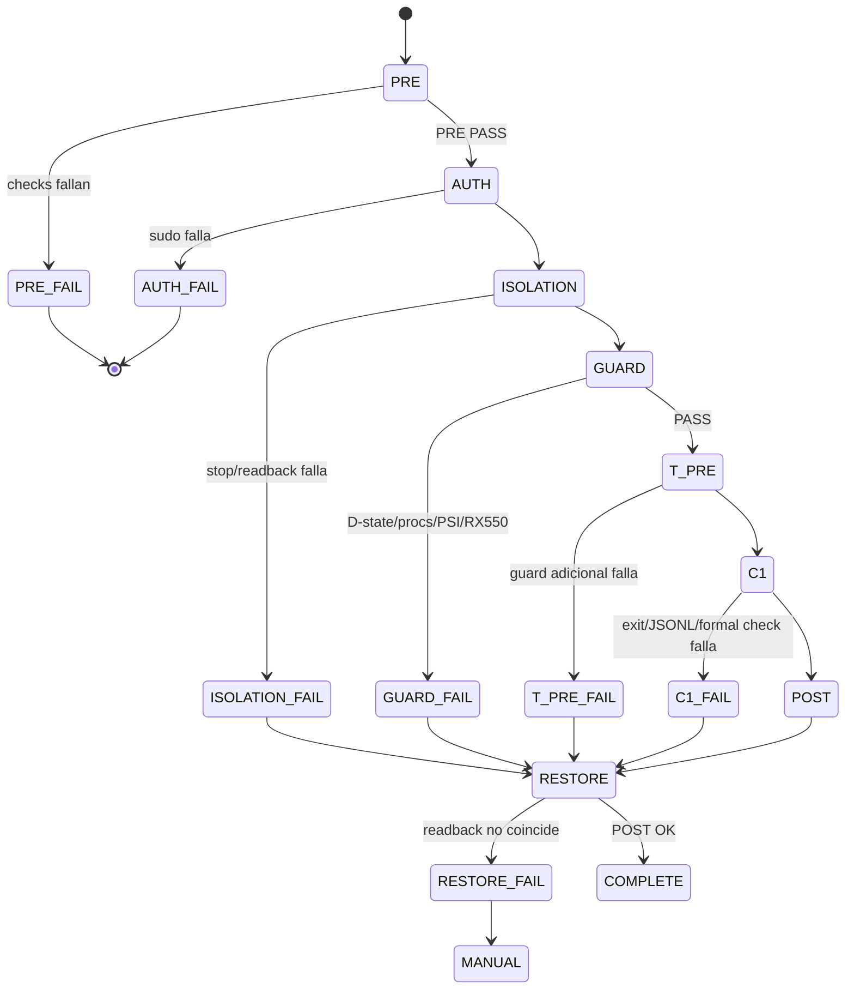

# C1 Isolation Automator

**Versión:** `1.1.1`
**Estado:** namespace runtime v2 implementado y preparado para revisión; la ruta real **NO fue ejecutada**.
**Script:** `04-IMPLEMENTACION/c1_isolation_automator.py`
**Runtime activo:** `/run/user/1000/c1-isolation-automator-v2/`
**Runtime histórico preservado:** `/run/user/1000/c1-isolation-automator/`
**C1 actual:** `C1_STATUS=DEFERRED`, `C1_RUNTIME_VALIDATED=NO`.

## Propósito

Convertir el procedimiento manual C1 en un flujo único, reproducible, auditable y fail-safe:

```text
PRE limpio → sudo interactivo → aislamiento mínimo → T_GUARD=120 s
→ T_PRE=30 s → C1 existente → T_POST=30 s → restore → POST
```

El automatizador no es un benchmark, no cambia parámetros científicos y no convierte
una ejecución en `VALID` global. Separa:

- `C1_EXECUTED`: el child fue lanzado y terminó;
- `C1_RUNTIME_VALIDATED=YES`: sólo cuando se cumplen los checks formales implementados;
- validez científica por claim A/B/C/D: se conserva como clasificación separada.

## Alcance y límites

Alcance de unidades, siempre condicionado al estado PRE:

| Scope | Units |
|---|---|
| system | `system-autopilot.timer`, `system-autopilot.service` |
| system | `sys-tuned.timer`, `sys-tuned.service` |
| system | `kalm-gpu.service`, `kalm.service`, `irqbalance.service`, `kalm-lite.service` |
| system | `sysstat-collect.timer`, `sysstat-collect.service` |
| user | `kde-baloo.service` |

Una unidad se detiene únicamente si su `ActiveState` PRE es `active`, `activating` o
`reloading`. Una unidad PRE inactiva se registra `SKIP_INACTIVE_PRE` y no se inicia al
restaurar. No existe `enable`, `disable`, `mask`, `unmask`, `kill`, `pkill` ni
`systemctl kill` en el automatizador.

No modifica:

- RX550, cap, DPM, SCLK/MCLK, PM o perfil;
- governor, IRQ affinity, scheduler, read-ahead;
- Mesa, RADV, shaders, sysctl, Btrfs;
- Xwayland, KWin o ChatGPT GPU;
- provenance científico ni archivos de C1.

## Interfaces

```bash
./c1_isolation_automator.py --dry-run
./c1_isolation_automator.py --prepare
./c1_isolation_automator.py --status
./c1_isolation_automator.py --run
```

### `--dry-run`

- Snapshot read-only de host/GPU/unidades/presión/provenance.
- Muestra `WOULD_STOP` por unidad, comandos exactos, archivos runtime, guard, C1 argv,
  restore y POST.
- No crea el namespace activo, lock, state, logs ni JSONL.
- No modifica ni reescribe el namespace histórico.
- No llama `sudo`, `sudo -v`, `systemctl stop/start` ni C1.
- Si el PRE actual falla, muestra `PRE_CURRENT_STATUS=FAIL`; no altera el sistema.
- Separa el resultado estático/dinámico de los checks dependientes del runtime:
  `RUNTIME_DEPENDENT_CHECKS=DEFERRED_RUNTIME_REQUIRED` y
  `OBSERVER_PREFLIGHT=NOT_RUN`.
- El observer no se invoca desde `--dry-run`; no se crea un runtime temporal para
  obtener un PASS artificial.

### `--prepare`

- Comprueba script, documentación, comandos requeridos, tmpfs y ejecutable.
- Clasifica read-only el allowlist del runtime histórico.
- No crea estado ni invoca sudo.
- No ejecuta PRE dinámico ni el guard.
- También marca el observer como `DEFERRED_RUNTIME_REQUIRED`/`NOT_RUN`; no intenta
  crear el namespace v2.

### `--status`

- Lee únicamente `CURRENT` y `state.json` del namespace activo v2.
- Clasifica el namespace legacy como `HISTORICAL_LEGACY_RUNTIME` sin cargarlo como estado activo.
- No crea lock/state y no restaura automáticamente.
- Un estado no terminal o con restore no confirmado se marca `INCOMPLETE_RECOVERABLE`.

### `--run`

- Exige TTY y confirmación literal `RUN-C1`.
- Exige autenticación normal mediante `sudo -v` y `sudo systemctl ...`; nunca usa
  `sudo -n`, captura contraseñas o evita sudo/polkit.
- No se ejecutó durante esta fase.

El orden de inicialización autorizada es:

```text
TTY + RUN-C1
→ RuntimeLock/validación del namespace v2
→ runs/<run-id>, tmp, cache, state.json, events.jsonl, CURRENT
→ validate_runtime_layout()
→ observer_check() --check-tmpfs
→ required_update_state(observer_check)
→ sudo/PRE/GUARD
→ validate_pre_c1_launch()
→ run_c1()
```

`RuntimeArtifacts` registra sólo paths v2 creados por la ejecución actual. Si falla
la inicialización antes de dejar un run durable, se intenta cleanup de esos paths y
de ninguna entrada preexistente; el namespace legacy queda fuera del tracker.

## Preflight formal

El script verifica antes de cualquier stop:

1. hostname `lex-luthor` y kernel `7.2.6-201.nobara.fc44.x86_64`;
2. BDF `0000:01:00.0`, vendor `0x1002`, device `0x699f`, driver `amdgpu`;
3. `card1`, `renderD129`, `hwmon2` y binario C1 ejecutable;
4. hashes establecidos de `main-graphics`, `graphics.cpp`, `c1_observer.py` y build ID;
5. `/run/user/1000` como tmpfs y ausencia de `c1-isolation-automator-v2/c1-observer-v1.jsonl` previo;
6. no otro C1/observer;
7. no estado runtime incompleto en el namespace v2;
8. el namespace legacy allowlisted queda preservado y clasificado `HISTORICAL_LEGACY_RUNTIME`;
9. `D_STATE_COUNT=0`;
10. `procs_blocked=0`;
11. IO PSI `some avg10 <= 10` y `full avg10 <= 10`.

El valor `10` es el criterio operacional propuesto ya existente. No es un umbral
histórico, universal ni una medida de porcentaje de uso del disco.

La ownership no se declara `CONTROLLED`: la ruta mínima deja clientes visibles y el
script conserva `OWNERSHIP=PARTIAL`.

### Separación de checks

```text
STATIC_DYNAMIC_PRECHECK:
  host, kernel, GPU, tmpfs, provenance, D-state, procs_blocked, IO, units,
  legacy allowlist, collision y ausencia de C1 activo.

RUNTIME_DEPENDENT_CHECKS:
  observer_check() y validación del JSONL real; se difieren hasta que el flujo
  real autorizado crea el namespace v2.
```

Un `DEFERRED_RUNTIME_REQUIRED` en `--dry-run` no es `PASS` ni `FAIL` del observer;
significa explícitamente `NOT_RUN` porque el runtime no debe existir en una ruta
read-only.

## Sudo y privilegios

- `--dry-run`, `--prepare` y `--status` no invocan sudo.
- `--run` llama `sudo -v` sin `-n`; la contraseña se solicita en la TTY.
- Los comandos de servicios system usan `sudo systemctl`; el user service usa
  `systemctl --user`.
- No se almacenan ni leen credenciales.
- Si la autenticación falla, no se detiene ninguna unidad.

## State machine



## Flujo de aislamiento

1. Capturar estado PRE de cada unidad.
2. Registrar si estaba activa y si se ordena ejecutar `stop`.
3. Detener sólo las unidades PRE activas dentro del scope aprobado.
4. Readback inmediato: `inactive`/`failed` esperado.
5. Registrar `touched[]` antes de cada comando para que un stop parcial sea restaurable.
6. Si falla un stop o readback, abortar C1 y restaurar las unidades ya tocadas.

`T_GUARD=120 s` y `T_PRE/T_POST=30 s` usan muestras cada `5 s` y sólo:

- D-state;
- `procs_blocked`;
- IO PSI `some/full avg10`;
- unidades aisladas que reaparecen;
- identidad/accesibilidad RX550;
- `power1_cap`, DPM level y `power/control` readback.

No hay polling indefinido. Una falla de guard nunca conduce a C1.

## C1 command

El script reutiliza el observer y el binario existentes, sin modificarlos:

```text
1920x1080
R8G8B8A8_UNORM
layers=4
textures=4
tex_size=4096
--fma-iters=4 (FMA efectivo=24)
MSAA=1
seeds=0x13579BDF / 0x2468ACE0
warmup=5s
duration=20s
offscreen
```

El argv completo se muestra en `--dry-run` y se guarda en `state.json`. El observer
valida tmpfs, allowlist del binario, hash, provenance y escribe JSONL exclusivamente
en `/run/user/1000/c1-isolation-automator-v2/c1-observer-v1.jsonl`.

### Checks formales implementados

`C1_RUNTIME_VALIDATED=YES` sólo si:

- observer minimum check devuelve 0;
- proceso C1/observer devuelve 0;
- JSONL existe y es parseable;
- `c1_exit=0` y `observer_end=0`;
- no hay `observer_error`;
- existen `measure_start`, `measure_end`, `run_end`;
- aparece `result: EJECUCIÓN_VÁLIDA`;
- restore queda `RESTORE_OK` y POST queda `POST_OK`.

Claims no se declaran globalmente válidas:

| Claim | Límite |
|---|---|
| A | resultado runtime; validez científica deferida |
| B | `frequency_effective_estimate=NOT_AVAILABLE` |
| C | `OWNERSHIP=PARTIAL` |
| D | contexto PSI/Btrfs; no causalidad |

## Restore y POST

- Sólo se inicia una unidad que estaba activa en PRE y fue registrada como `touched`.
- Unidades PRE inactivas nunca se inician indiscriminadamente.
- Se leen `ActiveState`, `SubState`, `UnitFileState` y `MainPID` después de restore.
- Se comparan estado PRE/POST y controles GPU.
- Estados: `RESTORE_OK`, `RESTORE_PARTIAL`, `RESTORE_FAILED`, `RESTORE_NOT_NEEDED`.
- Una discrepancia queda `POST_CONFLICT`; no se corrige automáticamente.
- `--status` nunca repara ni reintenta por sí solo.

## Runtime files

Namespace activo posterior al fix:

```text
/run/user/1000/c1-isolation-automator-v2/
├── .lock
├── CURRENT
├── c1-observer-v1.jsonl
└── runs/<run-id>/
    ├── state.json
    ├── events.jsonl
    ├── t_guard.jsonl
    ├── t_pre.jsonl
    ├── t_post.jsonl
    ├── c1.stdout
    ├── c1.stderr
    ├── tmp/
    └── cache/
```

Namespace histórico pre-fix, inmutable y fuera del scanner activo:

```text
/run/user/1000/c1-isolation-automator/
├── .lock
├── CURRENT
└── runs/20260924T154559Z-490709/
    ├── state.json
    ├── events.jsonl
    ├── tmp/
    └── cache/
```

El estado v2 incluye `automator_version`, `automator_sha256`,
`runtime_schema_version`, `runtime_namespace_version`, `runtime_namespace`,
`parent_namespace`, `parent_namespace_path`, `historical_namespace`,
`historical_namespace_path`, `legacy_reference`,
`runtime_namespace_activated_at`, `run_created_at`, timestamps, `run_id`,
`initial_state` y `final_state`. La compatibilidad del writer se valida
separadamente como `ACTIVE_RUNTIME_WRITER_MISMATCH`; el validador estructural
no acepta schemas legacy. Las escrituras son atómicas y runtime-only. No hay
retry automático.

## Abort y fail-safe

- PRE falla: no sudo, no stop.
- Falla la creación/inicialización v2: no observer, no sudo, no stop; cleanup sólo de
  artefactos propios de esa ejecución.
- Observer falla o su persistencia obligatoria falla: no C1; restore registra
  `RESTORE_ABORTED_NO_CHANGES` y el fallo durable cuando sea posible.
- sudo falla: no stop.
- stop/readback falla: restore de lo ya tocado.
- guard/T_PRE falla: restore, C1 no se lanza.
- C1 falla: T_POST si es posible, luego restore.
- SIGINT/SIGTERM: marca interrupción; en checkpoint segura se cleanup; el restore
  tiene prioridad sobre el informe.
- No se Intentan Reparaciones directas de IRQ, sysfs, PM, DPM o unit files.

## Hashes y provenance conservados

```text
main-graphics=f278f48c320f3f14edb5d796c75b3df8358e6ca2daf6b9d7d119aa86e0c65e81
graphics.cpp=7f1bf813d577a456d485a55ae01bd684bd746e9a3e03a084db2edcab57943615
c1_observer.py=0ddae72a65f9c687550be1d491858802c6c133a06b75fa29cc0d30725bd030c1
build_id=c18acae12e6a4ead407ba15c2bed66e057c2676a
git=c6146788e0d4fb12d9b0ec1209fa2840692de0c5
```

## Riesgos y límites

- `sudo` interactivo requiere TTY y puede interrumpirse.
- `systemd` puede reiniciar/resurrect units; readback lo marca como conflicto.
- `irqbalance` restart no garantiza restaurar una máscara IRQ previa; no se escribe IRQ.
- El estado PRE de unidades no prueba que un agente no haya escrito antes.
- `OWNERSHIP=PARTIAL` limita claims.
- `C1_RUNTIME_VALIDATED` es una condición formal de ejecución, no validación
  científica global.
- `T_GUARD` no sustituye una ventana de ownership exclusivo.
- La ruta real no fue probada con privilegios: `NOT_EXECUTED_REQUIRES_SUDO`.

## Corrección controlada posterior a `RUN_ID=20260924T154559Z-490709`

### BUG 1 — colisión de argumento

La llamada problemática era:

```python
update_state(state, state_path, events_path, "unit_pre", unit=unit, state=current)
```

La firma ahora usa `runtime_state` y el campo de evidencia es `unit_state`:

```python
update_state(state, state_path, events_path, "unit_pre", unit=unit, unit_state=current)
```

Se revisaron todas las llamadas a `update_state()`/`safe_update_state()`; no queda una llamada con keyword `state=` conflictivo.

### BUG 2 — schema de guard

El inicializador ahora contiene entradas completas para:

```text
guard.T_GUARD.status
guard.T_PRE.status
guard.T_POST.status
```

Cada entrada incluye `status`, `reason`, `sample_count`, `elapsed_seconds` y `log`. El validador exige las tres ventanas, todos esos campos y sus tipos; además rechaza valores `NOT_RUN` no canónicos. No se desactivó ni se debilitó la validación.

### Namespace runtime v2

La corrección usa un namespace hermano:

```text
LEGACY_RUNTIME_NAMESPACE=c1-isolation-automator
RUNTIME_NAMESPACE=c1-isolation-automator-v2
RUNTIME_NAMESPACE_VERSION=2
RUNTIME_SCHEMA_VERSION=2
```

El automatizador v1.1.1:

- verifica por `commonpath` que ambos roots son siblings y no anidados;
- usa `runtime_namespace_activated_at=2026-09-24T13:38:13-03:00` como marca fija de activación;
- sólo carga `CURRENT` y runs desde `c1-isolation-automator-v2`;
- inspecciona el namespace legacy sólo mediante `legacy_runtime_inventory()`;
- exige coincidencia de run ID y hashes del residual allowlisted;
- clasifica el artifact como `HISTORICAL_LEGACY_RUNTIME`;
- marca cualquier artifact legacy desconocido como `LEGACY_RUNTIME_UNRECOGNIZED` y bloquea;
- no convierte el residual en `ACTIVE_INCOMPLETE_RUNTIME`;
- no repara, migra, mueve ni reescribe el namespace legacy;
- mantiene el lock y el JSONL del observer dentro del namespace v2.

Allowlist histórica exactas:

```text
run_id=20260924T154559Z-490709
state_sha256=f368fa91d050267b9fe30fb2e331e87a8a82e43f16f439470cc4b53d167bf99c
events_sha256=8e7ffbe3693545144037d07727d834422bbb7c8fab81665bc6b7c123bc5d422d
CURRENT_sha256=a06971fcfef0f3fb2f843ed836a7ffc5517a600e345c4838714eb52ab319f31f
```

El nuevo precheck conserva `IO_GUARD_AVG10_MAX=10.0`, D-state y `procs_blocked` gates. Un namespace v2 vacío permite llegar al precheck, pero no omite checks vivos.

### State residual

No se modificó ni normalizó retroactivamente:

```text
/run/user/1000/c1-isolation-automator/runs/20260924T154559Z-490709/
```

La ejecución perturbada queda documentada como:

```text
ABORTED_FAILURE_RESTORED
legacy_schema_status=INVALID_LEGACY
legacy_active=false
legacy_blocking=false
STATE_SCHEMA_STATUS=INVALID en el artefacto histórico
BUG_1=update_state TypeError antes de primer stop
UNITS_STOPPED=NONE
C1_EXECUTED=NO
```

El `POST_CONFLICT` observado para `system-autopilot.service` se mantiene sin atribución causal. El automatizador ahora registra `external_transitions[]` cuando una unidad no está en `touched[]` cambia entre PRE y POST; la clasificación es `EXTERNAL_TRANSITION_OR_NATURAL_ONESHOT_COMPLETION`, `automator_stop_recorded=false`, `causality=NOT_PROVEN`. Esto no cambia el resultado fail-closed `POST_CONFLICT`.

### Corrección de persistencia pre-C1

La auditoría detectó que `safe_update_state()` podía convertir un fallo de escritura en `state_write_errors` y continuar. La versión v1.1.0 corregida separa:

```text
safe_update_state()      = tolerante sólo para restore/diagnóstico
required_update_state()  = propaga fallos de state.json/events.jsonl
```

Las escrituras obligatorias de guard, observer, provenance, collision, `c1_ready` y evidencia C1 usan `required_update_state()`. Un fallo se marca:

```text
state_write_errors[].critical=true
```

y se propaga como `AutomatorError`; nunca autoriza C1.

Inmediatamente antes de `run_c1()` se ejecuta `validate_pre_c1_launch()`. La compuerta relee el state durable y `events.jsonl`, y exige:

```text
validate_state()
validate_active_writer_compat()
CURRENT → state.json correcto
state.events == events.jsonl
state_write_errors vacío
phase=C1, terminal=false
T_GUARD=PASS
T_PRE=PASS
T_POST=NOT_RUN
PRE.ok=true y todos sus checks PASS
provenance PASS
collision PASS
observer minimum PASS
sudo status=OK
RUN-C1 confirmado
TTY real
```

`launch_c1_after_pre_c1_validation()` sólo llama a `run_c1()` después de todos los PASS. `c1_started` se activa después de la compuerta, no antes.

No se modificó el criterio `IO_GUARD_AVG10_MAX=10.0` ni los gates ambientales.

### Observer pre-C1

`observer_check()` ahora exige, antes de persistir `observer_check`:

```text
returncode=0
stdout JSON único y parseable
status=OK
path=<STATE_ROOT>
filesystem=tmpfs
free_bytes/total_bytes válidos
stderr vacío
runtime root es directorio utilizable
c1-observer-v1.jsonl ausente y con parent=<STATE_ROOT>
sha256(c1_observer.py)=hash esperado
```

El resultado completo se persiste en `state["observer_minimum_check"]`. `validate_pre_c1_launch()` exige que el resultado durable sea idéntico al resultado pre-C1 y que vuelva a pasar `validate_observer_preflight()`.

`run_c1()` conserva la ruta de ejecución real: `XDG_RUNTIME_DIR=STATE_ROOT` y `OBSERVER_JSONL=STATE_ROOT/c1-observer-v1.jsonl`. El observer real crea el JSONL con `O_EXCL`; un archivo previo o symlink falla cerrado.

La comprobación formal de muestras, `c1_exit`, `observer_end`, markers y `result:` sigue siendo posterior al child porque requiere la ejecución del observer/C1; no se simula ni se declara válida antes de tiempo.

### Tests

```text
04-IMPLEMENTACION/tests/test_c1_isolation_automator.py
```

Tests puros cubiertos:

- observer JSON inválido, ausente, excepción, runtime path incorrecto y JSONL existente;
- observer preflight estructurado y persistido;
- `--dry-run` sin runtime, sin observer runtime-dependent, sudo, servicios ni writes;
- orden de inicialización v2 antes de `observer_check()` y antes de C1;
- falla de inicialización sin observer/C1 y cleanup sólo de artefactos propios;
- observer fallido o persistencia obligatoria fallida sin `run_c1()`;
- cleanup que rechaza paths legacy y conserva entradas v2 preexistentes;
- `validate_observer_preflight()` y gate durable;
- state inicial v2, metadata de namespace y campos completos;
- `required_update_state()` ante fallo de escritura;
- state.json/events.jsonl write failure antes de C1;
- `validate_pre_c1_launch()` y state/events mismatch;
- provenance/collision failure antes de `run_c1()`;
- state durable válido llega a `run_c1()` únicamente con mock;
- `state_write_errors` crítico bloquea;
- `launch_c1_after_pre_c1_validation()` no llama C1 si falla la compuerta;
- transición `unit_pre` sin colisión;
- `unit_stop_requested`, `unit_post` y restore;
- transición AST de todas las llamadas `update_state`/`safe_update_state`;
- transiciones `T_GUARD`, `T_PRE`, `T_POST`;
- validación de `state.json` y `final_state`;
- schema inválido `{}` y campos faltantes rechazados;
- abort temprano antes de cualquier ventana con state terminal válido;
- restore parcial representado como estado válido y restaurable;
- POST transition externa explícita sin causalidad;
- residual legacy allowlisted clasificado y no activo;
- state inválido en namespace v2 bloquea;
- lock activo bloquea;
- namespace v2 vacío llega a PRECHECK pero no evade IO gate;
- hashes y `CURRENT` históricos conservados;
- ausencia de llamada conflictiva;
- clasificación legacy desconocida bloquea, sin excepción global;
- writer hash/version mismatch bloquea el namespace activo como `ACTIVE_RUNTIME_WRITER_MISMATCH`;
- invariante de paths siblings;
- `--status` no carga el residual legacy como estado activo.

No ejecutan `sudo`, `systemctl`, C1, observer runtime, guard real ni operaciones sobre el sistema.

## Validación estática realizada

**Fecha de cierre:** `2026-09-24T17:55:29-03:00`
**Git:** `c6146788e0d4fb12d9b0ec1209fa2840692de0c5`
**Commit:** `NONE`

```text
py_compile (destino temporal)=PASS
syntax compile (sin pyc en proyecto)=PASS
pyflakes=PASS
shellcheck=NOT_APPLICABLE_NO_SHELL_SCRIPT
static/forbidden operation scan=PASS
sudo -n scan=PASS
AST update_state keyword collision scan=PASS
legacy allowlist strictness=PASS
active namespace v2 schema/PASS
pure tests=54/54 PASS
implementation contract static tests=54/54 PASS
AST/pyflakes=PASS
required persistence pre-C1 gate=PASS
observer structured preflight=PASS (pure tests; live check NOT_RUN)
final pre-C1 validation gate=PASS
state/events write-failure tests=PASS
observer invalid/absent/runtime/JSONL tests=PASS
runtime initialization ordering/cleanup tests=PASS
dry-run read-only tests=PASS
single run_c1 call path AST=PASS
live environmental snapshot refreshed=false
A-S state/namespace/restore/POST coverage=PASS
historical state/events/CURRENT hash preservation=PASS
--prepare=NOT_REEXECUTED_AFTER_RUNTIME_INIT_FIX
--dry-run=PASS (read-only; RUNTIME_DEPENDENT_CHECKS=DEFERRED_RUNTIME_REQUIRED; OBSERVER_PREFLIGHT=NOT_RUN; PRE_CURRENT_STATUS=FAIL por dstate)
--status=NOT_REEXECUTED_AFTER_RUNTIME_INIT_FIX
active namespace creation by read-only validation=NONE
active writer mismatch contract=PASS
--run=NOT_EXECUTED
C1=NOT_EXECUTED
sudo=NOT_EXECUTED
systemctl stop/start/restart=NOT_EXECUTED
T_GUARD/T_PRE/T_POST real=NOT_EXECUTED
```

El `--dry-run` mantiene el gate vivo `IO_GUARD_AVG10_MAX=10.0`; no se modificó
el threshold ni se aplicó una política al PSI. La última ejecución read-only
reportó `PRE_CURRENT_STATUS=FAIL` por `dstate`; esto es una lectura ambiental
puntual distinta del snapshot `2026-09-24T14:23:08-03:00` y no autoriza una explicación causal.
El observer runtime-dependent quedó explícitamente `DEFERRED_RUNTIME_REQUIRED`/
`NOT_RUN`; no se creó v2 para forzar un PASS. El residual legacy no aparece como
error del namespace activo: se clasifica y se preserva. La ruta real no se validó
con privilegios: `NOT_EXECUTED_REQUIRES_SUDO`.

```text
SCRIPT_SHA256=006149849f4b0ba1a3dcb7f29b19501d9cccf04e54248215bc6471272be3e06d
DOCUMENTATION_SHA256=RECORDED_IN_SIDECAR_AFTER_FINAL_WRITE
TEST_SHA256=7e7a415542dd0d1db42b60b2bc3c0f2ac88b6ccea780dc46260d53fd3b8c1c93
VALIDATION_SIDECAR=04-IMPLEMENTACION/C1-ISOLATION-AUTOMATOR.sha256
```

La ruta `--run`, `sudo`, `systemctl stop/start/restart`, C1 y restoration real
están explícitamente `NOT_EXECUTED`.

## Qué NO hace

- No reintenta.
- No espera ni hace polling indefinido.
- No limpia caches, Btrfs, journal, procesos ni servicios.
- No convierte PRE/guard en una nueva política experimental.
- No ejecuta C1 durante validación.
- No eleva hypotheses diagnósticas a causalidad.

## Implementación estática del contrato de aislamiento (2026-09-25)

```text
VERSION=1.1.1
CONTRACT_VERSION=c1-isolation-design.v1
IMPLEMENTATION_STATUS=PARTIAL
OWNERSHIP=PARTIAL
GO_C1=NOT_AVAILABLE
RUNTIME_DESIGNED=YES
RUNTIME_MATERIALIZED=NO
RUNTIME_VALIDATED=NO
RESTORE_EXECUTED=NO
RESTORE_VALIDATED=NO
BTRFS=CONFLICT
```

La implementación agrega contratos y validadores estáticos. No convierte evidencia
mock, snapshot parcial o test en `OWNERSHIP=FULL`, `GO_C1`, `RUNTIME_VALIDATED` ni
`RESTORE_VALIDATED`.

La compuerta pre-C1 exige ahora `execution_gate=AVAILABLE`, ownership FULL, gates
sistémicos PASS y Btrfs MATCHED; el flujo real no puede llegar a `run_c1()` con
`OWNERSHIP=PARTIAL`. El guard registra `schema` y `sample_index`; D-state con
lectura incompleta falla cerrado. La ruta real y sus gates runtime siguen pendientes.

| REQ_ID | CODE_LOCATION | TEST | DOCUMENTATION | STATUS |
|---|---|---|---|---|
| `REQ-OWNERSHIP-CONTRACT` | `OWNERSHIP_CONTRACT`, `evaluate_ownership_proof()` | `test_ownership_contract_is_static_partial` | `C1-ISOLATION-DESIGN-v1.0.md §2` | `IMPLEMENTED` |
| `REQ-SYSTEM-GATES` | `SYSTEM_GATE_CONTRACT`, `evaluate_system_gate()` | `test_system_gate_contracts_keep_unknown_thresholds` | `C1-ISOLATION-DESIGN-v1.0.md §3` | `IMPLEMENTED` |
| `REQ-BTRFS-GATE` | `BTRFS_GATE_CONTRACT`, `evaluate_btrfs_gate()` | `test_btrfs_gate_is_conflict_without_runtime_evidence` | `C1-ISOLATION-DESIGN-v1.0.md §5` | `IMPLEMENTED` |
| `REQ-RESTORE-STATE` | `restore_contract_snapshot()`, `restore_contract_transition()` | `test_restore_contract_separates_executed_and_validated` | `C1-ISOLATION-DESIGN-v1.0.md §6` | `IMPLEMENTED` |
| `REQ-RUNTIME-STATE` | `runtime_contract_snapshot()` | `test_runtime_contract_is_not_materialized` | `C1-ISOLATION-DESIGN-v1.0.md §7` | `IMPLEMENTED` |
| `REQ-PRECHECK-CONTRACT` | `PRECHECK_CONTRACT_SPECS`, `build_precheck_contracts()` | `test_precheck_contract_has_all_required_fields` | `C1-ISOLATION-DESIGN-v1.0.md §8` | `IMPLEMENTED` |
| `REQ-FALLBACK` | `FALLBACK_CONTRACT_CASES`, `classify_fallback()` | `test_fallback_contract_distinguishes_no_go_abort_blocked` | `C1-ISOLATION-DESIGN-v1.0.md §9` | `IMPLEMENTED` |
| `REQ-PROVENANCE` | `IMPLEMENTATION_PROVENANCE` | `test_implementation_provenance_is_complete` | `C1-ISOLATION-DESIGN-v1.0.md §12` | `IMPLEMENTED` |

Los gaps G-01–G-08 y G-10 siguen `DEFINED_PENDING_EXECUTION`; no se cerraron con
mocks ni con la suite estática.
