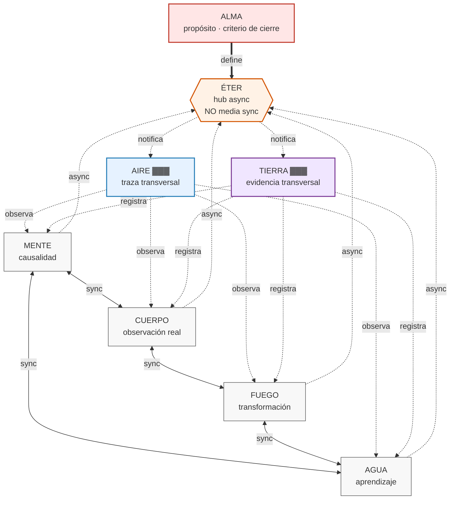

# Cómo creo que es rxre

Una línea antes de los diagramas:

> **rxre no es ocho módulos. Es un motor de investigación donde cada plano es una capacidad demostrable, atravesada por dos capas transversales (traza y evidencia), coordinada por un bus asíncrono que no media las llamadas, y gobernada por una disciplina epistémica que ningún paso puede saltear.**

Esto es **hipótesis** hasta que el audit confirme qué contratos son reales. Los diagramas muestran mi modelo mental, no la arquitectura verificada.

---

## Mermaid



---

## ASCII

```
┌──────────────────────────────────────────────────────────────────┐
│                            ALMA                                  │
│                   propósito · criterio de cierre                 │
└────────────────────────────┬─────────────────────────────────────┘
                             │ define
                             ▼
┌──────────────────────────────────────────────────────────────────┐
│                            ÉTER                                  │
│              hub de eventos ASYNC (NO media sync)                │
│              si cae, los contratos sync siguen funcionando       │
└────────────────────────────┬─────────────────────────────────────┘
                             │ notifica (async)
         ┌───────────────────┴───────────────────┐
         ▼                                       ▼
┌──────────────────┐                   ┌──────────────────┐
│      AIRE        │                   │     TIERRA       │
│  traza cada paso │                   │ evidencia + hash │
└────────┬─────────┘                   └────────┬─────────┘
         │ observa                              │ registra
         │                                      │
         ▼                                      ▼
    ┌──────────────────────────────────────────────────┐
    │              PLANOS DE ACCIÓN                    │
    │         (contratos SÍNCRONOS directos)           │
    │                                                  │
    │   MENTE ◄══sync══► CUERPO ◄══sync══► FUEGO       │
    │     ▲                                    ▲       │
    │     │                                    │       │
    │     └─────────sync────► AGUA ────────────┘       │
    │                                                  │
    │   Si un plano falla, los otros tres siguen       │
    │   (no hay bus en el camino crítico)              │
    └──────────────────────────────────────────────────┘

    ┌──────────────────────────────────────────────────┐
    │         DISCIPLINA POR PASO (no negociable)      │
    │                                                  │
    │  EVIDENCE → SEMANTICS → SCHEMA                   │
    │           → DISCRIMINATING TEST                  │
    │           → IMPLEMENTATION                       │
    │           → VALIDATION → nueva evidencia         │
    └──────────────────────────────────────────────────┘

    ┌──────────────────────────────────────────────────┐
    │         PUERTA GLOBAL (antes de escalar)         │
    │                                                  │
    │  AUDIT A–F → DELIVERED → CHALLENGED              │
    │            ↔ CONTESTED → ACCEPTED                │
    │            → ETAPA 1 (un plano, un test)         │
    │                                                  │
    │  Sin ACCEPTED, ETAPA 1 está BLOQUEADA            │
    └──────────────────────────────────────────────────┘
```

---

## Lo que este diagrama dice (y lo que no)

**Dice:**

- **ALMA** no es un módulo que "piensa": es la que define el criterio de cierre. Sin criterio, ningún ciclo termina.
- **ÉTER** es un hub **async**. No media las llamadas entre planos. Si cae, las llamadas directas siguen. Esto elimina el punto único de falla que se discutió.
- **MENTE, CUERPO, FUEGO, AGUA** son los cuatro planos de **acción**. Se comunican por **contratos síncronos directos** — explícitos, verificables, sin pasar por el bus.
- **AIRE y TIERRA** son **capas transversales**. No son pasos del ciclo. Atraviesan cada transición de cada plano. Si las quitás, perdés trazabilidad y evidencia, pero el ciclo sigue corriendo (y deja de ser verificable).
- La **disciplina epistémica** es el contrato de cada paso. Un plano que se saltea `DISCRIMINATING TEST` no es un plano: es una caja negra con nombre.
- La **puerta global** bloquea la Etapa 1 hasta `ACCEPTED`. No hay atajo.

**No dice (y no debe decir):**

- Cuáles contratos son síncronos y cuáles async en el rxre real. Eso lo decide el audit.
- Cuántos planos están implementados. Puede que 0, 3 u 8.
- Que el modelo de 8 elementos mejora nada. Eso se mide en Etapa 4 (A vs B), no acá.
- Que esta arquitectura es la correcta. Es la **hipótesis más razonable** dado lo discutido, sujeta a refutación por el audit.

---

## La diferencia con los diagramas anteriores

Los diagramas lineales (`ALMA → ÉTER → MENTE → CUERPO → ...`) convierten a rxre en un agente común con nombres poéticos. **Este no.**

La diferencia concreta:

```
Diagrama lineal (malo):    los planos son ETAPAS del ciclo
Diagrama hub (este):       los planos son CAPAS que se atraviesan

En el lineal, si quitás AIRE, el ciclo se corta.
En el hub, si quitás AIRE, el ciclo sigue pero perdés la traza.

En el lineal, ÉTER es un paso más.
En el hub, ÉTER es un canal de observabilidad que no bloquea.

En el lineal, TIERRA persiste "al final".
En el hub, TIERRA persiste cada transición.
```

Esa diferencia es la que separa "agente con 8 adjetivos" de "motor de investigación con 8 capacidades demostrables".

---

**Nada de esto abre la Etapa 1.** El audit sigue esperando. Estos diagramas son la vara con la que el revisor va a mirar el informe: si el rxre real no se parece a esto, la pregunta es *por qué no*, no *cómo forzarlo*.
