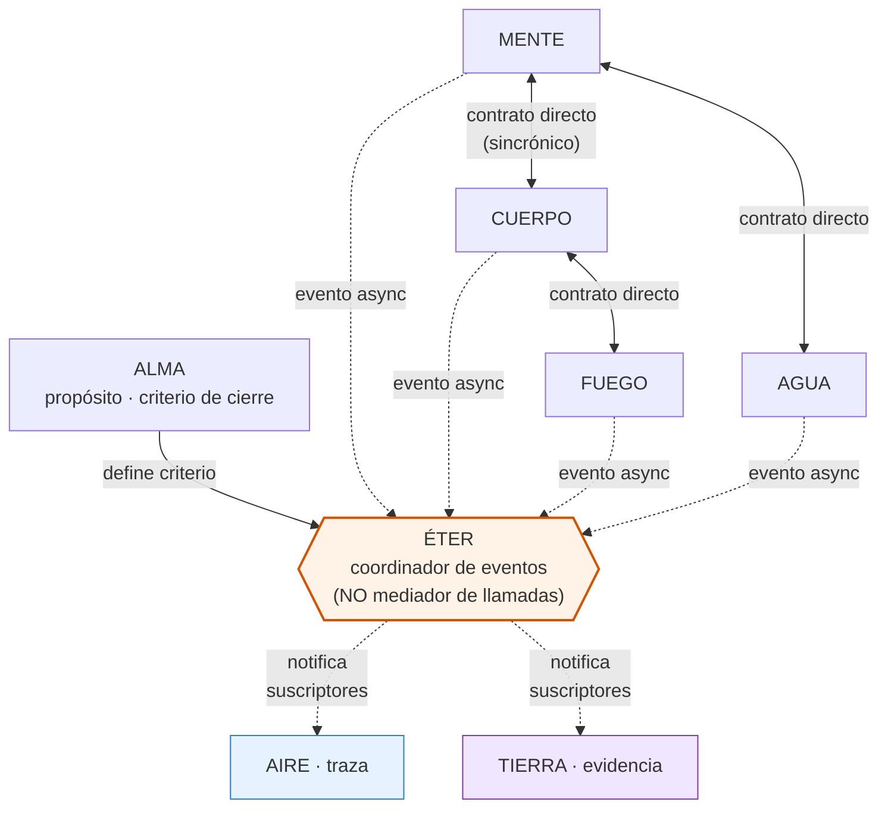
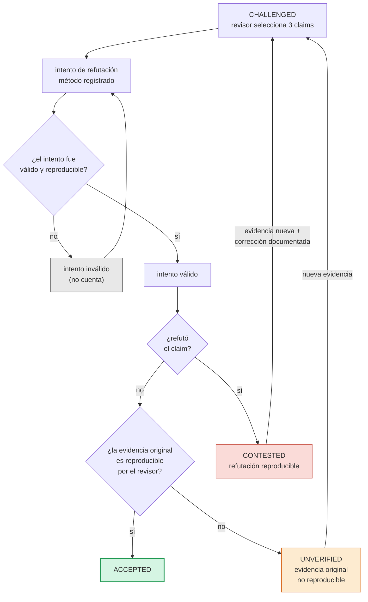
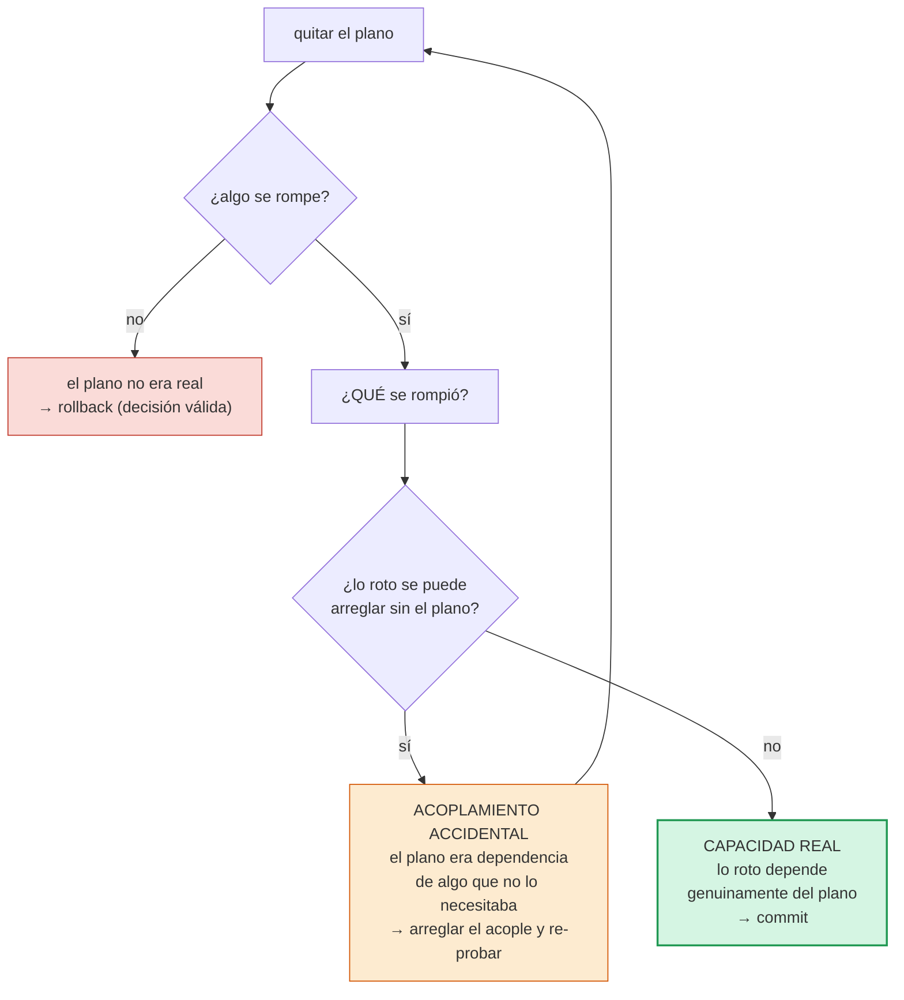

# Los tres ajustes son correctos. Aplico el mínimo.

No son objeciones de estilo. Son correcciones de especificación. Si los diagramas van a ser especificaciones ejecutables, los tres puntos son obligatorios.

---

## Fix 1 — Arquitectura: ÉTER coordina, no media



**Cambio**: las llamadas síncronas entre planos son directas (contrato explícito). ÉTER solo ve eventos asíncronos, para observabilidad y coordinación. Si ÉTER cae, las llamadas directas siguen. Eso elimina el punto único de falla que vos señalaste.

**Nota de especificación**: qué relaciones son síncronas y cuáles asíncronas **no está decidido**. Eso se verifica en el audit. El diagrama es hipótesis, no contrato.

---

## Fix 2 — Puerta: `ACCEPTED` no se gana con tres fallos



**Cambios respecto a la versión anterior**:

- `ACCEPTED` requiere **dos condiciones por claim**: (a) intento de refutación válido, (b) evidencia original reproducible por el revisor. Con una sola, no alcanza.
- Si el intento es inválido (método no reproducible), **no cuenta** — no se puede acumular "tres fallos vagos" y declarar victoria.
- `CONTESTED → CHALLENGED` requiere **evidencia nueva**, no solo "corrección". Sin esa flecha etiquetada, el estado se podía mover sin agregar información.
- Agregué `UNVERIFIED`: si la evidencia original no se reproduce, el claim ni se refuta ni se acepta. Queda abierto.

Esto cierra tu objeción: tres intentos fallidos, por sí solos, no mueven a `ACCEPTED`. Lo que mueve es **refutación fallida válida + evidencia reproducible**.

---

## Fix 3 — Micro-loop: quitar y que rompa no es prueba de nada



**Cambio**: el paso "quitar → rompe → commit" se descompone. Antes de declarar que el plano es real, se prueba si lo roto es **dependencia genuina** o **acoplamiento accidental**. Si es accidental, se arregla el acople y se **vuelve a quitar**. Solo después de que quitar rompa algo que no se puede arreglar sin el plano, el plano se declara real.

**Nota de especificación**: "arreglar el acople" puede requerir cambiar otro plano. Si eso pasa, el commit del plano nuevo y el fix de acople van juntos o no va ninguno.

---

## Lo que no cambia

La secuencia operativa:

```
AUDIT A-F → DELIVERED → CHALLENGED → (CONTESTED ↔ CHALLENGED) → ACCEPTED → ETAPA 1
```

Estos tres diagramas son **especificación de cómo se decide**, no autorización para decidir. Nada acá abre la Etapa 1. Esa sigue bloqueada hasta `ACCEPTED`.

---

## Una sola cosa para cuando llegue el `DELIVERED`

Los tres fixes que aplicaste cambian la vara. Cuando el revisor mire el informe, ahora tiene que verificar **dos cosas por claim** (intento válido + evidencia reproducible), no una. Y cuando el auditor evalúe un plano, tiene que distinguir **capacidad real** de **acoplamiento accidental**, no solo "quitar rompe".

Eso son dos preguntas más por claim, y una más por plano. Si el informe no las responde, el informe está incompleto — no por diseño, sino porque la vara subió.

Nada más. El audit sigue esperando.
