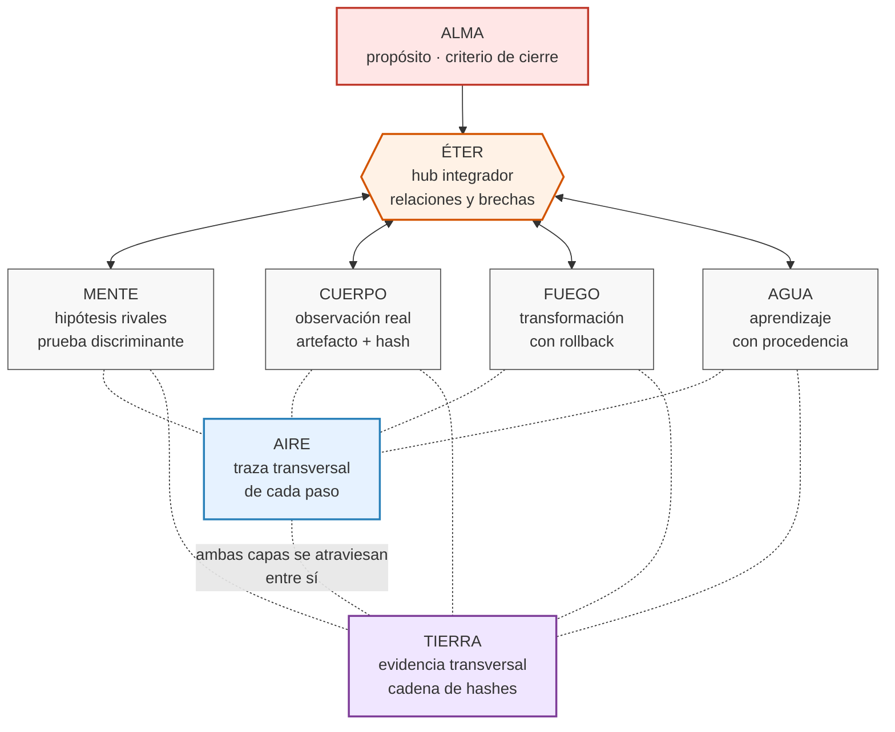
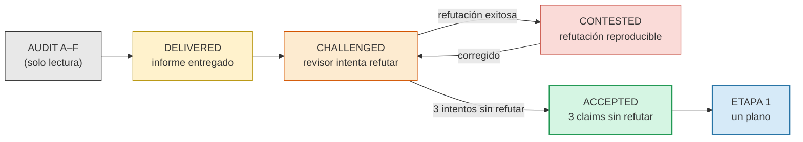
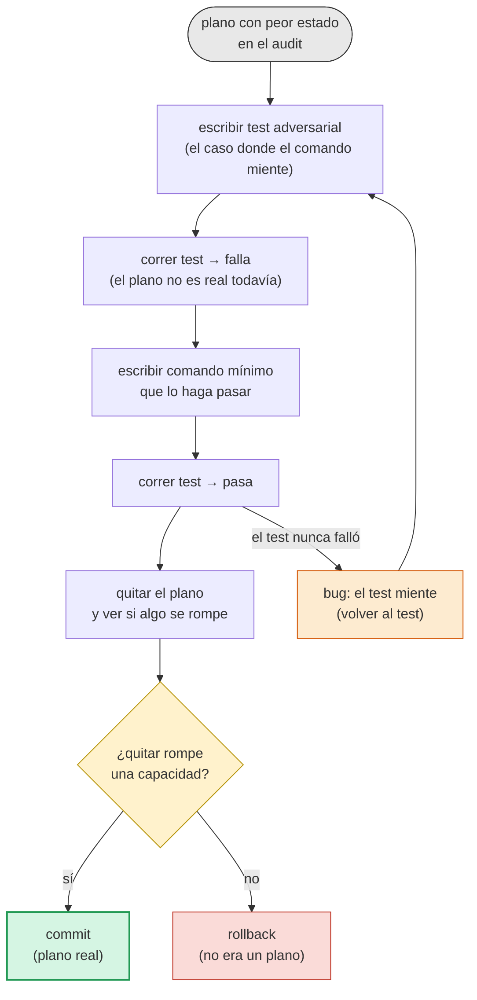

# Tres diagramas. No uno.

Un solo diagrama miente. Tres, cada uno con una pregunta distinta, no.

---

## 1. Arquitectura: hub, no pipeline

Esta es la corrección al diagrama lineal del doc anterior. ÉTER es hub, AIRE y TIERRA son transversales, no pasos.



**Lo que cambia respecto al lineal**:

- ÉTER no es un paso después de ALMA: es el hub al que todo se conecta
- AIRE y TIERRA no son pasos: son capas que atraviesan a los cuatro planos de acción
- Los planos de acción no están en secuencia: MENTE↔CUERPO, CUERPO↔FUEGO, etc. se llaman entre sí a través de ÉTER

---

## 2. Puertas: el audit no termina, pasa

Una vez `ACCEPTED`, recién hay Etapa 1. Antes no.



**Lo que cambia respecto a la secuencia original**: `CONTESTED → CHALLENGED` existe. Un informe puede rebotar. Sin esa flecha, `ACCEPTED` es "nadie se quejó", no "nadie pudo refutar".

---

## 3. Micro-loop: cada etapa es este ciclo

No es un diagrama de fases. Es el ciclo interno que se repite **una vez por plano** dentro de cada etapa.



**Lo que cambia respecto a "un plano, un test, un commit"**: hay **dos flechas de salida que no son éxito**. `REVERT` es válido. `FIX` es válido. Sin esas dos, el diagrama sería propaganda.

---

## Cómo se usan juntos

```
┌─────────────────────────────────────────────────────┐
│  Diagrama 1 (arquitectura) → ¿QUÉ es rxre?          │
│  Diagrama 2 (puertas)      → ¿CUÁNDO se escala?     │
│  Diagrama 3 (micro-loop)   → ¿CÓMO se hace un paso? │
└─────────────────────────────────────────────────────┘
```

Cada uno responde una pregunta distinta. Ninguno reemplaza a los otros.

**Si tuvieras que quedarte con uno solo**, quedate con el 2. Es el único que dice **cuándo no empezar**. Los otros dos dicen qué hacer, pero el 2 dice cuándo está permitido hacerlo.
